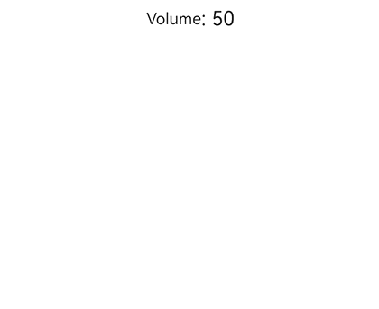

# Single Gestures

<!--Del-->
> **Note:**
>
> Currently in the beta phase.
<!--DelEnd-->

Single gestures are the most basic gesture types. The only single gesture supported in the current version is the pan gesture (PanGesture).

## Pan Gesture (PanGesture)

```cangjie
PanGesture(fingers!: ?Int32, direction!: ?PanDirection, distance!: ?Float64)
```

A pan gesture is used to trigger pan gesture events. A pan gesture is successfully recognized when the pan distance reaches the minimum pan distance (default value: 5.vp). For parameter definitions, see [PanGesture](../reference/arkui-cj/cj-basic-gestures-pangesture.md).

The following example implements a simple volume control, which handles the logic of increasing and decreasing the volume during upward and downward pans in the callbacks of the pan gesture.

<!-- run -->

```cangjie
package ohos_app_cangjie_entry

import kit.ArkUI.*
import ohos.arkui.state_macro_manage.*

@Entry
@Component
class EntryView {
    @State
    var currentVolume: Int64 = 50
    var startVolume: Int64 = 50

    func build() {
        Column(space: 12) {
            Row {
                Text('Volume')
                Text(': ${this.currentVolume}').fontSize(20)
            }.margin(10)
            Column()
                .width(100.percent)
                .height(250)
                .backgroundColor(0xF5F5F5)
                .borderRadius(12)
                .gesture(
                    PanGesture()
                        .onActionStart({ _ =>
                            // Records the current volume as the start volume of this adjustment when the gesture is successfully recognized
                            this.startVolume = this.currentVolume
                        })
                        .onActionUpdate({ event =>
                            // Panning up increases the volume, and panning down decreases it
                            let volumeChange = Int64(-event.offsetY * 0.1)
                            let newVolume = this.startVolume + volumeChange
                            if (newVolume > 100) {
                                this.currentVolume = 100
                            } else if (newVolume < 0) {
                                this.currentVolume = 0
                            } else {
                                this.currentVolume = newVolume
                            }
                        })
                        .onActionEnd({ _ =>
                            // The gesture ends
                        }))
        }
            .width(100.percent)
            .height(100.percent)
            .padding(12)
    }
}
```



>**Note:**
>
> - Most scrollable components, such as List, Grid, Scroll, and Tabs, implement scrolling through PanGesture. Binding a [Pan Gesture (PanGesture)](#pan-gesture-pangesture) to a child component inside these components causes gesture competition.
>
> - When a PanGesture is bound to a child component, panning within the area of the child component triggers only the child component's PanGesture. If the parent component also needs to respond, you can use the [parallel gesture binding method (parallelGesture)](./cj-gesture-events-binding.md#parallelgesture-parallel-gesture-binding-method) to enable the parent and child components to respond at the same time, or have the child component pass messages to the parent component. Alternatively, you can adjust the distance parameter of the parent and child components' PanGesture to make the pan more sensitive.
>
> - Inappropriate threshold settings may cause the pan to be unresponsive to finger movements (increased response latency).
