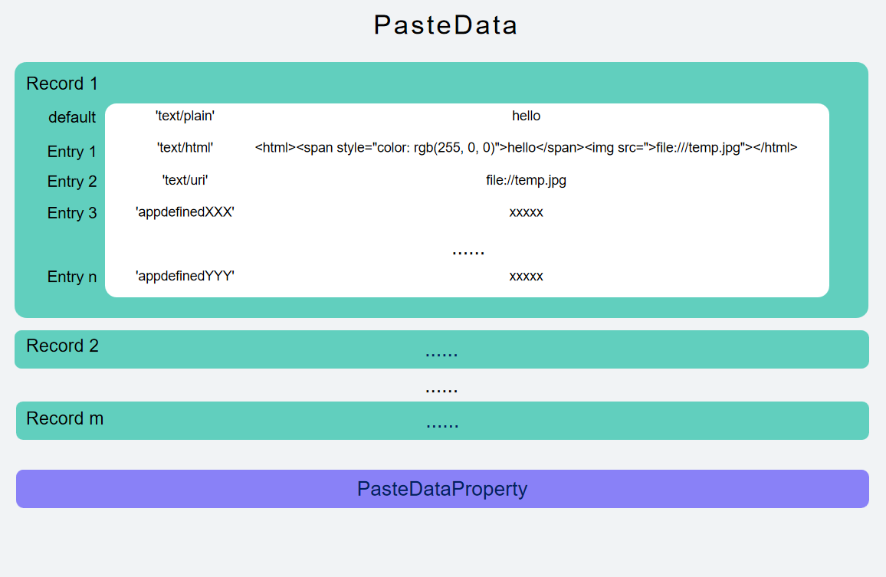

# Copy and Paste Using the Pasteboard (Cangjie)

<!--Del-->
> **Note:**
>
> Currently in the beta phase.
<!--DelEnd-->

The pasteboard module provides in-application and cross-application data copy and paste capabilities, supporting text, HTML, URI, PixelMap, and custom MIME type data. When an application needs to write data to the system pasteboard or read data from the system pasteboard, it can use the pasteboard module.

Pasteboard data is represented by PasteData. The copying party constructs PasteData and writes it to the system pasteboard, and the pasting party reads PasteData from the system pasteboard and parses the PasteDataRecord in it. The PasteDataProperty in PasteData describes attributes such as the data type, timestamp, and pasteable range.

**Figure 1** Overall structure of PasteData



This guide uses the copy and paste of plain text and HTML data as an example to describe the main usage process of the pasteboard.

## Development Steps and Precautions

For detailed API documentation, refer to [Pasteboard API Reference](../../reference/BasicServicesKit/cj-apis-pasteboard.md#class-systempasteboard).

1. Obtain the system pasteboard object.

   Call getSystemPasteboard() to obtain an entry object for the system pasteboard service. Each call may return a different wrapper object, but all wrapper objects operate on the same system pasteboard service. Subsequent read and write operations are performed through this object.

2. Construct pasteboard data.

   - To copy data of a single type, call createData(String, PasteDataValueType) to construct PasteData.
   - To copy data of multiple types, you can first put MIME types and data into a HashMap, and then call createData(HashMap\<String, PasteDataValueType>) to construct PasteData.
   - To append records to an existing PasteData, call createRecord(String, PasteDataValueType) to create a PasteDataRecord, and then call PasteData.addRecord(PasteDataRecord) or PasteData.addRecord(String, PasteDataValueType) to add it.

   The mapping between MIME type constants and PasteDataValueType is as follows:

   | MIME Type Constant | Constant Value | Data Construction Method |
   | :--- | :--- | :--- |
   | MIMETYPE_TEXT_PLAIN | "text/plain" | PasteDataValueType.StringValue(String) |
   | MIMETYPE_TEXT_HTML | "text/html" | PasteDataValueType.StringValue(String) |
   | MIMETYPE_TEXT_URI | "text/uri" | PasteDataValueType.StringValue(String) |
   | MIMETYPE_TEXT_WANT | "text/want" | Want data cannot be constructed using PasteDataValueType in the current version. |
   | MIMETYPE_PIXELMAP | "pixelMap" | PasteDataValueType.PixelMapValue(PixelMap) |
   | Custom MIME type | Custom string | PasteDataValueType.StringValue(String), PasteDataValueType.ArrayBufferValue(ArrayBuffer), or PasteDataValueType.PixelMapValue(PixelMap) |

   > **Note:**
   >
   > - The length of a MIME type string cannot exceed 1024 bytes.
   > - When using a HashMap to construct data of multiple types, the MIME type corresponding to the first key-value pair is used as the default type. Data of non-default types needs to be read through getData. Do not rely on the traversal order of HashMap.
   > - When the amount of ArrayBuffer and PixelMap data is large, set the data size properly and release objects that are no longer used in a timely manner.

3. Set pasteboard properties (optional).

   Call PasteDataProperty(Array\<String>, String, Int64, Bool, ShareOption) to create a property object, and then call PasteData.setProperty(PasteDataProperty) to set it to PasteData. ShareOption.Inapp indicates that pasting is allowed only within the same application, and ShareOption.Localdevice indicates that pasting is allowed in any application on the local device.

4. Write data to the system pasteboard.

   Call SystemPasteboard.setData(PasteData, AsyncCallback\<Unit>) to write data. On success, the error object in the callback is empty. On failure, the error object contains the error code and error message.

5. Read data from the system pasteboard.

   Call SystemPasteboard.getData(AsyncCallback\<PasteData>) to read data. When an application uses a custom control to access pasteboard content, it needs to request the ohos.permission.READ_PASTEBOARD permission. When using the paste control to access pasteboard content, no permission is required.

   After PasteData is read, you can parse the data through the following interfaces:

   - getMimeTypes(): Obtains all MIME types contained in the pasteboard content.
   - hasType(String): Checks whether data of the specified MIME type exists in the pasteboard content.
   - getRecordCount() and getRecord(Int32): Obtains the number of records and the record at the specified index.
   - getPrimaryText(), getPrimaryHtml(), getPrimaryUri(), and getPrimaryPixelMap(): Obtains the first content of the corresponding text, HTML, URI, or PixelMap type.

6. Query and clear the pasteboard.

   - hasData(AsyncCallback\<Bool>): Asynchronously checks whether the pasteboard has content.
   - hasDataType(String): Checks whether the pasteboard content contains data of the specified type.
   - clearData(AsyncCallback\<Unit>): Clears the system pasteboard content.
   - getDataSource(): Obtains the name of the application that is the source of the pasteboard data.
   - isRemoteData(): Checks whether the pasteboard data comes from another device.

   > **Note:**
   >
   > - To ensure the accuracy of pasteboard data, only one copy or paste operation can be performed at a time.
   > - The length of the written text data is subject to the constraints of the pasteboard service.
   > - Pasteboard data synchronized from other devices takes a long time to read. It is not recommended to perform data check and read on the UI thread.

Before calling getData through a custom control, request ohos.permission.READ_PASTEBOARD. This is a restricted permission at the system_basic level. A normal application must request it across levels through ACL by adding the permission to acls > allowed-acls in the HarmonyAppProvision Profile, declaring its APL as system_basic or higher, and re-signing the application. It must also declare the permission in module.json5 and obtain user authorization. For details, see [Restricted Open Permissions](../../security/AccessToken/cj-restricted-permissions.md#ohospermissionread_pasteboard). The complete example omits the authorization process. Configure the permission before running it.

## Complete Example

Refer to the following example to write plain text and HTML data to the system pasteboard, and then read the pasteboard content and parse the text and HTML data in it.

<!-- compile -->

```cangjie
// index.cj

import kit.BasicServicesKit.*
import kit.CangjieKit.*
import kit.PerformanceAnalysisKit.Hilog

// Create a Record object for HTML content
let record2 = createRecord(MIMETYPE_TEXT_HTML,
    PasteDataValueType.StringValue("<!DOCTYPE html><html><body><h1>Hello</h1></body></html>"))
// Create a PasteData object containing multiple records
let data = createData(MIMETYPE_TEXT_PLAIN, PasteDataValueType.StringValue("Hello, World"))
data.addRecord(record2)

let property = PasteDataProperty([MIMETYPE_TEXT_PLAIN, MIMETYPE_TEXT_HTML], "", 0, false, ShareOption.Localdevice)
// Set pasteboard content properties, such as cross-device access and paste scope
data.setProperty(property)

// Obtain the system pasteboard object
let board = getSystemPasteboard()

let clearCallback: AsyncCallback<Unit> = {
    err: Option<BusinessException>, _: Option<Unit> => match (err) {
        case Some(e) => Hilog.error(0, "PasteboardSample", "clearData failed: ${e.code}")
        case None => Hilog.info(0, "PasteboardSample", "clearData success")
    }
}

let readCallback: AsyncCallback<PasteData> = {
    err: Option<BusinessException>, pasteData: Option<PasteData> => match (err) {
        case Some(e) => Hilog.error(0, "PasteboardSample", "getData failed: ${e.code}")
        case None =>
            // Read the pasteboard data and print its content
            let result = pasteData.getOrThrow()
            Hilog.info(0, "PasteboardSample", "Text: ${result.getPrimaryText()}")
            Hilog.info(0, "PasteboardSample", "HTML: ${result.getPrimaryHtml()}")
            let hasText = board.hasDataType(MIMETYPE_TEXT_PLAIN)
            Hilog.info(0, "PasteboardSample", "Has text: ${hasText}")
            let source = board.getDataSource()
            Hilog.info(0, "PasteboardSample", "Source: ${source}")
            // Clear the pasteboard
            board.clearData(clearCallback)
    }
}

let hasDataCallback: AsyncCallback<Bool> = {
    err: Option<BusinessException>, has: Option<Bool> => match (err) {
        case Some(e) => Hilog.error(0, "PasteboardSample", "hasData failed: ${e.code}")
        case None =>
            if (has.getOrThrow()) {
                board.getData(readCallback)
            } else {
                Hilog.info(0, "PasteboardSample", "No pasteboard data")
            }
    }
}

let writeCallback: AsyncCallback<Unit> = {
    err: Option<BusinessException>, _: Option<Unit> => match (err) {
        case Some(e) => Hilog.error(0, "PasteboardSample", "setData failed: ${e.code}")
        case None =>
            // Check whether the pasteboard contains data after a successful write
            board.hasData(hasDataCallback)
    }
}

// Start writing to the pasteboard
board.setData(data, writeCallback)
```
