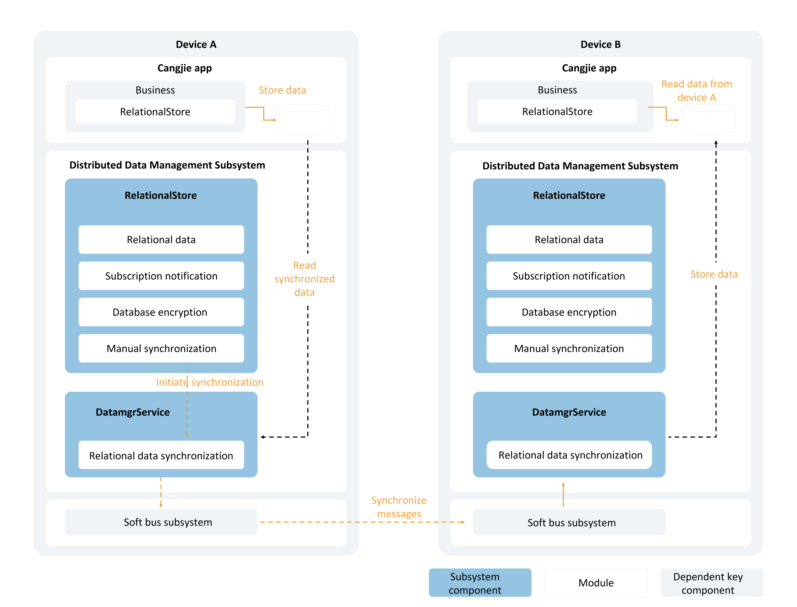

# Cross-Device Data Synchronization for Relational Databases

<!--Del-->
> **Note:**
>
> Currently in the beta phase.
<!--DelEnd-->

## Scenario Description

When an application's locally stored relational data requires cross-device synchronization, the table data that needs synchronization can be migrated to new tables that support cross-device functionality. Alternatively, tables can be configured to support cross-device synchronization immediately after creation.

## Basic Concepts

Cross-device data synchronization for relational databases enables applications to synchronize stored relational data across multiple devices.

- After creating a new table in the database, an application can designate it as a distributed table. When querying a remote device's database, the distributed table name on the specified remote device can be obtained using the local table name.
- Data synchronization between devices can be achieved in two ways: pushing data from the local device to a remote device or pulling data from a remote device to the local device.

## Operation Mechanism

The underlying communication component handles device discovery and authentication, notifying the upper-layer application when a device comes online. Upon receiving the device online notification, the data management service can establish an encrypted data transmission channel between the two devices, enabling data synchronization.

### Cross-Device Data Synchronization Mechanism

   <!-- ToBeReviewd -->

After writing data to the relational database, the business logic initiates a synchronization request to the data management service.

The data management service reads the data to be synchronized from the application sandbox and sends it to the data management service of the target device based on the deviceId. The target device's data management service then writes the data into the same application's database.

### Data Change Notification Mechanism

Subscribers receive notifications when data is added, deleted, or modified in the database. These notifications are primarily categorized into local data change notifications and distributed data change notifications.

- **Local Data Change Notification:** Applications on the local device subscribe to data change notifications. Notifications are received when data is added, deleted, or modified in the database.
- **Distributed Data Change Notification:** Applications subscribe to notifications for data changes on other devices within the same network group. Notifications are received when data is added, deleted, or modified on other devices.

## Constraints

- Each application supports opening a maximum of 16 relational distributed databases simultaneously.
- A single database supports registering up to 8 callbacks for data change subscriptions.
- Tables with composite keys cannot be designated as distributed tables.

## API Description

The following APIs are related to cross-device data synchronization for relational distributed databases. For more APIs and usage details, refer to [Relational Database](../reference/ArkData/cj-apis-relational_store.md).

| API Name | Description |
| -------- | -------- |
| sync(mode: SyncMode, predicates: RdbPredicates): Array\<(String, Int32)> | Synchronizes distributed data. |
| onDataChange(`type`: SubscribeType, callback: Callback1Argument\<Array\<String>>): Unit | Subscribes to distributed data changes. |
| offDataChange(`type`: SubscribeType, callback: Callback1Argument\<Array\<String>>): Unit | Unsubscribes from distributed data changes. |

## Development Procedure

> **Note:**
>
> Data can only be synchronized to devices with a security level equal to or higher than the data's security label. For specific rules, refer to [Cross-Device Synchronization Access Control Mechanism](cj-access-control-by-device-and-data-level.md#跨设备同步访问控制机制).

1. Import the module.

    <!-- compile -->

    ```cangjie
    import kit.ArkData.RelationalStoreSecurityLevel
    import kit.CangjieKit.BusinessException
    ```

2. Request permissions.

   (1) The ohos.permission.DISTRIBUTED_DATASYNC permission must be requested. For configuration details, refer to [Declaring Permissions](../security/AccessToken/cj-declare-permissions.md).

   (2) Additionally, user authorization must be requested via a pop-up during the application's first launch. For usage details, refer to [Requesting User Authorization](../security/AccessToken/cj-request-user-authorization.md).

3. Create a relational database.

    <!-- compile -->

    ```cangjie
    // main_ability.cj
    import kit.AbilityKit.{UIAbility, AbilityStage, Want, LaunchParam, LaunchReason, UIAbilityContext}
    import kit.ArkData.RdbStore
    import kit.ArkData.{StoreConfig, getRdbStore, RdbPredicates}
    import kit.ArkUI.WindowStage

    var rdbStore: Option<RdbStore> = Option<RdbStore>.None

    class MainAbility <: UIAbility {
        public init() {
            super()
            registerSelf()
        }

        public override func onCreate(want: Want, launchParam: LaunchParam): Unit {
            match (launchParam.launchReason) {
                case LaunchReason.StartAbility => Hilog.info(0, "cangjie", "START_ABILITY")
                case _ => ()
            }
        }

        public override func onWindowStageCreate(windowStage: WindowStage): Unit {
            Hilog.info(0, "cangjie", "MainAbility onWindowStageCreate.")
            windowStage.loadContent("EntryView")

            let storeConfig = StoreConfig(
                RelationalStoreSecurityLevel.S3, // Database security level
                name: "RdbTest.db", // Database file name
                
            )

            try {
                let store = getRdbStore(this.context, storeConfig)
                store.executeSql("CREATE TABLE EMPLOYEE(ID int NOT NULL, NAME varchar(255) NOT NULL, AGE int, SALARY float NOT NULL, CODES Bit NOT NULL, PRIMARY KEY (Id))")
                rdbStore = store
                // Subsequent data operations can be performed here
            } catch (e: BusinessException) {
                Hilog.error(0, "ErrorCode: ${e.code}", e.message)
            }
            // ...
        }
    }
    ```