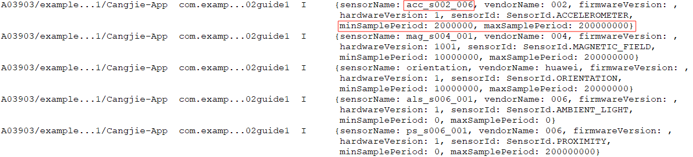
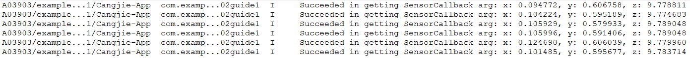
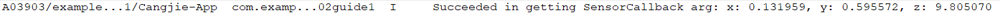

# Sensor Development Guide (Cangjie)

<!--Del-->
> **Note:**
>
> Currently in the beta phase.
<!--DelEnd-->

## Scenario Description

When a device needs to acquire sensor data, the `sensor` module can be utilized. For example: 
- Subscribing to orientation sensor data to detect the current orientation of the user's device.
- Subscribing to step counter sensor data to track the user's step count.

For detailed API documentation, refer to [Sensor API](../../reference/SensorServiceKit/cj-apis-sensor.md).

## Interface Specifications

| Name | Description |
| -------- | -------- |
| `on<T>(`type`:SensorId, callback:Callback1Argument<T>, option:?SensorOptions):Unit where T <: Response` | Continuously monitors sensor data changes. |
| `once<T>(`type`:SensorId, callback:Callback1Argument<T>):Unit where T <: Response` | Acquires sensor data change once. |
| `off(`type`: SensorId, callback!: ?CallbackObject = None): Unit` | Unregisters the sensor data listener. |
| `getSensorList():Array<Sensor>` | Retrieves all sensor information on the device. |
| getGeomagneticInfo(locationOptions: LocationOptions, timeMillis: Int64, callback: AsyncCallback&lt;GeomagneticResponse&gt;): Unit | Obtains the geomagnetic field of a geographic location at a certain time. |
| getDeviceAltitude(seaPressure: Float32, currentPressure: Float32, callback: AsyncCallback&lt;Float32&gt;): Unit | Obtains the altitude based on the atmospheric pressure. |
| getInclination(inclinationMatrix: Array&lt;Float32&gt;, callback: AsyncCallback&lt;Float32&gt;): Unit | Obtains the magnetic dip based on the inclination matrix. |
| getAngleVariation(currentRotationMatrix: Array&lt;Float32&gt;, preRotationMatrix: Array&lt;Float32&gt;, callback: AsyncCallback&lt;Array&lt;Float32&gt;&gt;): Unit | Obtains the angle change between two rotation matrices. |
| getRotationMatrix(rotationVector: Array&lt;Float32&gt;, callback: AsyncCallback&lt;Array&lt;Float32&gt;&gt;): Unit | Obtains the rotation matrix from a rotation vector. |
| transformRotationMatrix(inRotationVector: Array&lt;Float32&gt;, coordinates: CoordinatesOptions, callback: AsyncCallback&lt;Array&lt;Float32&gt;&gt;): Unit | Transforms a rotation vector based on the coordinate system. |
| getQuaternion(rotationVector: Array&lt;Float32&gt;, callback: AsyncCallback&lt;Array&lt;Float32&gt;&gt;): Unit | Obtains the quaternion from a rotation vector. |
| getOrientation(rotationMatrix: Array&lt;Float32&gt;, callback: AsyncCallback&lt;Array&lt;Float32&gt;&gt;): Unit | Obtains the device direction based on the rotation matrix. |
| getRotationMatrix(gravity: Array&lt;Float32&gt;, geomagnetic: Array&lt;Float32&gt;, callback: AsyncCallback&lt;RotationMatrixResponse&gt;): Unit | Obtains the rotation matrix based on a gravity vector and geomagnetic vector. |

## Development Procedure

The development procedure is demonstrated using the accelerometer sensor (`ACCELEROMETER`) as an example.

1. Import modules.

    <!-- compile -->

    ```cangjie
    import kit.SensorServiceKit.*
    import kit.CangjieKit.BusinessException
    import kit.CangjieKit.Callback1Argument
    ```

2. Query all supported sensor parameters on the device.

    <!-- compile -->

    ```cangjie
    try {
        let sensors = getSensorList()
        for (index in 0..sensors.size) {
            Hilog.info(1, "info", "{sensorName: ${sensors[index].sensorName}, vendorName: ${sensors[index].vendorName},
             firmwareVersion: ${sensors[index].firmwareVersion}, \n hardwareVersion: ${sensors[index].hardwareVersion}, 
             sensorId: ${sensors[index].sensorId}, \n minSamplePeriod: ${sensors[index].minSamplePeriod}, maxSamplePeriod: ${sensors[index].maxSamplePeriod}}")
        }
    } catch (e: BusinessException) {
        Hilog.info(1, "info", "Failed to get sensor list. Code: ${e.code}, message: ${e.message}")
    }
    ```

    

    This sensor supports a minimum sampling period of 2,000,000 nanoseconds and a maximum sampling period of 200,000,000 nanoseconds. Different sensors have varying supported sampling period ranges. The `interval` parameter should be set within the sensor's supported range. 
    - Values exceeding the maximum will default to the maximum reporting rate.
    - Values below the minimum will default to the minimum reporting rate.
    - Smaller values result in more frequent data reporting but higher power consumption.

3. Verify that the required permissions are configured. For permission requirements of different sensors, refer to [Sensor Development Overview](./cj-sensor-overview.md#constraints-and-limitations). For configuration methods, see [Declaring Permissions](../../security/AccessToken/cj-declare-permissions.md). For permission requests, refer to [Requesting User Authorization](../../security/AccessToken/cj-request-user-authorization.md).

4. Register listeners. Sensor callbacks can be monitored using either the `on()` or `once()` interfaces.

   Continuous monitoring via `on()` with a reporting interval (`interval`) set to 100,000,000 nanoseconds:

    <!-- compile -->

    ```cangjie
    // Custom callback
    class SensorCallback <: Callback1Argument<AccelerometerResponse>
    {
        init() {}
        public func invoke(err: ?BusinessException, arg: AccelerometerResponse): Unit {
            Hilog.info(1, "info", "Succeeded in getting SensorCallback arg: x: ${arg.x}, y: ${arg.y}, z: ${arg.z}")
        }
    }

    func onExample() {
        let callback = SensorCallback()
        try {
            // Periodic and instantaneous sensors follow the same development procedure.
            // Difference: Periodic sensors collect/output data at fixed intervals (option), while instantaneous sensors trigger data collection/output based on specific events (unaffected by option).
            on(SensorId.Accelerometer, callback, option: Options(interval: SensorNumber(100000000)))
        } catch (e: BusinessException) {
            Hilog.error(1, "info", "Sensor on error code: ${e.code}, message: ${e.message}")
        }
    }
    ```

    

   One-time monitoring via `once()`:

    <!-- compile -->

    ```cangjie
    // Custom callback
    class SensorCallback <: Callback1Argument<AccelerometerResponse>
    {
        init() {}
        public func invoke(err: ?BusinessException, arg: AccelerometerResponse): Unit {
            Hilog.info(1, "info", "Succeeded in getting SensorCallback arg: x: ${arg.x}, y: ${arg.y}, z: ${arg.z}")
        }
    }

    func onceExample() {
        try {
            let callback = SensorCallback()
            once(SensorId.Accelerometer, callback)
        } catch (e: BusinessException) {
            Hilog.error(1, "info", "Sensor once error code: ${e.code}, message: ${e.message}")
        }
    }
    ```

    

5. Cancel continuous monitoring.

    <!-- compile -->

    ```cangjie
    func offExample() {
        try {
            // Unregister all callbacks for SensorId.Accelerometer
            off(SensorId.Accelerometer)
        } catch (e: BusinessException) {
            Hilog.error(1, "info", "Sensor off error code: ${e.code}, message: ${e.message}")
        }
    }
    ```

6. Obtain the geomagnetic field of a geographic location at a certain time.

   <!-- compile -->

   ```cangjie
   // index.cj
   import kit.SensorServiceKit.*
   import kit.CangjieKit.AsyncCallback
   import kit.CangjieKit.BusinessException
   import kit.PerformanceAnalysisKit.Hilog

   func getGeomagneticInfoExample() {
       let locationOptions = LocationOptions(80.0, 0.0, 0.0)
       let timeMillis: Int64 = 1580486400000
       try {
           getGeomagneticInfo(locationOptions, timeMillis) { err, data =>
               if (err != None) {
                   Hilog.error(0, "test", "getGeomagneticInfo failed")
                   return
               }
               Hilog.info(0, "test", "x=${data.x}, y=${data.y}, z=${data.z}")
               Hilog.info(0, "test", "geomagneticDip=${data.geomagneticDip}")
               Hilog.info(0, "test", "deflectionAngle=${data.deflectionAngle}")
               Hilog.info(0, "test", "levelIntensity=${data.levelIntensity}")
               Hilog.info(0, "test", "totalIntensity=${data.totalIntensity}")
           }
       } catch (e: BusinessException) {
           Hilog.error(0, "test", "getGeomagneticInfo exception: ${e.message}")
       }
   }
   ```

7. Obtain the altitude based on the atmospheric pressure.

   <!-- compile -->

   ```cangjie
   // index.cj
   import kit.SensorServiceKit.*
   import kit.CangjieKit.AsyncCallback
   import kit.CangjieKit.BusinessException
   import kit.PerformanceAnalysisKit.Hilog

   func getDeviceAltitudeExample() {
       let seaPressure: Float32 = 1013.25
       let currentPressure: Float32 = 1000.0
       try {
           getDeviceAltitude(seaPressure, currentPressure) { err, altitude =>
               if (err != None) {
                   Hilog.error(0, "test", "getDeviceAltitude failed")
                   return
               }
               Hilog.info(0, "test", "altitude=${altitude}")
           }
       } catch (e: BusinessException) {
           Hilog.error(0, "test", "getDeviceAltitude exception: ${e.message}")
       }
   }
   ```

8. Obtain the magnetic dip based on the inclination matrix.

   <!-- compile -->

   ```cangjie
   // index.cj
   import kit.SensorServiceKit.*
   import kit.CangjieKit.AsyncCallback
   import kit.CangjieKit.BusinessException
   import kit.PerformanceAnalysisKit.Hilog

   func getInclinationExample() {
       let inclinationMatrix: Array<Float32> = Array<Float32>([1.0, 0.0, 0.0, 0.0, 1.0, 0.0, 0.0, 0.0, 1.0])
       try {
           getInclination(inclinationMatrix) { err, inclination =>
               if (err != None) {
                   Hilog.error(0, "test", "getInclination failed")
                   return
               }
               Hilog.info(0, "test", "inclination=${inclination}")
           }
       } catch (e: BusinessException) {
           Hilog.error(0, "test", "getInclination exception: ${e.message}")
       }
   }
   ```

9. Obtain the angle change between two rotation matrices.

   <!-- compile -->

   ```cangjie
   // index.cj
   import kit.SensorServiceKit.*
   import kit.CangjieKit.AsyncCallback
   import kit.CangjieKit.BusinessException
   import kit.PerformanceAnalysisKit.Hilog

   func getAngleVariationExample() {
       let currentMatrix: Array<Float32> = Array<Float32>([1.0, 0.0, 0.0, 0.0, 1.0, 0.0, 0.0, 0.0, 1.0])
       let preMatrix: Array<Float32> = Array<Float32>([1.0, 0.0, 0.0, 0.0, 1.0, 0.0, 0.0, 0.0, 1.0])
       try {
           getAngleVariation(currentMatrix, preMatrix) { err, angleVariation =>
               if (err != None) {
                   Hilog.error(0, "test", "getAngleVariation failed")
                   return
               }
               Hilog.info(0, "test", "angleVariation size=${angleVariation.size}")
           }
       } catch (e: BusinessException) {
           Hilog.error(0, "test", "getAngleVariation exception: ${e.message}")
       }
   }
   ```

10. Obtain the rotation matrix from a rotation vector.

    <!-- compile -->

    ```cangjie
    // index.cj
    import kit.SensorServiceKit.*
    import kit.CangjieKit.AsyncCallback
    import kit.CangjieKit.BusinessException
    import kit.PerformanceAnalysisKit.Hilog

    func getRotationMatrixExample() {
        let rotationVector: Array<Float32> = Array<Float32>([0.0, 0.0, 0.0, 1.0])
        try {
            getRotationMatrix(rotationVector) { err, rotationMatrix =>
                if (err != None) {
                    Hilog.error(0, "test", "getRotationMatrix failed")
                    return
                }
                Hilog.info(0, "test", "rotationMatrix size=${rotationMatrix.size}")
            }
        } catch (e: BusinessException) {
            Hilog.error(0, "test", "getRotationMatrix exception: ${e.message}")
        }
    }
    ```

11. Transform a rotation vector based on the coordinate system.

    <!-- compile -->

    ```cangjie
    // index.cj
    import kit.SensorServiceKit.*
    import kit.CangjieKit.AsyncCallback
    import kit.CangjieKit.BusinessException
    import kit.PerformanceAnalysisKit.Hilog

    func transformRotationMatrixExample() {
        let inRotationVector: Array<Float32> = Array<Float32>([1.0, 0.0, 0.0, 0.0, 1.0, 0.0, 0.0, 0.0, 1.0])
        let coordinates = CoordinatesOptions(1, 3)
        try {
            transformRotationMatrix(inRotationVector, coordinates) { err, result =>
                if (err != None) {
                    Hilog.error(0, "test", "transformRotationMatrix failed")
                    return
                }
                Hilog.info(0, "test", "result size=${result.size}")
            }
        } catch (e: BusinessException) {
            Hilog.error(0, "test", "transformRotationMatrix exception: ${e.message}")
        }
    }
    ```

12. Obtain the quaternion from a rotation vector.

    <!-- compile -->

    ```cangjie
    // index.cj
    import kit.SensorServiceKit.*
    import kit.CangjieKit.AsyncCallback
    import kit.CangjieKit.BusinessException
    import kit.PerformanceAnalysisKit.Hilog

    func getQuaternionExample() {
        let rotationVector: Array<Float32> = Array<Float32>([0.0, 0.0, 0.0, 1.0])
        try {
            getQuaternion(rotationVector) { err, quaternion =>
                if (err != None) {
                    Hilog.error(0, "test", "getQuaternion failed")
                    return
                }
                Hilog.info(0, "test", "quaternion size=${quaternion.size}")
            }
        } catch (e: BusinessException) {
            Hilog.error(0, "test", "getQuaternion exception: ${e.message}")
        }
    }
    ```

13. Obtain the device direction based on the rotation matrix.

    <!-- compile -->

    ```cangjie
    // index.cj
    import kit.SensorServiceKit.*
    import kit.CangjieKit.AsyncCallback
    import kit.CangjieKit.BusinessException
    import kit.PerformanceAnalysisKit.Hilog

    func getOrientationExample() {
        let rotationMatrix: Array<Float32> = Array<Float32>([1.0, 0.0, 0.0, 0.0, 1.0, 0.0, 0.0, 0.0, 1.0])
        try {
            getOrientation(rotationMatrix) { err, orientation =>
                if (err != None) {
                    Hilog.error(0, "test", "getOrientation failed")
                    return
                }
                Hilog.info(0, "test", "orientation size=${orientation.size}")
            }
        } catch (e: BusinessException) {
            Hilog.error(0, "test", "getOrientation exception: ${e.message}")
        }
    }
    ```

14. Obtain the rotation matrix based on a gravity vector and geomagnetic vector.

    <!-- compile -->

    ```cangjie
    // index.cj
    import kit.SensorServiceKit.*
    import kit.CangjieKit.AsyncCallback
    import kit.CangjieKit.BusinessException
    import kit.PerformanceAnalysisKit.Hilog

    func getRotationMatrixByGravityExample() {
        let gravity: Array<Float32> = Array<Float32>([0.0, 0.0, 9.8])
        let geomagnetic: Array<Float32> = Array<Float32>([0.0, 0.0, 50.0])
        try {
            getRotationMatrix(gravity, geomagnetic) { err, response =>
                if (err != None) {
                    Hilog.error(0, "test", "getRotationMatrix failed")
                    return
                }
                Hilog.info(0, "test", "rotation size=${response.rotation.size}")
                Hilog.info(0, "test", "inclination size=${response.inclination.size}")
            }
        } catch (e: BusinessException) {
            Hilog.error(0, "test", "getRotationMatrix exception: ${e.message}")
        }
    }
    ```

## Notes

All sensor development follows the same procedure as the accelerometer (`ACCELEROMETER`) example above. Note that sensors are categorized by data acquisition method:
- **Periodic Sensors**: Collect and output data at predefined fixed intervals (e.g., ambient temperature sensor `AMBIENT_TEMPERATURE`). Includes: `GRAVITY`, `AMBIENT_TEMPERATURE`, `HUMIDITY`, `BAROMETER`, etc.
- **Instantaneous Sensors**: Collect and output data only when triggered by specific events (e.g., step counter `PEDOMETER` reports upon step changes). Includes: `HALL`, `PROXIMITY`, `WEAR_DETECTION`, `PEDOMETER`, `PEDOMETER_DETECTION`.