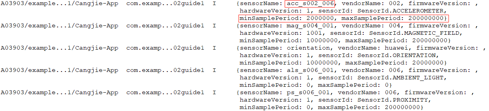
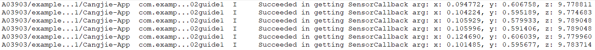
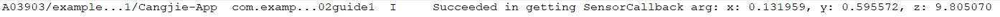

# Sensor Development Guide (Cangjie)

<!--Del-->
> **Note:**
>
> Currently in the beta phase.
<!--DelEnd-->

## Scenario Description

When a device needs to acquire sensor data, the `sensor` module can be utilized. For example: 
- Subscribing to orientation sensor data to detect the current orientation of the user's device.
- Subscribing to step counter sensor data to track the user's step count.

For detailed API documentation, refer to [Sensor API](../../reference/SensorServiceKit/cj-apis-sensor.md).

## Interface Specifications

| Name | Description |
| -------- | -------- |
| `on<T>(`type`:SensorId, callback:Callback1Argument<T>, option:?SensorOptions):Unit where T <: Response` | Continuously monitors sensor data changes. |
| `once<T>(`type`:SensorId, callback:Callback1Argument<T>):Unit where T <: Response` | Acquires sensor data change once. |
| `off(`type`: SensorId, callback!: ?CallbackObject = None): Unit` | Unregisters the sensor data listener. |
| `getSensorList():Array<Sensor>` | Retrieves all sensor information on the device. |

## Development Procedure

The development procedure is demonstrated using the accelerometer sensor (`ACCELEROMETER`) as an example.

1. Import modules.

    <!-- compile -->

    ```cangjie
    import kit.ArkUI.*
    import kit.SensorServiceKit.*
    import kit.CangjieKit.BusinessException
    import kit.CangjieKit.Callback1Argument
    ```

2. Query all supported sensor parameters on the device.

    <!-- compile -->

    ```cangjie
    try {
        let sensors = getSensorList()
        for (index in 0..sensors.size) {
            Hilog.info(1, "info", "{sensorName: ${sensors[index].sensorName}, vendorName: ${sensors[index].vendorName},
             firmwareVersion: ${sensors[index].firmwareVersion}, \n hardwareVersion: ${sensors[index].hardwareVersion}, 
             sensorId: ${sensors[index].sensorId}, \n minSamplePeriod: ${sensors[index].minSamplePeriod}, maxSamplePeriod: ${sensors[index].maxSamplePeriod}}")
        }
    } catch (e: BusinessException) {
        Hilog.info(1, "info", "Failed to get sensor list. Code: ${e.code}, message: ${e.message}")
    }
    ```

    

    This sensor supports a minimum sampling period of 2,000,000 nanoseconds and a maximum sampling period of 200,000,000 nanoseconds. Different sensors have varying supported sampling period ranges. The `interval` parameter should be set within the sensor's supported range. 
    - Values exceeding the maximum will default to the maximum reporting rate.
    - Values below the minimum will default to the minimum reporting rate.
    - Smaller values result in more frequent data reporting but higher power consumption.

3. Verify that the required permissions are configured. For permission requirements of different sensors, refer to [Sensor Development Overview](./cj-sensor-overview.md#constraints-and-limitations). For configuration methods, see [Declaring Permissions](../../security/AccessToken/cj-declare-permissions.md). For permission requests, refer to [Requesting User Authorization](../../security/AccessToken/cj-request-user-authorization.md).

4. Register listeners. Sensor callbacks can be monitored using either the `on()` or `once()` interfaces.

   Continuous monitoring via `on()` with a reporting interval (`interval`) set to 100,000,000 nanoseconds:

    <!-- compile -->

    ```cangjie
    // Custom callback
    class SensorCallback <: Callback1Argument<AccelerometerResponse>
    {
        init() {}
        public func invoke(err: ?BusinessException, arg: AccelerometerResponse): Unit {
            Hilog.info(1, "info", "Succeeded in getting SensorCallback arg: x: ${arg.x}, y: ${arg.y}, z: ${arg.z}")
        }
    }

    func onExample() {
        let callback = SensorCallback()
        try {
            // Periodic and instantaneous sensors follow the same development procedure.
            // Difference: Periodic sensors collect/output data at fixed intervals (option), while instantaneous sensors trigger data collection/output based on specific events (unaffected by option).
            on(SensorId.Accelerometer, callback, option: Options(interval: SensorNumber(100000000)))
        } catch (e: BusinessException) {
            Hilog.error(1, "info", "Sensor on error code: ${e.code}, message: ${e.message}")
        }
    }
    ```

    

   One-time monitoring via `once()`:

    <!-- compile -->

    ```cangjie
    // Custom callback
    class SensorCallback <: Callback1Argument<AccelerometerResponse>
    {
        init() {}
        public func invoke(err: ?BusinessException, arg: AccelerometerResponse): Unit {
            Hilog.info(1, "info", "Succeeded in getting SensorCallback arg: x: ${arg.x}, y: ${arg.y}, z: ${arg.z}")
        }
    }

    func onceExample() {
        try {
            let callback = SensorCallback()
            once(SensorId.Accelerometer, callback)
        } catch (e: BusinessException) {
            Hilog.error(1, "info", "Sensor once error code: ${e.code}, message: ${e.message}")
        }
    }
    ```

    

5. Cancel continuous monitoring.

    <!-- compile -->

    ```cangjie
    func offExample() {
        try {
            // Unregister all callbacks for SensorId.Accelerometer
            off(SensorId.Accelerometer)
        } catch (e: BusinessException) {
            Hilog.error(1, "info", "Sensor off error code: ${e.code}, message: ${e.message}")
        }
    }
    ```

## Notes

All sensor development follows the same procedure as the accelerometer (`ACCELEROMETER`) example above. Note that sensors are categorized by data acquisition method:
- **Periodic Sensors**: Collect and output data at predefined fixed intervals (e.g., ambient temperature sensor `AMBIENT_TEMPERATURE`). Includes: `GRAVITY`, `AMBIENT_TEMPERATURE`, `HUMIDITY`, `BAROMETER`, etc.
- **Instantaneous Sensors**: Collect and output data only when triggered by specific events (e.g., step counter `PEDOMETER` reports upon step changes). Includes: `HALL`, `PROXIMITY`, `WEAR_DETECTION`, `PEDOMETER`, `PEDOMETER_DETECTION`.