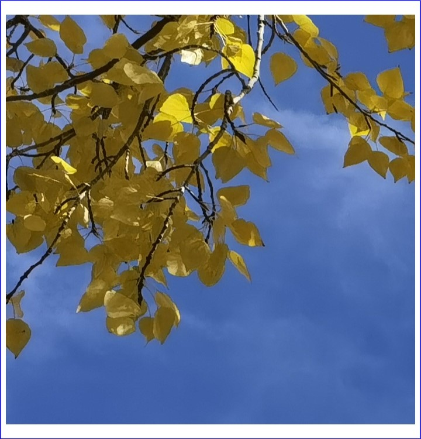
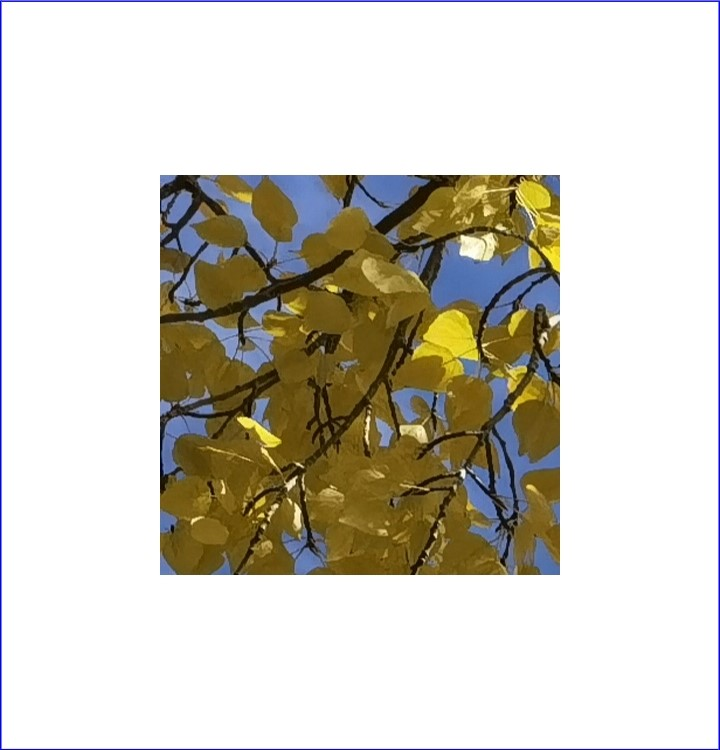
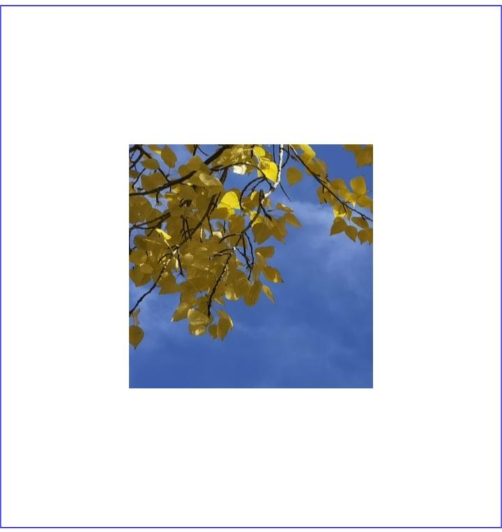
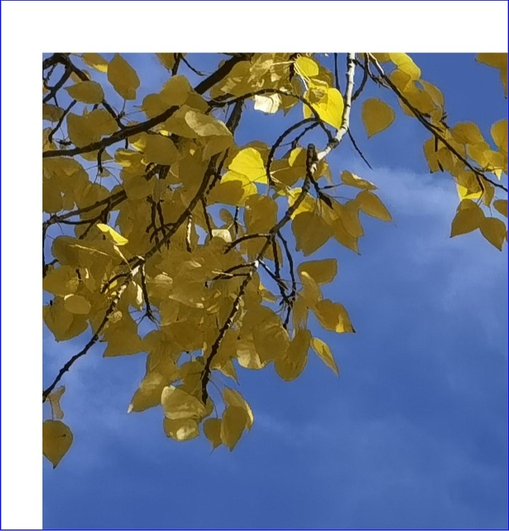
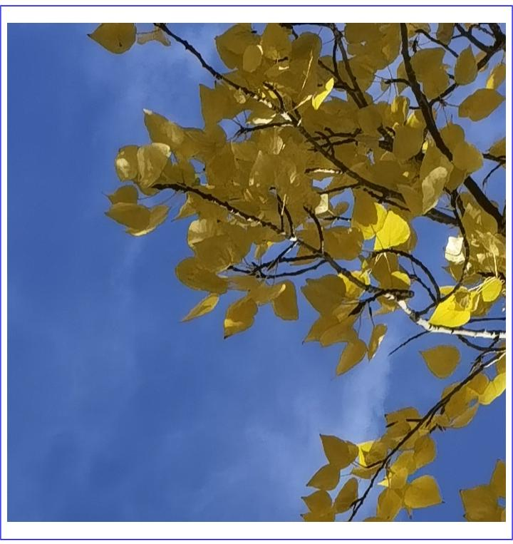
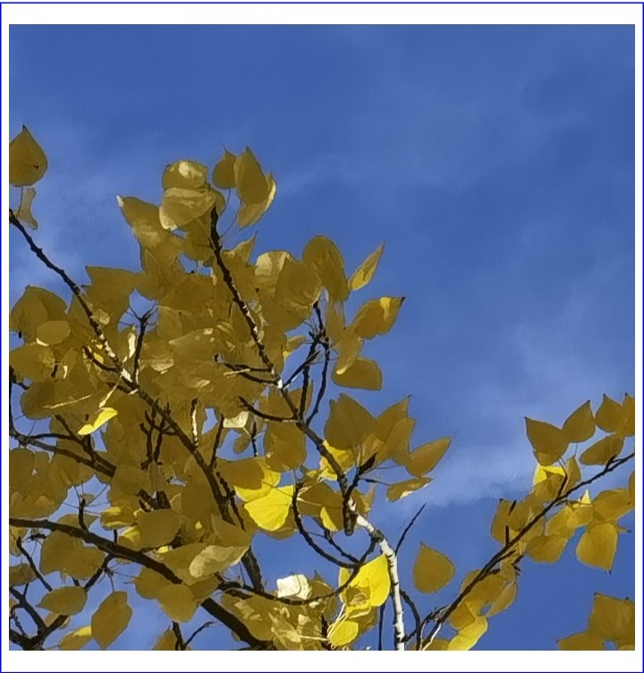
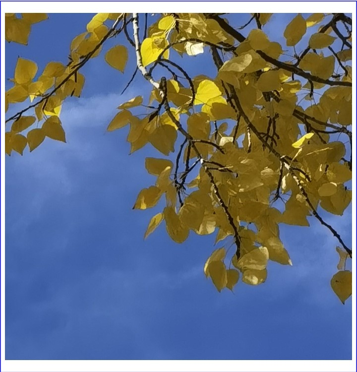
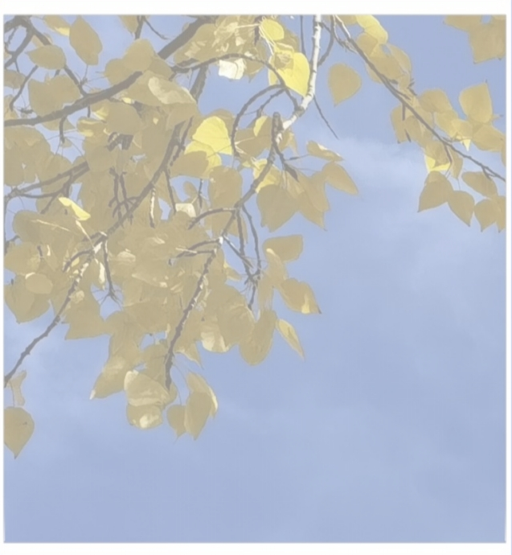

# Performing Image Transformations with PixelMap  

<!--Del-->
> **Note:**
>
> Currently in the beta phase.
<!--DelEnd-->

Image processing involves performing operations on PixelMap, such as retrieving image information, cropping, scaling, translating, rotating, flipping, setting opacity, and reading/writing pixel data. Image processing primarily includes image transformations and [bitmap operations](./cj-image-pixelmap-operation.md). This document focuses on image transformations.  

## Development Procedure  

For detailed information about image transformation APIs, refer to the [API Reference](../../reference/ImageKit/cj-apis-image.md#class-pixelmap).  

1. Complete [image decoding](./cj-image-decoding.md) to obtain a PixelMap object.  

2. Retrieve image information.  

    <!-- compile -->  

    ```cangjie  
    // Get the image dimensions.  
    let info = pixelMap.getImageInfo()  
    ```  

3. Perform image transformation operations.  

   Original image:  

      

   - Cropping  

     <!-- compile -->  

     ```cangjie  
     // x: Horizontal starting coordinate for cropping (0).  
     // y: Vertical starting coordinate for cropping (0).  
     // height: Cropping height (400), direction is top to bottom (resulting image height is 400).  
     // width: Cropping width (400), direction is left to right (resulting image width is 400).  
     pixelMap.crop(Region(Size(400, 400), 0, 0))  
     ```  

       

   - Scaling  

     <!-- compile -->  

     ```cangjie  
     // Width scaled to 0.5 of the original.  
     // Height scaled to 0.5 of the original.  
     pixelMap.scale(0.5, 0.5)  
     ```  

       

   - Translation  

     <!-- compile -->  

     ```cangjie  
     // Translate downward by 100.  
     // Translate rightward by 100.  
     pixelMap.translate(100.0, 100.0)  
     ```  

       

   - Rotation  

     <!-- compile -->  

     ```cangjie  
     // Rotate 90° clockwise.  
     pixelMap.rotate(90.0)  
     ```  

       

   - Flipping  

     <!-- compile -->  

     ```cangjie  
     // Flip vertically.  
     pixelMap.flip(false, true)  
     ```  

       

     <!-- compile -->  

     ```cangjie  
     // Flip horizontally.  
     pixelMap.flip(true, false);  
     ```  

       

   - Opacity  

     <!-- compile -->  

     ```cangjie  
     // Opacity set to 0.5.  
     pixelMap.opacity(0.5)  
     ```  

     