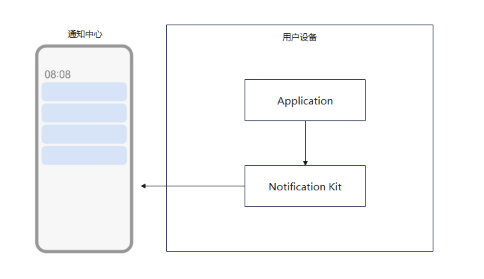
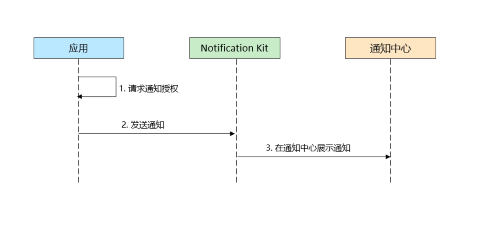
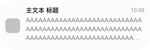

# Introduction to Notification Kit

<!--Del-->
> **Note:**
>
> Currently in the beta phase.
<!--DelEnd-->

Notification Kit (user notification service) provides applications with a local notification publishing channel. With Notification Kit, an application can push notifications generated by its services to users locally on the client. Depending on the notification type and publishing scenario, a local notification triggers the corresponding ringtone, vibration, banner, lock screen display, automatic screen lighting, status bar icon, and display in the notification center.

## When to Use

You can use Notification Kit to publish notifications to users when the application process is running.

Local notifications can be used in a variety of scenarios, such as synchronizing the upload/download progress for users, publishing instant customer service payment notifications, and updating the step count.

## Capabilities

The capabilities supported by Notification Kit on the Cangjie side mainly include:

- Publishing text notifications.
- Adding or updating the application notification badge.
- Canceling all notifications published by the application.
- Querying the notification switch status of the application itself.
- By default, the notification publishing capability is disabled for an application. You can display the authorization dialog box to request the user to authorize notification publishing.

  

## Working Principles

The main workflow of using Notification Kit is as follows:

1. Request notification authorization.

2. The application publishes a notification to the notification service.

3. The notification is displayed in the notification center.

## Notification Styles

> **Note:**
>
> The actual display effect depends on the device capabilities and the UI design style of the notification center.

Common notification styles in Notification Kit are as follows:

| Type | Notification Style | Description |
| ---- | --------| ------- |
| [Text](./cj-text-notification.md)   |  | A maximum of three lines of notification text is displayed. Excess text is truncated and displayed as "...". |
| [Notification badge](./cj-notification-badge.md) |  | Displayed as a number in the upper right corner. |

## Constraints

- The number of notifications that a single application can retain in system entries such as the notification center is limited (currently, a maximum of 24 notifications).
- The length of a notification cannot exceed 200 KB (cross-process serialization size limit).
- The notification publishing and update frequencies must meet the following requirements. Otherwise, the publishing or update fails and error code 1600009 is returned.
  - For a single application, no more than 10 new notifications can be published per second, and no more than 20 notifications can be updated per second.
  - For all third-party applications, no more than 15 new notifications can be published per second, and no more than 30 notifications can be updated per second.

## Relationship with Related Kits

- Notifications created by Notification Kit are immediately displayed in system entries such as the notification center. The notification lifecycle is managed by the application that publishes the notification, and the application can cancel the notification when appropriate.
- Before publishing notifications, an application must obtain user authorization. The authorization result can be queried through the APIs provided by Notification Kit.
