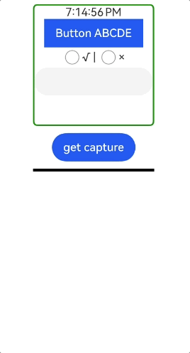

# ComponentSnapshot

<!--Del-->
> **Note:**
>
> Currently in the beta phase.
<!--DelEnd-->

Provides the capability to obtain component snapshots, including snapshots of loaded components, suitable for scenarios where the rendering result of a component needs to be obtained for display or subsequent processing.

> **Note:**
>
> The following APIs require first obtaining a ComponentSnapshot instance using the [getComponentSnapshot()](./cj-apis-uicontext-uicontext.md#func-getcomponentsnapshot) method from [UIContext](./cj-apis-uicontext-uicontext.md#class-uicontext), and then calling the corresponding methods through this instance.

## Importing Modules

```cangjie
import kit.ArkUI.*
```

## class ComponentSnapshot

```cangjie
public class ComponentSnapshot {}
```

**Description:** Component snapshot class, which provides the capability to obtain snapshots of loaded components.

**System Capability:** SystemCapability.ArkUI.ArkUI.Full

**Since:** 26.1.0

### func get(String, AsyncCallback\<PixelMap>, ?SnapshotOptions)

```cangjie
public func get(id: String, callback: AsyncCallback<PixelMap>, options!: ?SnapshotOptions = Option.None): Unit
```

**Description:** Obtains a snapshot of a loaded component. Pass in the [component ID](./cj-universal-attribute-componentid.md) of the component to locate the corresponding component for snapshotting. This is suitable for scenarios such as generating component preview images and saving or sharing partial UI snapshots. Uses a callback for asynchronous return.

> **Note:**
>
> The snapshot captures the drawing content of the latest frame. If the snapshot is called at the same time that the component triggers an update, the updated rendering content will not be captured, and the snapshot returns the drawing content of the previous frame.

**System Capability:** SystemCapability.ArkUI.ArkUI.Full

**Since:** 26.1.0

**Parameters:**

| Parameter | Type | Required | Default | Description |
|:---|:---|:---|:---|:---|
| id | String | Yes | - | The [component ID](./cj-universal-attribute-componentid.md) of the target component.<br>**Note:** Components that are not mounted on the tree are not supported. When the passed component ID is an offscreen or cached node that is not mounted on the tree, the system will not snapshot it. |
| callback | [AsyncCallback](../arkinterop/cj-api-business_exception.md#type-asynccallbackt)\<[PixelMap](../ImageKit/cj-apis-image.md#class-pixelmap)> | Yes | - | Callback function. When the snapshot result is successful, err is None and data is the obtained PixelMap; otherwise, data is an error object. |
| options | ?[SnapshotOptions](#class-snapshotoptions) | No | Option.None | **Named parameter.** Custom parameters related to snapshotting. Pass this parameter when you need to customize configurations such as the snapshot scale and the strategy for waiting for rendering to complete; if not passed, the system default snapshot configuration is used. |

**Exceptions:**

- [BusinessException](../arkinterop/cj-api-business_exception.md#class-businessexception): The corresponding error codes are listed in the following table. For details, see [Universal Error Codes](../cj-errorcode-universal.md), [Snapshot Error Codes](./cj-errorcode-snapshot.md), and [Interface Call Exception Error Codes](./cj-errorcode-internal.md).

  | Error Code | Description |
  |:----|:----|
  | 401 | Parameter error. Possible causes: 1. Mandatory parameters are left unspecified. 2. Incorrect parameter types. 3. Parameter verification failed. |
  | 100001 | Invalid ID. |
  | 160003 | Unsupported color space or dynamic range mode in snapshot options. |

**Example:**

<!-- run -->
```cangjie
package ohos_app_cangjie_entry

import kit.ArkUI.*
import ohos.arkui.state_macro_manage.*
import kit.ImageKit.PixelMap
import kit.CangjieKit.BusinessException
import kit.PerformanceAnalysisKit.Hilog
import kit.LocalizationKit.__GenerateResource__

@Entry
@Component
class EntryView {
    @State
    var pixmap: ?PixelMap = Option<PixelMap>.None

    func build() {
        Column() {
            Row() {
               Image(this.pixmap)
               .width(150)
               .height(150)
               .border(color: Color.Black, width: 2)
               .margin(5)
                // Replace $r('app.media.img') with the image resource file required by the developer.
                Image(@r(app.media.img))
                    .autoResize(true)
                    .width(150)
                    .height(150)
                    .margin(5)
                    .id("root")
            }

            Button("click to generate UI snapshot")
                .onClick({
                    evt =>
                        this.getUIContext().getComponentSnapshot().get("root", {
                            err: ?BusinessException, data: ?PixelMap =>
                                if (let Some(e) <- err) {
                                    Hilog.info(1, "Cangjie", "Failed to get component snapshot: ${e.code}")
                                    return
                                }
                                this.pixmap = data
                        }, options: SnapshotOptions(scale: 2.0, waitUntilRenderFinished: true))
                })
                .margin(10)
        }
        .width(100.percent)
        .height(100.percent)
        .alignItems(HorizontalAlign.Center)
    }
}
```


## class SnapshotOptions

```cangjie
public class SnapshotOptions {
    public var scale: ?Float64
    public var waitUntilRenderFinished: ?Bool
    public var region: ?SnapshotRegionType
    public var colorMode: ?ColorModeOptions
    public var dynamicRangeMode: ?DynamicRangeModeOptions
    public init(
        scale!: ?Float64 = None,
        waitUntilRenderFinished!: ?Bool = None,
        region!: ?SnapshotRegionType = None,
        colorMode!: ?ColorModeOptions = None,
        dynamicRangeMode!: ?DynamicRangeModeOptions = None
    )
}
```

**Description:** Snapshot options configuration class, used to customize the snapshot scale, the strategy for waiting for rendering to complete, the snapshot region, the color mode, and the dynamic range mode.

**System Capability:** SystemCapability.ArkUI.ArkUI.Full

**Since:** 26.1.0

### var scale

```cangjie
public var scale: ?Float64
```

**Description:** The scale at which the graphics side draws the pixelmap during snapshotting. If the scale is too large, the snapshotting time becomes longer, or the snapshot may fail.

**System Capability:** SystemCapability.ArkUI.ArkUI.Full

**Since:** 26.1.0

> **Note:**
>
> Do not snapshot an excessively large image. It is not recommended that the snapshot exceed the screen size. When the target length and width of the image to be captured exceed the underlying limit, the snapshot fails. The underlying limit varies by device.

### var waitUntilRenderFinished

```cangjie
public var waitUntilRenderFinished: ?Bool
```

**Description:** Whether to force the system to wait for all drawing instructions to complete before snapshotting. true means that the system is forced to wait for all drawing instructions to complete before snapshotting, and false means that the system is not forced to wait. This option can ensure that the snapshot content is in the latest state as much as possible and should be enabled as much as possible. Note that after this option is enabled, the interface may take longer to return, and the specific time depends on the size of the region that currently needs to be redrawn on the page.

**System Capability:** SystemCapability.ArkUI.ArkUI.Full

**Since:** 26.1.0

### var region

```cangjie
public var region: ?SnapshotRegionType
```

**Description:** The rectangular region range of the snapshot. The default value is the entire component.

**System Capability:** SystemCapability.ArkUI.ArkUI.Full

**Since:** 26.1.0

### var colorMode

```cangjie
public var colorMode: ?ColorModeOptions
```

**Description:** The color space used for snapshotting.

**System Capability:** SystemCapability.ArkUI.ArkUI.Full

**Since:** 26.1.0

### var dynamicRangeMode

```cangjie
public var dynamicRangeMode: ?DynamicRangeModeOptions
```

**Description:** The dynamic range mode used for snapshotting.

**System Capability:** SystemCapability.ArkUI.ArkUI.Full

**Since:** 26.1.0

### init(?Float64, ?Bool, ?SnapshotRegionType, ?ColorModeOptions, ?DynamicRangeModeOptions)

```cangjie
public init(
    scale!: ?Float64 = None,
    waitUntilRenderFinished!: ?Bool = None,
    region!: ?SnapshotRegionType = None,
    colorMode!: ?ColorModeOptions = None,
    dynamicRangeMode!: ?DynamicRangeModeOptions = None
)
```

**Description:** SnapshotOptions constructor.

**System Capability:** SystemCapability.ArkUI.ArkUI.Full

**Since:** 26.1.0

**Parameters:**

| Parameter | Type | Required | Default | Description |
|:---|:---|:---|:---|:---|
| scale | ?Float64 | No | None | **Named parameter.** The scale at which the graphics side draws the PixelMap. Value range: [0, +∞). When the value is less than or equal to 0, the initial value 1 is used. |
| waitUntilRenderFinished | ?Bool | No | None | **Named parameter.** Whether to force the system to wait for all drawing instructions to complete before snapshotting. Initial value: false. |
| region | ?[SnapshotRegionType](#interface-snapshotregiontype) | No | None | **Named parameter.** Rectangular region range. The default value is the entire component. |
| colorMode | ?[ColorModeOptions](#class-colormodeoptions) | No | None | **Named parameter.** Color space. Initial value: ColorModeOptions(colorSpace: ColorSpace.Srgb, isAuto: false). |
| dynamicRangeMode | ?[DynamicRangeModeOptions](#class-dynamicrangemodeoptions) | No | None | **Named parameter.** Dynamic range mode. Initial value: DynamicRangeModeOptions(dynamicRangeMode: DynamicRangeMode.Standard, isAuto: false). |

## class SnapshotRegion

```cangjie
public class SnapshotRegion {
    public var left: Float64
    public var right: Float64
    public var top: Float64
    public var bottom: Float64
    public init(left!: Float64, right!: Float64, top!: Float64, bottom!: Float64)
}
```

**Description:** Defines the rectangular region for component snapshotting.

**System Capability:** SystemCapability.ArkUI.ArkUI.Full

**Since:** 26.1.0

### var left

```cangjie
public var left: Float64
```

**Description:** The X coordinate of the upper-left corner of the rectangular region.

**System Capability:** SystemCapability.ArkUI.ArkUI.Full

**Since:** 26.1.0

### var right

```cangjie
public var right: Float64
```

**Description:** The X coordinate of the lower-right corner of the rectangular region.

**System Capability:** SystemCapability.ArkUI.ArkUI.Full

**Since:** 26.1.0

### var top

```cangjie
public var top: Float64
```

**Description:** The Y coordinate of the upper-left corner of the rectangular region.

**System Capability:** SystemCapability.ArkUI.ArkUI.Full

**Since:** 26.1.0

### var bottom

```cangjie
public var bottom: Float64
```

**Description:** The Y coordinate of the lower-right corner of the rectangular region.

**System Capability:** SystemCapability.ArkUI.ArkUI.Full

**Since:** 26.1.0

### init(Float64, Float64, Float64, Float64)

```cangjie
public init(left!: Float64, right!: Float64, top!: Float64, bottom!: Float64)
```

**Description:** SnapshotRegion constructor.

**System Capability:** SystemCapability.ArkUI.ArkUI.Full

**Since:** 26.1.0

**Parameters:**

| Parameter | Type | Required | Default | Description |
|:---|:---|:---|:---|:---|
| left | Float64 | Yes | - | **Named parameter.** Left boundary. Unit: px. Value range: [0, component width]. If the value is out of range, the snapshot fails and error code 401 is returned. |
| right | Float64 | Yes | - | **Named parameter.** Right boundary. Unit: px. Value range: [0, component width]. If the value is out of range, the snapshot fails and error code 401 is returned. |
| top | Float64 | Yes | - | **Named parameter.** Top boundary. Unit: px. Value range: [0, component height]. If the value is out of range, the snapshot fails and error code 401 is returned. |
| bottom | Float64 | Yes | - | **Named parameter.** Bottom boundary. Unit: px. Value range: [0, component height]. If the value is out of range, the snapshot fails and error code 401 is returned. |

## class LocalizedSnapshotRegion

```cangjie
public class LocalizedSnapshotRegion {
    public var start: Float64
    public var end: Float64
    public var top: Float64
    public var bottom: Float64
    public init(start!: Float64, end!: Float64, top!: Float64, bottom!: Float64)
}
```

**Description:** Defines the rectangular region for component snapshotting. The values of start and end are specified as left and right when the layout direction is LTR, and as right and left when the layout direction is RTL.

**System Capability:** SystemCapability.ArkUI.ArkUI.Full

**Since:** 26.1.0

### var start

```cangjie
public var start: Float64
```

**Description:** In LTR layout, the X coordinate of the upper-left corner of the rectangular region; in RTL layout, the X coordinate of the upper-right corner of the rectangular region.

**System Capability:** SystemCapability.ArkUI.ArkUI.Full

**Since:** 26.1.0

### var end

```cangjie
public var end: Float64
```

**Description:** In LTR layout, the X coordinate of the lower-right corner of the rectangular region; in RTL layout, the X coordinate of the lower-left corner of the rectangular region.

**System Capability:** SystemCapability.ArkUI.ArkUI.Full

**Since:** 26.1.0

### var top

```cangjie
public var top: Float64
```

**Description:** In LTR layout, the Y coordinate of the upper-left corner of the rectangular region; in RTL layout, the Y coordinate of the upper-right corner of the rectangular region.

**System Capability:** SystemCapability.ArkUI.ArkUI.Full

**Since:** 26.1.0

### var bottom

```cangjie
public var bottom: Float64
```

**Description:** In LTR layout, the Y coordinate of the lower-right corner of the rectangular region; in RTL layout, the Y coordinate of the lower-left corner of the rectangular region.

**System Capability:** SystemCapability.ArkUI.ArkUI.Full

**Since:** 26.1.0

### init(Float64, Float64, Float64, Float64)

```cangjie
public init(start!: Float64, end!: Float64, top!: Float64, bottom!: Float64)
```

**Description:** LocalizedSnapshotRegion constructor.

**System Capability:** SystemCapability.ArkUI.ArkUI.Full

**Since:** 26.1.0

**Parameters:**

| Parameter | Type | Required | Default | Description |
|:---|:---|:---|:---|:---|
| start | Float64 | Yes | - | **Named parameter.** Start boundary. Unit: px. Value range: [0, component width]. If the value is out of range, the snapshot fails and error code 401 is returned. |
| end | Float64 | Yes | - | **Named parameter.** End boundary. Unit: px. Value range: [0, component width]. If the value is out of range, the snapshot fails and error code 401 is returned. |
| top | Float64 | Yes | - | **Named parameter.** Top boundary. Unit: px. Value range: [0, component height]. If the value is out of range, the snapshot fails and error code 401 is returned. |
| bottom | Float64 | Yes | - | **Named parameter.** Bottom boundary. Unit: px. Value range: [0, component height]. If the value is out of range, the snapshot fails and error code 401 is returned. |

## interface SnapshotRegionType

```cangjie
public interface SnapshotRegionType {}
```

**Description:** Defines the type of the snapshot region. SnapshotRegionType is the union type of SnapshotRegion and LocalizedSnapshotRegion.

**System Capability:** SystemCapability.ArkUI.ArkUI.Full

**Since:** 26.1.0

### extend SnapshotRegion <: SnapshotRegionType

```cangjie
extend SnapshotRegion <: SnapshotRegionType {}
```

**Description:** Extends SnapshotRegion as a subclass of SnapshotRegionType.

### extend LocalizedSnapshotRegion <: SnapshotRegionType

```cangjie
extend LocalizedSnapshotRegion <: SnapshotRegionType {}
```

**Description:** Extends LocalizedSnapshotRegion as a subclass of SnapshotRegionType.

**Example:**

<!-- run -->
```cangjie
package ohos_app_cangjie_entry

import kit.ArkUI.*
import ohos.arkui.state_macro_manage.*
import kit.ImageKit.PixelMap
import kit.CangjieKit.BusinessException
import kit.PerformanceAnalysisKit.Hilog

@Entry
@Component
class EntryView {
    @State
    var pixmap: ?PixelMap = Option<PixelMap>.None

    func build() {
        Column() {
            Row() {
                Column() {
                    TextClock()
                    Button("Button ABCDE")
                        .shape(ButtonType.Normal)
                    Row() {
                        Checkbox()
                        Text("√")
                        Text(" | ")
                        Checkbox()
                        Text("×")
                    }
                    .align(Alignment.Start)

                    TextInput()
                }
                .align(Alignment.Start)
                .id("component1")
                .width(600.px)
                .height(600.px)
                .borderRadius(6)
                .borderWidth(2)
                .borderColor(Color.Green)
            }

            Button("get capture")
                .onClick({
                    evt =>
                        this.getUIContext().getComponentSnapshot().get("component1", {
                            err: ?BusinessException, data: ?PixelMap =>
                                if (let Some(e) <- err) {
                                    Hilog.info(1, "Cangjie", "get error:${e.code}")
                                    return
                                }
                                this.pixmap = data
                        }, options: SnapshotOptions(
                            scale: 2.0,
                            waitUntilRenderFinished: true,
                            region: LocalizedSnapshotRegion(start: 20.0, top: 20.0, end: 200.0, bottom: 240.0)
                        )
                        )
                })
                .margin(10)
            Image(this.pixmap)
                .border(color: Color.Black, width: 2)
                .width(600.px)
        }
        .width(100.percent)
        .align(Alignment.Center)
    }
}
```



## class ColorModeOptions

```cangjie
public class ColorModeOptions {
    public var colorSpace: ?ColorSpace
    public var isAuto: ?Bool
    public init(
        colorSpace!: ?ColorSpace = None,
        isAuto!: ?Bool = None
    )
}
```

**Description:** Defines the color space used for snapshotting.

**System Capability:** SystemCapability.ArkUI.ArkUI.Full

**Since:** 26.1.0

### var colorSpace

```cangjie
public var colorSpace: ?ColorSpace
```

**Description:** The color space used for snapshotting. If you know the color space used by the component to be snapshotted, you can specify it through the `colorSpace` field and set `isAuto` to false to achieve the expected snapshot effect.

**System Capability:** SystemCapability.ArkUI.ArkUI.Full

**Since:** 26.1.0

### var isAuto

```cangjie
public var isAuto: ?Bool
```

**Description:** Whether the system automatically determines the color space to be used. true means that the system automatically determines the color space to be used; false means that the color space type set through the `colorSpace` field is used for snapshotting.

**System Capability:** SystemCapability.ArkUI.ArkUI.Full

**Since:** 26.1.0

### init(?ColorSpace, ?Bool)

```cangjie
public init(
    colorSpace!: ?ColorSpace = None,
    isAuto!: ?Bool = None
)
```

**Description:** ColorModeOptions constructor.

**System Capability:** SystemCapability.ArkUI.ArkUI.Full

**Since:** 26.1.0

**Parameters:**

| Parameter | Type | Required | Default | Description |
|:---|:---|:---|:---|:---|
| colorSpace | ?[ColorSpace](../ArkGraphics2D/cj-apis-color_manager.md#enum-colorspace) | No | None | **Named parameter.** Specifies the color space used for snapshotting.<br>Value range: DisplayP3 and Srgb in [colorSpaceManager.ColorSpace](../ArkGraphics2D/cj-apis-color_manager.md#enum-colorspace).<br>Initial value: Srgb.<br>If the value is Option.None or not set, the initial value is used for snapshotting; other abnormal values cause the snapshot to fail and error code 160003 is returned. |
| isAuto | ?Bool | No | None | **Named parameter.** Whether the system automatically determines the color space to be used.<br>true means that the system automatically determines the color space to be used; false means that the color space type set through the `colorSpace` field is used for snapshotting. If the value is invalid, it is handled as the initial value false.<br>Initial value: false.<br>When `isAuto` is set to true, it is recommended that the `waitUntilRenderFinished` field in [SnapshotOptions](#class-snapshotoptions) also be set to true to ensure that the system can properly detect the mode in use.<br>When you are not sure of the color space used by the component, it is recommended to set `isAuto` to true so that the system automatically determines the color space to be used based on the actual situation.<br>When `isAuto` is true, the value set in the `colorSpace` field is ignored. In this case, if the component to be snapshotted contains subcomponents with different color spaces at the same time, the snapshot color space is the color space type with the highest priority, and the priority order is DisplayP3 > Srgb. |

**Example:**

<!-- run -->
```cangjie
package ohos_app_cangjie_entry

import kit.ArkUI.*
import ohos.arkui.state_macro_manage.*
import kit.ImageKit.PixelMap
import kit.CangjieKit.BusinessException
import kit.LocalizationKit.__GenerateResource__
import kit.PerformanceAnalysisKit.Hilog
import kit.ArkGraphics2D.{ColorSpace as ArkGraphics2DColorSpace}

@Entry
@Component
class EntryView {
    @State
    var pixmap: ?PixelMap = Option<PixelMap>.None

    func build() {
        Column() {
            Row() {
                Image(this.pixmap)
                    .width(150)
                    .height(150)
                    .border(color: Color.Black, width: 2)
                    .margin(5)
                // Replace @r('app.media.img') with the image resource file required by the developer.
                Image(@r(app.media.img))
                    .autoResize(true)
                    .width(150)
                    .height(150)
                    .margin(5)
                    .id("root")
            }

            Button("click to generate UI snapshot")
                .onClick({
                    evt =>
                        this.getUIContext().getComponentSnapshot().get("root", {
                            err: ?BusinessException, data: ?PixelMap =>
                                if (let Some(e) <- err) {
                                    Hilog.info(1, "Cangjie", "error:${e.code}.")
                                    return
                                }
                                this.pixmap = data
                        }, options: SnapshotOptions(
                            scale: 2.0,
                            waitUntilRenderFinished: true,
                            // Set the color space to DisplayP3.
                            colorMode: ColorModeOptions(colorSpace: ArkGraphics2DColorSpace.DisplayP3, isAuto: false)
                        )
                        )
                })
                .margin(10)
        }
        .width(100.percent)
        .height(100.percent)
        .alignItems(HorizontalAlign.Center)
    }
}
```


## class DynamicRangeModeOptions

```cangjie
public class DynamicRangeModeOptions {
    public var dynamicRangeMode: ?DynamicRangeMode
    public var isAuto: ?Bool
    public init(
        dynamicRangeMode!: ?DynamicRangeMode = None,
        isAuto!: ?Bool = None
    )
}
```

**Description:** Defines the dynamic range mode used for snapshotting.

**System Capability:** SystemCapability.ArkUI.ArkUI.Full

**Since:** 26.1.0

### var dynamicRangeMode

```cangjie
public var dynamicRangeMode: ?DynamicRangeMode
```

**Description:** The dynamic range mode used for snapshotting.

By default, the system performs snapshotting in the [Standard](./cj-common-types.md#standard) mode. If you know the dynamic range mode used by the component to be snapshotted, you can specify the specific dynamic range mode through the dynamicRangeMode field and set isAuto to false to achieve the expected snapshot effect.

Although there are three dynamic range modes, both [High](./cj-common-types.md#high) and [Constraint](./cj-common-types.md#constraint) are represented as HDR (high dynamic range). The [Standard](./cj-common-types.md#standard) mode corresponds to SDR (standard dynamic range).

After a valid dynamic range mode is specified, the dynamic range actually used for snapshotting is affected by both the component to be snapshotted and the set value, as follows:
1. When the dynamic range of the component to be snapshotted is SDR, even if the dynamic range mode is specified as [High](./cj-common-types.md#high), the dynamic range actually used for snapshotting is SDR.
2. When the dynamic range of the component to be snapshotted is HDR, the dynamic range actually used for snapshotting is the specified dynamic range mode.
3. When the color space is configured as Srgb or DisplayP3, the dynamic range actually used for snapshotting is SDR.
4. If the component to be snapshotted contains subcomponents with both SDR and HDR dynamic ranges at the same time, it is handled as HDR.
5. If the conditions in 3 and 4 are satisfied at the same time, the dynamic range actually used for snapshotting is SDR.

**System Capability:** SystemCapability.ArkUI.ArkUI.Full

**Since:** 26.1.0

### var isAuto

```cangjie
public var isAuto: ?Bool
```

**Description:** Whether the system automatically determines the dynamic range mode to be used. true means that the system automatically determines it, and false means that it is manually set through dynamicRangeMode. If the value is invalid, it is handled as the initial value false.

When isAuto is set to true, it is recommended that the waitUntilRenderFinished field in SnapshotOptions also be set to true to ensure that the system can properly detect the mode in use.

When you are not sure of the dynamic range mode used by the component, it is recommended to set isAuto to true so that the system automatically determines the dynamic range mode to be used based on the actual situation.

When isAuto is true, the value set in the dynamicRangeMode field is ignored.

**System Capability:** SystemCapability.ArkUI.ArkUI.Full

**Since:** 26.1.0

### init(?DynamicRangeMode, ?Bool)

```cangjie
public init(
    dynamicRangeMode!: ?DynamicRangeMode = None,
    isAuto!: ?Bool = None
)
```

**Description:** DynamicRangeModeOptions constructor.

**System Capability:** SystemCapability.ArkUI.ArkUI.Full

**Since:** 26.1.0

**Parameters:**

| Parameter | Type | Required | Default | Description |
|:---|:---|:---|:---|:---|
| dynamicRangeMode | ?[DynamicRangeMode](./cj-common-types.md#enum-dynamicrangemode) | No | None | **Named parameter.** Dynamic range mode. Initial value: DynamicRangeMode.Standard. If the value is Option.None or not set, the initial value is used for snapshotting; other abnormal values cause the snapshot to fail and error code 160003 is returned. |
| isAuto | ?Bool | No | None | **Named parameter.** Whether to automatically determine the dynamic range mode. Initial value: false. |

**Example:**

<!-- run -->
```cangjie
package ohos_app_cangjie_entry

import kit.ArkUI.*
import ohos.arkui.state_macro_manage.*
import kit.ImageKit.PixelMap
import kit.LocalizationKit.__GenerateResource__
import kit.CangjieKit.BusinessException
import kit.PerformanceAnalysisKit.Hilog

@Entry
@Component
class EntryView {
    @State
    var pixmap: ?PixelMap = Option<PixelMap>.None

    func build() {
        Column() {
            Row() {
                Image(this.pixmap)
                    .width(150)
                    .height(150)
                    .border(color: Color.Black, width: 2)
                    .margin(5)
                // Replace @r('app.media.img') with the image resource file required by the developer.
                Image(@r(app.media.img))
                    .autoResize(true)
                    .width(150)
                    .height(150)
                    .margin(5)
                    .id("root")
            }

            Button("click to generate UI snapshot")
                .onClick({
                    evt =>
                        this.getUIContext().getComponentSnapshot().get("root", {
                            err: ?BusinessException, data: ?PixelMap =>
                                if (let Some(e) <- err) {
                                    Hilog.info(1, "Cangjie", "error:${e.code}.")
                                    return
                                }
                                this.pixmap = data
                        }, options: SnapshotOptions(
                            scale: 2.0,
                            waitUntilRenderFinished: true,
                            // Set the dynamic range to auto mode.
                            dynamicRangeMode: DynamicRangeModeOptions(dynamicRangeMode: DynamicRangeMode.Standard, isAuto: true)
                        )
                        )
                })
                .margin(10)
        }
        .width(100.percent)
        .height(100.percent)
        .alignItems(HorizontalAlign.Center)
    }
}
```


