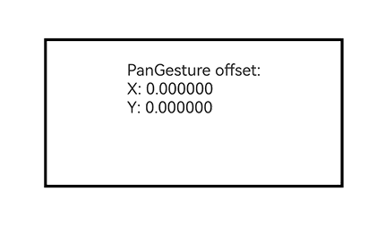

# PanGesture

<!--Del-->
> **Note:**
>
> Currently in the beta phase.
<!--DelEnd-->

A pan gesture event is triggered when the pan distance reaches the specified minimum value.

A pan gesture can be triggered in the following scenarios:

| Trigger Method | Input Source Type | Input Device Type |
|:---|:---|:---|
| A finger presses and pans. | [SourceTool](./cj-common-types.md#enum-sourcetool).Finger | [SourceType](./cj-common-types.md#enum-sourcetype).TouchScreen |
| The mouse pans after the left button is pressed. | [SourceTool](./cj-common-types.md#enum-sourcetool).Mouse | [SourceType](./cj-common-types.md#enum-sourcetype).Mouse |
| The mouse wheel scrolls. | [SourceTool](./cj-common-types.md#enum-sourcetool).Mouse | [SourceType](./cj-common-types.md#enum-sourcetype).Mouse |
| The trackpad pans after the left button is pressed. | [SourceTool](./cj-common-types.md#enum-sourcetool).Mouse | [SourceType](./cj-common-types.md#enum-sourcetype).Mouse |
| Two fingers pan on the trackpad. | [SourceTool](./cj-common-types.md#enum-sourcetool).Touchpad | [SourceType](./cj-common-types.md#enum-sourcetype).Mouse |

> **Note:**
>
> This capability is supported since API version 26.1.0.

## Import Module

```cangjie
import kit.ArkUI.*
```

## class PanGesture

```cangjie
public class PanGesture <: GestureType {
    public init(fingers!: ?Int32 = Option<Int32>.None, direction!: ?PanDirection = Option<PanDirection>.None, distance!: ?Float64 = Option<Float64>.None)
}
```

**Description:** Defines a pan gesture, which is triggered when the distance a finger pans on the screen reaches the specified minimum value. It inherits from [GestureType](./cj-common-types.md#class-gesturetype) and can be bound to a component through [gesture](./cj-universal-attribute-gesture.md) or [parallelGesture](./cj-universal-attribute-gesture.md#func-parallelgesturegesturetype).

> **Note:**
>
> In the elements of [GestureEvent](./cj-common-types.md#class-gestureevent)'s fingerList, the index of a finger corresponds to its position, that is, the ID of the finger in fingerList[index] is index. For a finger that is pressed first but does not participate in triggering the current gesture, its position in fingerList is left empty. You are advised to use fingerInfos first.

**System Capability:** SystemCapability.ArkUI.ArkUI.Full

**Since:** 26.1.0

**Parent Type:**

- [GestureType](./cj-common-types.md#class-gesturetype)

### init(?Int32, ?PanDirection, ?Float64)

```cangjie
public init(fingers!: ?Int32 = Option<Int32>.None, direction!: ?PanDirection = Option<PanDirection>.None, distance!: ?Float64 = Option<Float64>.None)
```

**Description:** Creates a pan gesture object.

**System Capability:** SystemCapability.ArkUI.ArkUI.Full

**Since:** 26.1.0

**Parameters:**

| Parameter | Type | Required | Default | Description |
|:---|:---|:---|:---|:---|
| fingers | ?Int32 | Yes | - | **Named parameter.** Minimum number of fingers to trigger a pan gesture.<br>Value range: [1, 10]<br>Default value: 1<br>**Note:**<br>If the value is less than 1, greater than 10, or not set, the default value is used. |
| direction | ?[PanDirection](./cj-common-types.md#enum-pandirection) | Yes | - | **Named parameter.** Pan direction. This enumeration value supports the AND (&amp;) and OR (\|) operations.<br>Default value: PanDirection.All |
| distance | ?Float64 | Yes | - | **Named parameter.** Minimum pan distance to trigger the gesture, in vp.<br>Value range: [0, +∞)<br>Default value: 5.0<br>**Note:**<br>If a pan gesture and the swiping of a [Tabs](./cj-navigation-switching-tabs.md) component occur at the same time, set distance to 1 to make the gesture more easily recognizable, avoiding unexpected response results of the pan gesture and Tabs component swiping.<br>If the value specified is less than 0, the default value is used.<br>When the [scale](./cj-universal-attribute-transform.md#func-scalefloat32-float32-float32-length-length) attribute is applied to the component, the actual pan distance is adjusted based on the scale ratio. |

### func onActionStart((GestureEvent) -> Unit)

```cangjie
public func onActionStart(callback: (GestureEvent) -> Unit): This
```

**Description:** Sets the callback for successful pan gesture recognition.

**System Capability:** SystemCapability.ArkUI.ArkUI.Full

**Since:** 26.1.0

**Parameters:**

| Parameter | Type | Required | Default | Description |
|:---|:---|:---|:---|:---|
| callback | ([GestureEvent](./cj-common-types.md#class-gestureevent)) -> Unit | Yes | - | Callback triggered when the pan gesture is successfully recognized. The callback parameter is a [GestureEvent](./cj-common-types.md#class-gestureevent) object, used to obtain the event information of the current pan gesture. |

**Return Value:**

| Type | Description |
|:---|:---|
| This | Returns the current gesture object itself, which can be used for chained calls. |

### func onActionUpdate((GestureEvent) -> Unit)

```cangjie
public func onActionUpdate(callback: (GestureEvent) -> Unit): This
```

**Description:** Sets the callback for pan gesture updates. If fingerList contains multiple fingers, this callback updates the location information of only one finger each time.

**System Capability:** SystemCapability.ArkUI.ArkUI.Full

**Since:** 26.1.0

**Parameters:**

| Parameter | Type | Required | Default | Description |
|:---|:---|:---|:---|:---|
| callback | ([GestureEvent](./cj-common-types.md#class-gestureevent)) -> Unit | Yes | - | Callback triggered when the pan gesture is updated. The callback parameter is a [GestureEvent](./cj-common-types.md#class-gestureevent) object, used to obtain the gesture event information during the pan. |

**Return Value:**

| Type | Description |
|:---|:---|
| This | Returns the current gesture object itself, which can be used for chained calls. |

### func onActionEnd((GestureEvent) -> Unit)

```cangjie
public func onActionEnd(callback: (GestureEvent) -> Unit): This
```

**Description:** Sets the callback for pan gesture completion. This callback is triggered when all fingers are lifted after successful pan gesture recognition.

**System Capability:** SystemCapability.ArkUI.ArkUI.Full

**Since:** 26.1.0

**Parameters:**

| Parameter | Type | Required | Default | Description |
|:---|:---|:---|:---|:---|
| callback | ([GestureEvent](./cj-common-types.md#class-gestureevent)) -> Unit | Yes | - | Callback triggered when the pan gesture ends. The callback parameter is a [GestureEvent](./cj-common-types.md#class-gestureevent) object, used to obtain the gesture event information when the pan ends. |

**Return Value:**

| Type | Description |
|:---|:---|
| This | Returns the current gesture object itself, which can be used for chained calls. |

### func onActionCancel(() -> Unit)

```cangjie
public func onActionCancel(callback: () -> Unit): This
```

**Description:** Sets the callback for pan gesture cancellation. This callback is triggered when a touch cancellation event occurs after successful pan gesture recognition. No gesture event information is returned.

**System Capability:** SystemCapability.ArkUI.ArkUI.Full

**Since:** 26.1.0

**Parameters:**

| Parameter | Type | Required | Default | Description |
|:---|:---|:---|:---|:---|
| callback | () -> Unit | Yes | - | Callback triggered when the pan gesture is canceled. |

**Return Value:**

| Type | Description |
|:---|:---|
| This | Returns the current gesture object itself, which can be used for chained calls. |

## Example Code

This example implements single-finger pan gesture recognition through PanGesture, and the component moves with the finger.

<!-- run -->

```cangjie
package ohos_app_cangjie_entry

import kit.ArkUI.*
import ohos.arkui.state_macro_manage.*

@Entry
@Component
class EntryView {
    @State
    var offsetX: Float64 = 0.0
    @State
    var offsetY: Float64 = 0.0
    var positionX: Float64 = 0.0
    var positionY: Float64 = 0.0

    func build() {
        Column {
            Column {
                Text('PanGesture offset:\nX: ' + this.offsetX.toString() + '\nY: ' + this.offsetY.toString())
            }
                .height(150)
                .width(300)
                .padding(20)
                .borderWidth(3)
                .margin(50)
                // Moves the component with its upper left corner as the coordinate origin
                .translate(x: this.offsetX, y: this.offsetY)
                // Binds a pan gesture, which is triggered only when panning horizontally
                .gesture(
                    PanGesture(direction: PanDirection.Horizontal)
                        .onActionStart({ _ =>
                            // The pan gesture is successfully recognized; record the current position of the component as the start position
                            this.positionX = this.offsetX
                            this.positionY = this.offsetY
                        })
                        .onActionUpdate({ event =>
                            // Updates the current position of the component based on the pan offset
                            this.offsetX = this.positionX + event.offsetX
                            this.offsetY = this.positionY + event.offsetY
                        })
                        .onActionEnd({ _ =>
                            // Saves the current position after the pan ends, as the start position of the next pan
                            this.positionX = this.offsetX
                            this.positionY = this.offsetY
                        })
                )
        }
            .height(100.percent)
            .width(100.percent)
    }
}
```


