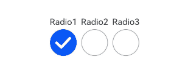
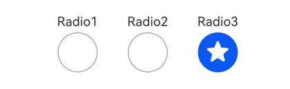

# Radio

<!--Del-->
> **Note:**
>
> Currently in the beta phase.
<!--DelEnd-->

Radio button, providing corresponding user interaction options.

## Import Module

```cangjie
import kit.ArkUI.*
```

## Child Components

None

## Creating Component

### init(?String, ?String)

```cangjie
public init(value!: ?String, group!: ?String)
```

**Function:** Creates a radio button component.

**System Capability:** SystemCapability.ArkUI.ArkUI.Full

**Since:** 22

**Parameters:**

| Parameter | Type | Required | Default | Description |
|:---|:---|:---|:---|:---|
| value | ?String | Yes | - | **Named parameter.** The value of the current radio button.<br>Initial value: "". |
| group | ?String | Yes | - | **Named parameter.** The group name to which the current radio button belongs. Only one radio button with the same group can be selected.<br>Initial value: "". |

### init(?String, ?String, RadioIndicatorType, ?() -> Unit)

```cangjie
public init(value!: ?String, group!: ?String, indicatorType!: RadioIndicatorType,
    indicatorBuilder!: ?() -> Unit = Option<() -> Unit>.None)
```

**Function:** Creates a radio button with the specified indicator type and an optional custom indicator builder.

**System Capability:** SystemCapability.ArkUI.ArkUI.Full

**Since:** 26.1.0

**Parameters:**

| Parameter | Type | Required | Default | Description |
|:---|:---|:---|:---|:---|
| value | ?String | Yes | - | **Named parameter.** The value of the current radio button.<br>Initial value: "". |
| group | ?String | Yes | - | **Named parameter.** The group name to which the current radio button belongs. Only one radio button with the same group can be selected.<br>Initial value: "". |
| indicatorType | [RadioIndicatorType](#enum-radioindicatortype) | Yes | - | **Named parameter.** Indicator type of the radio button that is checked. |
| indicatorBuilder | ?() -> Unit | No | None | **Named parameter.** Custom component to indicate that the radio button is checked. This custom component is center aligned with the radio button. If this parameter is set to **None**, **RadioIndicatorType.Tick** is used as the indicator type. |

## Universal Attributes/Events

Universal attributes: All supported.

Universal events: All supported.

## Component Attributes

### func checked(?Bool)

```cangjie
public func checked(value: ?Bool): This
```

**Function:** The selected state of the radio button.

**System Capability:** SystemCapability.ArkUI.ArkUI.Full

**Since:** 22

**Parameters:**

| Parameter | Type | Required | Default | Description |
|:---|:---|:---|:---|:---|
| value | ?Bool | Yes | - | Sets the selected state of the radio button.<br>Initial value: false.<br>**Note:** When value is true, it means changing from unselected to selected. When value is false, it means changing from selected to unselected. |

### func radioStyle(?ResourceColor, ?ResourceColor, ?ResourceColor)

```cangjie
public func radioStyle(
    checkedBackgroundColor!: ?ResourceColor = None,
    uncheckedBorderColor!: ?ResourceColor = None,
    indicatorColor!: ?ResourceColor = None
): This
```

**Function:** Sets the color styles of the radio button in the selected and deselected states.

**System Capability:** SystemCapability.ArkUI.ArkUI.Full

**Since:** 26.1.0

**Parameters:**

| Parameter | Type | Required | Default | Description |
|:---|:---|:---|:---|:---|
| checkedBackgroundColor | ?[ResourceColor](cj-common-types.md) | No | None | Base plate color in the checked state. |
| uncheckedBorderColor | ?[ResourceColor](cj-common-types.md) | No | None | Border color in the unchecked state. |
| indicatorColor | ?[ResourceColor](cj-common-types.md) | No | None | Color of the inner pie in the checked state. The color can be changed only when **indicatorType** is set to **RadioIndicatorType.Tick** or **RadioIndicatorType.Dot**. It cannot be changed when **indicatorType** is set to **RadioIndicatorType.Custom**. |

## Component Events

### func onChange(?(Bool) -> Unit)

```cangjie
public func onChange(callback: ?(Bool) -> Unit): This
```

**Function:** Triggered when the selected state of the radio button changes.

**System Capability:** SystemCapability.ArkUI.ArkUI.Full

**Since:** 22

**Parameters:**

| Parameter | Type | Required | Default | Description |
|:---|:---|:---|:---|:---|
| callback | ?(Bool)->Unit | Yes | - | The state of the radio button.<br>Initial value: { _ => }. |

## Basic Type Definitions

### enum RadioIndicatorType

```cangjie
public enum RadioIndicatorType <: Equatable<RadioIndicatorType> {
    | Tick
    | Dot
    | Custom
    | ...
}
```

**Function:** Enum of the indicator icon style of a radio button in the selected state.

**System Capability:** SystemCapability.ArkUI.ArkUI.Full

**Since Version:** 26.1.0

**Parent Type:**

- Equatable\<[RadioIndicatorType](#enum-radioindicatortype)>

#### Tick

```cangjie
Tick
```

**Function:** Checked style: default tick icon.

**System Capability:** SystemCapability.ArkUI.ArkUI.Full

**Since:** 26.1.0

#### Dot

```cangjie
Dot
```

**Function:** Checked style: default dot icon.

**System Capability:** SystemCapability.ArkUI.ArkUI.Full

**Since:** 26.1.0

#### Custom

```cangjie
Custom
```

**Function:** Checked style: the content in **indicatorBuilder**.

**System Capability:** SystemCapability.ArkUI.ArkUI.Full

**Since:** 26.1.0

#### operator func ==(RadioIndicatorType)

```cangjie
public operator func ==(other: RadioIndicatorType): Bool
```

**Function:** Checks whether two RadioIndicatorType enums are equal.

**System Capability:** SystemCapability.ArkUI.ArkUI.Full

**Since Version:** 26.1.0

**Parameters:**

| Parameter | Type | Required | Default Value | Description |
|:---|:---|:---|:---|:---|
| other | [RadioIndicatorType](#enum-radioindicatortype) | Yes | - | The other RadioIndicatorType enum to compare. |

**Return Value:**

| Type | Description |
|:---|:---|
| Bool | Returns true if the two enums are equal; returns false otherwise. |

#### operator func !=(RadioIndicatorType)

```cangjie
public operator func !=(other: RadioIndicatorType): Bool
```

**Function:** Checks whether two RadioIndicatorType enums are not equal.

**System Capability:** SystemCapability.ArkUI.ArkUI.Full

**Since Version:** 26.1.0

**Parameters:**

| Parameter | Type | Required | Default Value | Description |
|:---|:---|:---|:---|:---|
| other | [RadioIndicatorType](#enum-radioindicatortype) | Yes | - | The other RadioIndicatorType enum to compare. |

**Return Value:**

| Type | Description |
|:---|:---|
| Bool | Returns true if the two enums are not equal; returns false otherwise. |

## Example Code

### Example 1: Creating Radio Components

<!-- run -->

```cangjie

package ohos_app_cangjie_entry
import kit.ArkUI.*
import ohos.arkui.state_macro_manage.*

@Entry
@Component
class EntryView {
    @State var radioName: String = "Null"

    func build() {
        Flex(direction: FlexDirection.Row, justifyContent: FlexAlign.Center, alignItems: ItemAlign.Center) {
            Column() {
                Text("Radio1")
                Radio(group: "radioGroup", value: "Radio1").checked(true).height(50).width(50)
            }
            Column() {
                Text("Radio2")
                Radio(group: "radioGroup", value: "Radio2").checked(true).height(50).width(50)
            }
            Column() {
                Text("Radio3")
                Radio(group: "radioGroup", value: "Radio3").checked(true).height(50).width(50)
            }
        }
    }
}
```



### Example 2 (Setting the Selected Style)

This example customizes the selected style by configuring **indicatorType** and **indicatorBuilder**.

<!-- run -->

```cangjie
package ohos_app_cangjie_entry

import kit.ArkUI.*
import ohos.arkui.state_macro_manage.*

@Entry
@Component
class EntryView {
    @Builder
    func IndicatorBuilder() {
        Text("★").fontSize(30).fontColor(Color.White)
    }

    func build() {
        Flex(direction: FlexDirection.Row, justifyContent: FlexAlign.Center, alignItems: ItemAlign.Center) {
            Column() {
                Text("Radio1")
                Radio(value: "Radio1", group: "radioGroup", indicatorType: RadioIndicatorType.Tick)
                    .checked(true)
                    .height(50)
                    .width(80)
                    .onChange({ isChecked: Bool =>
                        Hilog.info(0, "CangjieTest", "Radio1 status is ${isChecked}")
                    })
            }
            Column() {
                Text("Radio2")
                Radio(value: "Radio2", group: "radioGroup", indicatorType: RadioIndicatorType.Dot)
                    .checked(false)
                    .height(50)
                    .width(80)
                    .onChange({ isChecked: Bool =>
                        Hilog.info(0, "CangjieTest", "Radio2 status is ${isChecked}")
                    })
            }
            Column() {
                Text("Radio3")
                Radio(value: "Radio3", group: "radioGroup", indicatorType: RadioIndicatorType.Custom,
                    indicatorBuilder: bind(this.IndicatorBuilder, this))
                    .checked(false)
                    .height(50)
                    .width(80)
                    .onChange({ isChecked: Bool =>
                        Hilog.info(0, "CangjieTest", "Radio3 status is ${isChecked}")
                    })
            }
        }.padding(top: 30)
    }
}
```


