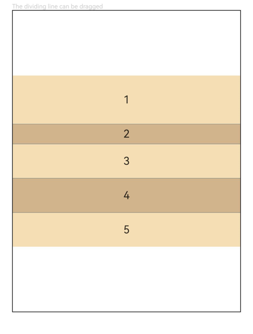

# ColumnSplit

<!--Del-->
> **NOTE**
>
> This component is in Beta phase.
<!--DelEnd-->

A layout container that divides child components vertically. Child components are arranged vertically in sequence, with a horizontal divider inserted between every two child components.

## Import Module

```cangjie
import kit.ArkUI.*
```

## Child Components

Child components are supported.

ColumnSplit limits the height of its child components through dividers, and the divider positions are calculated based on the heights of the child components.

## Creating the Component

### init(() -> Unit)

```cangjie
public init(content: () -> Unit)
```

**Function:** Creates a vertical split layout container.

**System Capability:** SystemCapability.ArkUI.ArkUI.Full

**Since:** 26.1.0

**Parameters:**

| Parameter | Type | Required | Default | Description |
|:---|:---|:---|:---|:---|
| content | () -> Unit | Yes | - | Declares the child components of the container. |

## Universal Attributes/Events

Supports [universal attributes](./cj-universal-attributes.md) and [universal events](./cj-universal-events.md).

## Component Attributes

### func resizeable(?Bool)

```cangjie
public func resizeable(value: ?Bool): This
```

**Function:** Sets whether the divider can be dragged. When set to **true**, the user can drag the divider to adjust the height of adjacent child components. When set to **false**, the divider cannot be dragged and the child component height is fixed.

> **NOTE**
>
> - After initialization, when dynamic modification of the margin, border, or padding universal attributes causes a child component size to exceed the spacing between adjacent dividers, dragging the divider to change the child component height is not supported.

**System Capability:** SystemCapability.ArkUI.ArkUI.Full

**Since:** 26.1.0

**Parameters:**

| Parameter | Type | Required | Default | Description |
|:---|:---|:---|:---|:---|
| value | ?Bool | Yes | - | Whether the divider can be dragged.<br>Initial value: false. |

## Example Code

### Example 1: Setting the Resizable ColumnSplit Component

This example shows how to set the resizable **ColumnSplit** component and its effect.

<!-- run -->

```cangjie
package ohos_app_cangjie_entry

import kit.ArkUI.*
import ohos.arkui.state_macro_manage.*

@Entry
@Component
class EntryView {
    func build() {
        Column() {
            Text("The dividing line can be dragged").fontSize(9).fontColor(0xCCCCCC).width(90.percent)
            ColumnSplit() {
                Text("1").width(100.percent).height(50).backgroundColor(0xF5DEB3).textAlign(TextAlign.Center)
                Text("2").width(100.percent).height(50).backgroundColor(0xD2B48C).textAlign(TextAlign.Center)
                Text("3").width(100.percent).height(50).backgroundColor(0xF5DEB3).textAlign(TextAlign.Center)
                Text("4").width(100.percent).height(50).backgroundColor(0xD2B48C).textAlign(TextAlign.Center)
                Text("5").width(100.percent).height(50).backgroundColor(0xF5DEB3).textAlign(TextAlign.Center)
            }
            .borderWidth(1)
            .resizeable(true) // Set the divider to be draggable
            .width(90.percent).height(60.percent)
        }.width(100.percent)
    }
}
```


