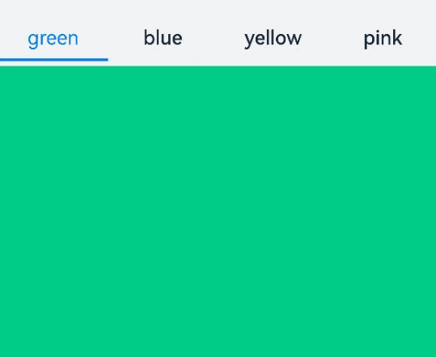
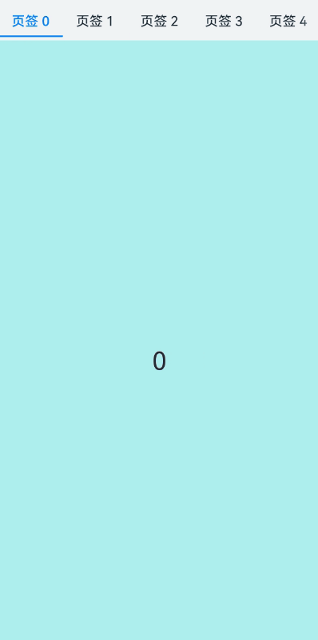
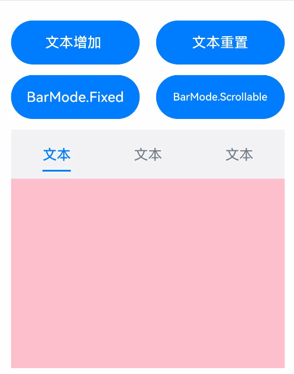
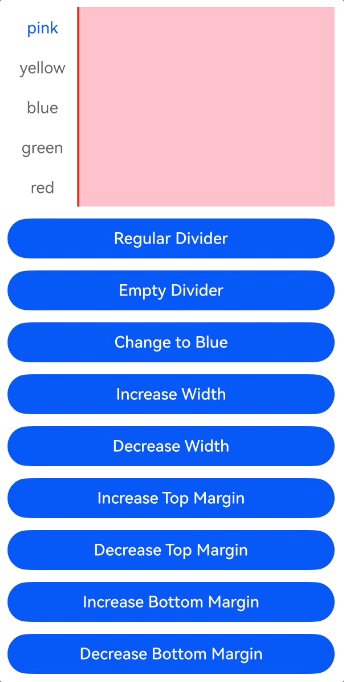
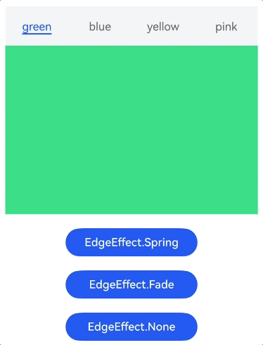
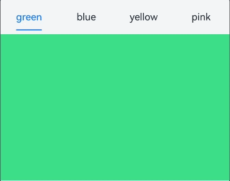
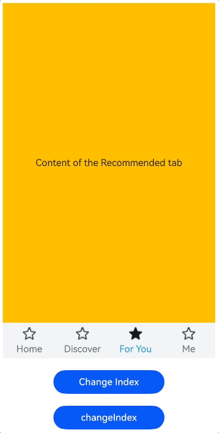

# Tabs

<!--Del-->
> **Note:**
>
> Currently in the beta phase.
<!--DelEnd-->

A container component for switching content views through tabs, where each tab corresponds to a content view.

## Import Module

```cangjie
import kit.ArkUI.*
```

## Child Components

Custom components are not supported as child components. Only [TabContent](./cj-navigation-switching-tabcontent.md) child components are allowed, along with rendering control types [if/else](../../arkui-cj/rendering_control/cj-rendering-control-ifelse.md) and [ForEach](cj-state-rendering-foreach.md). Note that if/else and ForEach can only contain TabContent and not custom components.

> **Note:**
>
> - When the visibility property of a Tabs child component is set to None or Hidden, the corresponding child component will not be displayed but will still occupy space within the viewport.
> - When the Tabs [height](./cj-universal-attribute-size.md#func-heightoptionlength) is set to [LengthMetrics.AUTO](./cj-common-types.md#static-let-auto), it can adapt its height based on the child component's height. When the [width](./cj-universal-attribute-size.md#func-widthoptionlength) is set to [LengthMetrics.AUTO](./cj-common-types.md#static-let-auto), it can adapt its width based on the child component's width

## Creating the Component

### init(?BarPosition, ?TabsController, ?Int32, () -> Unit)

```cangjie
public init(
    barPosition!: ?BarPosition = None,
    controller!: ?TabsController = None,
    index!: ?Int32 = None,
    child!: () -> Unit = {=>}
)
```

**Function:** Creates a Tabs container.

**System Capability:** SystemCapability.ArkUI.ArkUI.Full

**Since:** 22

**Parameters:**

| Parameter | Type | Required | Default | Description |
|:---|:---|:---|:---|:---|
| barPosition | ?[BarPosition](./cj-common-types.md#enum-barposition) | No | None | **Named parameter.** Sets the position of the Tabs bar.<br> Initial value: BarPosition.Start |
| controller | ?[TabsController](#class-tabscontroller) | No | None | **Named parameter.** Sets the Tabs controller.<br> Initial value: TabsController() |
| index | ?Int32 | No | None | **Named parameter.** Sets the index of the currently displayed tab.<br> Initial value: 0 <br> **Note:**<br> Values less than 0 will default to the initial value. Valid range: [0, number of TabContent child nodes - 1]. Directly modifying the index to switch tabs will not trigger the transition animation. Using TabController's changeIndex will enable the transition animation by default, which can be disabled by setting animationDuration to 0. |
| child | () -> Unit | No | {=>} | **Named parameter.** Declares the child components within the container. |

## Common Attributes/Events

Common Attributes: All supported.

Common Events: All supported.

## Component Attributes

### func animationDuration(?Float32)

```cangjie
public func animationDuration(value: ?Float32): This
```

**Function:** Sets the animation duration for Tabs.

**System Capability:** SystemCapability.ArkUI.ArkUI.Full

**Since:** 22

**Parameters:**

| Parameter | Type | Required | Default | Description |
|:---|:---|:---|:---|:---|
| value | ?Float32 | Yes | - | Animation duration in milliseconds. Initial value: -1.0. |

### func barHeight(?Length)

```cangjie
public func barHeight(value: ?Length): This
```

**Function:** Sets the height of the Tabs bar.

**System Capability:** SystemCapability.ArkUI.ArkUI.Full

**Since:** 22

**Parameters:**

| Parameter | Type | Required | Default | Description |
|:---|:---|:---|:---|:---|
| value | ?[Length](./cj-common-types.md#interface-length) | Yes | - | Height of the Tabs bar. When the bar is horizontal, this parameter represents its height; when vertical, it represents its width. |

### func barMode(?BarMode)

```cangjie
public func barMode(value: ?BarMode): This
```

**Function:** Sets the layout mode of the Tabs bar.

**System Capability:** SystemCapability.ArkUI.ArkUI.Full

**Since:** 22

**Parameters:**

| Parameter | Type | Required | Default | Description |
|:---|:---|:---|:---|:---|
| value | ?[BarMode](./cj-common-types.md#enum-barmode) | Yes | - | Layout mode of the Tabs bar. Initial value: BarMode.Fixed. |

### func barWidth(?Length)

```cangjie
public func barWidth(value: ?Length): This
```

**Function:** Sets the width of the Tabs bar.

**System Capability:** SystemCapability.ArkUI.ArkUI.Full

**Since:** 22

**Parameters:**

| Parameter | Type | Required | Default | Description |
|:---|:---|:---|:---|:---|
| value | ?[Length](./cj-common-types.md#interface-length) | Yes | - | Width of the Tabs bar. When the bar is horizontal, this parameter represents its width; when vertical, it represents its height. |

### func scrollable(?Bool)

```cangjie
public func scrollable(value: ?Bool): This
```

**Function:** Sets whether the Tabs are scrollable.

**System Capability:** SystemCapability.ArkUI.ArkUI.Full

**Since:** 22

**Parameters:**

| Parameter | Type | Required | Default | Description |
|:---|:---|:---|:---|:---|
| value | ?Bool | Yes | - | Whether scrolling is enabled. Initial value: true. |

### func vertical(?Bool)

```cangjie
public func vertical(value: ?Bool): This
```

**Function:** Sets the orientation of the Tabs bar.

**System Capability:** SystemCapability.ArkUI.ArkUI.Full

**Since:** 22

**Parameters:**

| Parameter | Type | Required | Default | Description |
|:---|:---|:---|:---|:---|
| value | ?Bool | Yes | - | Whether the Tabs bar is vertically oriented. Initial value: false. <br> When horizontal Tabs has height set to LengthMetrics.AUTO, the Tabs component height adapts to the child component height, which equals tabBar height + divider line width + TabContent height + top and bottom padding values + top and bottom border width. <br> When vertical Tabs has width set to LengthMetrics.AUTO, the Tabs component width adapts to the child component width, which equals tabBar width + divider line width + TabContent width + left and right padding values + left and right border width. |

### func divider(?Length, ?ResourceColor, ?Length, ?Length)

```cangjie
public func divider(strokeWidth!: ?Length, color!: ?ResourceColor = None, startMargin!: ?Length = None, endMargin!: ?Length = None): This
```

**Function:** Sets the style of the divider between the TabBar and TabContent. If visual separation is required between the TabBar and TabContent, you can add a divider through this API.

**System Capability:** SystemCapability.ArkUI.ArkUI.Full

**Since:** 26.1.0

**Parameters:**

| Parameter | Type | Required | Default | Description |
|:---|:---|:---|:---|:---|
| strokeWidth | ?[Length](./cj-common-types.md#interface-length) | Yes | - | **Named parameter.** Width of the divider.<br>Percentage values are not supported. Initial value: 0.0vp. Value range: [0, +∞). When the value is less than 0, the initial value is used. |
| color | ?[ResourceColor](./cj-common-types.md#interface-resourcecolor) | No | None | **Named parameter.** Color of the divider.<br>Initial value: #33182431. |
| startMargin | ?[Length](./cj-common-types.md#interface-length) | No | None | **Named parameter.** Distance between the divider and the top edge of the sidebar.<br>Percentage values are not supported. Initial value: 0.0vp. Value range: [0, +∞). When the value is less than 0, the initial value is used. |
| endMargin | ?[Length](./cj-common-types.md#interface-length) | No | None | **Named parameter.** Distance between the divider and the bottom edge of the sidebar.<br>Percentage values are not supported. Initial value: 0.0vp. Value range: [0, +∞). When the value is less than 0, the initial value is used. |

### func edgeEffect(?EdgeEffect)

```cangjie
public func edgeEffect(edgeEffect: ?EdgeEffect): This
```

**Function:** Sets the edge sliding effect. When sliding to the edge, the corresponding rebound action is executed based on the set edge effect type: the Spring mode uses a spring curve to implement the elastic rebound effect, the Fade mode uses gradient transparency to implement visual feedback, and the None mode does not execute any edge effect. The edge effect is triggered when the sliding content exceeds the container boundary.

**System Capability:** SystemCapability.ArkUI.ArkUI.Full

**Since:** 26.1.0

**Parameters:**

| Parameter | Type | Required | Default | Description |
|:---|:---|:---|:---|:---|
| edgeEffect | ?[EdgeEffect](./cj-common-types.md#enum-edgeeffect) | Yes | - | Edge sliding effect.<br>Initial value: EdgeEffect.Spring. |

## Component Events

### func onChange(?Callback\<Int32, Unit>)

```cangjie
public func onChange(event: ?Callback<Int32, Unit>): This
```

**Function:** Triggered when switching tabs.

**System Capability:** SystemCapability.ArkUI.ArkUI.Full

**Since:** 22

**Parameters:**

| Parameter | Type | Required | Default | Description |
|:---|:---|:---|:---|:---|
| event | ?[Callback](./cj-common-types.md#type-callbackt-v)\<Int32, Unit> | Yes | - | Callback function triggered when the tab index changes. Initial value: { _ => }. |

### func onAnimationStart(?(Int32, Int32, TabsAnimationEvent) -> Unit)

```cangjie
public func onAnimationStart(handler: ?(Int32, Int32, TabsAnimationEvent) -> Unit): This
```

**Function:** Triggered when the switching animation starts. When [animationDuration](#func-animationdurationfloat32) is 0 (animation disabled) and [scrollable](#func-scrollablebool) is false, this callback is not triggered.

**System Capability:** SystemCapability.ArkUI.ArkUI.Full

**Since:** 26.1.0

**Parameters:**

| Parameter | Type | Required | Default | Description |
|:---|:---|:---|:---|:---|
| handler | ?(Int32, Int32, [TabsAnimationEvent](#class-tabsanimationevent)) -> Unit | Yes | - | Callback triggered when the switching animation starts.<br>Parameter 1: index of the currently displayed element, starting from 0.<br>Parameter 2: index of the target element of the switching animation, starting from 0.<br>Parameter 3: animation-related information, including the offset of the currently displayed element and the target element relative to the start position of Tabs along the main axis, and the release velocity. |

### func onContentWillChange(?(Int32, Int32) -> Bool)

```cangjie
public func onContentWillChange(handler: ?(Int32, Int32) -> Bool): This
```

**Function:** Custom Tabs page switching interception capability. This callback is triggered when a new page is about to be displayed.

This event is triggered when any of the following conditions is met:

1. Swiping TabContent to switch to a new page.

2. Switching to a new page through the [TabsController.changeIndex](#func-changeindexint32) API.

3. Switching to a new page by dynamically modifying the index attribute value.

4. Switching to a new page by clicking a TabBar tab.

5. After a TabBar tab gains focus, switching to a new page through keyboard left/right arrow keys.

**System Capability:** SystemCapability.ArkUI.ArkUI.Full

**Since:** 26.1.0

**Parameters:**

| Parameter | Type | Required | Default | Description |
|:---|:---|:---|:---|:---|
| handler | ?(Int32, Int32) -> Bool | Yes | - | Custom Tabs page switching interception capability. Callback triggered when a new page is about to be displayed.<br>Parameter 1: index of the currently displayed page, starting from 0.<br>Parameter 2: index of the new page to be displayed, starting from 0.<br>Return value: when the return value of the callback function handler is true, Tabs can switch to the new page; when the return value is false, Tabs cannot switch to the new page and still displays the original page content. |

### func onGestureSwipe(?(Int32, TabsAnimationEvent) -> Unit)

```cangjie
public func onGestureSwipe(handler: ?(Int32, TabsAnimationEvent) -> Unit): This
```

**Function:** Triggered frame by frame during page swipe-following, used to listen to the real-time sliding state of the currently displayed page.

**System Capability:** SystemCapability.ArkUI.ArkUI.Full

**Since:** 26.1.0

**Parameters:**

| Parameter | Type | Required | Default | Description |
|:---|:---|:---|:---|:---|
| handler | ?(Int32, [TabsAnimationEvent](#class-tabsanimationevent)) -> Unit | Yes | - | Callback triggered frame by frame during page swipe-following.<br>Parameter 1: index of the currently displayed element, starting from 0. Value range: [0, total number of tabs - 1].<br>Parameter 2: animation-related information, only returns the offset of the currently displayed element relative to the start position of Tabs along the main axis. |

### func onTabBarClick(?(Int32) -> Unit)

```cangjie
public func onTabBarClick(event: ?(Int32) -> Unit): This
```

**Function:** Event triggered after a Tab tab is clicked.

**System Capability:** SystemCapability.ArkUI.ArkUI.Full

**Since:** 26.1.0

**Parameters:**

| Parameter | Type | Required | Default | Description |
|:---|:---|:---|:---|:---|
| event | ?(Int32) -> Unit | Yes | - | Index value of the clicked tab, starting from 0. |

## Basic Type Definitions

### class TabsController

```cangjie
public class TabsController {
    public init()
}
```

**Function:** Tabs controller.

**System Capability:** SystemCapability.ArkUI.ArkUI.Full

**Since:** 22

#### init()

```cangjie
public init()
```

**Function:** Constructs a Tabs controller.

**System Capability:** SystemCapability.ArkUI.ArkUI.Full

**Since:** 22

#### func changeIndex(?Int32)

```cangjie
public func changeIndex(value: ?Int32): Unit
```

**Function:** Switches to the tab at the specified index.

**System Capability:** SystemCapability.ArkUI.ArkUI.Full

**Since:** 22

**Parameters:**

| Parameter | Type | Required | Default | Description |
|:---|:---|:---|:---|:---|
| value | ?Int32 | Yes | - | Index of the tab to switch to. Initial value: 0. |

### class TabsAnimationEvent

```cangjie
public class TabsAnimationEvent {
    public var currentOffset: Float32
    public var targetOffset: Float32
    public var velocity: Float32
}
```

**Function:** Collection of animation-related information for the Tabs component.

**System Capability:** SystemCapability.ArkUI.ArkUI.Full

**Since:** 26.1.0

#### var currentOffset

```cangjie
public var currentOffset: Float32
```

**Function:** Offset of the currently displayed element of Tabs relative to the start position of Tabs along the main axis. Unit: vp, initial value: 0. A positive value indicates offset to the right (horizontal) or downward (vertical), and a negative value indicates offset to the left (horizontal) or upward (vertical).

**System Capability:** SystemCapability.ArkUI.ArkUI.Full

**Since:** 26.1.0

#### var targetOffset

```cangjie
public var targetOffset: Float32
```

**Function:** Offset of the animation target element of Tabs relative to the start position of Tabs along the main axis. Unit: vp, initial value: 0. A positive value indicates offset to the right (horizontal) or downward (vertical), and a negative value indicates offset to the left (horizontal) or upward (vertical).

**System Capability:** SystemCapability.ArkUI.ArkUI.Full

**Since:** 26.1.0

#### var velocity

```cangjie
public var velocity: Float32
```

**Function:** Release velocity of Tabs when the release animation starts. Unit: vp/s, initial value: 0. A positive value indicates sliding to the right (horizontal) or downward (vertical), and a negative value indicates sliding to the left (horizontal) or upward (vertical). A larger velocity value indicates faster sliding. This parameter can be used to implement inertial scrolling effects.

**System Capability:** SystemCapability.ArkUI.ArkUI.Full

**Since:** 26.1.0

## Example Code

### Example 1 (Custom Tab Switching Synchronization)

This example demonstrates custom synchronization between tabBar and TabContent during switching using onChange.

<!-- run -->

```cangjie
package ohos_app_cangjie_entry

import kit.ArkUI.*
import std.collection.*
import ohos.arkui.state_macro_manage.*

@Entry
@Component
class EntryView {
    @State var fontColor: UInt32 = 0x182431
    @State var selectedFontColor: UInt32 = 0x007DFF
    @State var currentIndex: Int32 = 0
    @State var selectedIndex: Int32 = 0
    var controller: TabsController = TabsController()

    func getFontColor(index: Int32): UInt32 {
        if (this.selectedIndex == index) {
            return this.selectedFontColor
        }
        return this.fontColor
    }

    func getFontWeight(index: Int32): FontWeight {
        if (this.selectedIndex == index) {
            return FontWeight.W400
        }
        return FontWeight.W500
    }

    func getOpacity(index: Int32): Float64 {
        if (this.selectedIndex == index) {
            return Float64(1)
        }
        return Float64(0)
    }

    @Builder
    func tabBuilder(index: Int32, name: String) {
        Column() {
            Text(name)
            .fontColor(this.getFontColor(index))
            .fontSize(16)
            .fontWeight(this.getFontWeight(index))
            .lineHeight(22)
            .margin(top: 17, bottom: 7)
            Divider()
            .strokeWidth(2)
            .color(0x007DFF)
            .opacity(this.getOpacity(index))
        }.width(100.percent)
    }

    func build() {
        Column() {
            Tabs(barPosition: BarPosition.Start, controller: this.controller, index: this.currentIndex) {
                TabContent() {
                    Column().width(100.percent).height(100.percent).backgroundColor(0x00CB87)
                }.tabBar({=>bind(this.tabBuilder, this)(0, "green")})

                TabContent() {
                    Column().width(100.percent).height(100.percent).backgroundColor(0x007DFF)
                }.tabBar({=>bind(this.tabBuilder, this)(1,"blue")})

                TabContent() {
                    Column().width(100.percent).height(100.percent).backgroundColor(0xFFBF00)
                }.tabBar({=>bind(this.tabBuilder, this)(2,"yellow")})

                TabContent() {
                    Column().width(100.percent).height(100.percent).backgroundColor(0xE67C92)
                }.tabBar({=>bind(this.tabBuilder, this)(3, "pink")})
              }
            .vertical(false)
            .barMode(BarMode.Fixed)
            .barWidth(360)
            .barHeight(56)
            .animationDuration(400.0)
            .onChange({index: Int32 =>
                // currentIndex controls the displayed tab in TabContent
                this.currentIndex = index
                // selectedIndex controls the color toggle of Image and Text within the custom TabBar.
                this.selectedIndex = index
            })
            .width(360)
            .height(296)
            .margin(top: 52)
            .backgroundColor(0xF1F3F5)

        }.width(100.percent)
    }
}
```



### Example 2 (Lazy Loading and Release of Pages)

This example demonstrates lazy loading and release of pages using custom TabBar with Swiper and LazyForEach.

<!-- run -->

```cangjie
package ohos_app_cangjie_entry

import kit.ArkUI.*
import kit.PerformanceAnalysisKit.*
import std.collection.*
import ohos.arkui.state_macro_manage.*

class MyDataSource <: IDataSource<String> {
  public MyDataSource(let list: ArrayList<String> ) {}

  public func totalCount(): Int64 {
    return this.list.size
  }

  public func getData(index: Int64): String {
    return this.list[index]
  }

  public func registerDataChangeListener(listener: DataChangeListener): Unit {
  }

  public func unregisterDataChangeListener(listener: DataChangeListener): Unit {
  }
}

@Entry
@Component
class EntryView {
    @State var fontColor: Color = Color(0x182431)
    @State var selectedFontColor: Color = Color(0x007DFF)
    @State var currentIndex: Int32 = 0
    var list: ArrayList<String> = ArrayList<String>()
    var tabsController: TabsController = TabsController()
    var swiperController: SwiperController = SwiperController()
    var swiperData: MyDataSource = MyDataSource(ArrayList<String>())

    protected override func aboutToAppear() {
        for (i in 0..9) {
          this.list.add("${i}");
        }
        this.swiperData = MyDataSource(this.list)
    }

    @Builder
    func tabBuilder(index: Int32, name: String) {
        Column() {
            Text(name)
            .fontColor(if(this.currentIndex == index) {this.selectedFontColor} else {this.fontColor})
            .fontSize(16)
            .fontWeight(if(this.currentIndex == index) {FontWeight.W500} else {FontWeight.W400})
            .lineHeight(22)
            .margin(top: 17, bottom: 7)

            Divider()
            .strokeWidth(2)
            .color(0x007DFF)
            .opacity(if(this.currentIndex == index) {1.0} else {0.0})
        }.width(20.percent)
    }

    func build() {
        Column() {
            Tabs(barPosition: BarPosition.Start, controller: this.tabsController) {
                ForEach(this.list, itemGeneratorFunc:{item: String, index: Int64 =>
                    TabContent(){}.tabBar({=>bind(this.tabBuilder, this)(Int32(index), 'Tab ${this.list[index]}')})
                })
            }
            .barMode(BarMode.Scrollable)
            .backgroundColor(0xF1F3F5)
            .height(56)
            .width(100.percent)

            Swiper(controller: this.swiperController) {
                LazyForEach(this.swiperData, itemGeneratorFunc: {item: String, idx: Int64 =>
                    Text(item)
                    .onAppear({=>
                      Hilog.info(0, "AppLogCj", 'onAppear ' + item)
                    })
                    .onDisAppear({=>
                      Hilog.info(0, "AppLogCj", 'onDisAppear ' + item)
                    })
                    .width(100.percent)
                    .height(100.percent)
                    .backgroundColor(0xAFEEEE)
                    .textAlign(TextAlign.Center)
                    .fontSize(30)
                })
            }
            .loop(false)
            .onChange({index: Int32 =>
                this.currentIndex = index
                this.tabsController.changeIndex(index)
            })
        }
    }
}
```



### Example 3 (Setting TabBar Layout Mode)

This example demonstrates two layout modes for tabs using `barMode`: evenly distributed layout and actual length layout. It also shows the scrollable effect when the total length of tab layouts exceeds the TabBar's total length.

<!-- run -->

```cangjie
package ohos_app_cangjie_entry

import kit.ArkUI.*
import std.collection.*
import ohos.arkui.state_macro_manage.*

@Entry
@Component
class EntryView{
    @State var text: String = "Text"
    @State var barMode: BarMode = BarMode.Fixed

    func build(){
        Column(){
            Row(){
                Button("Add Text")
                .width(47.percent)
                .height(50)
                .onClick({event => this.text += "Text"})
                .margin(right: 6.percent, bottom: 12)

                Button("Reset Text")
                .width(47.percent)
                .height(50)
                .onClick({event => this.text = "Text"})
                .margin(bottom: 12)
            }

            Row(){
                Button("BarMode.Fixed")
                .width(47.percent)
                .height(50)
                .onClick({event => this.barMode = BarMode.Fixed})
                .margin(right: 6.percent, bottom: 12)

                Button("BarMode.Scrollable")
                .width(47.percent)
                .height(50)
                .onClick({event => this.barMode = BarMode.Scrollable})
                .margin(bottom: 12)
            }
            Tabs(){
                TabContent(){
                    Column().width(100.percent).height(100.percent).backgroundColor(0xFEC0CD)
                }.tabBar(this.text)

                TabContent(){
                    Column().width(100.percent).height(100.percent).backgroundColor(Color.Green)
                }.tabBar(this.text)

                TabContent(){
                    Column().width(100.percent).height(100.percent).backgroundColor(Color.Blue)
                }.tabBar(this.text)
            }
            .height(60.percent)
            .backgroundColor(0xf1f3f5)
            .barMode(this.barMode)
        }
        .width(100.percent)
        .height(500)
        .padding(24)
    }
}
```



### Example 4 (Basic Divider Attributes)

This example demonstrates the display of various divider attributes through [divider](#func-dividerlength-resourcecolor-length-length).

<!-- run -->

```cangjie
package ohos_app_cangjie_entry

import kit.ArkUI.*
import ohos.arkui.state_macro_manage.*
import kit.PerformanceAnalysisKit.Hilog

@Entry
@Component
class EntryView {
    var controller: TabsController = TabsController()
    @State
    var dividerColor: ResourceColor = Color.Red
    @State
    var strokeWidth: Float64 = 2.0
    @State
    var startMargin: Float64 = 0.0
    @State
    var endMargin: Float64 = 0.0
    @State
    var nullFlag: Bool = false

    func build() {
        Column() {
            Tabs(controller: this.controller) {
                TabContent() {
                    Column()
                        .width(100.percent)
                        .height(100.percent)
                        .backgroundColor(0xFFFFC0CB)
                }.tabBar("pink")

                TabContent() {
                    Column()
                        .width(100.percent)
                        .height(100.percent)
                        .backgroundColor(0xFFFFFF00)
                }.tabBar("yellow")

                TabContent() {
                    Column()
                        .width(100.percent)
                        .height(100.percent)
                        .backgroundColor(0xFF0000FF)
                }.tabBar("blue")

                TabContent() {
                    Column()
                        .width(100.percent)
                        .height(100.percent)
                        .backgroundColor(0xFF008000)
                }.tabBar("green")

                TabContent() {
                    Column()
                        .width(100.percent)
                        .height(100.percent)
                        .backgroundColor(0xFFFF0000)
                }.tabBar("red")
            }
                .vertical(true)
                .scrollable(true)
                .barMode(BarMode.Fixed)
                .barWidth(70)
                .barHeight(200)
                .animationDuration(400.0)
                .onChange(
                    {
                        index: Int32 =>
                            Hilog.info(1, "Cangjie", "${index}.")
                    }
                )
                .height(200.vp)
                .margin(bottom: 12.vp)
                .divider(
                    strokeWidth: if(this.nullFlag) { Option.None } else { this.strokeWidth },
                    color: if(this.nullFlag) { Option.None } else { this.dividerColor },
                    startMargin: if(this.nullFlag) { Option.None } else { this.startMargin },
                    endMargin: if(this.nullFlag) { Option.None } else { this.endMargin }
                )

            Button("Regular Divider")
                .width(100.percent)
                .margin(bottom: 12.vp)
                .onClick(
                    {
                        event =>
                            this.nullFlag = false
                            this.strokeWidth = 2.0
                            this.dividerColor = 0xFFFF0000
                            this.startMargin = 0.0
                            this.endMargin = 0.0
                    }
                )
            Button("Empty Divider")
                .width(100.percent)
                .margin(bottom: 12.vp)
                .onClick(
                    {
                        event =>
                            this.nullFlag = true
                    }
                )
            Button("Change to Blue")
                .width(100.percent)
                .margin(bottom: 12.vp)
                .onClick(
                    {
                        event =>
                            this.dividerColor = 0xFF0000FF
                    }
                )
            Button("Increase Width")
                .width(100.percent)
                .margin(bottom: 12.vp)
                .onClick(
                    {
                        event =>
                            this.strokeWidth += 2.0
                    }
                )
            Button("Decrease Width")
                .width(100.percent)
                .margin(bottom: 12.vp)
                .onClick(
                    {
                        event =>
                            if (this.strokeWidth > 2.0) {
                                this.strokeWidth -= 2.0
                            }
                    }
                )
            Button("Increase Top Margin")
                .width(100.percent)
                .margin(bottom: 12.vp)
                .onClick(
                    {
                        event =>
                            this.startMargin += 2.0
                    }
                )
            Button("Decrease Top Margin")
                .width(100.percent)
                .margin(bottom: 12.vp)
                .onClick(
                    {
                        event =>
                            if (this.startMargin > 2.0) {
                                this.startMargin -= 2.0
                            }
                    }
                )
            Button("Increase Bottom Margin")
                .width(100.percent)
                .margin(bottom: 12.vp)
                .onClick(
                    {
                        event =>
                            this.endMargin += 2.0
                    }
                )
            Button("Decrease Bottom Margin")
                .width(100.percent)
                .margin(bottom: 12.vp)
                .onClick(
                    {
                        event =>
                            if (this.endMargin > 2.0) {
                                this.endMargin -= 2.0
                            }
                    }
                )
        }
            .padding(top: 24.vp, left: 24.vp, right: 24.vp)
    }
}
```



### Example 5 (Setting Edge Sliding Effect)

This example implements different edge rebound effects through [edgeEffect](#func-edgeeffectedgeeffect).

<!-- run -->

```cangjie
package ohos_app_cangjie_entry

import kit.ArkUI.*
import ohos.arkui.state_macro_manage.*

@Entry
@Component
class EntryView {
    @State
    var edgeEffect: EdgeEffect = EdgeEffect.Spring

    func build() {
        Column() {
            Tabs() {
                TabContent() {
                    Column()
                        .width(100.percent)
                        .height(100.percent)
                        .backgroundColor(0x00CB87)
                }.tabBar("green")

                TabContent() {
                    Column()
                        .width(100.percent)
                        .height(100.percent)
                        .backgroundColor(0x007DFF)
                }.tabBar("blue")

                TabContent() {
                    Column()
                        .width(100.percent)
                        .height(100.percent)
                        .backgroundColor(0xFFBF00)
                }.tabBar("yellow")

                TabContent() {
                    Column()
                        .width(100.percent)
                        .height(100.percent)
                        .backgroundColor(0xE67C92)
                }.tabBar("pink")
            }
                .width(360)
                .height(296)
                .margin(top: 52)
                .backgroundColor(0xF1F3F5)
                .edgeEffect(this.edgeEffect) // Set the edge sliding effect.

            Button("EdgeEffect.Spring")
                .width(50.percent)
                .margin(top: 20)
                .onClick(
                    {
                        event =>
                            this.edgeEffect = EdgeEffect.Spring
                    }
                )

            Button("EdgeEffect.Fade")
                .width(50.percent)
                .margin(top: 20)
                .onClick(
                    {
                        event =>
                            this.edgeEffect = EdgeEffect.Fade
                    }
                )

            Button("EdgeEffect.None")
                .width(50.percent)
                .margin(top: 20)
                .onClick(
                    {
                        event =>
                            this.edgeEffect = EdgeEffect.None
                    }
                )
        }
            .width(100.percent)
    }
}
```



### Example 6 (Custom TabBar Switching Animation)

This example implements a custom TabBar switching animation through interfaces such as [onChange](#func-onchangecallbackint32-unit), [onAnimationStart](#func-onanimationstartint32-int32-tabsanimationevent---unit), and [onGestureSwipe](#func-ongestureswipeint32-tabsanimationevent---unit).

<!-- run -->

```cangjie
package ohos_app_cangjie_entry

import kit.ArkUI.*
import ohos.arkui.state_macro_manage.*
import kit.PerformanceAnalysisKit.Hilog
import std.collection.HashMap
import std.math.abs

@Entry
@Component
class EntryView {
    @State
    var colorArray: Array<(String, UInt32)> = [("green", 0x00CB87), ("blue", 0x007DFF), ("yellow", 0xFFBF00), ("pink", 0xE67C92)]
    @State
    var currentIndex: Int32 = 0
    @State
    var animationDuration: Float32 = 300.0
    @State
    var indicatorLeftMargin: Float64 = 0.0
    @State
    var indicatorWidth: Float64 = 0.0
    var tabsWidth: Float64 = 0.0
    var textInfos: Array<(Float64, Float64)> = Array<(Float64, Float64)>(4, repeat: (0.0, 0.0))
    var isStartAnimateTo: Bool = false

    @Builder
    func tabBuilder(index: Int32, name: String) {
        Column() {
            Text(name)
                .fontSize(16)
                .fontColor(if (this.currentIndex == index) { Color(0x007DFF) } else { Color(0x182431) })
                .fontWeight(if (this.currentIndex == index) { FontWeight.W500 } else { FontWeight.W400 })
                .id(index.toString())
                .onAreaChange(
                    {
                        oldValue: Area, newValue: Area =>
                            this.textInfos[Int64(index)] = (newValue.globalPosition.x.getOrThrow().value,newValue.width.value)
                            if (!this.isStartAnimateTo && this.currentIndex == index && this.tabsWidth > 0.0) {
                                this.setIndicatorAttr(this.textInfos[Int64(this.currentIndex)][0], this.textInfos[Int64(this.currentIndex)][1])
                            }
                    }
                )
        }.width(100.percent)
    }

    func build() {
        Stack(alignContent: Alignment.TopStart) {
            Tabs(barPosition: BarPosition.Start) {
                ForEach(this.colorArray, itemGeneratorFunc: {
                    item: (String, UInt32), index: Int64 =>
                    TabContent() {
                        Column()
                            .width(100.percent)
                            .height(100.percent)
                            .backgroundColor(item[1])
                    }.tabBar({=> bind(this.tabBuilder, this)(Int32(index), item[0])})
                })
            }
                .onAreaChange(
                    {
                        oldValue: Area, newValue: Area =>
                            this.tabsWidth = newValue.width.value
                            if (!this.isStartAnimateTo) {
                                this.setIndicatorAttr(this.textInfos[Int64(this.currentIndex)][0], this.textInfos[Int64(this.currentIndex)][1])
                            }
                    }
                )
                .barWidth(100.percent)
                .barHeight(56)
                .width(100.percent)
                .height(296)
                .backgroundColor(0xF1F3F5)
                .animationDuration(this.animationDuration)
                .onChange(
                    {
                        index: Int32 =>
                            // Listen for changes in the index to implement tab content switching.
                            this.currentIndex = index
                    }
                )
                .onAnimationStart(
                    {
                        index: Int32, targetIndex: Int32, event: TabsAnimationEvent =>
                            // This callback is triggered when the switching animation starts. The underline slides with the page while its width gradually changes.
                            this.currentIndex = targetIndex
                            this.startAnimateTo(Int32(this.animationDuration), this.textInfos[Int64(targetIndex)][0], this.textInfos[Int64(targetIndex)][1])
                    }
                )
                .onGestureSwipe(
                    {
                        index: Int32, event: TabsAnimationEvent =>
                            // This callback is triggered frame by frame while the page follows the swipe gesture.
                            let currentIndicatorInfo = this.getCurrentIndicatorInfo(index, event)
                            this.currentIndex = Int32(currentIndicatorInfo["index"])
                            this.setIndicatorAttr(currentIndicatorInfo["left"], currentIndicatorInfo["width"])
                    }
                )

            Column()
                .height(2)
                .width(this.indicatorWidth)
                .margin(left: this.indicatorLeftMargin.vp, top: 48.vp)
                .backgroundColor(0x007DFF)
        }.width(100.percent)
    }

    func getCurrentIndicatorInfo(index: Int32, event: TabsAnimationEvent): HashMap<String, Float64> {
        var nextIndex = index
        if (index > 0 && event.currentOffset > 0.0) {
            nextIndex--
        } else if (index < Int32(this.textInfos.size) - 1 && event.currentOffset < 0.0) {
            nextIndex++
        }
        let indexInfo = this.textInfos[Int64(index)]
        let nextIndexInfo = this.textInfos[Int64(nextIndex)]
        let swipeRatio = abs(Float64(event.currentOffset) / this.tabsWidth)
        let currentIndex = if (swipeRatio > 0.5) { nextIndex } else { index } // When the page is swiped more than halfway, the tabBar switches to the next page.
        let currentLeft = indexInfo[0] + (nextIndexInfo[0] - indexInfo[0]) * swipeRatio
        let currentWidth = indexInfo[1] + (nextIndexInfo[1] - indexInfo[1]) * swipeRatio
        var result = HashMap<String, Float64>()
        result["index"] = Float64(currentIndex)
        result["left"] = currentLeft
        result["width"] = currentWidth
        return result
    }

    func startAnimateTo(duration: Int32, leftMargin: Float64, width: Float64) {
        this.isStartAnimateTo = true
        this.getUIContext().animateTo(
            AnimateParam(
                duration: duration, // Animation duration
                curve: Curve.Linear, // Animation curve
                iterations: 1, // Number of playbacks.
                playMode: PlayMode.Normal, // Animation mode.
                onFinish: {
                    =>
                        this.isStartAnimateTo = false
                        Hilog.info(1, "Cangjie", "play end.")
                }
            ),
            {
                =>
                    this.setIndicatorAttr(leftMargin, width)
            }
        )
    }

    func setIndicatorAttr(leftMargin: Float64, width: Float64) {
        this.indicatorWidth = width
        this.indicatorLeftMargin = leftMargin
    }
}
```



### Example 7 (Page Switching Interception)

This example implements custom page gesture swipe switching interception through [onContentWillChange](#func-oncontentwillchangeint32-int32---bool).

<!-- run -->

```cangjie
package ohos_app_cangjie_entry

import kit.ArkUI.*
import ohos.arkui.state_macro_manage.*
import kit.LocalizationKit.__GenerateResource__

@Entry
@Component
class EntryView {
    @State
    var selectedIndex: Int32 = 2
    @State
    var currentIndex: Int32 = 2
    var controller: TabsController = TabsController()

    @Builder
    func tabBuilder(title: String, targetIndex: Int32) {
        Column() {
            // Replace @r(app.media.star_fill) with the image resource file required.
            // Replace @r(app.media.star) with the image resource file required.
            Image(if (this.selectedIndex == targetIndex) { @r(app.media.star_fill) } else { @r(app.media.star) })
                .width(24)
                .height(24)
                .margin(bottom: 4)
                .objectFit(ImageFit.Contain)
            Text(title)
                .fontColor(if (this.selectedIndex == targetIndex) { Color(0x1698CE) } else { Color(0x6B6B6B) })
        }.width(100.percent)
            .height(50)
            .justifyContent(FlexAlign.Center)
    }

    func build() {
        Column() {
            Tabs(barPosition: BarPosition.End, index: this.currentIndex, controller: this.controller) {
                TabContent() {
                    Column() {
                        Text("Content of the Home tab")
                    }.width(100.percent)
                        .height(100.percent)
                        .backgroundColor(0x00CB87)
                        .justifyContent(FlexAlign.Center)
                }.tabBar({=> bind(this.tabBuilder, this)("Home", 0)})

                TabContent() {
                    Column() {
                        Text("Discovered content")
                    }.width(100.percent)
                        .height(100.percent)
                        .backgroundColor(0x007DFF)
                        .justifyContent(FlexAlign.Center)
                }.tabBar({=> bind(this.tabBuilder, this)("Discover", 1)})

                TabContent() {
                    Column() {
                        Text("Content of the Recommended tab")
                    }.width(100.percent)
                        .height(100.percent)
                        .backgroundColor(0xFFBF00)
                        .justifyContent(FlexAlign.Center)
                }.tabBar({=> bind(this.tabBuilder, this)("For You", 2)})

                TabContent() {
                    Column() {
                        Text("Content of the Me tab")
                    }.width(100.percent)
                        .height(100.percent)
                        .backgroundColor(0xE67C92)
                        .justifyContent(FlexAlign.Center)
                }.tabBar({=> bind(this.tabBuilder, this)("Me", 3)})
            }
                .vertical(false)
                .barMode(BarMode.Fixed)
                .barWidth(360)
                .barHeight(60)
                .animationDuration(0.0)
                .onChange(
                    {
                        index: Int32 =>
                            this.currentIndex = index
                            this.selectedIndex = index
                    }
                )
                .width(360)
                .height(600)
                .backgroundColor(0xF1F3F5)
                .scrollable(true)
                .onContentWillChange(
                    {
                        currentIndex: Int32, comingIndex: Int32 =>
                            if (comingIndex == 2) {
                                return false
                            }
                            return true
                    }
                )

            Button("Change Index")
                .width(50.percent)
                .margin(top: 20)
                .onClick(
                    {
                        event =>
                            this.currentIndex = (this.currentIndex + 1) % 4
                    }
                )

            Button("changeIndex")
                .width(50.percent)
                .margin(top: 20)
                .onClick(
                    {
                        event =>
                            this.currentIndex = (this.currentIndex + 1) % 4
                            this.controller.changeIndex(this.currentIndex)
                    }
                )
        }.width(100.percent)
    }
}
```

