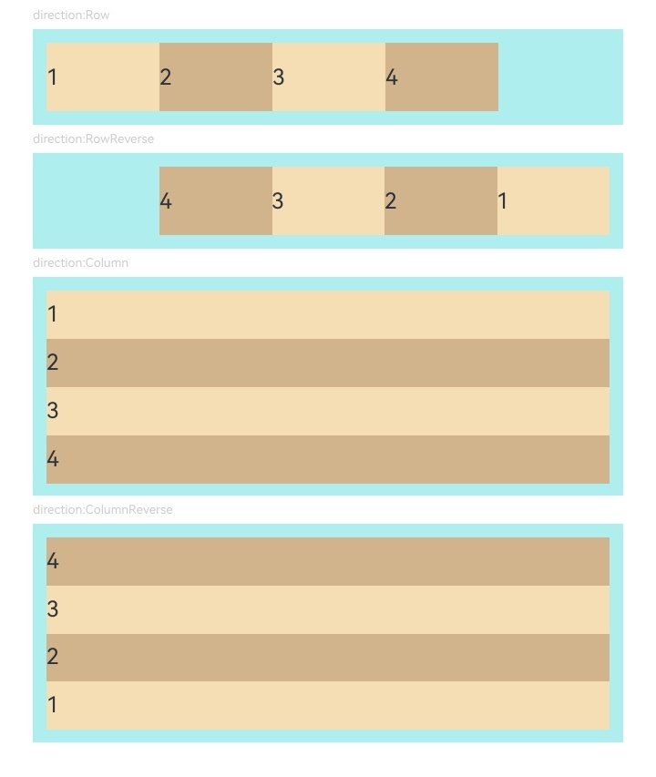
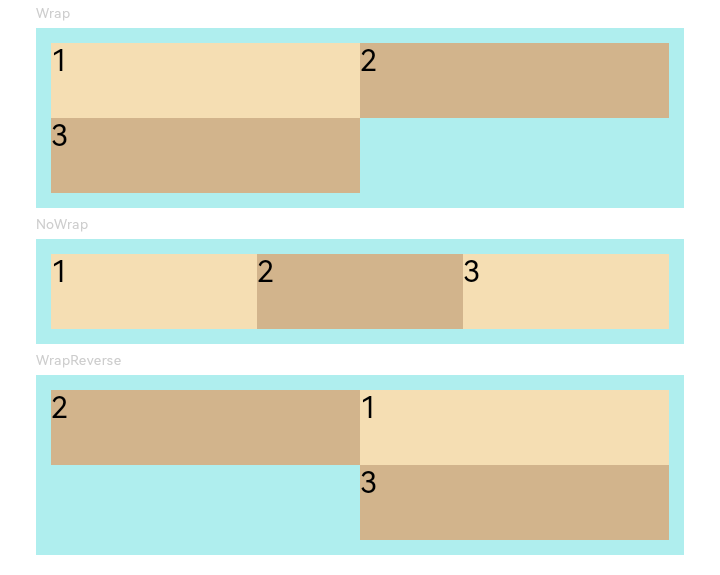
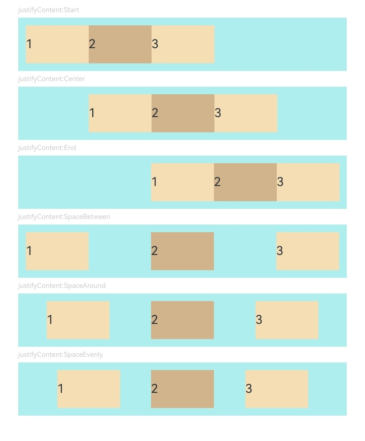
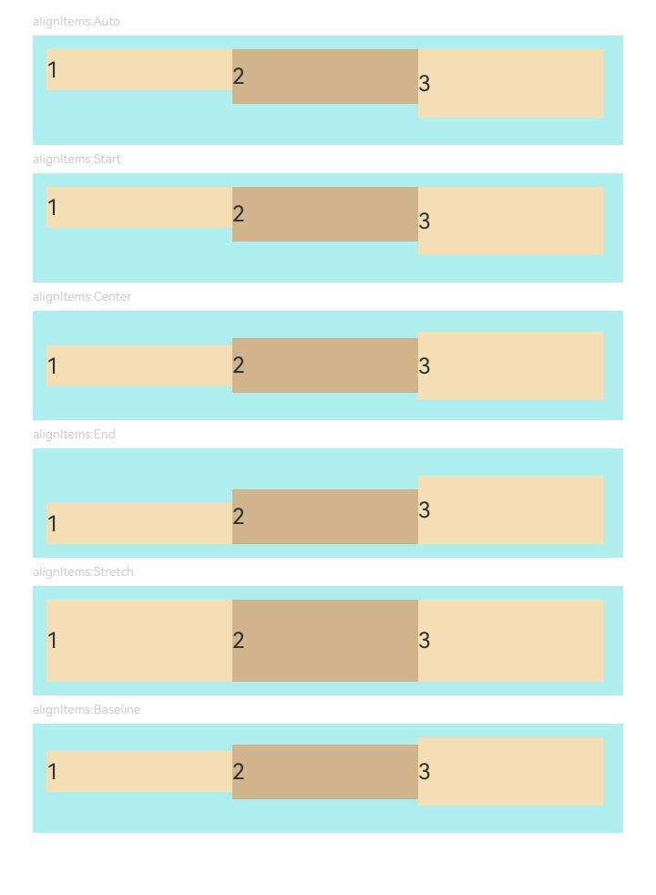
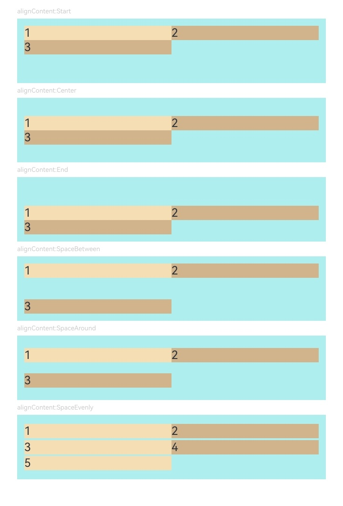
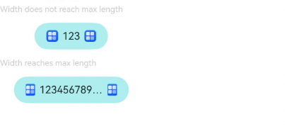
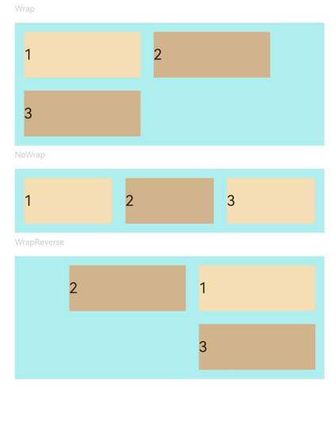

# Flex

<!--Del-->
> **Note:**
>
> Currently in the beta phase.
<!--DelEnd-->

Flex is a container component that arranges child components in a flexible layout, providing a more efficient way to align, distribute, and allocate remaining space among child elements within the container.

For detailed guidelines, refer to [Flexible Layout](../../arkui-cj/cj-layout-development-flex-layout.md).

> **Note:**
>
> - The Flex component undergoes a secondary layout process during rendering. Therefore, it is recommended to use [Column](cj-row-column-stack-column.md) or [Row](cj-row-column-stack-row.md) in performance-critical scenarios.
> - When the main axis of the Flex component is not explicitly set, it expands to fill the parent container. In contrast, the [Column](cj-row-column-stack-column.md) and [Row](cj-row-column-stack-row.md) components default to matching the size of their child nodes when the main axis is not set.
> - The main axis length can be set to [LengthMetrics.AUTO](./cj-common-types.md#static-let-auto) to enable Flex to adapt to child component layouts. In adaptive mode, the Flex length is constrained by the [constraintSize](./cj-universal-attribute-layoutconstraints.md#func-constraintsizelength-length-length-length) property and the parent container's maximum/minimum length, with the constraintSize property taking higher priority.

## Import Module

```cangjie
import kit.ArkUI.*
```

## Child Components

Can contain child components.

## Creating the Component

### init(?FlexDirection, ?FlexWrap, ?FlexAlign, ?ItemAlign, ?FlexAlign, () -> Unit)

```cangjie
public init(direction!: ?FlexDirection = None, wrap!: ?FlexWrap = None,
    justifyContent!: ?FlexAlign = None, alignItems!: ?ItemAlign = None,
    alignContent!: ?FlexAlign = None, child!: () -> Unit = {=>})
```

**Function:** Creates a Flex container.

**System Capability:** SystemCapability.ArkUI.ArkUI.Full

**Since:** 22

**Parameters:**

| Parameter Name | Type | Required | Default Value | Description |
|:---|:---|:---|:---|:---|
| direction | ?[FlexDirection](./cj-common-types.md#enum-flexdirection) | No | None | **Named parameter.** Initial value: FlexDirection.Row. The direction in which child components are arranged along the Flex container's main axis. |
| wrap | ?[FlexWrap](./cj-common-types.md#enum-flexwrap) | No | None | **Named parameter.** Initial value: FlexWrap.NoWrap. Determines whether the Flex container arranges child components in a single line/column or multiple lines/columns. |
| justifyContent | ?[FlexAlign](./cj-common-types.md#enum-flexalign) | No | None | **Named parameter.** Initial value: FlexAlign.Start. The alignment format for all child components along the Flex container's main axis. |
| alignItems | ?[ItemAlign](./cj-common-types.md#enum-itemalign) | No | None | **Named parameter.** Initial value: ItemAlign.Start. The alignment format for all child components along the Flex container's cross axis. |
| alignContent | ?[FlexAlign](./cj-common-types.md#enum-flexalign) | No | None | **Named parameter.** Initial value: FlexAlign.Start. The alignment method for multiple lines of content when there is extra space on the cross axis. Only takes effect when `wrap` is set to Wrap or WrapReverse. |
| child | () -> Unit | No | {=>} | **Named parameter.** Declares the child components within the container. |

### init(?FlexDirection, ?FlexWrap, ?FlexAlign, ?ItemAlign, ?FlexAlign, ?FlexSpaceOptions, () -> Unit)

```cangjie
public init(direction!: ?FlexDirection = None, wrap!: ?FlexWrap = None,
    justifyContent!: ?FlexAlign = None, alignItems!: ?ItemAlign = None,
    alignContent!: ?FlexAlign = None, space!: ?FlexSpaceOptions,
    child!: () -> Unit = {=>})
```

**Function:** Creates a Flex container and configures the spacing along the main and cross axes.

**System Capability:** SystemCapability.ArkUI.ArkUI.Full

**Since:** 26.1.0

**Parameters:**

| Parameter Name | Type | Required | Default Value | Description |
|:---|:---|:---|:---|:---|
| direction | ?[FlexDirection](cj-common-types.md#enum-flexdirection) | No | None | Arrangement direction of child components in the Flex container, that is, the main axis direction. |
| wrap | ?[FlexWrap](cj-common-types.md#enum-flexwrap) | No | None | Whether child components in the Flex container are arranged in a single row/column or in multiple rows/columns. |
| justifyContent | ?[FlexAlign](cj-common-types.md#enum-flexalign) | No | None | Alignment format of child components along the main axis of the Flex container. |
| alignItems | ?[ItemAlign](cj-common-types.md#enum-itemalign) | No | None | Alignment format of child components along the cross axis of the Flex container. |
| alignContent | ?[FlexAlign](cj-common-types.md#enum-flexalign) | No | None | Overall alignment format of multiple rows/columns of child components along the cross axis. |
| space | ?[FlexSpaceOptions](#class-flexspaceoptions) | Yes | - | **Named parameter.** Spacing configuration of child components along the main and cross axes. |
| child | () -> Unit | No | {=>} | **Named parameter.** Declares the child components of the Flex container. |

> **NOTE**
>
> When justifyContent is set to SpaceBetween, SpaceAround, or SpaceEvenly, the spacing configured by space does not take effect, and the spacing is distributed according to the alignment rules.

## Common Attributes/Events

Common Attributes: All are supported.

Common Events: All are supported.

## Basic Type Definitions

### class FlexSpaceOptions

```cangjie
public class FlexSpaceOptions {
    public var mainSpacing: ?LengthMetrics
    public var crossSpacing: ?LengthMetrics
    public init(mainSpacing!: ?LengthMetrics = None, crossSpacing!: ?LengthMetrics = None)
}
```

**Function:** Sets the spacing between child components along the main axis or cross axis of the **Flex** component.

**System Capability:** SystemCapability.ArkUI.ArkUI.Full

**Since:** 26.1.0

#### var mainSpacing

```cangjie
public var mainSpacing: ?LengthMetrics
```

**Function:** Spacing between adjacent child components on the main axis of the **Flex** component. After being set, adjacent child components in the main axis direction are separated by the specified spacing, which takes effect in both single-line and multi-line layouts. This parameter does not take effect when **mainSpacing** is negative or set to a percentage, or when **justifyContent** is set to **FlexAlign.SpaceBetween**, **FlexAlign.SpaceAround**, or **FlexAlign.SpaceEvenly**. Initial value: LengthMetrics(0.0, unit: LengthUnit.Px).

**Type:** ?[LengthMetrics](cj-common-types.md#class-lengthmetrics)

**Access:** Read-write

**System Capability:** SystemCapability.ArkUI.ArkUI.Full

**Since:** 26.1.0

#### var crossSpacing

```cangjie
public var crossSpacing: ?LengthMetrics
```

**Function:** Spacing between adjacent lines on the cross axis of the **Flex** component. After being set, adjacent lines in the cross axis direction are separated by the specified spacing, which takes effect only in multi-line layout (where **wrap** is set to **Wrap** or **WrapReverse**). This parameter does not take effect when **crossSpacing** is negative or set to a percentage. Initial value: LengthMetrics(0.0, unit: LengthUnit.Px).

**Type:** ?[LengthMetrics](cj-common-types.md#class-lengthmetrics)

**Access:** Read-write

**System Capability:** SystemCapability.ArkUI.ArkUI.Full

**Since:** 26.1.0

#### init(?LengthMetrics, ?LengthMetrics)

```cangjie
public init(mainSpacing!: ?LengthMetrics = None, crossSpacing!: ?LengthMetrics = None)
```

**Function:** Constructor used to create a FlexSpaceOptions object.

**System Capability:** SystemCapability.ArkUI.ArkUI.Full

**Since:** 26.1.0

**Parameters:**

| Parameter Name | Type | Required | Default Value | Description |
|:---|:---|:---|:---|:---|
| mainSpacing | ?[LengthMetrics](cj-common-types.md#class-lengthmetrics) | No | None | Spacing between child components along the main axis. |
| crossSpacing | ?[LengthMetrics](cj-common-types.md#class-lengthmetrics) | No | None | Row spacing along the cross axis. |

## Example Code

### Example 1 (Child Component Arrangement Direction)

This example demonstrates different child component arrangement directions by setting `direction`.

<!-- run -->

```cangjie
package ohos_app_cangjie_entry
import kit.ArkUI.*
import ohos.arkui.state_macro_manage.*
import std.collection.*

@Entry
@Component
class EntryView {
    func build() {
        Column {
            Column(space: 5) {
                Text("direction:Row")
                .fontSize(9)
                .fontColor(0xCCCCCC)
                .width(90.percent)

                // Child components arranged in a row along the main axis
                Flex(direction: FlexDirection.Row) {
                    Text("1")
                    .width(20.percent)
                    .height(50)
                    .backgroundColor(0xF5DEB3)
                    Text("2")
                    .width(20.percent)
                    .height(50)
                    .backgroundColor(0xD2B48C)
                    Text("3")
                    .width(20.percent)
                    .height(50)
                    .backgroundColor(0xF5DEB3)
                    Text("4")
                    .width(20.percent)
                    .height(50)
                    .backgroundColor(0xD2B48C)
                }
                .height(70)
                .width(90.percent)
                .padding(10)
                .backgroundColor(0xAFEEEE)

                Text("direction:RowReverse")
                .fontSize(9)
                .fontColor(0xCCCCCC)
                .width(90.percent)
                // Child components arranged in a reverse row along the main axis
                Flex(direction: FlexDirection.RowReverse) {
                    Text("1")
                    .width(20.percent)
                    .height(50)
                    .backgroundColor(0xF5DEB3)
                    Text("2")
                    .width(20.percent)
                    .height(50)
                    .backgroundColor(0xD2B48C)
                    Text("3")
                    .width(20.percent)
                    .height(50)
                    .backgroundColor(0xF5DEB3)
                    Text("4")
                    .width(20.percent)
                    .height(50)
                    .backgroundColor(0xD2B48C)
                }
                .height(70)
                .width(90.percent)
                .padding(10)
                .backgroundColor(0xAFEEEE)

                Text("direction:Column")
                .fontSize(9)
                .fontColor(0xCCCCCC)
                .width(90.percent)
                // Child components arranged in a column along the main axis
                Flex(direction: FlexDirection.Column) {
                    Text("1")
                    .width(100.percent)
                    .height(50)
                    .backgroundColor(0xF5DEB3)
                    Text("2")
                    .width(100.percent)
                    .height(50)
                    .backgroundColor(0xD2B48C)
                    Text("3")
                    .width(100.percent)
                    .height(50)
                    .backgroundColor(0xF5DEB3)
                    Text("4")
                    .width(100.percent)
                    .height(50)
                    .backgroundColor(0xD2B48C)
                }
                .width(90.percent)
                .height(160)
                .padding(10)
                .backgroundColor(0xAFEEEE)
                Text("direction:ColumnReverse")
                .fontSize(9)
                .fontColor(0xCCCCCC)
                .width(90.percent)
                // Child components arranged in a reverse column along the main axis
                Flex(direction: FlexDirection.ColumnReverse) {
                    Text("1")
                    .width(100.percent)
                    .height(50)
                    .backgroundColor(0xF5DEB3)
                    Text("2")
                    .width(100.percent)
                    .height(50)
                    .backgroundColor(0xD2B48C)
                    Text("3")
                    .width(100.percent)
                    .height(50)
                    .backgroundColor(0xF5DEB3)
                    Text("4")
                    .width(100.percent)
                    .height(50)
                    .backgroundColor(0xD2B48C)
                }
                .width(90.percent)
                .height(160)
                .padding(10)
                .backgroundColor(0xAFEEEE)
            }
            .width(100.percent)
            .margin(top: 5)
        }
        .width(100.percent)
    }
}
```



### Example 2 (Single/Multi-line Child Component Arrangement)

This example demonstrates single-line or multi-line child component arrangements by setting `wrap`.

<!-- run -->

```cangjie
package ohos_app_cangjie_entry
import kit.ArkUI.*
import ohos.arkui.state_macro_manage.*

@Entry
@Component
class EntryView {
    func build() {
        Column {
            Column(space: 5) {
                Text("Wrap")
                .fontSize(9)
                .fontColor(0xCCCCCC)
                .width(90.percent)
                Flex(wrap: FlexWrap.Wrap) {
                    Text("1")
                    .width(50.percent)
                    .height(50)
                    .backgroundColor(0xF5DEB3)
                    Text("2")
                    .width(50.percent)
                    .height(50)
                    .backgroundColor(0xD2B48C)
                    Text("3")
                    .width(50.percent)
                    .height(50)
                    .backgroundColor(0xD2B48C)
                }
                .width(90.percent)
                .padding(10)
                .backgroundColor(0xAFEEEE)

                Text("NoWrap")
                .fontSize(9)
                .fontColor(0xCCCCCC)
                .width(90.percent)
                Flex(wrap: FlexWrap.NoWrap) {
                    Text("1")
                    .width(50.percent)
                    .height(50)
                    .backgroundColor(0xF5DEB3)
                    Text("2")
                    .width(50.percent)
                    .height(50)
                    .backgroundColor(0xD2B48C)
                    Text("3")
                    .width(50.percent)
                    .height(50)
                    .backgroundColor(0xF5DEB3)
                }
                .width(90.percent)
                .padding(10)
                .backgroundColor(0xAFEEEE)

                Text("WrapReverse")
                .fontSize(9)
                .fontColor(0xCCCCCC)
                .width(90.percent)
                Flex(wrap: FlexWrap.WrapReverse, direction:FlexDirection.Row) {
                    Text("1")
                    .width(50.percent)
                    .height(50)
                    .backgroundColor(0xF5DEB3)
                    Text("2")
                    .width(50.percent)
                    .height(50)
                    .backgroundColor(0xD2B48C)
                    Text("3")
                    .width(50.percent)
                    .height(50)
                    .backgroundColor(0xD2B48C)
                }
                .width(90.percent)
                .height(120)
                .padding(10)
                .backgroundColor(0xAFEEEE)
            }
            .width(100.percent)
            .margin(top: 5)
        }
        .width(100.percent)
    }
}
```



### Example 3 (Child Component Alignment on Main Axis)

This example demonstrates different child component alignment effects on the main axis by setting `justifyContent`.

<!-- run -->

```cangjie
package ohos_app_cangjie_entry
import kit.ArkUI.*
import ohos.arkui.state_macro_manage.*
import std.collection.*

@Component
class JustifyContentFlex{
    // Initial alignment: Child components aligned to the start of the main axis
    var justifyContent :  FlexAlign  = FlexAlign.Start

    func build(){
        Flex(justifyContent:this.justifyContent){
            Text('1').width(20.percent).height(50).backgroundColor(0xF5DEB3)
            Text('2').width(20.percent).height(50).backgroundColor(0xD2B48C)
            Text('3').width(20.percent).height(50).backgroundColor(0xF5DEB3)
        }
        .width(90.percent)
        .padding(10)
        .backgroundColor(0xAFEEEE)
    }
}

@Entry
@Component
class EntryView {
    func build() {
        Column {
            Column(space: 5) {
                Text('justifyContent:Start').fontSize(9).fontColor(0xCCCCCC).width(90.percent)
                JustifyContentFlex() // Child components aligned to the start of the main axis
                Text('justifyContent:Center').fontSize(9).fontColor(0xCCCCCC).width(90.percent)
                JustifyContentFlex(justifyContent:FlexAlign.Center) // Child components centered on the main axis
                Text('justifyContent:End').fontSize(9).fontColor(0xCCCCCC).width(90.percent)
                JustifyContentFlex(justifyContent:FlexAlign.End) // Child components aligned to the end of the main axis
                Text('justifyContent:SpaceBetween').fontSize(9).fontColor(0xCCCCCC).width(90.percent)
                // Child components evenly distributed along the main axis, with the first aligned to the start and the last to the end.
                JustifyContentFlex(justifyContent:FlexAlign.SpaceBetween)
                Text('justifyContent:SpaceAround').fontSize(9).fontColor(0xCCCCCC).width(90.percent)
                // Child components evenly distributed along the main axis, with equal space around them.
                JustifyContentFlex(justifyContent:FlexAlign.SpaceAround)
                Text('justifyContent:SpaceEvenly').fontSize(9).fontColor(0xCCCCCC).width(90.percent)
                // Child components evenly distributed along the main axis, with equal space between and around them.
                JustifyContentFlex(justifyContent:FlexAlign.SpaceEvenly)
            }
            .width(100.percent)
            .margin(top: 5)
        }
        .width(100.percent)
    }
}
```



### Example 4 (Child Component Alignment on Cross Axis)

This example demonstrates different child component alignment effects on the cross axis by setting `alignItems`.

<!-- run -->

```cangjie
package ohos_app_cangjie_entry
import kit.ArkUI.*
import ohos.arkui.state_macro_manage.*
import std.collection.*

@Component
class AlignItemsFlex{
    // Initial alignment: Child components aligned to the start of the cross axis
    var alignItems :  ItemAlign  = ItemAlign.Auto

    func build(){
        Flex(alignItems:this.alignItems){
            Text('1').width(33.percent).height(30).backgroundColor(0xF5DEB3)
            Text('2').width(33.percent).height(40).backgroundColor(0xD2B48C)
            Text('3').width(33.percent).height(50).backgroundColor(0xF5DEB3)
        }
        .width(90.percent)
        .height(80)
        .padding(10)
        .backgroundColor(0xAFEEEE)
    }
}

@Entry
@Component
class EntryView {
    func build() {
        Column {
            Column(space: 5) {
                Text('alignItems:Auto').fontSize(9).fontColor(0xCCCCCC).width(90.percent)
                // Child components aligned to the start of the cross axis
                AlignItemsFlex()
                Text('alignItems:Start').fontSize(9).fontColor(0xCCCCCC).width(90.percent)
                // Child components aligned to the start of the cross axis
                AlignItemsFlex(alignItems:ItemAlign.Start)
                Text('alignItems:Center').fontSize(9).fontColor(0xCCCCCC).width(90.percent)
                // Child components centered on the cross axis
                AlignItemsFlex(alignItems:ItemAlign.Center)
                Text('alignItems:End').fontSize(9).fontColor(0xCCCCCC).width(90.percent)
                // Child components aligned to the end of the cross axis
                AlignItemsFlex(alignItems:ItemAlign.End)
                Text('alignItems:Stretch').fontSize(9).fontColor(0xCCCCCC).width(90.percent)
                // Child components stretched to fill the cross axis
                AlignItemsFlex(alignItems:ItemAlign.Stretch)
                Text('alignItems:Baseline').fontSize(9).fontColor(0xCCCCCC).width(90.percent)
                // Child components aligned to the text baseline on the cross axis
                AlignItemsFlex(alignItems:ItemAlign.Baseline)
            }
            .width(100.percent)
            .margin(top: 5)
        }
        .width(100.percent)
    }
}
```



### Example 5 (Alignment Methods for Multi-line Content)

This example demonstrates different alignment effects for multi-line content by setting `alignContent`.

<!-- run -->

```cangjie
package ohos_app_cangjie_entry
import kit.ArkUI.*
import ohos.arkui.state_macro_manage.*
import std.collection.*

@Component
class AlignContentFlex{
    // Initialize alignment: child components aligned to the start in multi-line layout
    var alignContent :  FlexAlign  = FlexAlign.Start

    func build(){
        Flex(wrap: FlexWrap.Wrap, alignContent:this.alignContent){
            Text('1').width(50.percent).height(20).backgroundColor(0xF5DEB3)
            Text('2').width(50.percent).height(20).backgroundColor(0xD2B48C)
            Text('3').width(50.percent).height(20).backgroundColor(0xD2B48C)
        }
        .width(90.percent)
        .height(90)
        .padding(10)
        .backgroundColor(0xAFEEEE)
    }
}

@Entry
@Component
class EntryView {
    func build() {
        Column {
            Column(space: 5) {
                Text('alignContent:Start').fontSize(9).fontColor(0xCCCCCC).width(90.percent)
                // Child components aligned to the start in multi-line layout
                AlignContentFlex()
                Text('alignContent:Center').fontSize(9).fontColor(0xCCCCCC).width(90.percent)
                // Child components center-aligned in multi-line layout
                AlignContentFlex(alignContent:FlexAlign.Center)
                Text('alignContent:End').fontSize(9).fontColor(0xCCCCCC).width(90.percent)
                // Child components aligned to the end in multi-line layout
                AlignContentFlex(alignContent:FlexAlign.End)
                Text('alignContent:SpaceBetween').fontSize(9).fontColor(0xCCCCCC).width(90.percent)
                // First line aligned to container start and last line aligned to container end in multi-line layout
                AlignContentFlex(alignContent:FlexAlign.SpaceBetween)
                Text('alignContent:SpaceAround').fontSize(9).fontColor(0xCCCCCC).width(90.percent)
                // Distance from first line to container start and last line to container end is half the spacing between adjacent lines
                AlignContentFlex(alignContent:FlexAlign.SpaceAround)
                Text('alignContent:SpaceEvenly').fontSize(9).fontColor(0xCCCCCC).width(90.percent)
                // Equal spacing between all elements including container edges in multi-line layout
                Flex(wrap: FlexWrap.Wrap, alignContent:FlexAlign.SpaceEvenly){
                    Text('1').width(50.percent).height(20).backgroundColor(0xF5DEB3)
                    Text('2').width(50.percent).height(20).backgroundColor(0xD2B48C)
                    Text('3').width(50.percent).height(20).backgroundColor(0xF5DEB3)
                    Text('4').width(50.percent).height(20).backgroundColor(0xD2B48C)
                    Text('5').width(50.percent).height(20).backgroundColor(0xF5DEB3)
                }
                .width(90.percent)
                .height(90)
                .padding(10)
                .backgroundColor(0xAFEEEE)
            }
            .width(100.percent)
            .margin(top: 5)
        }
        .width(100.percent)
    }
}
```



### Example 6 (Flex Container with Adaptive Width)

This example demonstrates the Flex's ability to adapt to child component layout when width is set to LengthMetrics.AUTO.

``` cangjie
package ohos_app_cangjie_entry
import kit.ArkUI.*
import ohos.arkui.state_macro_manage.*

@Component
class Demo {
    @Prop var text: String

    func build() {
        Button() {
            Flex() {
                Image(@r(app.media.startIcon))
                .width(16)
                .height(16)

                Row() {
                    Text(this.text)
                    .margin(
                        left: 6,
                        right: 6
                    )
                    .fontSize(14)
                    .maxLines(1)
                    .textOverflow(overflow: TextOverflow.Ellipsis)
                }

                Image(@r(app.media.startIcon))
                .width(16)
                .height(16)
            }.width(LengthMetrics.AUTO)
        }
        .backgroundColor(0xAFEEEE)
        .height(36)
        .padding(left: 16, right: 16)
        .constraintSize(maxWidth: 156)
        .width(LengthMetrics.AUTO)
    }
}

@Entry
@Component
class EntryView {
    build() {
        Column(space: 12 ) {
            Text('Width does not reach max length').fontSize(11).fontColor(0XCCCCCC).width(50.percent)
            Demo(text: '123' )
            Text('Width reaches max length').fontSize(11).fontColor(0XCCCCCC).width(50.percent)
            Demo(text: '1234567890-1234567890-1234567890-1234567890')
        }
    }
}
```



### Example 7 (Spacing Along the Main/Cross Axis in Single/Multi-Line Layout)

This example uses [FlexSpaceOptions](#class-flexspaceoptions) to set the spacing between child components along the main and cross axes of the **Flex** container.

<!-- run -->

```cangjie
package ohos_app_cangjie_entry

import kit.ArkUI.*
import ohos.arkui.state_macro_manage.*
import ohos.base.*

@Entry
@Component
class EntryView {
    func build() {
        Column(space: 5) {
            Text("Wrap").fontSize(9).fontColor(0xCCCCCC).width(90.percent)
            Flex(wrap: FlexWrap.Wrap, space: FlexSpaceOptions(
                mainSpacing: LengthMetrics(50.0, unit: LengthUnit.Px),
                crossSpacing: LengthMetrics(50.0, unit: LengthUnit.Px))) {
                Text("1").width(40.percent).height(50).backgroundColor(0xF5DEB3)
                Text("2").width(40.percent).height(50).backgroundColor(0xD2B48C)
                Text("3").width(40.percent).height(50).backgroundColor(0xD2B48C)
            }
            .width(90.percent)
            .padding(10)
            .backgroundColor(0xAFEEEE)
            .margin(top: 5)

            Text("NoWrap").fontSize(9).fontColor(0xCCCCCC).width(90.percent)
            Flex(wrap: FlexWrap.NoWrap, space: FlexSpaceOptions(
                mainSpacing: LengthMetrics(50.0, unit: LengthUnit.Px),
                crossSpacing: LengthMetrics(50.0, unit: LengthUnit.Px))) {
                Text("1").width(50.percent).height(50).backgroundColor(0xF5DEB3)
                Text("2").width(50.percent).height(50).backgroundColor(0xD2B48C)
                Text("3").width(50.percent).height(50).backgroundColor(0xF5DEB3)
            }
            .width(90.percent)
            .padding(10)
            .backgroundColor(0xAFEEEE)
            .margin(top: 5)

            Text("WrapReverse").fontSize(9).fontColor(0xCCCCCC).width(90.percent)
            Flex(direction: FlexDirection.Row, wrap: FlexWrap.WrapReverse, space: FlexSpaceOptions(
                mainSpacing: LengthMetrics(50.0, unit: LengthUnit.Px),
                crossSpacing: LengthMetrics(50.0, unit: LengthUnit.Px))) {
                Text("1").width(40.percent).height(50).backgroundColor(0xF5DEB3)
                Text("2").width(40.percent).height(50).backgroundColor(0xD2B48C)
                Text("3").width(40.percent).height(50).backgroundColor(0xD2B48C)
            }
            .width(90.percent)
            .padding(10)
            .backgroundColor(0xAFEEEE)
            .margin(top: 5)
        }
        .width(100.percent)
    }
}
```


