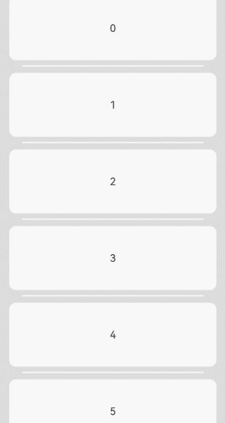
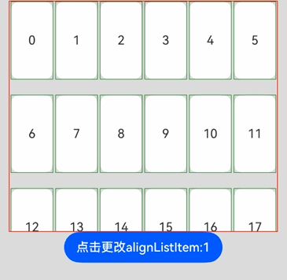
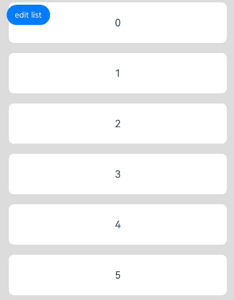
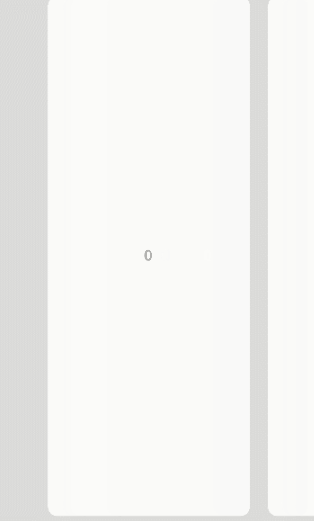
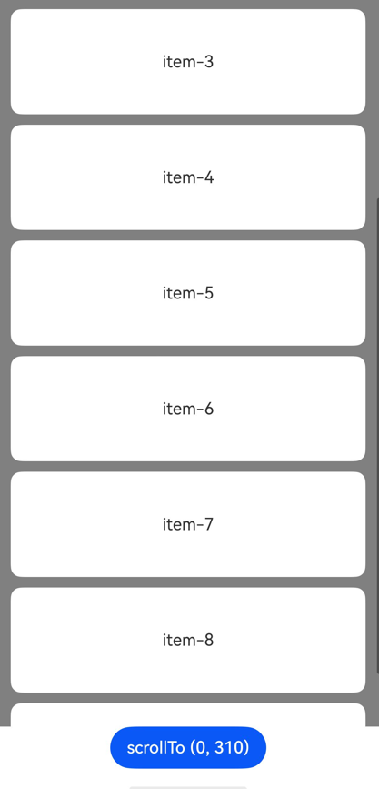
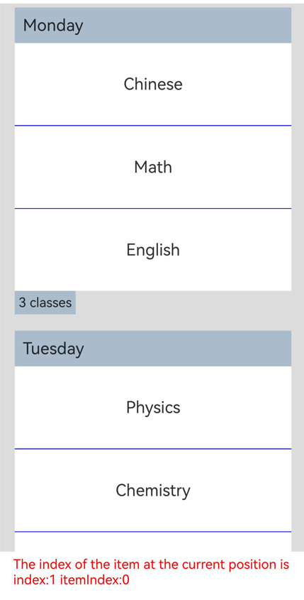
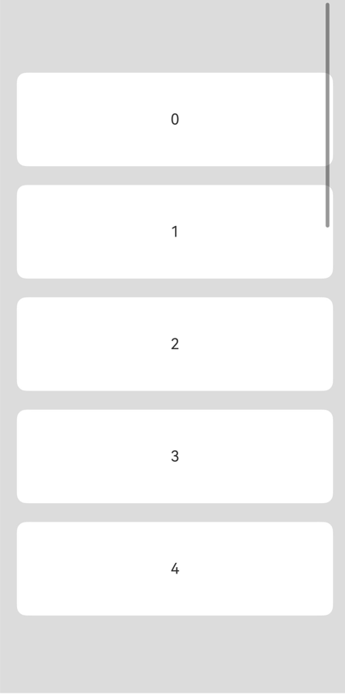
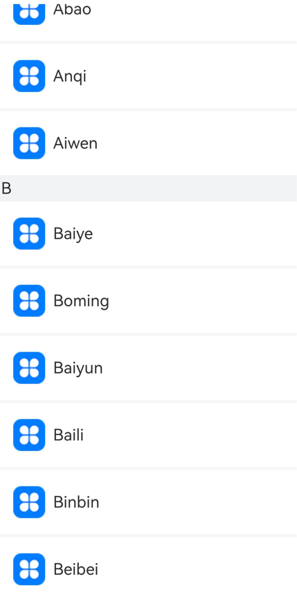

# List

<!--Del-->
> **Note:**
>
> Currently in the beta phase.
<!--DelEnd-->

A container component that contains a series of list items with the same width. Suitable for presenting homogeneous data in continuous, multi-line formats, such as images and text.

## Import Module

```cangjie
import kit.ArkUI.*
```

## Child Components

Only supports [ListItem](./cj-scroll-swipe-listitem.md) and [ListItemGroup](./cj-scroll-swipe-listgroup.md) child components. Supports rendering control types ([if/else](../../arkui-cj/rendering_control/cj-rendering-control-ifelse.md), [ForEach](../../arkui-cj/rendering_control/cj-rendering-control-foreach.md), [LazyForEach](./cj-state-rendering-lazyforeach.md)).

> **Note:**
>
> Index calculation rules for List child components:
>
> * Increments sequentially in the order of child components.
> * In if/else statements, only child components within the branch where the condition is true participate in index calculation; those in the false branch are excluded.
> * In ForEach/LazyForEach statements, all expanded child nodes are included in index calculation.
> * When [if/else](../../arkui-cj/rendering_control/cj-rendering-control-ifelse.md), [ForEach](../../arkui-cj/rendering_control/cj-rendering-control-foreach.md), or [LazyForEach](./cj-state-rendering-lazyforeach.md) changes, child node indices are updated.
> * ListItemGroup is treated as a single unit for index calculation, and its internal ListItems are excluded.
> * Child components with visibility set to Hidden or None are still included in index calculation.

## Creating the Component

### init(?Int64, ?Int32, ?Scroller, () -> Unit)

```cangjie
public init(
    space!: ?Int64 = None,
    initialIndex!: ?Int32 = None,
    scroller!: ?Scroller = Option<Scroller>.None,
    child!: () -> Unit
)
```

**Function:** Creates a List container that can hold child components.

**System Capability:** SystemCapability.ArkUI.ArkUI.Full

**Since Version:** 22

**Parameters:**

| Parameter Name | Type | Required | Default Value | Description |
|:---|:---|:---|:---|:---|
| space | ?Int64 | No | None | **Named parameter.** Spacing between child components along the main axis. |
| initialIndex | ?Int32 | No | None | **Named parameter.** Sets the initial item displayed at the viewport's starting position when the List first loads. If the value exceeds the index of the last item, it is ignored. |
| scroller | ?[Scroller](cj-scroll-swipe-scroll.md#class-scroller) | No | Option\<Scroller>.None | **Named parameter.** Controller for scrollable components, used to bind with scrollable components. |
| child | () -> Unit | Yes | - | **Named parameter.** Declares the List child components within the container. |

## Common Attributes/Events

Common Attributes: Supports [Common Attributes of Scrollable Components](./cj-scroll-swipe-common.md#component-attributes) in addition to general attributes.

Common Events: Supports [Common Events of Scrollable Components](./cj-scroll-swipe-common.md#component-events) in addition to general events.

## Component Attributes

### func alignListItem(?ListItemAlign)

```cangjie
public func alignListItem(value: ?ListItemAlign): This
```

**Function:** Sets the layout alignment of ListItems along the cross axis when the List's cross-axis width exceeds `ListItem's cross-axis width * lanes`.

**System Capability:** SystemCapability.ArkUI.ArkUI.Full

**Since Version:** 22

**Parameters:**

| Parameter Name | Type | Required | Default Value | Description |
|:---|:---|:---|:---|:---|
| value | ?[ListItemAlign](./cj-common-types.md#enum-listitemalign) | Yes | - | Cross-axis layout alignment. Initial value: ListItemAlign.Start. |

### func cachedCount(?Int32)

```cangjie
public func cachedCount(value: ?Int32): This
```

**Function:** Sets the number of ListItems/ListItemGroups to preload. In lazy-loading scenarios, only `cachedCount` items outside the display area are preloaded. In non-lazy-loading scenarios, all items are loaded. Both scenarios only lay out items within the display area plus `cachedCount` items outside.

After setting `cachedCount`, ListItems outside the display area are preloaded and laid out in both upward and downward directions. When counting ListItem rows, ListItems within ListItemGroups are included. If a ListItemGroup contains no ListItems, the entire group counts as one row.

When LazyForEach is nested under List and ListItemGroup is nested under LazyForEach, LazyForEach creates `cachedCount` ListItemGroups outside the display area in both upward and downward directions.

**System Capability:** SystemCapability.ArkUI.ArkUI.Full

**Since Version:** 22

**Parameters:**

| Parameter Name | Type | Required | Default Value | Description |
|:---|:---|:---|:---|:---|
| value | ?Int32 | Yes | - | Number of ListItems/ListItemGroups to preload. Initial value: 1. |

### func chainAnimation(?Bool)

```cangjie
public func chainAnimation(value: ?Bool): This
```

**Function:** Enables or disables chain animation. Chain animation provides a visual "chaining" effect when scrolling or dragging to the top/bottom boundaries.

**System Capability:** SystemCapability.ArkUI.ArkUI.Full

**Since Version:** 22

**Parameters:**

| Parameter Name | Type | Required | Default Value | Description |
|:---|:---|:---|:---|:---|
| value | ?Bool | Yes | - | Whether to enable chain animation. Initial value: false. |

### func divider(Option\<ListDividerOptions>)

```cangjie
public func divider(value: Option<ListDividerOptions>): This
```

**Function:** Sets the divider style between list items. No dividers are shown by default.

**System Capability:** SystemCapability.ArkUI.ArkUI.Full

**Since Version:** 22

**Parameters:**

| Parameter Name | Type | Required | Default Value | Description |
|:---|:---|:---|:---|:---|
| value | Option\<[ListDividerOptions](./cj-scroll-swipe-listgroup.md#class-listdivideroptions)> | Yes | - | Divider style configuration. |

### func edgeEffect(?EdgeEffect)

```cangjie
public func edgeEffect(value: ?EdgeEffect): This
```

**Function:** Sets the edge effect when scrolling to boundaries.

**System Capability:** SystemCapability.ArkUI.ArkUI.Full

**Since Version:** 22

**Parameters:**

| Parameter Name | Type | Required | Default Value | Description |
|:---|:---|:---|:---|:---|
| value | ?[EdgeEffect](./cj-common-types.md#enum-edgeeffect) | Yes | - | Edge effect type. Initial value: EdgeEffect.Spring. |

### func edgeEffect(?EdgeEffect, ?EdgeEffectOptions)

```cangjie
public func edgeEffect(edgeEffect: ?EdgeEffect, options!: ?EdgeEffectOptions): This
```

**Function:** Sets the effect used when the scroll boundary is reached.

**System capability:** SystemCapability.ArkUI.ArkUI.Full

**Since:** 26.1.0

**Parameters:**

|Name|Type|Mandatory|Default Value|Description|
|:---|:---|:---|:---|:---|
|edgeEffect|?[EdgeEffect](./cj-common-types.md#enum-edgeeffect)|Yes|-|Effect used when the scroll boundary is reached. The spring and shadow effects are supported. Initial value: EdgeEffect.Spring.|
|options|?[EdgeEffectOptions](./cj-common-types.md#class-edgeeffectoptions)|Yes|-|Whether to enable the scroll effect when the component content is smaller than the component itself. The value EdgeEffectOptions(true) means to enable the scroll effect, and EdgeEffectOptions(false) means the opposite. Initial value: EdgeEffectOptions(false).|

### func lanes(?Int32)

```cangjie
public func lanes(value: ?Int32): This
```

**Function:** Sets the number of columns or rows in the list.

**System Capability:** SystemCapability.ArkUI.ArkUI.Full

**Since Version:** 22

**Parameters:**

| Parameter Name | Type | Required | Default Value | Description |
|:---|:---|:---|:---|:---|
| value | ?Int32 | Yes | - | Number of columns or rows. Initial value: 1. |

### func lanes(?Length, ?Length)

```cangjie
public func lanes(minLength!: ?Length, maxLength!: ?Length): This
```

**Function:** Sets the number of columns or rows in the list.

**System Capability:** SystemCapability.ArkUI.ArkUI.Full

**Since Version:** 22

**Parameters:**

| Parameter Name | Type | Required | Default Value | Description |
|:---|:---|:---|:---|:---|
| minLength | ?[Length](./cj-common-types.md#interface-length) | Yes | - | **Named parameter.** Minimum length of columns or rows. Initial value: (-1.0).vp. |
| maxLength | ?[Length](./cj-common-types.md#interface-length) | Yes | - | **Named parameter.** Maximum length of columns or rows. Initial value: (-1.0).vp. |

### func listDirection(?Axis)

```cangjie
public func listDirection(value: ?Axis): This
```

**Function:** Sets the direction in which list items are arranged.

**System Capability:** SystemCapability.ArkUI.ArkUI.Full

**Since Version:** 22

**Parameters:**

| Parameter Name | Type | Required | Default Value | Description |
|:---|:---|:---|:---|:---|
| value | ?[Axis](./cj-common-types.md#enum-axis) | Yes | - | List item arrangement direction. Initial value: Axis.Vertical. |

### func multiSelectable(?Bool)

```cangjie
public func multiSelectable(value: ?Bool): This
```

**Function:** Enables or disables multi-selection.

**System Capability:** SystemCapability.ArkUI.ArkUI.Full

**Since Version:** 22

**Parameters:**

| Parameter Name | Type | Required | Default Value | Description |
|:---|:---|:---|:---|:---|
| value | ?Bool | Yes | - | Whether to enable multi-selection. Initial value: false. |

### func scrollSnapAlign(?ScrollSnapAlign)

```cangjie
public func scrollSnapAlign(value: ?ScrollSnapAlign): This
```

**Function:** Sets the scroll snap alignment effect for list items when scrolling ends.

**System Capability:** SystemCapability.ArkUI.ArkUI.Full

**Since Version:** 26.1.0

**Parameters:**

| Parameter Name | Type | Required | Default Value | Description |
|:---|:---|:---|:---|:---|
| value | ?[ScrollSnapAlign](#enum-scrollsnapalign) | Yes | - | Alignment mode of the scroll snap position. Initial value: ScrollSnapAlign.None. |

> **NOTE**
>
> Scroll snap alignment is supported only for lists with uniform item heights; otherwise, the result may be inaccurate. During the alignment animation, the scroll operation source type reported by the [onWillScroll](./cj-scroll-swipe-common.md#func-onwillscrolloptionfloat64scrollstatescrollsource---scrollresult) event is ScrollSource.Fling.

### func sticky(?StickyStyle)

```cangjie
public func sticky(value: ?StickyStyle): This
```

**Function:** Sets whether to pin ListItemGroup headers to the top or footers to the bottom.

**System Capability:** SystemCapability.ArkUI.ArkUI.Full

**Since Version:** 22

**Parameters:**

| Parameter Name | Type | Required | Default Value | Description |
|:---|:---|:---|:---|:---|
| value | ?[StickyStyle](./cj-common-types.md#enum-stickystyle) | Yes | - | Sticky style. Initial value: StickyStyle.None. |

## Component Events

### func onScrollFrameBegin(?(Float64, ScrollState) -> OnScrollFrameBeginHandlerResult)

```cangjie
public func onScrollFrameBegin(event: ?(Float64, ScrollState) -> OnScrollFrameBeginHandlerResult): This
```

**Function:** Triggered at the start of each scroll frame.

**System Capability:** SystemCapability.ArkUI.ArkUI.Full

**Since Version:** 22

**Parameters:**

| Parameter Name | Type | Required | Default Value | Description |
|:---|:---|:---|:---|:---|
| event | ?(Float64, [ScrollState](./cj-common-types.md#enum-scrollstate)) -> [OnScrollFrameBeginHandlerResult](#class-onscrollframebeginhandlerresult) | Yes | - | Scroll frame start event callback. Parameter 1: the upcoming scroll amount. Parameter 2: the current scroll state. Initial value: `{ _, _ => OnScrollFrameBeginHandlerResult(offsetRemain: 0.0) }`. |

### func onScrollIndex(?(Int32, Int32, Int32) -> Unit)

```cangjie
public func onScrollIndex(event: ?(Int32, Int32, Int32) -> Unit): This
```

**Function:** Triggered when child components enter or leave the list display area.

**System Capability:** SystemCapability.ArkUI.ArkUI.Full

**Since Version:** 22

**Parameters:**

| Parameter Name | Type | Required | Default Value | Description |
|:---|:---|:---|:---|:---|
| event | ?(Int32, Int32, Int32) -> Unit | Yes | - | Scroll index event callback. <br> Parameter 1 indicates the index of the first child component in the List's visible area; <br> Parameter 2 indicates the index of the last child component in the List's visible area; <br> Parameter 3 indicates the index of the middle child component in the List's visible area. Initial value: `{ _, _, _ => }`. |

## Basic Type Definitions


### class ListScroller

Scroll controller of the **List** component, used to control the scrolling of the **List** component. Only one-to-one binding to a **List** component is supported.

```cangjie
public class ListScroller <: Scroller {
    public init()
}
```

**Function:** Controller of the List component. It inherits from [Scroller](cj-scroll-swipe-scroll.md#class-scroller) and, based on Scroller capabilities, provides scrolling and layout information query for list items in groups.

**System Capability:** SystemCapability.ArkUI.ArkUI.Full

**Since Version:** 26.1.0

#### init()

```cangjie
public init()
```

**Function:** Constructor used to create a ListScroller object.

**System Capability:** SystemCapability.ArkUI.ArkUI.Full

**Since Version:** 26.1.0

#### func getItemRectInGroup(Int32, Int32)

```cangjie
public func getItemRectInGroup(index: Int32, indexInGroup: Int32): RectResult
```

**Function:** Obtains the size of a list item in a list item group and its position relative to the List.

**System Capability:** SystemCapability.ArkUI.ArkUI.Full

**Since Version:** 26.1.0

**Parameters:**

| Parameter Name | Type | Required | Default Value | Description |
|:---|:---|:---|:---|:---|
| index | Int32 | Yes | - | Index of the list item group in the List. Only list item groups visible in the display area are supported. |
| indexInGroup | Int32 | Yes | - | Index of the list item in the list item group. Only list items visible in the display area are supported. |

**Return Value:**

| Type | Description |
|:----|:----|
| [RectResult](cj-scroll-swipe-scroll.md#class-rectresult) | Size of the list item in the list item group and its position relative to the List, in vp. If index or indexInGroup is set to an invalid value (negative value, out-of-range index, or the target item is not in the display area), the returned size and position are both 0. |

**Exceptions:**

- BusinessException: Corresponding error codes are shown in the table below. For details, see [Universal Error Codes](../cj-errorcode-universal.md).

  |Error Code|Description|
  |:----|:----|
  |100004|Controller not bound to a component.|

#### func scrollToItemInGroup(Int32, Int32, ?Bool, ?ScrollAlign)

```cangjie
public func scrollToItemInGroup(
    index: Int32,
    indexInGroup: Int32,
    smooth!: ?Bool = None,
    align!: ?ScrollAlign = None
): Unit
```

**Function:** Scrolls to the specified list item in the specified list item group.

**System Capability:** SystemCapability.ArkUI.ArkUI.Full

**Since Version:** 26.1.0

**Parameters:**

| Parameter Name | Type | Required | Default Value | Description |
|:---|:---|:---|:---|:---|
| index | Int32 | Yes | - | Index of the target list item group in the current container. |
| indexInGroup | Int32 | Yes | - | Index of the target list item in the list item group specified by index. |
| smooth | ?Bool | No | None | Whether the scroll animation is enabled. Initial value: false. When smooth is set to true, all passed items are loaded and counted in layout calculation. This may result in performance issues if a large number of items are involved. |
| align | ?[ScrollAlign](cj-scroll-swipe-scroll.md#enum-scrollalign) | No | None | How the list item to scroll to is aligned with the container. Initial value: ScrollAlign.Start. |

> **NOTE**
>
> If index or indexInGroup is set to a negative value or greater than the maximum index, the value is deemed invalid, and no scrolling is performed. When the alignment target exceeds the maximum scroll range, the list scrolls to the maximum scroll position.

**Exceptions:**

- BusinessException: Corresponding error codes are shown in the table below. For details, see [Universal Error Codes](../cj-errorcode-universal.md).

  |Error Code|Description|
  |:----|:----|
  |100004|Controller not bound to a component.|

#### func closeAllSwipeActions(?() -> Unit)

```cangjie
public func closeAllSwipeActions(onFinish!: ?() -> Unit = None): Unit
```

**Function:** Collapses all list items in the Expanded state and sets a callback.

**System Capability:** SystemCapability.ArkUI.ArkUI.Full

**Since Version:** 26.1.0

**Parameters:**

| Parameter Name | Type | Required | Default Value | Description |
|:---|:---|:---|:---|:---|
| onFinish | ?() -> Unit | No | None | Callback invoked when all list items in the Expanded state are collapsed. The callback is not triggered if no list item is in the Expanded state. |

**Exceptions:**

- BusinessException: Corresponding error codes are shown in the table below. For details, see [Universal Error Codes](../cj-errorcode-universal.md).

  |Error Code|Description|
  |:----|:----|
  |100004|Controller not bound to a component.|

#### func getVisibleListContentInfo(Float64, Float64)

```cangjie
public func getVisibleListContentInfo(x: Float64, y: Float64): VisibleListContentInfo
```

**Function:** Obtains the index information of the child component at the specified coordinates.

**System Capability:** SystemCapability.ArkUI.ArkUI.Full

**Since Version:** 26.1.0

**Parameters:**

| Parameter Name | Type | Required | Default Value | Description |
|:---|:---|:---|:---|:---|
| x | Float64 | Yes | - | X-coordinate, in vp. |
| y | Float64 | Yes | - | Y-coordinate, in vp. |

**Return Value:**

| Type | Description |
|:----|:----|
| [VisibleListContentInfo](#class-visiblelistcontentinfo) | Index information of the child component at the specified coordinates. |

> **NOTE**
>
> **NOTE**
>
> - The reference point of the input coordinates (x, y) is the position of the **List** component.
> - If the coordinate position is within a **ListItem** and the parent component of the **ListItem** is a **List**, the index member of the returned object is the index of the **ListItem** in the **List**, **itemGroupArea** returns **None**, and **itemIndexInGroup** returns **None**.
> - If the coordinate position is within a **ListItem** and the parent component of the **ListItem** is a **ListItemGroup**, the index member of the returned object is the index of the **ListItemGroup** in the **List**, **itemGroupArea** returns **ListItemGroupArea.InListItemArea**, and **itemIndexInGroup** returns the index of the **ListItem** in the **ListItemGroup**.
> - If the coordinate position is not within a **ListItem** but is within the header or footer of a **ListItemGroup**, the index member of the returned object is the index of the **ListItemGroup** in the **List**, and **itemIndexInGroup** returns **None**. If the coordinate position is within the header, **itemGroupArea** returns **ListItemGroupArea.InHeaderArea**. If the coordinate position is within the footer, **itemGroupArea** returns **ListItemGroupArea.InFooterArea**.
> - If the coordinate position is neither within a **ListItem** nor within the header or footer of a **ListItemGroup**, but is within a **ListItemGroup**, the index member of the returned object is the index of the **ListItemGroup** in the **List**, **itemIndexInGroup** returns **None**, and **itemGroupArea** returns **ListItemGroupArea.None**.
> - If the coordinate position is neither within a **ListItem** nor within a **ListItemGroup**, the index member of the returned object is **-1**, **itemIndexInGroup** returns **None**, and **itemGroupArea** returns **None**.

**Exceptions:**

- BusinessException: Corresponding error codes are shown in the table below. For details, see [Universal Error Codes](../cj-errorcode-universal.md).

  |Error Code|Description|
  |:----|:----|
  |100004|Controller not bound to a component.|

### class OnScrollFrameBeginHandlerResult

```cangjie
public class OnScrollFrameBeginHandlerResult {
    public var offsetRemain: ?Float64
    public init(offsetRemain!: ?Float64)
}
```

**Function:** Result of scroll frame start handling.

**System Capability:** SystemCapability.ArkUI.ArkUI.Full

**Since Version:** 22

#### var offsetRemain

```cangjie
public var offsetRemain: ?Float64
```

**Function:** Remaining offset.

**Type:** ?Float64

**Read/Write:** Read-Write

**System Capability:** SystemCapability.ArkUI.ArkUI.Full

**Since Version:** 22

#### init(?Float64)

```cangjie
public init(offsetRemain!: ?Float64)
```

**Function:** Creates an `OnScrollFrameBeginHandlerResult` object.

**System Capability:** SystemCapability.ArkUI.ArkUI.Full

**Since Version:** 22

**Parameters:**

| Parameter Name | Type | Required | Default Value | Description |
|:---|:---|:---|:---|:---|
| offsetRemain | ?Float64 | Yes | - | **Named parameter.** Remaining offset. Initial value: 0.0. |

### class VisibleListContentInfo

```cangjie
public class VisibleListContentInfo {
    public var index: Int32
    public var itemGroupArea: ?ListItemGroupArea
    public var itemIndexInGroup: ?Int32
    public init(index: Int32, itemGroupArea!: ?ListItemGroupArea = Option<ListItemGroupArea>.None,
        itemIndexInGroup!: ?Int32 = None)
}
```

**Function:** Describes the details of the child components in the visible area of a list.

**System Capability:** SystemCapability.ArkUI.ArkUI.Full

**Since Version:** 26.1.0

#### var index

```cangjie
public var index: Int32
```

**Function:** Index of the **ListItem** or **ListItemGroup** in the **List** component.

**Type:** Int32

**Access:** Read-write

**System Capability:** SystemCapability.ArkUI.ArkUI.Full

**Since Version:** 26.1.0

#### var itemGroupArea

```cangjie
public var itemGroupArea: ?ListItemGroupArea
```

**Function:** Area where the **ListItemGroup** is located.

**Type:** ?[ListItemGroupArea](#enum-listitemgrouparea)

**Access:** Read-write

**System Capability:** SystemCapability.ArkUI.ArkUI.Full

**Since Version:** 26.1.0

#### var itemIndexInGroup

```cangjie
public var itemIndexInGroup: ?Int32
```

**Function:** Index of the **ListItem** in the **ListItemGroup**.

**Type:** ?Int32

**Access:** Read-write

**System Capability:** SystemCapability.ArkUI.ArkUI.Full

**Since Version:** 26.1.0

#### init(Int32, ?ListItemGroupArea, ?Int32)

```cangjie
public init(index: Int32, itemGroupArea!: ?ListItemGroupArea = Option<ListItemGroupArea>.None,
    itemIndexInGroup!: ?Int32 = None)
```

**Function:** Constructor used to create a VisibleListContentInfo object.

**System Capability:** SystemCapability.ArkUI.ArkUI.Full

**Since Version:** 26.1.0

**Parameters:**

| Parameter Name | Type | Required | Default Value | Description |
|:---|:---|:---|:---|:---|
| index | Int32 | Yes | - | Index of the list item or list item group. |
| itemGroupArea | ?[ListItemGroupArea](#enum-listitemgrouparea) | No | Option\<ListItemGroupArea>.None | Position in the list item group. |
| itemIndexInGroup | ?Int32 | No | None | Index of the list item in the list item group. |

### enum ListItemGroupArea

```cangjie
public enum ListItemGroupArea <: Equatable<ListItemGroupArea> {
    | None
    | InListItemArea
    | InHeaderArea
    | InFooterArea
    | ...
}
```

Enumerates the areas of **ListItemGroup**.

**System Capability:** SystemCapability.ArkUI.ArkUI.Full

**Since Version:** 26.1.0

**Parent Type:**

- Equatable\<[ListItemGroupArea](#enum-listitemgrouparea)>

#### None

```cangjie
None
```

**Function:** Area other than the ListItem, header, and footer areas in the ListItemGroup. Used for an empty list item group (with no ListItem, header, or footer). Initial value.

**System Capability:** SystemCapability.ArkUI.ArkUI.Full

**Since:** 26.1.0

#### InListItemArea

```cangjie
InListItemArea
```

**Function:** ListItem area.

**System Capability:** SystemCapability.ArkUI.ArkUI.Full

**Since:** 26.1.0

#### InHeaderArea

```cangjie
InHeaderArea
```

**Function:** Header area.

**System Capability:** SystemCapability.ArkUI.ArkUI.Full

**Since:** 26.1.0

#### InFooterArea

```cangjie
InFooterArea
```

**Function:** Footer area.

**System Capability:** SystemCapability.ArkUI.ArkUI.Full

**Since:** 26.1.0

#### operator func ==(ListItemGroupArea)

```cangjie
public operator func ==(other: ListItemGroupArea): Bool
```

**Function:** Checks whether two **ListItemGroupArea** enums are equal.

**System Capability:** SystemCapability.ArkUI.ArkUI.Full

**Since Version:** 26.1.0

**Parameters:**

| Parameter | Type | Required | Default | Description |
|:----|:----|:----|:----|:----|
| other | [ListItemGroupArea](#enum-listitemgrouparea) | Yes | - | The other **ListItemGroupArea** enum to compare. |

**Return Value:**

| Type | Description |
|:----|:----|
| Bool | Returns true if the two enums are equal; otherwise, returns false. |

#### operator func !=(ListItemGroupArea)

```cangjie
public operator func !=(other: ListItemGroupArea): Bool
```

**Function:** Checks whether two **ListItemGroupArea** enums are not equal.

**System Capability:** SystemCapability.ArkUI.ArkUI.Full

**Since Version:** 26.1.0

**Parameters:**

| Parameter | Type | Required | Default | Description |
|:----|:----|:----|:----|:----|
| other | [ListItemGroupArea](#enum-listitemgrouparea) | Yes | - | The other **ListItemGroupArea** enum to compare. |

**Return Value:**

| Type | Description |
|:----|:----|
| Bool | Returns true if the two enums are not equal; otherwise, returns false. |

### enum ScrollSnapAlign

```cangjie
public enum ScrollSnapAlign <: Equatable<ScrollSnapAlign> {
    | None
    | Start
    | Center
    | End
    | ...
}
```

Sets the scroll snap alignment effect for list items when scrolling ends.

**System Capability:** SystemCapability.ArkUI.ArkUI.Full

**Since Version:** 26.1.0

**Parent Type:**

- Equatable\<[ScrollSnapAlign](#enum-scrollsnapalign)>

#### None

```cangjie
None
```

**Function:** No snap alignment; list items stay where scrolling stops. Initial value.

**System Capability:** SystemCapability.ArkUI.ArkUI.Full

**Since:** 26.1.0

#### Start

```cangjie
Start
```

**Function:** List items are aligned with the start edge of the List after scrolling stops.

**System Capability:** SystemCapability.ArkUI.ArkUI.Full

**Since:** 26.1.0

#### Center

```cangjie
Center
```

**Function:** List items are aligned with the center of the List after scrolling stops.

**System Capability:** SystemCapability.ArkUI.ArkUI.Full

**Since:** 26.1.0

#### End

```cangjie
End
```

**Function:** List items are aligned with the end edge of the List after scrolling stops.

**System Capability:** SystemCapability.ArkUI.ArkUI.Full

**Since:** 26.1.0

#### operator func ==(ScrollSnapAlign)

```cangjie
public operator func ==(other: ScrollSnapAlign): Bool
```

**Function:** Checks whether two **ScrollSnapAlign** enums are equal.

**System Capability:** SystemCapability.ArkUI.ArkUI.Full

**Since Version:** 26.1.0

**Parameters:**

| Parameter | Type | Required | Default | Description |
|:----|:----|:----|:----|:----|
| other | [ScrollSnapAlign](#enum-scrollsnapalign) | Yes | - | The other **ScrollSnapAlign** enum to compare. |

**Return Value:**

| Type | Description |
|:----|:----|
| Bool | Returns true if the two enums are equal; otherwise, returns false. |

#### operator func !=(ScrollSnapAlign)

```cangjie
public operator func !=(other: ScrollSnapAlign): Bool
```

**Function:** Checks whether two **ScrollSnapAlign** enums are not equal.

**System Capability:** SystemCapability.ArkUI.ArkUI.Full

**Since Version:** 26.1.0

**Parameters:**

| Parameter | Type | Required | Default | Description |
|:----|:----|:----|:----|:----|
| other | [ScrollSnapAlign](#enum-scrollsnapalign) | Yes | - | The other **ScrollSnapAlign** enum to compare. |

**Return Value:**

| Type | Description |
|:----|:----|
| Bool | Returns true if the two enums are not equal; otherwise, returns false. |

## Example Code

### Example 1 (Adding Scroll Events)

This example demonstrates setting up a vertical list and logging indices when the display area changes.

<!-- run -->

```cangjie
package ohos_app_cangjie_entry
import kit.ArkUI.*
import ohos.arkui.state_macro_manage.*
import kit.PerformanceAnalysisKit.*

func loggerInfo(str: String) {
    Hilog.info(0, "CangjieTest", str)
}

@Entry
@Component
class EntryView {
    let arr =[0, 1, 2, 3, 4, 5, 6, 7, 8, 9]
    func build() {
        Stack(alignContent: Alignment.TopStart){
            Column() {
                List( space: 20, initialIndex: 0 ) {
                    ForEach(this.arr, itemGeneratorFunc: {item:Int64,_:Int64 =>
                            ListItem() {
                                Text("${item}")
                                .width(100.percent).height(100).fontSize(16)
                                .textAlign(TextAlign.Center).borderRadius(10).backgroundColor(0xFFFFFF)
                            }
                            })
                }.id("list")
                .listDirection(Axis.Vertical) // Arrangement direction
                .scrollBar(BarState.Off)
                //.friction(0.6)
                .divider(ListDividerOptions(strokeWidth: 2.px, color: Color(0xFFFFFF), startMargin: 20.px, endMargin: 20.px)) // Divider between rows
                .edgeEffect(EdgeEffect.Spring) // Edge effect set to Spring
                .onScrollIndex({firstIndex: Int32, lastIndex: Int32, middleIndex: Int32 =>
                        loggerInfo("first" + firstIndex.toString())
                        loggerInfo("last" + lastIndex.toString())
                        loggerInfo("middle" + middleIndex.toString())
                      })
                .width(90.percent)
                }
            .width(100.percent)
            .height(100.percent)
            .backgroundColor(0xDCDCDC)
            .padding(top: 5.px )
        }
    }
}
```



### Example 2 (Setting Child Element Alignment)

This example demonstrates the alignment effects of List child components along the cross axis under different `ListItemAlign` enum values.

<!-- run -->

```cangjie
package ohos_app_cangjie_entry
import kit.ArkUI.*
import ohos.arkui.state_macro_manage.*

@Entry
@Component
class EntryView {
    let arr: Array<String> = ["0", "1", "2", "3", "4", "5", "6", "7", "8", "9", "10", "11", "12", "13", "14", "15",
        "16", "17", "18", "19"]
    @State var alignListItem: ListItemAlign = ListItemAlign.Start

    func build() {
        Column() {
            List(space: 20, initialIndex: 0) {
                ForEach(
                    this.arr,
                    itemGeneratorFunc: {
                        item: String, _: Int64 => ListItem() {
                            Text("${item}")
                            .width(100.percent)
                            .height(100)
                            .fontSize(16)
                            .textAlign(TextAlign.Center)
                            .borderRadius(10).backgroundColor(0xFFFFFF)
                        }.border(width: 2.px, color: Color.Green).width(55)
                    }
                )
            }
            .height(300)
            .width(90.percent)
            .border(width: 3.px, color: Color.Red)
            .lanes(6)
            .alignListItem(
                this.alignListItem)
            .scrollBar(BarState.Off)
            Button("Click to change alignListItem").onClick(
                {
                 evt => match (this.alignListItem) {
                    case ListItemAlign.Start =>
                        this.alignListItem = ListItemAlign.Center
                    case ListItemAlign.Center =>
                        this.alignListItem = ListItemAlign.End
                    case ListItemAlign.End =>
                        this.alignListItem = ListItemAlign.Start
                    case _ => return
                }
            })
        }.width(100.percent).height(100.percent).backgroundColor(0xDCDCDC).padding(top: 5.px)
    }
}
```



### Example 3 (Setting Edit Mode)

This example demonstrates how to set whether the current List component is in editable mode.

<!-- run -->

```cangjie
package ohos_app_cangjie_entry
import kit.ArkUI.*
import ohos.arkui.state_macro_manage.*

@Entry
@Component
class EntryView {
  @State var arr:ObservedArrayList<Int64> = ObservedArrayList<Int64>([0, 1, 2, 3, 4, 5, 6, 7, 8, 9])
  @State var editFlag: Bool = false

  func build() {
    Stack(alignContent: Alignment.TopStart ) {
      Column() {
        List(space: 20, initialIndex: 0 ) {
          ForEach(this.arr, itemGeneratorFunc:{item: Int64,index: Int64  =>
            ListItem() {
              Flex(direction:FlexDirection.Row, alignItems:ItemAlign.Center) {
                Text("${item}" )
                  .width(100.percent)
                  .height(80)
                  .fontSize(20)
                  .textAlign(TextAlign.Center)
                  .borderRadius(10)
                  .backgroundColor(0xFFFFFF)
                  .flexShrink(1)
                if (this.editFlag) {
                  Button() {
                    Text("delete").fontSize(16)
                  }.width(30.percent).height(40)
                  .onClick({event =>
                    if (index >=0 && index<this.arr.size) {
                      //BaseLog.info( "${this.arr[index]}Delete")
                      this.arr.remove(index)
                      //Hilog.info(0, "AppLogCj", this.arr.size.toString())
                      this.editFlag = false
                   }
                  }).stateEffect(true)
                }
              }
            }
          })
        }.width(90.percent)
        .scrollBar(BarState.Off)
      }.width(100.percent)

      Button("edit list")
        .onClick({event=>
          this.editFlag = !this.editFlag
        }).margin(top: 5, left: 20 )
    }.width(100.percent).height(100.percent).backgroundColor(0xDCDCDC).padding(top: 5)
  }
}
```



### Example 4 (Setting Alignment Limits)

This example demonstrates the implementation effect of setting center alignment limits for the List component.

<!-- run -->

```cangjie
package ohos_app_cangjie_entry
import kit.ArkUI.*
import ohos.arkui.state_macro_manage.*
import std.collection.ArrayList

@Entry
@Component
class EntryView {
   let arr: ArrayList<Int64> =  ArrayList<Int64>([0,1,2,3,4,5,6,7,8,9,10,11,12,13,14,15,16,17,18,19])
   let scrollerForList = Scroller()

  func build() {
    Column() {
      Row() {
        List(space: 20, initialIndex: 3, scroller: this.scrollerForList ) {
          ForEach(this.arr, itemGeneratorFunc:{item:Int64,_:Int64=>
            ListItem() {
              Text("${item}")
                .width(100.percent).height(100).fontSize(16)
                .textAlign(TextAlign.Center)
            }
            .borderRadius(10).backgroundColor(0xFFFFFF)
            .width(60.percent)
            .height(80.percent)
          } )
        }
        .chainAnimation(true)
        .edgeEffect(EdgeEffect.Spring)
        .listDirection(Axis.Horizontal)
        .height(100.percent)
        .width(100.percent)
        .scrollSnapAlign(ScrollSnapAlign.Center)
        .borderRadius(10.px)
        .backgroundColor(0xDCDCDC)
      }
      .width(100.percent)
      .height(100.percent)
      .backgroundColor(0xDCDCDC)
      .padding(top: 10.px )
    }
  }
}
```




### Example 5 (Accurate Jump)

This example shows that the **List** component jumps to a specified position when the scrollTo API is called.

<!-- run -->

```cangjie
package ohos_app_cangjie_entry

import kit.ArkUI.*
import ohos.arkui.state_macro_manage.*

@Entry
@Component
class EntryView {
    let listScroller: ListScroller = ListScroller()

    func build() {
        Column() {
            List(space: 10, initialIndex: 4, scroller: this.scroller) {
                ForEach([0, 1, 2, 3, 4, 5, 6, 7, 8, 9], itemGeneratorFunc: {
                    item: Int64, _: Int64 => ListItem() {
                        Text("item-${item}")
                            .height(100).width(90.percent)
                            .fontSize(16).textAlign(TextAlign.Center)
                            .borderRadius(10).backgroundColor(0xFFFFFF)
                    }
                })
            }
            .backgroundColor(Color.Gray)
            .layoutWeight(1)
            .scrollBar(BarState.On)
            .alignListItem(ListItemAlign.Center)

            Button("scrollTo (0, 310)")
                .onClick({ evt =>
                    this.listScroller.scrollTo(xOffset: 0.0, yOffset: 310.0)
                })
        }
    }
}
```



### Example 6 (Obtaining the Index Information of Child Components)

This example shows how to obtain the index information of list items while dragging in a grouped **List** component, with the list item at the current position highlighted.

<!-- run -->

```cangjie
package ohos_app_cangjie_entry

import kit.ArkUI.*
import ohos.arkui.state_macro_manage.*

class TimeTable {
    var title: String
    var projects: Array<String>

    init(title: String, projects: Array<String>) {
        this.title = title
        this.projects = projects
    }
}

@Entry
@Component
class EntryView {
    private var timeTable: Array<TimeTable> = [
        TimeTable("Monday", ["Chinese", "Math", "English"]),
        TimeTable("Tuesday", ["Physics", "Chemistry", "Biology"]),
        TimeTable("Wednesday", ["History", "Geography", "Politics"]),
        TimeTable("Thursday", ["artCourse", "Music", "PE"])
    ]
    private var scroller: ListScroller = ListScroller()
    @State
    var listIndexInfo: Int32 = -1
    @State
    var mess: String = "null"
    @State
    var itemBackgroundColorArr: Array<Bool> = Array<Bool>(12, repeat: false)

    @Builder
    func ItemHead(text: String) {
        Text(text).fontSize(20).backgroundColor(0xAABBCC).width(100.percent).padding(10)
    }

    @Builder
    func ItemFoot(num: Int64) {
        Text("${num} classes").fontSize(16).backgroundColor(0xAABBCC).padding(5)
    }

    func updateIndexInfo(localX: Float64, localY: Float64) {
        try {
            let info = this.scroller.getVisibleListContentInfo(localX, localY)
            this.listIndexInfo = info.index
            var itemIndex = "undefined"
            if (info.itemIndexInGroup.isSome()) {
                itemIndex = "${info.itemIndexInGroup.getOrThrow()}"
                if (info.index >= 0 && info.itemIndexInGroup.getOrThrow() >= 0) {
                    this.itemBackgroundColorArr[Int64(info.index) * 3 + Int64(info.itemIndexInGroup.getOrThrow())] = true
                }
            }
            this.mess = "index:${info.index} itemIndex:${itemIndex}"
        } catch (e: Exception) {
            Hilog.error(0, "CangjieTest", "Failed to get visible list content info. Code: ${e.message}")
        }
    }

    func build() {
        Column() {
            List(space: 20, scroller: this.scroller) {
                ForEach(this.timeTable, itemGeneratorFunc: {
                    item: TimeTable, index: Int64 =>
                        ListItemGroup(header: this.ItemHead(item.title), footer: this.ItemFoot(item.projects.size)) {
                            ForEach(item.projects, itemGeneratorFunc: {
                                project: String, subIndex: Int64 => ListItem() {
                                    Text(project)
                                        .width(100.percent)
                                        .height(100)
                                        .fontSize(20)
                                        .textAlign(TextAlign.Center)
                                        .backgroundColor(
                                            if (this.itemBackgroundColorArr[index * 3 + subIndex]) {
                                                0x68B4FF
                                            } else {
                                                0xFFFFFF
                                            })
                                }
                            }, keyGeneratorFunc: { project: String, _: Int64 => project })
                        }
                        .divider(ListDividerOptions(strokeWidth: 1, color: Color.Blue))
                }, keyGeneratorFunc: { item: TimeTable, _: Int64 => item.title })
            }
            .width(90.percent)
            .sticky(StickyStyle.Header)
            .scrollBar(BarState.Off)
            .gesture(
                PanGesture()
                    .onActionUpdate({ event: GestureEvent =>
                        if (event.fingerList.size > 0) {
                            this.updateIndexInfo(event.fingerList[0].localX, event.fingerList[0].localY)
                        }
                    })
            )
            .onClick({ evt =>
                this.itemBackgroundColorArr = Array<Bool>(12, repeat: false)
                this.mess = "null"
            })
            Text("The index of the item at the current position is ${this.mess}")
                .fontColor(Color.Red)
                .height(50)
        }
        .width(100.percent)
        .height(90.percent)
        .backgroundColor(0xDCDCDC)
        .padding(top: 5)
    }
}
```



### Example 7 (Single-Side Edge Effect)

This example uses the [edgeEffect](#func-edgeeffectedgeeffect-edgeeffectoptions) API to set a single-side edge effect for the **List** component.

<!-- run -->

```cangjie
package ohos_app_cangjie_entry

import kit.ArkUI.*
import ohos.arkui.state_macro_manage.*

@Entry
@Component
class EntryView {
    let listScroller: ListScroller = ListScroller()

    func build() {
        Column() {
            List(space: 20, initialIndex: 0, scroller: this.listScroller) {
                ForEach([0, 1, 2, 3, 4, 5, 6, 7, 8, 9, 10, 11],
                    itemGeneratorFunc: {
                        item: Int64, _: Int64 => ListItem() {
                            Text("${item}")
                                .width(100.percent).height(100).fontSize(16)
                                .textAlign(TextAlign.Center).borderRadius(10).backgroundColor(0xFFFFFF)
                        }
                    })
            }
            .edgeEffect(EdgeEffect.Spring, options: EdgeEffectOptions(true, effectEdge: 1))
            .width(90.percent)
            .height(90.percent)
        }
        .width(100.percent)
        .height(100.percent)
        .backgroundColor(0xDCDCDC)
        .padding(top: 5)
    }
}
```




### Example 8: Centering a List Item in a ListItemGroup on Click

This example uses the [scrollToItemInGroup](#func-scrolltoitemingroupint32-int32-bool-scrollalign) API to center a [ListItem](./cj-scroll-swipe-listitem.md) in a [ListItemGroup](./cj-scroll-swipe-listgroup.md) when it is clicked.

<!-- run -->

```cangjie
package ohos_app_cangjie_entry

import kit.ArkUI.*
import ohos.arkui.state_macro_manage.*

class Contact {
    var name: String

    init(name: String) {
        this.name = name
    }
}

class ContactsGroup {
    var title: String
    var contacts: Array<Contact>

    init(title: String, contacts: Array<Contact>) {
        this.title = title
        this.contacts = contacts
    }
}

@Entry
@Component
class EntryView {
    private var listScroller: ListScroller = ListScroller()
    private var contactsGroups: Array<ContactsGroup> = [
        ContactsGroup("A", [
            Contact("Aijia"), Contact("Anan"), Contact("Angela"),
            Contact("Abao"), Contact("Anqi"), Contact("Aiwen")
        ]),
        ContactsGroup("B", [
            Contact("Baiye"), Contact("Boming"), Contact("Baiyun"),
            Contact("Baili"), Contact("Binbin"), Contact("Beibei")
        ])
    ]

    @Builder
    func ItemHead(text: String) {
        Text(text).fontSize(20).backgroundColor(0xFFF1F3F5).width(100.percent).padding(5)
    }

    func build() {
        List(scroller: this.listScroller) {
            ForEach(this.contactsGroups, itemGeneratorFunc: {
                item: ContactsGroup, index: Int64 =>
                    ListItemGroup(header: this.ItemHead(item.title)) {
                        ForEach(item.contacts, itemGeneratorFunc: {
                            contact: Contact, subIndex: Int64 => ListItem() {
                                Row() {
                                    Image(@r(app.media.icon))
                                        .width(40)
                                        .height(40)
                                        .margin(10)
                                    Text(contact.name).fontSize(20)
                                }
                                .width(100.percent)
                                .justifyContent(FlexAlign.Start)
                                .margin(10)
                            }
                            .onClick({ evt =>
                                try {
                                    let itemRect = this.listScroller.getItemRectInGroup(Int32(index), Int32(subIndex))
                                    Hilog.info(0, "CangjieTest", "x: ${itemRect.x}, y: ${itemRect.y}, width: ${itemRect.width}, height: ${itemRect.height}")
                                    this.listScroller.scrollToItemInGroup(Int32(index), Int32(subIndex), smooth: true, align: ScrollAlign.Center)
                                } catch (e: Exception) {
                                    Hilog.error(0, "CangjieTest", "getItemRectInGroup or scrollToItemInGroup failed, error: ${e.message}")
                                }
                            })
                        })
                    }
                    .divider(ListDividerOptions(strokeWidth: 4.vp))
                    .width(100.percent)
            }, keyGeneratorFunc: { item: ContactsGroup, _: Int64 => item.title })
        }
        .onScrollFrameBegin({ offset: Float64, state: ScrollState =>
            OnScrollFrameBeginHandlerResult(offsetRemain: offset)
        })
    }
}
```


