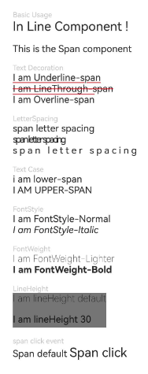

# Span

<!--Del-->
> **Note:**
>
> Currently in the beta phase.
<!--DelEnd-->

A child component of the [Text](cj-text-input-text.md) component, used to display inline text.

## Import Module

```cangjie
import kit.ArkUI.*
```

## Child Components

None

## Creating the Component

### init(?ResourceStr)

```cangjie
public init(value: ?ResourceStr)
```

**Function:** Creates a Span component.

**System Capability:** SystemCapability.ArkUI.ArkUI.Full

**Since:** 22

**Parameters:**

| Parameter | Type | Required | Default Value | Description |
|:---|:---|:---|:---|:---|
| value | ?[ResourceStr](./cj-common-types.md#interface-resourcestr) | Yes | - | Text content.<br>Initial value: "". |

## Common Attributes/Common Events

Common Attributes: Not supported.

Common Events: Only [onClick](#func-onclickclickevent---unit) click event sare supported.

> **Note:**
>
> Since the Span component has no size information, the target property of the ClickEvent object returned by click events is invalid.

## Component Attributes

### func decoration(?TextDecorationType, ?ResourceColor)

```cangjie
public func decoration(decorationType!: ?TextDecorationType, color!: ?ResourceColor = None): This
```

**Function:** Sets the text decoration line style and its color.

**System Capability:** SystemCapability.ArkUI.ArkUI.Full

**Since:** 22

**Parameters:**

| Parameter | Type | Required | Default Value | Description |
|:---|:---|:---|:---|:---|
| decorationType | ?[TextDecorationType](./cj-common-types.md#enum-textdecorationtype) | Yes | - | **Named parameter.** Text decoration line style.<br>Initial value: TextDecorationType.None. |
| color | ?[ResourceColor](./cj-common-types.md#interface-resourcecolor) | No | None | **Named parameter.** Text decoration line color.<br>Initial value: Color.Black. |

### func fontColor(?ResourceColor)

```cangjie
public func fontColor(value: ?ResourceColor): This
```

**Function:** Sets the font color.

**System Capability:** SystemCapability.ArkUI.ArkUI.Full

**Since:** 22

**Parameters:**

| Parameter | Type | Required | Default Value | Description |
|:---|:---|:---|:---|:---|
| value | ?[ResourceColor](./cj-common-types.md#interface-resourcecolor) | Yes | - | Font color. |

### func fontFamily(?ResourceStr)

```cangjie
public func fontFamily(value: ?ResourceStr): This
```

**Function:** Sets the font list.

**System Capability:** SystemCapability.ArkUI.ArkUI.Full

**Since:** 22

**Parameters:**

| Parameter | Type | Required | Default Value | Description |
|:---|:---|:---|:---|:---|
| value | ?[ResourceStr](./cj-common-types.md#interface-resourcestr) | Yes | - | Font list.<br>Initial value: "HarmonyOS Sans". |

### func fontSize(?Length)

```cangjie
public func fontSize(value: ?Length): This
```

**Function:** Sets the font size.

**System Capability:** SystemCapability.ArkUI.ArkUI.Full

**Since:** 22

**Parameters:**

| Parameter | Type | Required | Default Value | Description |
|:---|:---|:---|:---|:---|
| value | ?[Length](./cj-common-types.md#interface-length) | Yes | - | Font size. |

### func fontStyle(?FontStyle)

```cangjie
public func fontStyle(value: ?FontStyle): This
```

**Function:** Sets the font style.

**System Capability:** SystemCapability.ArkUI.ArkUI.Full

**Since:** 22

**Parameters:**

| Parameter | Type | Required | Default Value | Description |
|:---|:---|:---|:---|:---|
| value | ?[FontStyle](./cj-common-types.md#enum-fontstyle) | Yes | - | Font style.<br>Initial value: FontStyle.Normal. |

### func fontWeight(?FontWeight)

```cangjie
public func fontWeight(value: ?FontWeight): This
```

**Function:** Sets the font weight of the text. Setting too large a value may result in truncation in different fonts.

**System Capability:** SystemCapability.ArkUI.ArkUI.Full

**Since:** 22

**Parameters:**

| Parameter | Type | Required | Default Value | Description |
|:---|:---|:---|:---|:---|
| value | ?[FontWeight](./cj-common-types.md#enum-fontweight) | Yes | - | Font weight of the text. Setting too large a value may result in truncation in different fonts.<br>Initial value: FontWeight.Normal. |

### func letterSpacing(?Length)

```cangjie
public func letterSpacing(value: ?Length): This
```

**Function:** Sets the text character spacing.

**System Capability:** SystemCapability.ArkUI.ArkUI.Full

**Since:** 22

**Parameters:**

| Parameter | Type | Required | Default Value | Description |
|:---|:---|:---|:---|:---|
| value | ?[Length](./cj-common-types.md#interface-length) | Yes | - | Character spacing.<br>Initial value: 0.0.px. |

### func textCase(?TextCase)

```cangjie
public func textCase(value: ?TextCase): This
```

**Function:** Sets the text case.

**System Capability:** SystemCapability.ArkUI.ArkUI.Full

**Since:** 22

**Parameters:**

| Parameter | Type | Required | Default Value | Description |
|:---|:---|:---|:---|:---|
| value | ?[TextCase](./cj-common-types.md#enum-textcase) | Yes | - | Text case.<br>Initial value: TextCase.Normal. |

### func lineHeight(?Length)

```cangjie
public func lineHeight(value: ?Length): This
```

**Function:** Sets the text line height. If this API is not called, the system automatically calculates the line height based on the font size by default.

**System Capability:** SystemCapability.ArkUI.ArkUI.Full

**Since:** 26.1.0

**Parameters:**

| Parameter | Type | Required | Default Value | Description |
|:---|:---|:---|:---|:---|
| value | ?[Length](./cj-common-types.md#interface-length) | Yes | - | Text line height.<br>For Int64 and Float64 types, the unit is fp. Percentage strings are not supported. |

## Component Events

### func onClick(?(ClickEvent) -> Unit)

```cangjie
public func onClick(event: ?(ClickEvent) -> Unit): This
```

**Function:** Click event callback function.

**System Capability:** SystemCapability.ArkUI.ArkUI.Full

**Since:** 22

**Parameters:**

| Parameter | Type | Required | Default Value | Description |
|:---|:---|:---|:---|:---|
| event | ?([ClickEvent](./cj-common-types.md#class-clickevent)) -> Unit | Yes | - | Click event callback function, triggered on click.<br>Initial value: { _ => }. |

## Basic Type Definitions

### class BaseSpan

```cangjie
public abstract class BaseSpan {}
```

**Function:** Base class for Span components.

**System Capability:** SystemCapability.ArkUI.ArkUI.Full

**Since:** 22

## Example Code

### Example 1 (Setting Text Styles)

This example shows different text styles and Span click event configuration.

<!--run-->

```cangjie
package ohos_app_cangjie_entry

import kit.ArkUI.*
import ohos.arkui.state_macro_manage.*
import kit.PerformanceAnalysisKit.Hilog

@Entry
@Component
class EntryView {
    func build() {
        Flex(direction: FlexDirection.Column, alignItems: ItemAlign.Start) {
            Text("Basic Usage").fontSize(9).fontColor(0xCCCCCC)
            Text() {
                Span("In Line")
                Span(" Component")
                Span(" !")
            }

            Text() {
                Span("This is the Span component")
                    .fontSize(12)
                    .textCase(TextCase.Normal)
                    .decoration(decorationType: TextDecorationType.None, color: Color.Red)
                    .fontFamily("HarmonyOS Sans")
            }.margin(top: 12)

            // Add a line under the text.
            Text("Text Decoration").fontSize(9).fontColor(0xCCCCCC).margin(top: 12)
            Text() {
                Span("I am Underline-span")
                    .decoration(decorationType: TextDecorationType.Underline, color: Color.Red)
                    .fontSize(12)
            }

            Text() {
                Span("I am LineThrough-span")
                    .decoration(decorationType: TextDecorationType.LineThrough, color: Color.Red)
                    .fontSize(12)
            }

            Text() {
                Span("I am Overline-span")
                    .decoration(decorationType: TextDecorationType.Overline, color: Color.Red)
                    .fontSize(12)
            }

            // Set the letter spacing.
            Text("LetterSpacing").fontSize(9).fontColor(0xCCCCCC).margin(top: 12)
            Text() {
                Span("span letter spacing")
                    .letterSpacing(0)
                    .fontSize(12)
            }

            Text() {
                Span("span letter spacing")
                    .letterSpacing(-2)
                    .fontSize(12)
            }

            Text() {
                Span("span letter spacing")
                    .letterSpacing(3)
                    .fontSize(12)
            }

            // Set the text case.
            Text("Text Case").fontSize(9).fontColor(0xCCCCCC).margin(top: 12)
            Text() {
                Span("I am Lower-span")
                    .fontSize(12)
                    .textCase(TextCase.LowerCase)
                    .decoration(decorationType: TextDecorationType.None)
            }

            Text() {
                Span("I am Upper-span")
                    .fontSize(12)
                    .textCase(TextCase.UpperCase)
                    .decoration(decorationType: TextDecorationType.None)
            }

            // Set the text font style.
            Text("FontStyle").fontSize(9).fontColor(0xCCCCCC).margin(top: 12)
            Text() {
                Span("I am FontStyle-Normal")
                    .fontSize(12)
                    .fontStyle(FontStyle.Normal)
            }

            Text() {
                Span("I am FontStyle-Italic")
                    .fontSize(12)
                    .fontStyle(FontStyle.Italic)
            }

            // Set the text font weight.
            Text("FontWeight").fontSize(9).fontColor(0xCCCCCC).margin(top: 12)
            Text() {
                Span("I am FontWeight-Lighter")
                    .fontSize(12)
                    .fontWeight(FontWeight.Lighter)
            }

            Text() {
                Span("I am FontWeight-Bold")
                    .fontSize(12)
                    .fontWeight(FontWeight.Bold)
            }

            // Set the text line height.
            Text("LineHeight").fontSize(9).fontColor(0xCCCCCC).margin(top: 12)
            Text() {
                Span("I am lineHeight default\n")
                    .fontSize(12)
                    .fontWeight(FontWeight.Lighter)
                Span("I am lineHeight 30")
                    .fontSize(12)
                    .lineHeight(30)
            }
                .backgroundColor(Color.Gray)

            // Set the click event.
            Text("span click event").fontSize(9).fontColor(0xCCCCCC).margin(top: 12)
            Text() {
                Span("Span default ").fontSize(12)
                Span("Span click")
                    .onClick(
                        {
                            event =>
                                Hilog.info(1, "Cangjie", "span onClick.")
                        }
                    )
            }
        }
            .width(100.percent)
            .padding(left: 35, right: 35, top: 35)
    }
}
```

