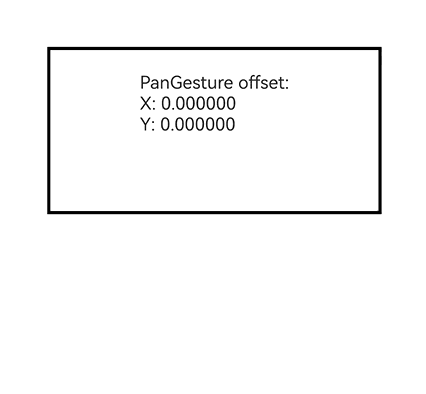
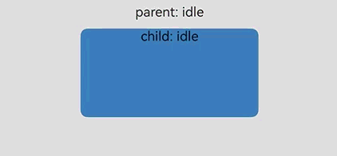

# Binding Gesture Events

<!--Del-->
> **Note:**
>
> Currently in the beta phase.
<!--DelEnd-->

Binds gesture events of different types to a component and sets how the events are responded to. Both regular gesture binding (gesture) and parallel gesture binding that can be triggered by parent and child components at the same time (parallelGesture) are supported. This capability applies to scenarios such as component interaction response and gesture collaboration between parent and child components.

> **Note:**
>
> - Only the pan gesture [PanGesture](./cj-basic-gestures-pangesture.md) can be bound in the current version.
> - You can use [touch target settings](./cj-universal-attribute-touchtarget.md) to specify the area where gestures can be recognized.

## Import Module

```cangjie
import kit.ArkUI.*
```

## func gesture(GestureType)

```cangjie
func gesture(gesture: GestureType): T
```

**Description:** Binds a gesture.

**System Capability:** SystemCapability.ArkUI.ArkUI.Full

**Since:** 26.1.0

**Parameters:**

| Parameter | Type | Required | Default | Description |
|:---|:---|:---|:---|:---|
| gesture | [GestureType](./cj-common-types.md#class-gesturetype) | Yes | - | Type of the gesture to bind. Only [PanGesture](./cj-basic-gestures-pangesture.md) is supported in the current version. |

**Return Value:**

| Type | Description |
|:---|:---|
| T | Returns the component instance itself that calls this interface, which can be used for chained calls. |

## func gesture(GestureType, ?GestureMask)

```cangjie
func gesture(gesture: GestureType, mask: ?GestureMask): T
```

**Description:** Binds a gesture and uses a gesture mask to control whether to block child component gestures.

**System Capability:** SystemCapability.ArkUI.ArkUI.Full

**Since:** 26.1.0

**Parameters:**

| Parameter | Type | Required | Default | Description |
|:---|:---|:---|:---|:---|
| gesture | [GestureType](./cj-common-types.md#class-gesturetype) | Yes | - | Type of the gesture to bind. Only [PanGesture](./cj-basic-gestures-pangesture.md) is supported in the current version. |
| mask | ?[GestureMask](./cj-common-types.md#enum-gesturemask) | Yes | GestureMask.Normal | Event response setting. Pass this parameter when you need to control whether to block child component gestures: GestureMask.Normal indicates that child component gestures are not blocked, which applies to scenarios where child component gestures are still allowed to participate in recognition as per the default rules after the parent component gesture is responded to; GestureMask.IgnoreInternal indicates that child component gestures are blocked, which applies to scenarios where you want the gesture bound to the parent component to respond and child component gestures to be ignored. |

**Return Value:**

| Type | Description |
|:---|:---|
| T | Returns the component instance itself that calls this interface, which can be used for chained calls. |

## func parallelGesture(GestureType)

```cangjie
func parallelGesture(gesture: GestureType): T
```

**Description:** Binds a gesture that can be triggered at the same time as child component gestures. Gesture events are non-bubbling events. When parallelGesture is set for a parent component, the same gesture events of both the parent and child components can be triggered, implementing a quasi-bubbling effect.

**System Capability:** SystemCapability.ArkUI.ArkUI.Full

**Since:** 26.1.0

**Parameters:**

| Parameter | Type | Required | Default | Description |
|:---|:---|:---|:---|:---|
| gesture | [GestureType](./cj-common-types.md#class-gesturetype) | Yes | - | Gesture object to bind. Only [PanGesture](./cj-basic-gestures-pangesture.md) is supported in the current version. |

**Return Value:**

| Type | Description |
|:---|:---|
| T | Returns the component instance itself that calls this interface, which can be used for chained calls. |

## func parallelGesture(GestureType, ?GestureMask)

```cangjie
func parallelGesture(gesture: GestureType, mask: ?GestureMask): T
```

**Description:** Binds a gesture that can be triggered at the same time as child component gestures, and uses a gesture mask to control whether to block child component gestures. Gesture events are non-bubbling events. When parallelGesture is set for a parent component, the same gesture events of both the parent and child components can be triggered, implementing a quasi-bubbling effect.

**System Capability:** SystemCapability.ArkUI.ArkUI.Full

**Since:** 26.1.0

**Parameters:**

| Parameter | Type | Required | Default | Description |
|:---|:---|:---|:---|:---|
| gesture | [GestureType](./cj-common-types.md#class-gesturetype) | Yes | - | Gesture object to bind. Only [PanGesture](./cj-basic-gestures-pangesture.md) is supported in the current version. |
| mask | ?[GestureMask](./cj-common-types.md#enum-gesturemask) | Yes | GestureMask.Normal | Event response setting. Pass this parameter when you need to configure simultaneous triggering of parent and child component gestures to control whether to block child component gestures: GestureMask.Normal indicates that child component gestures are not blocked, which applies to scenarios where both parent and child component gestures need to be responded to; GestureMask.IgnoreInternal indicates that child component gestures are blocked, which applies to scenarios where only the gesture bound to the parent component through parallelGesture is expected to respond. |

**Return Value:**

| Type | Description |
|:---|:---|
| T | Returns the component instance itself that calls this interface, which can be used for chained calls. |

## Example Code

### Example 1 (Binding a Pan Gesture to Move a Component with the Finger)

This example demonstrates binding a pan gesture through gesture, obtaining the offset in the callback after the pan gesture is successfully recognized, and moving the component with the finger.

<!-- run -->

```cangjie
package ohos_app_cangjie_entry

import kit.ArkUI.*
import ohos.arkui.state_macro_manage.*

@Entry
@Component
class EntryView {
    @State
    var offsetX: Float64 = 0.0
    @State
    var offsetY: Float64 = 0.0
    var positionX: Float64 = 0.0
    var positionY: Float64 = 0.0

    func build() {
        Column {
            Column {
                Text('PanGesture offset:\nX: ' + this.offsetX.toString() + '\nY: ' + this.offsetY.toString())
            }
                .height(150)
                .width(300)
                .padding(20)
                .borderWidth(3)
                .margin(50)
                // Moves the component with its upper left corner as the coordinate origin
                .translate(x: this.offsetX, y: this.offsetY)
                // Binds a pan gesture, which is triggered when one finger pans in any direction
                .gesture(
                    PanGesture(fingers: 1, direction: PanDirection.All, distance: 5.0)
                        .onActionStart({ _ =>
                            // The pan gesture is successfully recognized; record the current position of the component as the start position
                            this.positionX = this.offsetX
                            this.positionY = this.offsetY
                        })
                        .onActionUpdate({ event =>
                            // Updates the current position of the component based on the pan offset
                            this.offsetX = this.positionX + event.offsetX
                            this.offsetY = this.positionY + event.offsetY
                        })
                        .onActionEnd({ _ =>
                            // Saves the current position after the pan ends, as the start position of the next pan
                            this.positionX = this.offsetX
                            this.positionY = this.offsetY
                        })
                )
        }
            .height(100.percent)
            .width(100.percent)
    }
}
```



### Example 2 (Parent and Child Components Responding to a Pan Gesture at the Same Time)

This example demonstrates that after the parent component binds a parallel gesture through parallelGesture, the pan gestures bound to the parent and child components can be triggered at the same time when a pan is performed within the area of the child component.

<!-- run -->

```cangjie
package ohos_app_cangjie_entry

import kit.ArkUI.*
import ohos.arkui.state_macro_manage.*

@Entry
@Component
class EntryView {
    @State
    var parentText: String = 'parent: idle'
    @State
    var childText: String = 'child: idle'

    func build() {
        Column {
            Text(this.parentText)
                .fontSize(15)
                .margin(bottom: 10)
            Column {
                Text(this.childText)
                    .fontSize(15)
            }
                .width(200)
                .height(100)
                .backgroundColor(0x4682B4)
                .borderRadius(8)
                // The child component binds a pan gesture through gesture
                .gesture(
                    PanGesture()
                        .onActionUpdate({ event =>
                            this.childText = 'child pan, offsetX: ' + event.offsetX.toString()
                        })
                )
        }
            .width(100.percent)
            .height(200)
            .backgroundColor(0xDDDDDD)
            .borderRadius(12)
            .padding(10)
            // The parent component binds a parallel gesture through parallelGesture, so the pan gestures of the parent and child components can be triggered at the same time
            .parallelGesture(
                PanGesture()
                    .onActionUpdate({ event =>
                        this.parentText = 'parent parallel pan, offsetX: ' + event.offsetX.toString()
                    })
            )
    }
}
```


