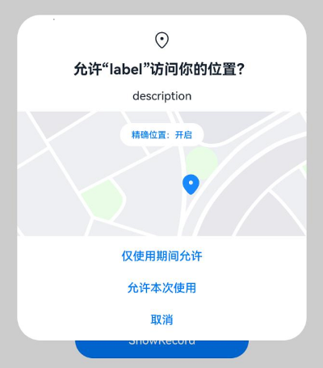

# Requesting User Authorization

<!--Del-->
> **Note:**
>
> Currently in the beta phase.
<!--DelEnd-->

When an application needs to access user privacy information or utilize system capabilities—such as obtaining location data, accessing calendars, using the camera to take photos, or recording videos—it must request authorization from the user. These permissions are classified as `user_grant` permissions.

When an application requests `user_grant` permissions, the following steps must be completed:

1. **Declare the required permissions** in the configuration file.  
2. **Associate the target objects** in the application with the corresponding permissions to ensure users clearly understand which operations require specific permissions.  
   For steps 1 and 2, refer to the section [Declaring Permissions](./cj-declare-permissions.md).  
3. **Trigger dynamic authorization prompts** at runtime when users initiate actions requiring permissions. The system checks whether the user has already granted the required permissions. If not, it displays a dynamic authorization dialog.  
4. **Verify the authorization result** before proceeding with restricted operations.  

This section explains how to complete steps 3 and 4.

## Constraints and Limitations

- **User-Centric Authorization**: `user_grant` permissions must adhere to the principle of user awareness and control. Applications must proactively call system APIs to request permissions at runtime. Users evaluate the legitimacy of sensitive permission requests based on the application's context.  
- **Limited Pop-up Frequency**: If a user denies authorization, the system prevents repeated pop-ups. Applications must guide users to manually grant permissions via **Settings**.  
- **Unobstructed Authorization Dialogs**:  
  System permission dialogs cannot be obscured by other UI components. They must be fully visible for users to make informed decisions.  
  If a permission dialog overlaps with other components, the system dialog takes precedence.  
- **Continuous Permission Checks**:  
  Before performing any operation requiring permissions, applications must verify authorization status using [`checkAccessToken()`](../../reference/AbilityKit/cj-apis-ability_access_ctrl.md#func-checkaccesstokenuint32-permissions). This returns [`PERMISSION_GRANTED`](../../reference/AbilityKit/cj-apis-ability_access_ctrl.md#enum-grantstatus) or [`PERMISSION_DENIED`](../../reference/AbilityKit/cj-apis-ability_access_ctrl.md#enum-grantstatus). See examples below.  
- **Dynamic Permission Requests**:  
  Use [`requestPermissionsFromUser()`](../../reference/AbilityKit/cj-apis-ability_access_ctrl.md#func-requestpermissionsfromuseruiabilitycontext-arraypermissions-asynccallbackexpermissionrequestresult) before accessing restricted APIs. Users may revoke permissions via system settings, so applications must not persist prior authorization states.  
- **Timing in `onWindowStageCreate()`**:  
  When requesting permissions in `onWindowStageCreate()`, ensure [`loadContent()`/`setUIContent()`](../../reference/AbilityKit/cj-apis-ability_access_ctrl.md#func-requestpermissionsfromuseruiabilitycontext-arraypermissions-asynccallbackexpermissionrequestresult) completes first. Otherwise, `requestPermissionsFromUser()` will fail.  
  <!--RP1--><!--RP1End-->

## Development Steps

Example: Requesting location permissions.

**Demo**:  
<!--RP4-->  
  
<!--RP4End-->

1. **Declare Permissions**:  
   Request `ohos.permission.LOCATION` and `ohos.permission.APPROXIMATELY_LOCATION` in the configuration file. Refer to [Declaring Permissions](./cj-declare-permissions.md).  

2. **Check Current Authorization Status**:  
   Before requesting permissions, verify whether they are already granted using [`checkAccessToken()`](../../reference/AbilityKit/cj-apis-ability_access_ctrl.md#func-checkaccesstokenuint32-permissions). Proceed if authorized; otherwise, request permissions.  

   ```cangjie
   import kit.AbilityKit.{Permissions, AbilityAccessCtrl, GrantStatus, BundleManager, BundleFlag}
   import kit.PerformanceAnalysisKit.Hilog
   import kit.AbilityKit.BundleInfo

   func checkPermissionGrant(permission: Permissions): GrantStatus {
       try {
           // Get the application's accessTokenID
           let tokenID = BundleManager.getBundleInfoForSelf(BundleFlag.GET_BUNDLE_INFO_WITH_APPLICATION).appInfo.accessTokenId
           let atManager = AbilityAccessCtrl.createAtManager()
           // Check authorization status
           return atManager.checkAccessToken(tokenID, permission)
       } catch(e: Exception) {
           Hilog.error(0,"","checkAccessToken Exception: ${e}")
           throw e
       }
   }

   func checkPermissions(): Unit {
       let grantStatus1: Bool = (checkPermissionGrant("ohos.permission.LOCATION") == GrantStatus.PermissionGranted)
       let grantStatus2: Bool = (checkPermissionGrant("ohos.permission.APPROXIMATELY_LOCATION") == GrantStatus.PermissionDenied)
       // Precise location (ohos.permission.LOCATION) can only be requested with approximate location (ohos.permission.APPROXIMATELY_LOCATION) or if approximate location is already granted.
       if (grantStatus2 && !grantStatus1) {
           Hilog.info(0,"","Only APPROXIMATELY_LOCATION is granted")
       } else if (!grantStatus1 && !grantStatus2) {
           Hilog.info(0,"","LOCATION and APPROXIMATELY_LOCATION not granted")
       } else {
           Hilog.info(0,"","LOCATION and APPROXIMATELY_LOCATION are granted")
       }
   }
   ```

3. **Request Permissions Dynamically**:  
   Use [`requestPermissionsFromUser()`](../../reference/AbilityKit/cj-apis-ability_access_ctrl.md#func-requestpermissionsfromuseruiabilitycontext-arraypermissions-asynccallbackexpermissionrequestresult) to prompt users for permissions like location, calendar, or camera access.  

   - **Request in `UIAbility`**:  
     ```cangjie
     // main_ability.cj
     import kit.AbilityKit.*
     import kit.PerformanceAnalysisKit.Hilog
     import kit.CangjieKit.*
     import kit.ArkUI.WindowStage

     class MainAbility <: UIAbility {
         public override func onWindowStageCreate(windowStage: WindowStage): Unit {
             Hilog.info(0,"","MainAbility onWindowStageCreate.")
             windowStage.loadContent("EntryView")
             var resultCallback = {
                 errorCode: Option<BusinessException>, data: Option<PermissionRequestResult> => match (errorCode) {
                     case Some(e) => Hilog.error(0,"","requestPermissionsFromUser failed, errcode: ${e.code}")
                     case _ =>
                         match (data) {
                             case Some(value) =>
                                 for (i in (0..value.permissions.size)) {
                                     if (value.authResults[i] == 0) {
                                         Hilog.info(0,"","permission: ${value.permissions[i]} is granted.")
                                     } else {
                                         Hilog.info(0,"","permission: ${value.permissions[i]} is denied by user.")
                                     }
                                 }
                             case _ => Hilog.error(0,"","requestPermissionsFromUser error: data is null")
                         }
                 }
             }
             let permissionList = ["ohos.permission.LOCATION", "ohos.permission.APPROXIMATELY_LOCATION"]
             let atManager = AbilityAccessCtrl.createAtManager()
             atManager.requestPermissionsFromUser(this.context, permissionList, resultCallback)
         }
     }
     ```

   - **Request in UI**:  
     ```cangjie
     // index.cj
     import kit.AbilityKit.*
     import kit.CangjieKit.*
     import kit.PerformanceAnalysisKit.Hilog
     import ohos.arkui.component.button.Button
     import ohos.arkui.state_macro_manage.Entry
     import ohos.arkui.state_macro_manage.Component

     @Entry
     @Component
     class EntryView {
         func requestPermissons(): Unit {
             var resultCallback = {
                 errorCode: Option<BusinessException>, data: Option<PermissionRequestResult> => match (errorCode) {
                     case Some(e) => Hilog.info(0,"","permissionResultCallBack request error: errcode: ${e.code}")
                     case _ =>
                         match (data) {
                             case Some(value) =>
                                 for (i in (0..value.permissions.size)) {
                                     if (value.authResults[i] == 0) {
                                         Hilog.info(0,"","permission: ${value.permissions[i]} is granted.")
                                     } else {
                                         Hilog.info(0,"","permission: ${value.permissions[i]} is denied by user.")
                                     }
                                 }
                             case _ => Hilog.info(0,"","permissionResultCallBack request error: data is null")
                         }
                 }
             }
             let atManager = AbilityAccessCtrl.createAtManager()
             let stageContext = Global.abilityContext
             let permissionList = ["ohos.permission.LOCATION", "ohos.permission.APPROXIMATELY_LOCATION"]
             atManager.requestPermissionsFromUser(stageContext, permissionList, resultCallback)
         }

         func build() {
             Row {
                 Column {
                     Button("requestPermissons").onClick ({
                         evt => Hilog.info(0,"","Hello Cangjie")
                         requestPermissons()
                     }).fontSize(30).height(50)
                 }.width(100.percent)
             }.height(100.percent)
         }
     }
     ```

4. **Handle Authorization Results**:  
   If the user denies permissions, guide them to enable permissions manually via:  
   <!--RP3-->  
   **Settings > Privacy > Permission Manager > [App Name]**  
   <!--RP3End-->