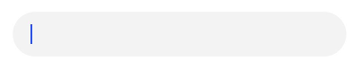
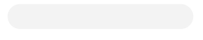
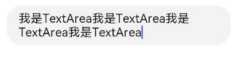
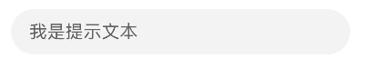
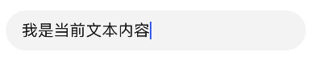
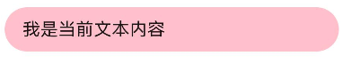
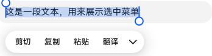
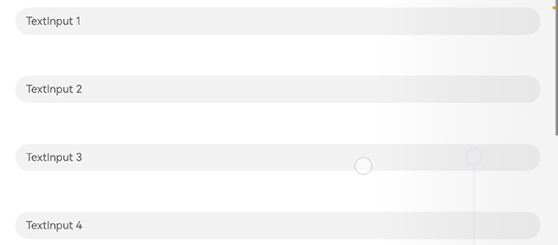
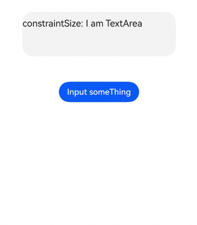

# 文本输入（TextInput/TextArea）

<!--Del-->
> **说明：**
>
> 当前为Beta阶段。
<!--DelEnd-->

TextInput、TextArea是输入框组件，通常用于响应用户的输入操作，比如评论区的输入、聊天框的输入、表格的输入等，也可以结合其它组件构建功能页面，例如登录注册页面。具体用法请参见[TextInput](../reference/arkui-cj/cj-text-input-textinput.md)、[TextArea](../reference/arkui-cj/cj-text-input-textarea.md)。

## 创建输入框

TextInput为单行输入框、TextArea为多行输入框。通过以下接口来创建。

```cangjie
init(placeholder!: ?ResourceStr = None, text!: ?ResourceStr = None, controller!: ?TextInputController = None)
```

```cangjie
init(placeholder!: ?ResourceStr = None, text!: ?ResourceStr = None,controller!: ?TextAreaController = None)
```

- 单行输入框。

    ```cangjie
    TextInput()
    ```

    

- 多行输入框。

    ```cangjie
    TextArea()
    ```

    

- 多行输入框文字超出一行时会自动折行。

    ```cangjie
    TextArea(text: "我是TextArea我是TextArea我是TextArea我是TextArea" ).width(300)
    ```

    

## 自定义样式

- 设置无输入时的提示文本。

    ```cangjie
    TextInput(placeholder: '我是提示文本')
    ```

    

- 设置输入框当前的文本内容。

    ```cangjie
    TextInput( placeholder: '我是提示文本', text: '我是当前文本内容' )
    ```

    

- 添加backgroundColor改变输入框的背景颜色。

    ```cangjie
    TextInput( placeholder: '我是提示文本', text: '我是当前文本内容' )
    .backgroundColor(0x4D0A59F7)
    ```

    

    更丰富的样式可以结合[通用属性](../reference/arkui-cj/cj-universal-attributes.md)实现。

## 选中菜单

输入框中的文字被选中时会弹出包含剪切、复制、翻译的菜单。

TextInput:

```cangjie
TextInput( text: '这是一段文本，用来展示选中菜单')
```



TextArea:

```cangjie
TextArea( text: '这是一段文本，用来展示选中菜单')
```


### 隐藏选中菜单

如需隐藏系统选中菜单，可使用[selectionMenuHidden](../reference/arkui-cj/cj-text-input-textinput.md#func-selectionmenuhiddenbool)接口。

```cangjie
TextInput(text: '隐藏选中菜单').selectionMenuHidden(true)
```

### 自定义键盘

通过[customKeyboard](../reference/arkui-cj/cj-text-input-textinput.md#func-customkeyboardcustombuilder-supportavoidancebool)接口可以自定义输入框的键盘。该接口接受一个[CustomBuilder](../reference/arkui-cj/cj-common-types.md#custombuilder)，用于构建自定义键盘内容。

> **说明：**
>
> 设置自定义键盘后，系统软键盘不再弹出。需开发者自行处理输入逻辑。

```cangjie
package ohos_app_cangjie_entry

import kit.ArkUI.*
import ohos.arkui.state_macro_manage.*

@Entry
@Component
class CustomKeyboardExample {
    @State
    var text: String = ""

    func build() {
        Column() {
            TextInput(text: this.text, placeholder: '请输入内容')
                .customKeyboard(this.customKey)
        }
        .width(100.percent)
        .height(100.percent)
        .alignItems(HorizontalAlign.Center)
    }

    @Builder
    func customKey(): Component {
        Column() {
            Row() {
                Button('1').onClick({evt => this.text += "1"}).width(60)
                Button('2').onClick({evt => this.text += "2"}).width(60)
                Button('3').onClick({evt => this.text += "3"}).width(60)
            }
            Row() {
                Button('4').onClick({evt => this.text += "4"}).width(60)
                Button('5').onClick({evt => this.text += "5"}).width(60)
                Button('6').onClick({evt => this.text += "6"}).width(60)
            }
        }
        .width(100.percent)
        .backgroundColor(Color.Gray)
    }
}
```

## 文本省略模式

当输入框内容超出显示范围时，可使用[textOverflow](../reference/arkui-cj/cj-text-input-textinput.md#func-textoverflowtextoverflow)、[ellipsisMode](../reference/arkui-cj/cj-text-input-textinput.md#func-ellipsismodeellipsismode)和[style](../reference/arkui-cj/cj-text-input-textinput.md#func-styletextinputstyle)接口配合实现省略号在不同位置显示的效果。

- **textOverflow**：设置文本超长时的显示方式，支持[TextOverflow.Ellipsis](../reference/arkui-cj/cj-common-types.md#enum-textoverflow)（省略号截断）和[TextOverflow.Clip](../reference/arkui-cj/cj-common-types.md#enum-textoverflow)（直接截断）。
- **ellipsisMode**：设置省略号的位置，支持以下模式：
  - [EllipsisMode.End](../reference/arkui-cj/cj-common-types.md#enum-ellipsismode)：省略号在末尾（默认值）。
  - [EllipsisMode.Start](../reference/arkui-cj/cj-common-types.md#enum-ellipsismode)：省略号在开头。
  - [EllipsisMode.Center](../reference/arkui-cj/cj-common-types.md#enum-ellipsismode)：省略号在中间。
  - [EllipsisMode.MultilineStart](../reference/arkui-cj/cj-common-types.md#enum-ellipsismode)：多行省略时在首行行首。
  - [EllipsisMode.MultilineCenter](../reference/arkui-cj/cj-common-types.md#enum-ellipsismode)：多行省略时在中间行。
- **style**：设置输入框风格，Inline风格支持多行文本省略，Default风格仅支持单行文本省略。

```cangjie
package ohos_app_cangjie_entry

import kit.ArkUI.*
import ohos.arkui.state_macro_manage.*

@Entry
@Component
class EllipsisModeExample {
    @State
    var text: String = "As the sun begins to set, casting a warm golden hue across the sky, " +
        "the world seems to slow down and breathe a sigh of relief. The sky is painted with hues of orange, " +
        "pink, and lavender, creating a breath taking tapestry that stretches as far as the eye can see."

    func build() {
        Column() {
            // 单行省略在末尾（默认）
            TextInput(text: this.text)
                .textOverflow(TextOverflow.Ellipsis)
                .ellipsisMode(EllipsisMode.End)
                .style(TextInputStyle.Default)
                .fontSize(30)
                .margin(10)

            // 单行省略在开头
            TextInput(text: this.text)
                .textOverflow(TextOverflow.Ellipsis)
                .ellipsisMode(EllipsisMode.Start)
                .style(TextInputStyle.Default)
                .fontSize(30)
                .margin(10)

            // 多行省略在中间行
            TextInput(text: this.text)
                .textOverflow(TextOverflow.Ellipsis)
                .ellipsisMode(EllipsisMode.MultilineCenter)
                .style(TextInputStyle.Inline)
                .fontSize(30)
                .margin(10)
        }
        .width(100.percent)
    }
}
```

## 绑定事件

TextInput提供以下事件回调：

- [onChange](../reference/arkui-cj/cj-text-input-textinput.md#func-onchangecallbackstring-unit)：输入内容变化时触发。
- [onSubmit](../reference/arkui-cj/cj-text-input-textinput.md#func-onsubmitcallbackenterkeytype-unit)：按下输入法回车键时触发。
- [onEditChange](../reference/arkui-cj/cj-text-input-textinput.md#func-oneditchangecallbackbool-unit)：输入框编辑状态变化时触发。
- [onCopy](../reference/arkui-cj/cj-text-input-textinput.md#func-oncopycallbackstring-unit)：复制时触发。
- [onCut](../reference/arkui-cj/cj-text-input-textinput.md#func-oncutcallbackstring-unit)：剪切时触发。
- [onPaste](../reference/arkui-cj/cj-text-input-textinput.md#func-onpastecallbackstring-unit)：粘贴时触发。

```cangjie
package ohos_app_cangjie_entry

import kit.ArkUI.*
import ohos.arkui.state_macro_manage.*

@Entry
@Component
class EventExample {
    @State
    var text: String = ""

    func build() {
        Column() {
            TextInput(text: this.text, placeholder: '请输入内容')
                .onChange({
                    value: String =>
                        this.text = value
                })
                .onSubmit({
                    enterKeyType: EnterKeyType =>
                        println("onSubmit: ${enterKeyType}")
                })
                .onEditChange({
                    isEditing: Bool =>
                        println("onEditChange: ${isEditing}")
                })
                .onCopy({
                    value: String =>
                        println("onCopy: ${value}")
                })
                .onCut({
                    value: String =>
                        println("onCut: ${value}")
                })
                .onPaste({
                    value: String =>
                        println("onPaste: ${value}")
                })
        }
        .width(100.percent)
    }
}
```


## 键盘避让

键盘抬起后，具有滚动能力的容器组件在横竖屏切换时，才会生效键盘避让，若希望无滚动能力的容器组件也生效键盘避让，建议在组件外嵌套一层具有滚动能力的容器组件，比如[Scroll](../reference/arkui-cj/cj-scroll-swipe-scroll.md)、[List](../reference/arkui-cj/cj-scroll-swipe-list.md)、[Grid](../reference/arkui-cj/cj-scroll-swipe-grid.md)。

<!-- run -->

```cangjie
package ohos_app_cangjie_entry

import kit.ArkUI.*
import ohos.arkui.state_macro_manage.*

@Entry
@Component
class EntryView {
    var placeHolderArr: Array<String> = ["1", "2", "3", "4", "5", "6", "7"];
    func build() {
        Scroll() {
            Column {
                ForEach(
                    this.placeHolderArr,
                    itemGeneratorFunc: {
                        placeholder: String, _: Int64 => TextInput(placeholder: 'TextInput ' + placeholder).margin(30)
                    }
                )
            }
        }
            .height(100.percent)
            .width(100.percent)
    }
}
```



## 常见问题

### 如何设置TextArea的文本最少展示行数并自适应高度

**问题现象**

设置TextArea的初始高度来控制最少文本展示行数，当输入文本超过初始高度时，TextArea的高度自适应。

**解决措施**

设置height为LengthMetrics.AUTO，并使用constraintSize自行计算高度。

``` cangjie
package ohos_app_cangjie_entry

import kit.ArkUI.*
import ohos.arkui.state_macro_manage.*

@Entry
@Component
class EntryView {
    let textAreaPadding = 12.0
    let setMaxLines = 3.0
    let changeText = "Add TextArea \n"
    @State var fullText: String = this.changeText
    @State var originText: String = this.changeText

    func build() {
        Column() {
            TextArea(text: 'constraintSize: ' + this.fullText)
            .fontSize(18)
            .padding(this.textAreaPadding)
            .width(300)
            .height(LengthMetrics.AUTO)
            .constraintSize(
                // 结合padding计算，设置至少显示this.setMaxLines行文本
                // 若涉及适老化字号缩放，需要监听并调整高度
                minHeight: (this.textAreaPadding * 2.0 + this.setMaxLines * 21.0)
            )

            Blank(min: 50)
            Button("Input something")
            .onClick({ evt =>
                this.fullText += this.changeText
            })
        }
        .justifyContent(FlexAlign.Center)
        .width(100.percent)
        .padding(top: 30)
    }
}
```

