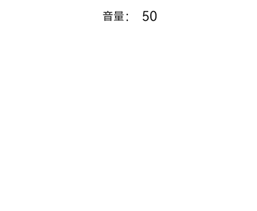

# 单一手势

<!--Del-->
> **说明：**
>
> 当前为Beta阶段。
<!--DelEnd-->

单一手势为最基础的手势类型，当前版本支持的单一手势为滑动手势（PanGesture）。

## 滑动手势（PanGesture）

```cangjie
PanGesture(fingers!: ?Int32, direction!: ?PanDirection, distance!: ?Float64)
```

滑动手势用于触发滑动手势事件，滑动达到最小滑动距离（默认值为5.vp）时滑动手势识别成功，参数定义参考[PanGesture](../reference/arkui-cj/cj-basic-gestures-pangesture.md)。

以下以实现一个简单的音量控制为例，可以通过滑动手势的回调函数处理上下滑动时的音量值增减逻辑。

<!-- run -->

```cangjie
package ohos_app_cangjie_entry

import kit.ArkUI.*
import ohos.arkui.state_macro_manage.*

@Entry
@Component
class EntryView {
    @State
    var currentVolume: Int64 = 50
    var startVolume: Int64 = 50

    func build() {
        Column(space: 12) {
            Row {
                Text('音量')
                Text('： ${this.currentVolume}').fontSize(20)
            }.margin(10)
            Column()
                .width(100.percent)
                .height(250)
                .backgroundColor(0xF5F5F5)
                .borderRadius(12)
                .gesture(
                    PanGesture()
                        .onActionStart({ _ =>
                            // 手势识别成功时记录当前音量，作为本次调节的起始音量
                            this.startVolume = this.currentVolume
                        })
                        .onActionUpdate({ event =>
                            // 上滑增大音量，下滑减小音量
                            let volumeChange = Int64(-event.offsetY * 0.1)
                            let newVolume = this.startVolume + volumeChange
                            if (newVolume > 100) {
                                this.currentVolume = 100
                            } else if (newVolume < 0) {
                                this.currentVolume = 0
                            } else {
                                this.currentVolume = newVolume
                            }
                        })
                        .onActionEnd({ _ =>
                            // 手势结束
                        }))
        }
        .width(100.percent)
        .height(100.percent)
        .padding(12)
    }
}
```



>**说明：**
>
> - 大部分可滑动组件，如List、Grid、Scroll、Tabs等组件是通过PanGesture实现滑动，在组件内部的子组件绑定[滑动手势（PanGesture）](#滑动手势pangesture)会导致手势竞争。
>
> - 当在子组件绑定PanGesture时，在子组件区域进行滑动仅触发子组件的PanGesture。如果需要父组件响应，可以通过[并行手势绑定方法（parallelGesture）](./cj-gesture-events-binding.md#parallelgesture并行手势绑定方法)实现父子组件同时响应，或者子组件向父组件传递消息进行实现，也可以通过修改父子组件的PanGesture参数distance使得滑动更灵敏。
>
> - 不合理的阈值设置会导致滑动不跟手（响应时延慢）的问题。
