# 选项卡（Tabs）

<!--Del-->
> **说明：**
>
> 当前为Beta阶段。
<!--DelEnd-->

当页面信息较多时，为了让用户能够聚焦于当前显示的内容，需要对页面内容进行分类，提高页面空间利用率。[Tabs](../reference/arkui-cj/cj-navigation-switching-tabs.md)组件可以在一个页面内快速实现视图内容的切换，一方面提升查找信息的效率，另一方面精简用户单次获取到的信息量。

## 基本布局

Tabs组件的页面组成包含两个部分，分别是TabContent和TabBar。TabContent是内容页，TabBar是导航页签栏，页面结构如下图所示，根据不同的导航类型，布局会有区别，可以分为底部导航、顶部导航、侧边导航，其导航栏分别位于底部、顶部和侧边。

**图1** Tabs组件布局示意图

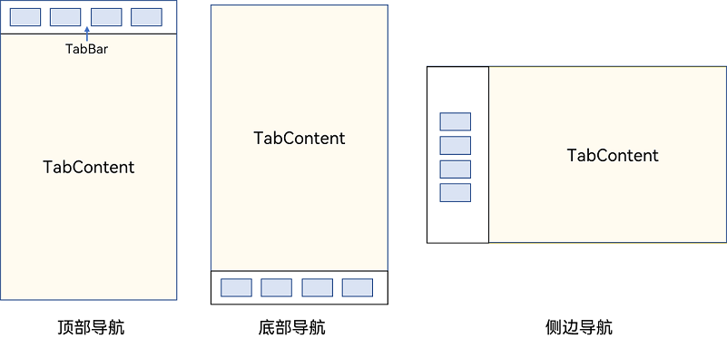

> **说明：**
>
> - TabContent组件不支持设置通用宽度属性，其宽度默认撑满Tabs父组件。
> - TabContent组件不支持设置通用高度属性，其高度由Tabs父组件高度与TabBar组件高度决定。

Tabs使用花括号包裹TabContent，如图2，其中TabContent显示相应的内容页。

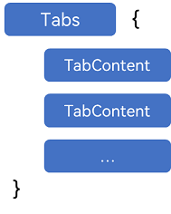

每一个TabContent对应的内容需要有一个页签，可以通过TabContent的tabBar属性进行配置。在如下TabContent组件上设置tabBar属性，可以设置其对应页签中的内容，tabBar作为内容的页签。

```cangjie
 TabContent() {
   Text('首页的内容').fontSize(30)
 }
.tabBar('首页')
```

设置多个内容时，需在Tabs内按照顺序放置。

```cangjie
Tabs() {
  TabContent() {
    Text('首页的内容').fontSize(30)
  }
  .tabBar('首页')

  TabContent() {
    Text('推荐的内容').fontSize(30)
  }
  .tabBar('推荐')

  TabContent() {
    Text('发现的内容').fontSize(30)
  }
  .tabBar('发现')

  TabContent() {
    Text('我的内容').fontSize(30)
  }
  .tabBar("我的")
}
```

## 底部导航

底部导航是应用中最常见的一种导航方式。底部导航位于应用一级页面的底部，用户打开应用，能够分清整个应用的功能分类，以及页签对应的内容，并且其位于底部更加方便用户单手操作。底部导航一般作为应用的主导航形式存在，其作用是将用户关心的内容按照功能进行分类，迎合用户使用习惯，方便在不同模块间的内容切换。

**图3** 底部导航栏


导航栏位置使用Tabs的barPosition参数进行设置。默认情况下，导航栏位于顶部，此时，barPosition为BarPosition.Start。设置为底部导航时，需要将barPosition设置为BarPosition.End。

```cangjie
Tabs(barPosition: BarPosition.End) {
    // TabContent的内容，例如：首页、发现、推荐、我的
    // ...
}
```

## 顶部导航

当内容分类较多，用户对不同内容的浏览概率相差不大，需要经常快速切换时，一般采用顶部导航模式进行设计，作为对底部导航内容的进一步划分，常见一些资讯类应用对内容的分类为关注、视频、数码，或者主题应用中对主题进行进一步划分为图片、视频、字体等。

**图4** 顶部导航栏

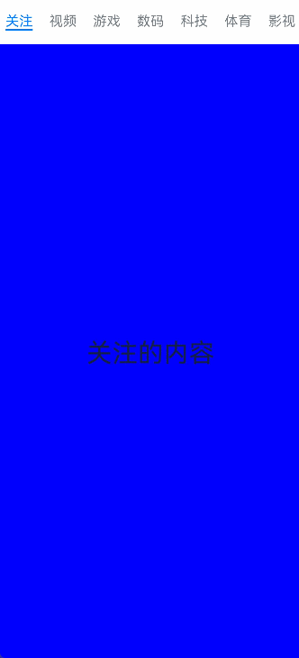

```cangjie
Tabs(barPosition: BarPosition.Start) {
    // TabContent的内容，例如:关注、视频、游戏、数码、科技、体育、影视
    // ...
}
```

## 侧边导航

侧边导航是应用较为少见的一种导航模式，更多适用于横屏界面，用于对应用进行导航操作，由于用户的视觉习惯是从左到右，侧边导航栏默认为左侧侧边栏。

**图5** 侧边导航栏

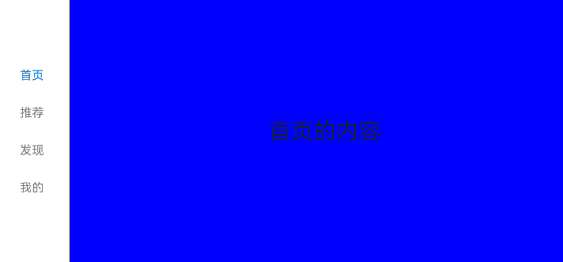

实现侧边导航栏需要将Tabs的vertical属性设置为true，vertical默认值为false，表明内容页和导航栏垂直方向排列。

```cangjie
Tabs(barPosition: BarPosition.Start) {
    // TabContent的内容，例如：首页、发现、推荐、我的
    // ...
}
.vertical(true)
```

> **说明：**
>
> - vertical为false时，tabbar的宽度默认为撑满屏幕的宽度，需要设置barWidth为合适值。
> - vertical为true时，tabbar的高度默认为实际内容的高度，需要设置barHeight为合适值。

## 限制导航栏的滑动切换

默认情况下，导航栏都支持滑动切换，在一些内容信息量需要进行多级分类的页面，如支持底部导航+顶部导航组合的情况下，底部导航栏的滑动效果与顶部导航出现冲突，此时需要限制底部导航的滑动，避免引起不好的用户体验。

**图6** 限制底部导航栏滑动

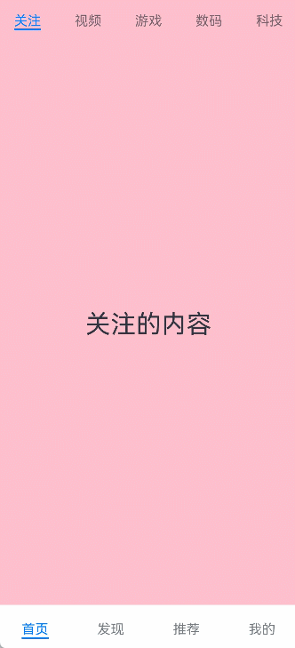

控制滑动切换的属性为scrollable，默认值为true，表示可以滑动，若要限制滑动切换页签则需要设置为false。

```cangjie
Tabs(barPosition: BarPosition.End) {
    TabContent() {
        Column() {
            Tabs() {
                // 顶部导航栏的内容
                // ...
            }
        }
        .backgroundColor(0XFF08A8F1)
        .width(100.percent)
    }
    .tabBar("首页")

    // 其他TabContent内容，例如：发现、推荐、我的
    // ...
}
.scrollable(false)
```

## 固定导航栏

当内容分类较为固定且不具有拓展性时，例如底部导航内容分类一般固定，分类数量一般在3-5个，此时使用固定导航栏。固定导航栏不可滚动，无法被拖拽滚动，内容均分tabBar的宽度。

**图7** 固定导航栏

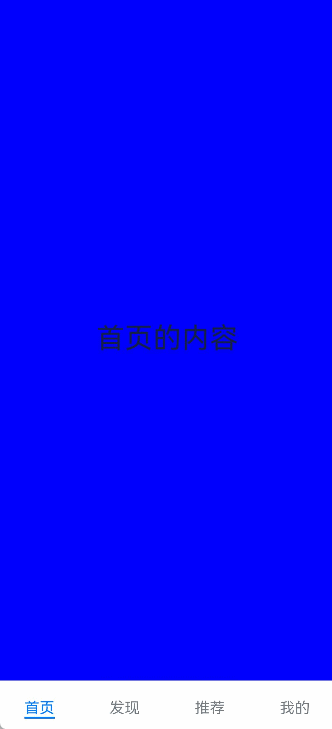

Tabs的barMode属性用于控制导航栏是否可以滚动，默认值为BarMode.Fixed。

```cangjie
Tabs(barPosition: BarPosition.End) {
    // TabContent的内容，例如：首页、发现、推荐、我的
    // ...
}
.barMode(BarMode.Fixed)
```

## 滚动导航栏

滚动导航栏可以用于顶部导航栏或者侧边导航栏的设置，内容分类较多，屏幕宽度无法容纳所有分类页签的情况下，需要使用可滚动的导航栏，支持用户点击和滑动来加载隐藏的页签内容。

**图8** 可滚动导航栏

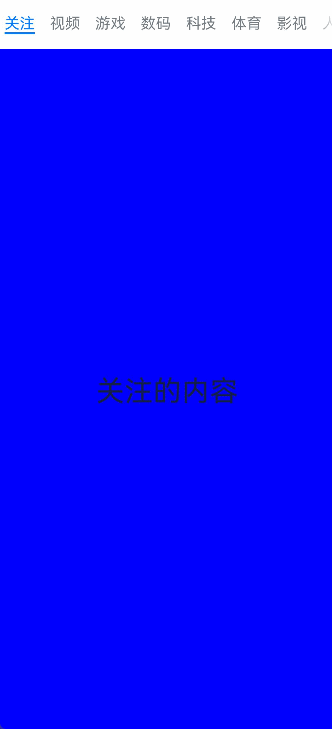

滚动导航栏需要设置Tabs组件的barMode属性，默认值为BarMode.Fixed表示为固定导航栏，BarMode.Scrollable表示可滚动导航栏

```cangjie
Tabs(barPosition: BarPosition.Start) {
    // TabContent的内容，例如：首页、发现、推荐、我的
    // ...
}
.barMode(BarMode.Scrollable)
```

## 自定义导航栏

对于底部导航栏，一般作为应用主页面功能区分，为了更好的用户体验，会组合文字以及对应语义图标表示页签内容，这种情况下，需要自定义导航页签的样式。

**图9** 自定义导航栏

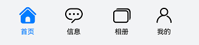

系统默认情况下采用了下划线标志当前活跃的页签，而自定义导航栏需要自行实现相应的样式，用于区分当前活跃页签和未活跃页签。

设置自定义导航栏需要使用tabBar的参数，以其支持的CustomBuilder的方式传入自定义的函数组件样式。例如这里声明tabBuilder的自定义函数组件，传入参数包括页签文字title，对应位置index，以及选中状态和未选中状态的图片资源。通过当前活跃的currentIndex和页签对应的targetIndex匹配与否，决定UI显示的样式。

<!-- code_check_manual -->

```cangjie
@State
var currentIndex: Int32 = 0

@Builder
func tabBuilder(title: String, targetIndex: Int32, imgs: Array<AppResource>) {
    Column() {
        if (this.currentIndex != targetIndex) {
            Image(imgs[0]).size(width: 25, height: 25)
            Text(title).fontColor(0X1698CE)
        } else {
            Image(imgs[1]).size(width: 25, height: 25)
            Text(title).fontColor(0X6B6B6B)
        }
    }
        .width(100.percent)
        .height(50)
        .justifyContent(FlexAlign.Center)
}
```

在TabContent对应tabBar属性中传入自定义函数组件，并传递相应的参数。

<!-- code_check_manual -->

```cangjie
TabContent(){
  Text("我的内容").fontSize(30)
}.tabBar({ =>
  bind(this.tabBuilder, this)("我的", 0, [@r(app.media.mine_normal), @r(app.media.mine_selected)])
})
```

## 切换至指定页签

在不使用自定义导航栏时，默认的Tabs会实现切换逻辑。在使用了自定义导航栏后，默认的Tabs仅实现滑动内容页和点击页签时内容页的切换逻辑，页签切换逻辑需要自行实现。即用户滑动内容页和点击页签时，页签栏需要同步切换至内容页对应的页签。

**图10** 内容页和页签不联动

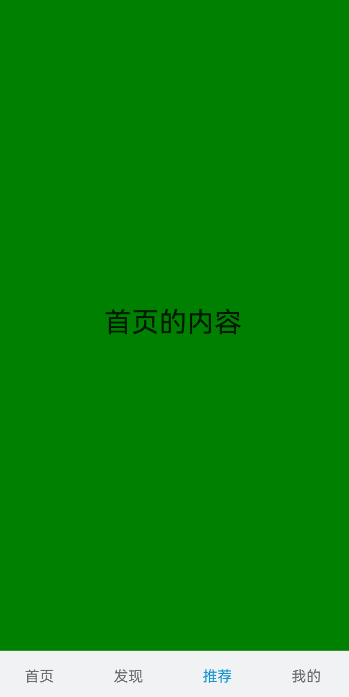

此时需要使用Tabs提供的onChange事件方法，监听索引index的变化，并将当前活跃的index值传递给currentIndex，实现页签的切换。

<!-- run -->

```cangjie
package ohos_app_cangjie_entry

import kit.ArkUI.*
import ohos.arkui.state_macro_manage.*
import std.collection.ArrayList

@Entry
@Component
public class EntryView {
    @State
    var currentIndex: Int32 = 2

    @Builder
    func tabBuilder(title: String, targetIndex: Int32) {
        Column() {
            Text(title).fontColor(if (this.currentIndex == targetIndex) {
                0X1698CE
            } else {
                0X6B6B6B
            })
        }
    }

    func build() {
        Column() {
            Tabs(barPosition: BarPosition.End) {
                TabContent() {
                    // ...
                }
                    .tabBar({
                        => bind(this.tabBuilder, this)("首页", 0)
                    })
                    .backgroundColor(Color.Green)
                TabContent() {
                    // ...
                }
                    .tabBar({
                        => bind(this.tabBuilder, this)("发现", 1)
                    })
                    .backgroundColor(Color(0xFFFF00))
                TabContent() {
                    // ...
                }
                    .tabBar({
                        => bind(this.tabBuilder, this)("推荐", 2)
                    })
                    .backgroundColor(0xFEC0CD)
                TabContent() {
                    // ...
                }
                    .tabBar({
                        => bind(this.tabBuilder, this)("我的", 3)
                    })
                    .backgroundColor(Color.Blue)
            }
                .animationDuration(0.0)
                .backgroundColor(0xF1F3F5)
                .onChange({
                    index => this.currentIndex = index
                })
        }.width(100.percent)
    }
}
```

**图11** 内容页和页签联动

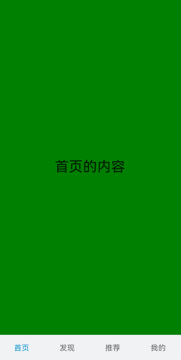

若希望不滑动内容页和点击页签也能实现内容页和页签的切换，可以将currentIndex传给Tabs的index参数，通过改变currentIndex来实现跳转至指定索引值对应的TabContent内容。也可以使用TabsController，TabsController是Tabs组件的控制器，用于控制Tabs组件进行内容页切换。通过TabsController的changeIndex方法来实现跳转至指定索引值对应的TabContent内容。

**图12** 切换指定页签

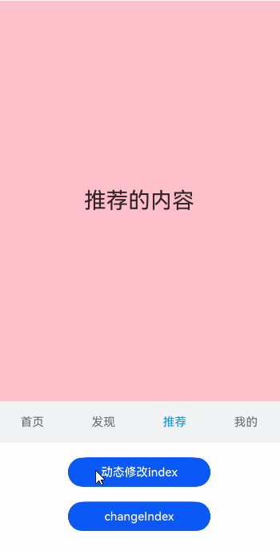

## 监听页签切换动画与手势滑动

当开发者需要在页签切换过程中实现自定义动画效果时，可使用以下事件接口：

- [onChange](../reference/arkui-cj/cj-navigation-switching-tabs.md#func-onchangecallbackint32-unit)：监听页签切换完成事件，返回当前选中页签的索引。
- [onAnimationStart](../reference/arkui-cj/cj-navigation-switching-tabs.md#func-onanimationstartint32-int32-tabsanimationevent---unit)：监听页签切换动画开始事件，返回起始索引、目标索引及动画信息。建议在此回调中提前更新自定义页签的状态，确保切换动画及时触发。
- [onGestureSwipe](../reference/arkui-cj/cj-navigation-switching-tabs.md#func-ongestureswipeint32-tabsanimationevent---unit)：监听用户手势滑动过程中目标页签的内容区域偏移事件，可用于实现自定义页签跟随手势滑动的动效。
- [onTabBarClick](../reference/arkui-cj/cj-navigation-switching-tabs.md#func-ontabbarclickint32)：监听点击页签事件，返回被点击页签的索引。

下面通过自定义TabBar切换动画（下划线跟随页面滑动）的示例，展示[onAnimationStart](../reference/arkui-cj/cj-navigation-switching-tabs.md#func-onanimationstartint32-int32-tabsanimationevent---unit)、[onGestureSwipe](../reference/arkui-cj/cj-navigation-switching-tabs.md#func-ongestureswipeint32-tabsanimationevent---unit)、[onChange](../reference/arkui-cj/cj-navigation-switching-tabs.md#func-onchangecallbackint32-unit)的配合使用。

**图13** 自定义TabBar切换动画


<!--run-->

```cangjie
package ohos_app_cangjie_entry

import kit.ArkUI.*
import ohos.arkui.state_macro_manage.*

@Entry
@Component
class CustomizeTabs {
    @State
    var currentIndex: Int32 = 0
    @State
    var selectedIndex: Int32 = 0
    @State
    var startX: Float64 = 0.0
    @State
    var endX: Float64 = 0.0
    @State
    var gestureStartX: Float64 = 0.0
    @State
    var gestureEndX: Float64 = 0.0
    @State
    var animationDuration: Int32 = 300

    func build() {
        Stack(align: Alignment.TopStart) {
            Tabs() {
                ForEach(Array<String>(3, item: {i =>
                    if (i == 0) { "green" } else if (i == 1) { "blue" } else { "yellow" }
                }), itemFunc: {item: String, index: Int32 =>
                    TabContent() {
                        Text(item).width(100.percent).height(100.percent).textAlign(TextAlign.Center).fontSize(50)
                    }
                    .tabBar(this.tabBuilder(index))
                })

            }
            .barPosition(BarPosition.Start)
            .onChange({
                index: Int32 =>
                    this.currentIndex = index
                    this.selectedIndex = index
            })
            .onAnimationStart({
                index: Int32, targetIndex: Int32, event: TabsAnimationEvent =>
                    if (index == targetIndex) {
                        return
                    }
                    this.selectedIndex = targetIndex
                    this.startX = Float64(index) * 100.0 / 3.0
                    this.endX = Float64(targetIndex) * 100.0 / 3.0
                    this.animationDuration = event.duration
            })
            .onGestureSwipe({
                index: Int32, event: TabsAnimationEvent =>
                    this.gestureStartX = Float64(index) * 100.0 / 3.0
                    this.gestureEndX = event.start * 100.0
            })

            // 自定义TabBar下划线
            Column() {
                Row() {
                    Text("green").fontSize(20).fontColor(this.selectedIndex == 0 ? Color.Red : Color.Black)
                    Text("blue").fontSize(20).fontColor(this.selectedIndex == 1 ? Color.Red : Color.Black)
                    Text("yellow").fontSize(20).fontColor(this.selectedIndex == 2 ? Color.Red : Color.Black)
                }
                .width(100.percent)
                .height(40)
                .justifyContent(FlexAlign.SpaceAround)

                // 下划线
                Text("")
                    .width(100.0 / 3.0)
                    .height(3)
                    .backgroundColor(Color.Red)
                    .position(x: Float64(this.selectedIndex) * 100.0 / 3.0)
            }
            .width(100.percent)
            .height(40)
        }
        .width(100.percent)
        .height(100.percent)
    }

    @Builder
    func tabBuilder(index: Int32): Component {
        Text("")
    }
}
```

## 页面切换拦截

当开发者需要在页签切换前进行业务判断（例如表单未保存时阻止切换）时，可使用[onContentWillChange](../reference/arkui-cj/cj-navigation-switching-tabs.md#func-oncontentwillchangeint32-int32---bool)事件接口。该接口在页签切换前触发，返回当前索引和目标索引，开发者可基于业务需求返回true允许切换或返回false阻止切换。

下面通过示例展示：当目标页签索引为2时阻止切换。

**图14** 页面切换拦截


<!--run-->

```cangjie
package ohos_app_cangjie_entry

import kit.ArkUI.*
import ohos.arkui.state_macro_manage.*

@Entry
@Component
class InterceptTabs {
    @State
    var currentIndex: Int32 = 0

    func build() {
        Column() {
            Tabs() {
                ForEach(Array<String>(3, item: {i =>
                    if (i == 0) { "green" } else if (i == 1) { "blue" } else { "yellow" }
                }), itemFunc: {item: String, index: Int32 =>
                    TabContent() {
                        Text(item).width(100.percent).height(100.percent).textAlign(TextAlign.Center).fontSize(50)
                    }
                    .tabBar(this.tabBuilder(index))
                })
            }
            .barPosition(BarPosition.Start)
            .onChange({
                index: Int32 =>
                    this.currentIndex = index
            })
            // 当目标页签为第3个时（索引为2），阻止切换
            .onContentWillChange({
                currentIndex: Int32, comingIndex: Int32 =>
                    if (comingIndex == 2) {
                        return false
                    }
                    return true
            })
        }
        .width(100.percent)
        .height(100.percent)
    }

    @Builder
    func tabBuilder(index: Int32): Component {
        Text("Tab ${index}").fontSize(20)
    }
}
```

