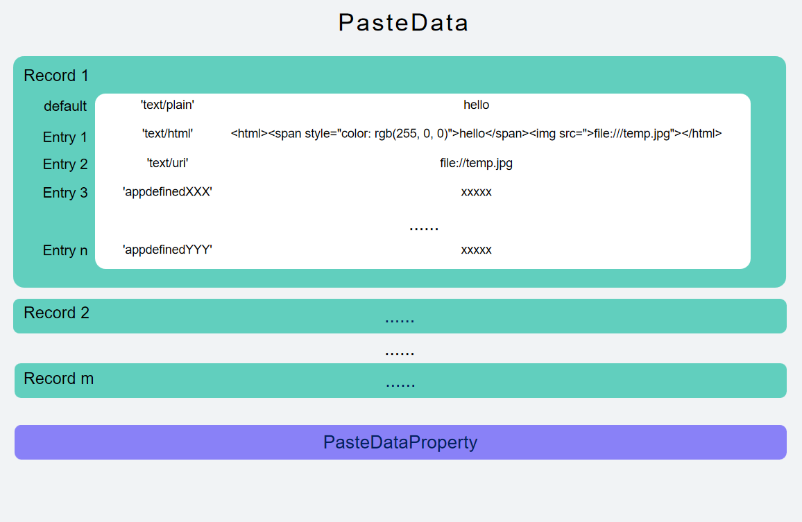

# 使用剪贴板进行复制粘贴

<!--Del-->
> **说明：**
>
> 当前为Beta阶段。
<!--DelEnd-->

剪贴板模块提供应用内及跨应用的数据复制、粘贴能力，支持文本、HTML、URI、PixelMap 以及自定义 MIME 类型的数据。当应用需要将数据写入系统剪贴板，或从系统剪贴板读取数据时，可以通过剪贴板模块完成。

剪贴板数据使用 PasteData 表示。复制方构建 PasteData 并写入系统剪贴板，粘贴方从系统剪贴板读取 PasteData 并解析其中的 PasteDataRecord。PasteData 中的 PasteDataProperty 描述数据类型、时间戳、可粘贴范围等属性。

**图1** PasteData整体结构示意图



本指南以纯文本和 HTML 数据的复制粘贴为例，介绍剪贴板的主要使用流程。

## 开发步骤及注意事项

详细的API说明请参见[剪贴板 API参考](../../reference/BasicServicesKit/cj-apis-pasteboard.md#class-systempasteboard)。

1. 获取系统剪贴板对象。

   调用 getSystemPasteboard() 获取系统剪贴板服务入口对象。每次调用可返回不同的包装对象，所有包装对象均操作同一个系统剪贴板服务，后续的读写操作都通过该对象完成。

2. 构建剪贴板数据。

   - 复制单一类型的数据时，调用 createData(String, PasteDataValueType) 构建 PasteData。
   - 复制多种类型的数据时，可以先将 MIME 类型和数据放入 HashMap，再调用 createData(HashMap\<String, PasteDataValueType>) 构建 PasteData。
   - 需要在已有 PasteData 中追加条目时，调用 createRecord(String, PasteDataValueType) 创建 PasteDataRecord，再调用 PasteData.addRecord(PasteDataRecord) 或 PasteData.addRecord(String, PasteDataValueType) 添加。

   MIME 类型常量与 PasteDataValueType 的对应关系如下：

   | MIME类型常量 | 常量值 | 数据构造方式 |
   | :--- | :--- | :--- |
   | MIMETYPE_TEXT_PLAIN | "text/plain" | PasteDataValueType.StringValue(String) |
   | MIMETYPE_TEXT_HTML | "text/html" | PasteDataValueType.StringValue(String) |
   | MIMETYPE_TEXT_URI | "text/uri" | PasteDataValueType.StringValue(String) |
   | MIMETYPE_TEXT_WANT | "text/want" | 当前版本不支持通过 PasteDataValueType 构造 Want 数据。 |
   | MIMETYPE_PIXELMAP | "pixelMap" | PasteDataValueType.PixelMapValue(PixelMap) |
   | 自定义MIME类型 | 自定义字符串 | PasteDataValueType.StringValue(String)、PasteDataValueType.ArrayBufferValue(ArrayBuffer) 或 PasteDataValueType.PixelMapValue(PixelMap) |

   > **说明：**
   >
   > - MIME 类型字符串长度不能超过 1024 字节。
   > - 使用 HashMap 构建多类型数据时，首个 key-value 对应的 MIME 类型会作为默认类型，非默认类型的数据需要通过 getData 读取。HashMap 的遍历顺序不应作为业务依赖。
   > - ArrayBuffer 和 PixelMap 数据量较大时，应合理设置数据大小，并及时释放不再使用的对象。

3. 设置剪贴板属性（可选）。

   调用 PasteDataProperty(Array\<String>, String, Int64, Bool, ShareOption) 创建属性对象，再调用 PasteData.setProperty(PasteDataProperty) 设置到 PasteData 中。ShareOption.Inapp 表示仅允许同应用内粘贴，ShareOption.Localdevice 表示允许在本设备任意应用内粘贴。

4. 将数据写入系统剪贴板。

   调用 SystemPasteboard.setData(PasteData, AsyncCallback\<Unit>) 写入数据。成功时回调中的错误对象为空，失败时错误对象中携带错误码和错误信息。

5. 从系统剪贴板读取数据。

   调用 SystemPasteboard.getData(AsyncCallback\<PasteData>) 读取数据。应用使用自定义控件访问剪贴板内容时，需要申请 ohos.permission.READ_PASTEBOARD 权限；使用粘贴控件访问剪贴板内容时无需申请权限。

   读取到 PasteData 后，可以通过以下接口解析数据：

   - getMimeTypes()：获取剪贴板内容包含的所有 MIME 类型。
   - hasType(String)：判断剪贴板内容中是否存在指定 MIME 类型的数据。
   - getRecordCount() 和 getRecord(Int32)：获取条目数量和指定下标的条目。
   - getPrimaryText()、getPrimaryHtml()、getPrimaryUri()、getPrimaryPixelMap()：获取首个对应类型的文本、HTML、URI 或 PixelMap 内容。

6. 查询和清理剪贴板。

   - hasData(AsyncCallback\<Bool>)：异步判断剪贴板中是否有内容。
   - hasDataType(String)：判断剪贴板内容中是否有指定类型的数据。
   - clearData(AsyncCallback\<Unit>)：清空系统剪贴板内容。
   - getDataSource()：获取剪贴板数据的来源应用名称。
   - isRemoteData()：判断剪贴板数据是否来自其他设备。

   > **说明：**
   >
   > - 为保证剪贴板数据的准确性，同一时间只能执行一个复制或粘贴操作。
   > - 写入的文本数据长度受剪贴板服务约束。
   > - 从其他设备同步的剪贴板数据在读取时耗时较长，不建议在 UI 线程中执行数据检查和读取。

使用自定义控件调用 getData 前，需要申请 ohos.permission.READ_PASTEBOARD 权限。该权限为 system_basic 级别的受限权限，normal 应用需通过 ACL 跨级申请，在 HarmonyAppProvision Profile 的 acls > allowed-acls 中添加该权限，将应用的 APL 级别声明为 system_basic 及以上，并重新签名；同时在 module.json5 中声明权限并完成用户授权。具体申请方式参见[受限开放权限](../../security/AccessToken/cj-restricted-permissions.md#ohospermissionread_pasteboard)。完整示例省略授权流程，运行前需要完成权限配置。

## 完整示例

参考以下示例，将纯文本和 HTML 数据写入系统剪贴板，然后读取剪贴板内容并解析其中的文本和 HTML 数据。

<!-- compile -->

```cangjie
// index.cj

import kit.BasicServicesKit.*
import kit.CangjieKit.*
import kit.PerformanceAnalysisKit.Hilog

// 创建 HTML 类型的 Record 对象
let record2 = createRecord(MIMETYPE_TEXT_HTML,
    PasteDataValueType.StringValue("<!DOCTYPE html><html><body><h1>Hello</h1></body></html>"))
// 创建包含多个 Record 的 PasteData 对象
let data = createData(MIMETYPE_TEXT_PLAIN, PasteDataValueType.StringValue("Hello, World"))
data.addRecord(record2)

let property = PasteDataProperty([MIMETYPE_TEXT_PLAIN, MIMETYPE_TEXT_HTML], "", 0, false, ShareOption.Localdevice)
// 设置剪贴板内容属性，如是否允许跨设备、粘贴范围等
data.setProperty(property)

// 获取系统剪贴板对象
let board = getSystemPasteboard()

let clearCallback: AsyncCallback<Unit> = {
    err: Option<BusinessException>, _: Option<Unit> => match (err) {
        case Some(e) => Hilog.error(0, "PasteboardSample", "clearData failed: ${e.code}")
        case None => Hilog.info(0, "PasteboardSample", "clearData success")
    }
}

let readCallback: AsyncCallback<PasteData> = {
    err: Option<BusinessException>, pasteData: Option<PasteData> => match (err) {
        case Some(e) => Hilog.error(0, "PasteboardSample", "getData failed: ${e.code}")
        case None =>
            // 读取剪贴板数据并输出内容
            let result = pasteData.getOrThrow()
            Hilog.info(0, "PasteboardSample", "Text: ${result.getPrimaryText()}")
            Hilog.info(0, "PasteboardSample", "HTML: ${result.getPrimaryHtml()}")
            let hasText = board.hasDataType(MIMETYPE_TEXT_PLAIN)
            Hilog.info(0, "PasteboardSample", "Has text: ${hasText}")
            let source = board.getDataSource()
            Hilog.info(0, "PasteboardSample", "Source: ${source}")
            // 清空剪贴板
            board.clearData(clearCallback)
    }
}

let hasDataCallback: AsyncCallback<Bool> = {
    err: Option<BusinessException>, has: Option<Bool> => match (err) {
        case Some(e) => Hilog.error(0, "PasteboardSample", "hasData failed: ${e.code}")
        case None =>
            if (has.getOrThrow()) {
                board.getData(readCallback)
            } else {
                Hilog.info(0, "PasteboardSample", "No pasteboard data")
            }
    }
}

let writeCallback: AsyncCallback<Unit> = {
    err: Option<BusinessException>, _: Option<Unit> => match (err) {
        case Some(e) => Hilog.error(0, "PasteboardSample", "setData failed: ${e.code}")
        case None =>
            // 写入成功后查询剪贴板是否有数据
            board.hasData(hasDataCallback)
    }
}

// 开始写入剪贴板
board.setData(data, writeCallback)
```
