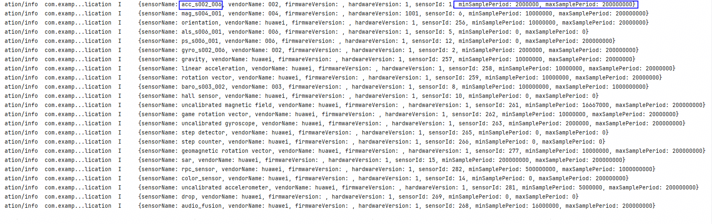
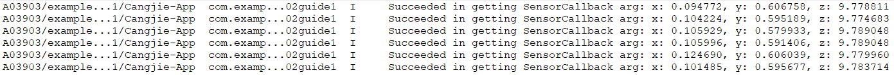
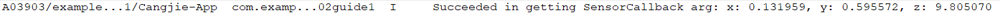

# 传感器开发指导

<!--Del-->
> **说明：**
>
> 当前为Beta阶段。
<!--DelEnd-->

## 场景介绍

当设备需要获取传感器数据时，可以使用sensor模块，例如：通过订阅方向传感器数据感知用户设备当前的朝向，通过订阅计步传感器数据统计用户的步数等。

详细的API介绍请参见[Sensor API](../../reference/SensorServiceKit/cj-apis-sensor.md)。

## 接口说明

| 名称 | 描述 |
| -------- | -------- |
| on\<T>(sensorType: SensorId, callback: Callback1Argument\<T>, option!: ?Options = None): Unit where T \<: Response | 持续监听传感器数据变化。 |
| once\<T>(sensorType: SensorId, callback: Callback1Argument\<T>): Unit where T \<: Response | 获取一次传感器数据变化。 |
| off(sensorType: SensorId, callback!: ?CallbackObject = None): Unit | 注销传感器数据的监听。 |
| getSensorList():Array\<Sensor> | 获取设备上的所有传感器信息。 |
| getGeomagneticInfo(locationOptions: LocationOptions, timeMillis: Int64, callback: AsyncCallback&lt;GeomagneticResponse&gt;): Unit | 获取某时刻地球上特定位置的地磁场信息。 |
| getDeviceAltitude(seaPressure: Float32, currentPressure: Float32, callback: AsyncCallback&lt;Float32&gt;): Unit | 根据气压值获取海拔高度。 |
| getInclination(inclinationMatrix: Array&lt;Float32&gt;, callback: AsyncCallback&lt;Float32&gt;): Unit | 根据倾斜矩阵计算地磁倾角。 |
| getAngleVariation(currentRotationMatrix: Array&lt;Float32&gt;, preRotationMatrix: Array&lt;Float32&gt;, callback: AsyncCallback&lt;Array&lt;Float32&gt;&gt;): Unit | 计算两个旋转矩阵之间的角度变化。 |
| getRotationMatrix(rotationVector: Array&lt;Float32&gt;, callback: AsyncCallback&lt;Array&lt;Float32&gt;&gt;): Unit | 从旋转向量获取旋转矩阵。 |
| transformRotationMatrix(inRotationVector: Array&lt;Float32&gt;, coordinates: CoordinatesOptions, callback: AsyncCallback&lt;Array&lt;Float32&gt;&gt;): Unit | 根据坐标系变换旋转向量。 |
| getQuaternion(rotationVector: Array&lt;Float32&gt;, callback: AsyncCallback&lt;Array&lt;Float32&gt;&gt;): Unit | 从旋转向量获取四元数。 |
| getOrientation(rotationMatrix: Array&lt;Float32&gt;, callback: AsyncCallback&lt;Array&lt;Float32&gt;&gt;): Unit | 根据旋转矩阵获取设备方向。 |
| getRotationMatrix(gravity: Array&lt;Float32&gt;, geomagnetic: Array&lt;Float32&gt;, callback: AsyncCallback&lt;RotationMatrixResponse&gt;): Unit | 根据重力向量和地磁向量获取旋转矩阵。 |

## 开发步骤

开发步骤以加速度传感器ACCELEROMETER为例。

1. 导入模块。

    <!-- compile -->

    ```cangjie
    import kit.SensorServiceKit.*
    import kit.CangjieKit.BusinessException
    import kit.CangjieKit.Callback1Argument
    import kit.PerformanceAnalysisKit.Hilog
    ```

2. 查询设备支持的所有传感器的参数。

    <!-- compile -->

    ```cangjie
    try {
        let sensors = getSensorList()
        for (index in 0..sensors.size) {
            Hilog.info(1, "info",
                "{sensorName: ${sensors[index].sensorName}, vendorName: ${sensors[index].vendorName}, firmwareVersion: ${sensors[index].firmwareVersion}, \n hardwareVersion: ${sensors[index].hardwareVersion}, sensorId: ${sensors[index].sensorId}, \n minSamplePeriod: ${sensors[index].minSamplePeriod}, maxSamplePeriod: ${sensors[index].maxSamplePeriod}}")
        }
    } catch (e: BusinessException) {
        Hilog.info(1, "info", "Failed to get sensor list. Code: ${e.code}, message: ${e.message}")
    }
    ```

    

    该传感器支持的最小采样周期为2000000纳秒，最大采样周期是200000000纳秒。不同传感器支持的采样周期范围也不同，interval应该设置在传感器支持范围内，大于最大值时以最大值上报数据，小于最小值时以最小值上报数据。设置数值越小数据上报越频繁，其功耗越大。

3. 检查是否已经配置相应权限，不同传感器所需权限信息请参见[传感器开发概述](./cj-sensor-overview.md#约束与限制)，具体配置方式请参见[声明权限](../../security/AccessToken/cj-declare-permissions.md)，申请权限请参见[向用户申请授权](../../security/AccessToken/cj-request-user-authorization.md)。

4. 注册监听。可以通过on()和once()两种接口监听传感器的调用结果。

   通过on()接口，实现对传感器的持续监听，传感器上报周期interval设置为100000000纳秒。

    <!-- compile -->

    ```cangjie
    // 自定义回调
    class SensorCallback <: Callback1Argument<AccelerometerResponse>
    {
        init() {}
        public func invoke(err: ?BusinessException, arg: AccelerometerResponse): Unit {
            Hilog.info(1, "info", "Succeeded in getting SensorCallback arg: x: ${arg.x}, y: ${arg.y}, z: ${arg.z}")
        }
    }

    func onExample() {
        let callback = SensorCallback()
        try {
            //周期传感器与瞬时传感器开发步骤相同。
            //区别是周期传感器按设定的固定时间间隔option采集并输出数据,瞬时传感器受特定触发事件影响采集并输出数据,不受option约束。
            on(SensorId.Accelerometer, callback, option: Options(interval: SensorNumber(100000000)))
        } catch (e: BusinessException) {
            Hilog.error(1, "info", "Sensor on error code: ${e.code}, message: ${e.message}")
        }
    }
    ```

    

    通过once()接口，实现对传感器的一次监听。

    <!-- compile -->

    ```cangjie
    // 自定义回调
    class SensorCallback <: Callback1Argument<AccelerometerResponse>
    {
        init() {}
        public func invoke(err: ?BusinessException, arg: AccelerometerResponse): Unit {
            Hilog.info(1, "info", "Succeeded in getting SensorCallback arg: x: ${arg.x}, y: ${arg.y}, z: ${arg.z}")
        }
    }

    func onceExample() {
        try {
            let callback = SensorCallback()
            once(SensorId.Accelerometer, callback)
        } catch (e: BusinessException) {
            Hilog.error(1, "info", "Sensor once error code: ${e.code}, message: ${e.message}")
        }
    }
    ```

    

5. 取消持续监听。

    <!-- compile -->

    ```cangjie
    func offExample() {
        try {
            // 取消注册SensorId.Accelerometer的所有回调
            off(SensorId.Accelerometer)
        } catch (e: BusinessException) {
            Hilog.error(1, "info", "Sensor off error code: ${e.code}, message: ${e.message}")
        }
    }
    ```

6. 获取某时刻地球上特定位置的地磁场信息。

   <!-- compile -->

   ```cangjie
   // index.cj
   import kit.SensorServiceKit.*
   import kit.CangjieKit.AsyncCallback
   import kit.CangjieKit.BusinessException
   import kit.PerformanceAnalysisKit.Hilog

   func getGeomagneticInfoExample() {
       let locationOptions = LocationOptions(80.0, 0.0, 0.0)
       let timeMillis: Int64 = 1580486400000
       try {
           getGeomagneticInfo(locationOptions, timeMillis) { err, data =>
               if (err != None) {
                   Hilog.error(0, "test", "getGeomagneticInfo failed")
                   return
               }
               Hilog.info(0, "test", "x=${data.x}, y=${data.y}, z=${data.z}")
               Hilog.info(0, "test", "geomagneticDip=${data.geomagneticDip}")
               Hilog.info(0, "test", "deflectionAngle=${data.deflectionAngle}")
               Hilog.info(0, "test", "levelIntensity=${data.levelIntensity}")
               Hilog.info(0, "test", "totalIntensity=${data.totalIntensity}")
           }
       } catch (e: BusinessException) {
           Hilog.error(0, "test", "getGeomagneticInfo exception: ${e.message}")
       }
   }
   ```

7. 根据气压值获取海拔高度。

   <!-- compile -->

   ```cangjie
   // index.cj
   import kit.SensorServiceKit.*
   import kit.CangjieKit.AsyncCallback
   import kit.CangjieKit.BusinessException
   import kit.PerformanceAnalysisKit.Hilog

   func getDeviceAltitudeExample() {
       let seaPressure: Float32 = 1013.25
       let currentPressure: Float32 = 1000.0
       try {
           getDeviceAltitude(seaPressure, currentPressure) { err, altitude =>
               if (err != None) {
                   Hilog.error(0, "test", "getDeviceAltitude failed")
                   return
               }
               Hilog.info(0, "test", "altitude=${altitude}")
           }
       } catch (e: BusinessException) {
           Hilog.error(0, "test", "getDeviceAltitude exception: ${e.message}")
       }
   }
   ```

8. 根据倾斜矩阵计算地磁倾角。

   <!-- compile -->

   ```cangjie
   // index.cj
   import kit.SensorServiceKit.*
   import kit.CangjieKit.AsyncCallback
   import kit.CangjieKit.BusinessException
   import kit.PerformanceAnalysisKit.Hilog

   func getInclinationExample() {
       let inclinationMatrix: Array<Float32> = Array<Float32>([1.0, 0.0, 0.0, 0.0, 1.0, 0.0, 0.0, 0.0, 1.0])
       try {
           getInclination(inclinationMatrix) { err, inclination =>
               if (err != None) {
                   Hilog.error(0, "test", "getInclination failed")
                   return
               }
               Hilog.info(0, "test", "inclination=${inclination}")
           }
       } catch (e: BusinessException) {
           Hilog.error(0, "test", "getInclination exception: ${e.message}")
       }
   }
   ```

9. 计算两个旋转矩阵之间的角度变化。

   <!-- compile -->

   ```cangjie
   // index.cj
   import kit.SensorServiceKit.*
   import kit.CangjieKit.AsyncCallback
   import kit.CangjieKit.BusinessException
   import kit.PerformanceAnalysisKit.Hilog

   func getAngleVariationExample() {
       let currentMatrix: Array<Float32> = Array<Float32>([1.0, 0.0, 0.0, 0.0, 1.0, 0.0, 0.0, 0.0, 1.0])
       let preMatrix: Array<Float32> = Array<Float32>([1.0, 0.0, 0.0, 0.0, 1.0, 0.0, 0.0, 0.0, 1.0])
       try {
           getAngleVariation(currentMatrix, preMatrix) { err, angleVariation =>
               if (err != None) {
                   Hilog.error(0, "test", "getAngleVariation failed")
                   return
               }
               Hilog.info(0, "test", "angleVariation size=${angleVariation.size}")
           }
       } catch (e: BusinessException) {
           Hilog.error(0, "test", "getAngleVariation exception: ${e.message}")
       }
   }
   ```

10. 从旋转向量获取旋转矩阵。

    <!-- compile -->

    ```cangjie
    // index.cj
    import kit.SensorServiceKit.*
    import kit.CangjieKit.AsyncCallback
    import kit.CangjieKit.BusinessException
    import kit.PerformanceAnalysisKit.Hilog

    func getRotationMatrixExample() {
        let rotationVector: Array<Float32> = Array<Float32>([0.0, 0.0, 0.0, 1.0])
        try {
            getRotationMatrix(rotationVector) { err, rotationMatrix =>
                if (err != None) {
                    Hilog.error(0, "test", "getRotationMatrix failed")
                    return
                }
                Hilog.info(0, "test", "rotationMatrix size=${rotationMatrix.size}")
            }
        } catch (e: BusinessException) {
            Hilog.error(0, "test", "getRotationMatrix exception: ${e.message}")
        }
    }
    ```

11. 根据坐标系变换旋转向量。

    <!-- compile -->

    ```cangjie
    // index.cj
    import kit.SensorServiceKit.*
    import kit.CangjieKit.AsyncCallback
    import kit.CangjieKit.BusinessException
    import kit.PerformanceAnalysisKit.Hilog

    func transformRotationMatrixExample() {
        let inRotationVector: Array<Float32> = Array<Float32>([1.0, 0.0, 0.0, 0.0, 1.0, 0.0, 0.0, 0.0, 1.0])
        let coordinates = CoordinatesOptions(1, 3)
        try {
            transformRotationMatrix(inRotationVector, coordinates) { err, result =>
                if (err != None) {
                    Hilog.error(0, "test", "transformRotationMatrix failed")
                    return
                }
                Hilog.info(0, "test", "result size=${result.size}")
            }
        } catch (e: BusinessException) {
            Hilog.error(0, "test", "transformRotationMatrix exception: ${e.message}")
        }
    }
    ```

12. 从旋转向量获取四元数。

    <!-- compile -->

    ```cangjie
    // index.cj
    import kit.SensorServiceKit.*
    import kit.CangjieKit.AsyncCallback
    import kit.CangjieKit.BusinessException
    import kit.PerformanceAnalysisKit.Hilog

    func getQuaternionExample() {
        let rotationVector: Array<Float32> = Array<Float32>([0.0, 0.0, 0.0, 1.0])
        try {
            getQuaternion(rotationVector) { err, quaternion =>
                if (err != None) {
                    Hilog.error(0, "test", "getQuaternion failed")
                    return
                }
                Hilog.info(0, "test", "quaternion size=${quaternion.size}")
            }
        } catch (e: BusinessException) {
            Hilog.error(0, "test", "getQuaternion exception: ${e.message}")
        }
    }
    ```

13. 根据旋转矩阵获取设备方向。

    <!-- compile -->

    ```cangjie
    // index.cj
    import kit.SensorServiceKit.*
    import kit.CangjieKit.AsyncCallback
    import kit.CangjieKit.BusinessException
    import kit.PerformanceAnalysisKit.Hilog

    func getOrientationExample() {
        let rotationMatrix: Array<Float32> = Array<Float32>([1.0, 0.0, 0.0, 0.0, 1.0, 0.0, 0.0, 0.0, 1.0])
        try {
            getOrientation(rotationMatrix) { err, orientation =>
                if (err != None) {
                    Hilog.error(0, "test", "getOrientation failed")
                    return
                }
                Hilog.info(0, "test", "orientation size=${orientation.size}")
            }
        } catch (e: BusinessException) {
            Hilog.error(0, "test", "getOrientation exception: ${e.message}")
        }
    }
    ```

14. 根据重力向量和地磁向量获取旋转矩阵。

    <!-- compile -->

    ```cangjie
    // index.cj
    import kit.SensorServiceKit.*
    import kit.CangjieKit.AsyncCallback
    import kit.CangjieKit.BusinessException
    import kit.PerformanceAnalysisKit.Hilog

    func getRotationMatrixByGravityExample() {
        let gravity: Array<Float32> = Array<Float32>([0.0, 0.0, 9.8])
        let geomagnetic: Array<Float32> = Array<Float32>([0.0, 0.0, 50.0])
        try {
            getRotationMatrix(gravity, geomagnetic) { err, response =>
                if (err != None) {
                    Hilog.error(0, "test", "getRotationMatrix failed")
                    return
                }
                Hilog.info(0, "test", "rotation size=${response.rotation.size}")
                Hilog.info(0, "test", "inclination size=${response.inclination.size}")
            }
        } catch (e: BusinessException) {
            Hilog.error(0, "test", "getRotationMatrix exception: ${e.message}")
        }
    }
    ```

## 备注

传感器的开发均同上述加速度传感器ACCELEROMETER。需要注意的是，传感器按采集数据方式分为周期传感器和瞬时传感器。周期传感器按预先设定的固定时间间隔采集并输出数据，如环境温度传感器AMBIENT_TEMPERATURE，订阅后，传感器按设计的时间间隔上报数据。周期传感器有GRAVITY、AMBIENT_TEMPERATURE、HUMIDITY、BAROMETER等。瞬时传感器受特定触发事件影响才采集并输出数据，如计步传感器PEDOMETER，步数有变化会上报。瞬时传感器有HALL、PROXIMITY、WEAR_DETECTION、PEDOMETER、PEDOMETER_DETECTION。
<!--Del-->
## 示例代码

[获取传感器信息](https://gitcode.com/openharmony/applications_app_samples_cangjie/tree/master/code/BasicFeature/DeviceManagement/Sensor)
<!--DelEnd-->
