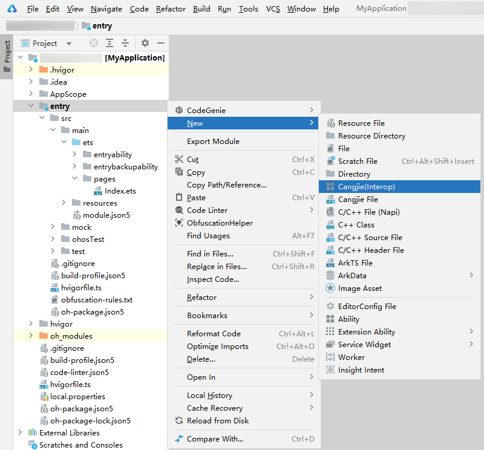
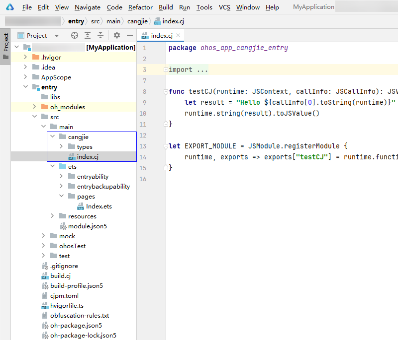
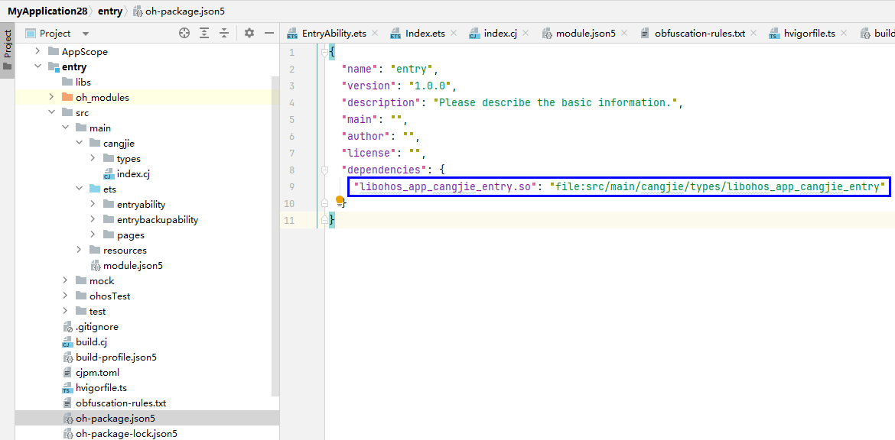
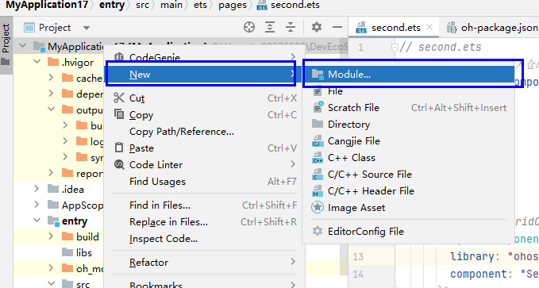
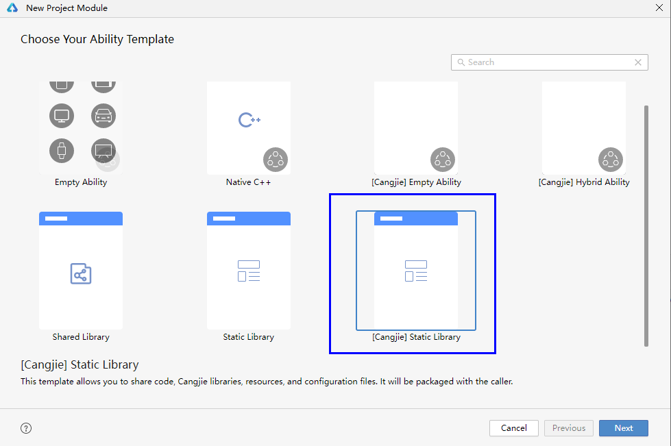
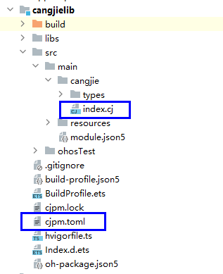

# 增加仓颉模块

该章节介绍如何在 DevEco Studio 的 ArkTS 工程中添加仓颉模块，主要分为在同一个 module 中添加仓颉模块及添加仓颉静态库模块，然后进行互操作调用。

## 在同一个 module 中添加仓颉模块

1. 按照下图所示，选中 ArkTS 的 entry 目录中的任意文件，单击右键，选择 **New -> Cangjie(Interop)**。

   

2. 点击 **Cangjie(Interop)** 按钮后，在选中的 ArkTS 模块下，自动创建 cjpm 的配置文件 `cjpm.toml` 和名为 `cangjie` 的文件夹。文件夹内包含模板代码文件 `index.cj`、用于存放仓颉的互操作接口声明文件 `types` 文件夹。如下图所示：

      

      并在 **entry -> oh-package.json5** 中自动生成仓颉的依赖：

      

3. 仓颉互操作模块实现后，在 ArkTS 代码中导入仓颉 `ohos_app_cangjie_entry` 模块，即可加载自定义的仓颉互操作模块，并调用相关的接口。

   ```typescript
   // 加载自定义的仓颉互操作模块
   import testCJ from "libohos_app_cangjie_entry.so"
   ```

4. 自定义的仓颉互操作模块加载成功后，即可在 ArkTS 工程中调用仓颉互操作模块提供的接口。

在 ArkTS 应用中调用仓颉互操作模块提供的 `testCJ` 函数示例如下：

```typescript
// 调用仓颉接口
console.log(testCJ("Cangjie"))
```

## 添加仓颉静态库模块

1. 右键单击工程名，然后选择 **New->Module** 添加仓颉静态库模块。

   

2. 选择 **[Cangjie] Static Library**，单击 **Next**，在弹出窗口中将 **Module name** 改为 **cangjielib**。

   

3. 然后会生成一个 **cangjielib** 文件夹，其中内容为仓颉源码文件及配置文件。

   

4. 在 **cangjielib->src->main->cangjie->index.cj** 文件中，添加互操作代码，以如下代码为例：

   <!-- compile -->
   ```cangjie
   package ohos_app_cangjie_cangjielib

   // 导入文件
   internal import kit.CangjieKit.JSModule
   internal import kit.CangjieKit.JSContext
   internal import kit.CangjieKit.JSCallInfo
   internal import kit.CangjieKit.JSValue

   // 互操作函数
   func sayHelloCJ(runtime: JSContext, callInfo: JSCallInfo): JSValue {
       let result = "cangjie har arkts use "
       runtime.string(result).toJSValue()
   }

   let EXPORT_MODULE = JSModule.registerModule {
       runtime, exports => exports["sayHelloCJ"] = runtime.function(sayHelloCJ).toJSValue()
   }
   ```

5. 在 **cangjielib->src->main->cangjie** 下创建互操作文件夹，命名为 **types**，并在 **types** 下创建 **libohos_app_cangjie_entry** 文件夹。

6. 在 **types->libohos_app_cangjie_entry** 下创建 **Index.d.ts** 文件，实现上述 index.cj 中 sayHelloCJ 相对应的 ArkTS 函数：

   ```ts
   export declare function sayHelloCJ(s: string): string
   ```

7. 在 **types->libohos_app_cangjie_entry** 下创建 **oh-package.json5** 文件，内容如下。其中 **name** 字段为互操作代码中对应的包名，该包名需要和 **cangjielib->cjpm.toml** 中配置的包名一致，此处设置 **name** 为 `libohos_app_cangjie_cangjielib.so`。

   ```json
   {
     "name": "libohos_app_cangjie_cangjielib.so",
     "types": "./Index.d.ts",
     "version": "1.0.0",
     "description": ""
   }
   ```

8. 在 ArkTS 使用仓颉静态库模块时，在 **entry/oh-package.json5** 的 **dependencies** 中，增加对上述包的依赖：

   ```json
   // ...
     "dependencies": {
       "cangjielib": "file:../cangjielib",
       "libohos_app_cangjie_cangjielib.so": "file:../cangjielib/src/main/cangjie/types/libohos_app_cangjie_entry"
     }
   // ...
   ```

9. 然后在 **entry->src->main->ets** 中，正常使用该函数，以如下 **Index.ets** 为例：

   ```ts
   // 导入仓颉函数
   import { sayHelloCJ } from 'libohos_app_cangjie_cangjielib.so'

   @Entry
   @Component
   struct Index {
     @State message: string = 'Hello World';

     build() {
       RelativeContainer() {
         Text(this.message)
           .fontSize(40)
           .fontWeight(FontWeight.Bold)
           .alignRules({
             center: { anchor: '__container__', align: VerticalAlign.Center },
             middle: { anchor: '__container__', align: HorizontalAlign.Center }
           })
           .onClick(() => {
             // 使用仓颉函数
             this.message = sayHelloCJ("Cangjie")
           })
       }
       .height('100%')
       .width('100%')
     }
   }
   ```

> **说明：**
>
> 禁止仓颉互操作模块被其他模块导入，否则在ArkTS导入互操作模块时，导入的内容可能缺失。

## 在仓颉模块中调用 ArkTS 模块

若仓颉互操作模块中需要反向调用 ArkTS 模块（系统模块、工程内模块等），可在互操作函数内使用 `requireArkModule` 动态导入并调用。以调用系统模块 `@ohos.hilog` 为例，最小示例如下：

<!-- compile -->
```cangjie
package ohos_app_cangjie_entry

// 导入互操作库
import kit.CangjieKit.*

// 互操作函数：在函数内动态导入 ArkTS 系统模块并调用
func loadHilog(context: JSContext, callInfo: JSCallInfo): JSValue {
    // 1. 动态导入系统模块 "@ohos.hilog"
    let module = context.requireArkModule("@ohos.hilog")
    // 2. 把导入的模块转换为 JSObject
    let hilog = module.asObject()
    // 3. 调用模块的 info 方法，打印一条日志
    hilog.callMethod(
        "info",
        [
            context.number(0).toJSValue(),
            context.string("test").toJSValue(),
            context.string("load hilog success").toJSValue()
        ]
    )
    // 4. 返回执行结果
    return context.boolean(true).toJSValue()
}

// 在模块导出时，将 loadHilog 注册为可被 ArkTS 调用的函数
let EXPORT_MODULE = JSModule.registerModule {
    runtime, exports => exports["loadHilog"] = runtime.function(loadHilog).toJSValue()
}
```

> **注意：**
>
> - `requireArkModule` 只能在 ArkTS 绑定线程使用，禁止在全局变量初始化和模块导出流程中调用，否则会触发错误码 34300007（Can not requireArkModule during initializing cangjie module）。完整限制请参见[在仓颉代码里导入ArkTS模块](./cangjie-load-arkts.md#使用限制)。

更多调用方式（模块方法列表的查询、通用调用流程、异步方法调用等），请参见[在仓颉代码里导入ArkTS模块](./cangjie-load-arkts.md)和[仓颉侧调用 ArkTS 模块](./cj-using_arkts_module.md)。
