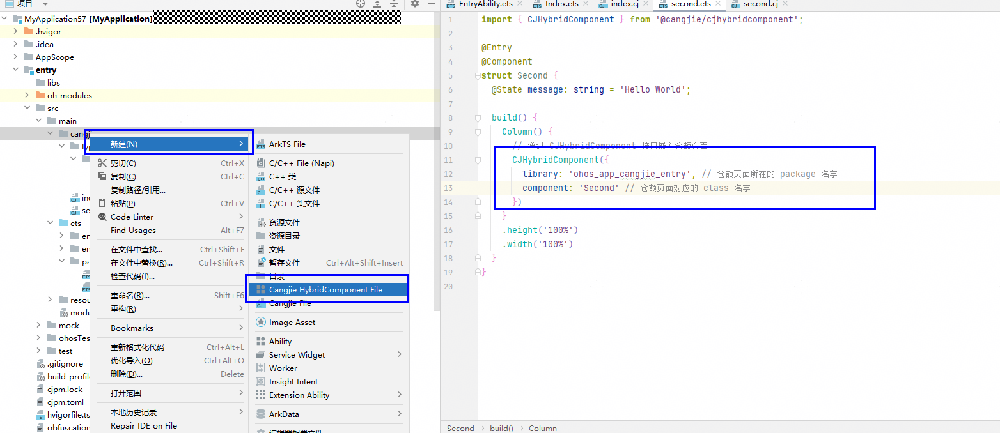
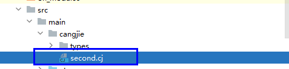
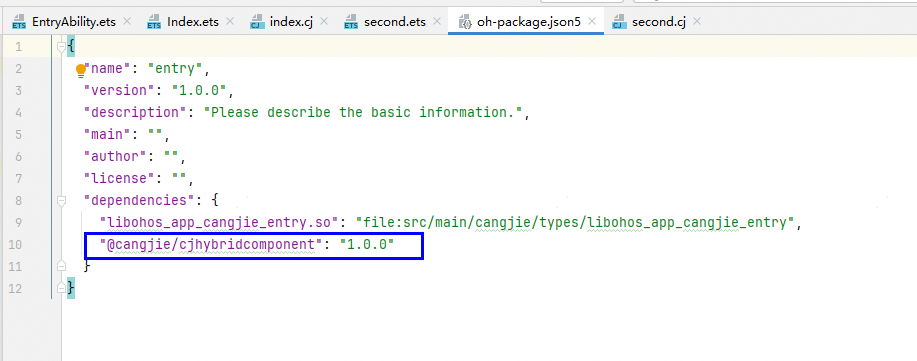

# 增加仓颉页面

在 ArkTS 使用仓颉中，支持增加仓颉页面（Page）。在 OpenHarmony 中，页面是应用程序界面的一部分，负责展示用户界面的元素，如文本、按钮、图片等，以及处理用户的交互操作。

> **说明：**
>
> 本文档适用于"在已有 ArkTS 工程中新增一个仓颉页面组件"的场景。若需从零开始体验完整的仓颉与 ArkTS 混合应用开发流程（含工程创建、路由跳转、运行），请先参见[构建第一个仓颉与ArkTS混合应用](./cj-quick-start-first-cangjie-hybrid-app.md)。
>
> 在仓颉与 ArkTS 混合开发场景中，仓颉页面不是一个真正意义上具有完整生命周期的页面，只能以组件的形式嵌入到 ArkTS 页面中，因此需要在 ArkTS 侧提供一个 @Entry 的页面作为容器，用于加载仓颉页面，以下将这种仓颉页面命名为仓颉页面组件。

在 DevEco Studio 中创建仓颉页面步骤如下：

1. 在 **Project** 窗口，打开 **entry > src > main**，右键单击 **cangjie** 文件夹，选择 **New > Cangjie HybridComponent File**，命名为 **Second**，如下图所示：

   

2. 在 Cangjie 目录下便会生成仓颉页面组件的文件：

   

   生成的 second.cj 文件内容如下：

   <!-- compile -->
   ```cangjie
   package ohos_app_cangjie_entry

   import kit.ArkUI.*
   import ohos.arkui.state_macro_manage.*

   // 该页面组件必须由HybridComponentEntry修饰
   @HybridComponentEntry
   @Component
   class Second {
       @State
       var msg: String = "Hello"
       // 仓颉组件构建
       public func build() {
           Column {
               Text(msg)
               Button("click to change Text").onClick({
                   _ => msg = "world"
               })
           }
       }
   }
   ```

   在 **entry->oh-package.json5** 中会生成页面组件的相关依赖：

   

3. 在 **entry->src->main->ets->pages** 中会生成一个 ArkTS 文件，该文件作为容器加载仓颉页面组件（见本章节开头的说明），其名为 second.ets，文件内容如下：

   ```ts
   // 在 ArkTS 页面中嵌入仓颉页面组件
   // 导入接口函数
   import { CJHybridComponent } from '@cangjie/cjhybridcomponent';

   @Entry
   @Component
   struct Second {
     build() {
       Row() {
         // 通过 CJHybridComponent 接口嵌入仓颉页面
         CJHybridComponent({
           library: "ohos_app_cangjie_entry", // 仓颉页面所在的 package 名字
           component: "Second"                // 仓颉页面对应的 class 名字
         })
       }
       .height('100%')
       .width('100%')
     }
   }
   ```

## 在仓颉页面组件中使用 List 渲染列表数据

当页面需要展示同类型的多条数据（如通讯录、音乐列表、购物清单等，数据量可达上千项）时，可以在仓颉页面组件中使用 List 组件：List 的子组件必须是 ListItemGroup 或 ListItem，列表项数量超出屏幕大小时会自动提供滚动能力；配合 ForEach 循环渲染，可从数据源中迭代生成列表项，避免逐个平铺内容相似的 ListItem。

以下示例在仓颉页面组件中用 List + ForEach 渲染列表数据（此处以少量数据演示写法，实际开发中数据源可以是上千项的数组）：

<!-- compile -->
```cangjie
package ohos_app_cangjie_entry

import kit.ArkUI.*
import ohos.arkui.state_macro_manage.*

// 该页面组件必须由HybridComponentEntry修饰
@HybridComponentEntry
@Component
class Second {
    @State
    var msg: String = "Hello"

    // 列表数据源，实际开发中可以是上千项的数组
    private var contacts: Array<String> = ["item 1", "item 2", "item 3"]

    // 仓颉组件构建
    public func build() {
        Column {
            Text(msg)
            // List 的子组件必须是 ListItemGroup 或 ListItem
            List() {
                ForEach(
                    this.contacts,
                    itemGeneratorFunc: {
                        item: String, _: Int64 => ListItem() {
                            Text(item)
                                .fontSize(20)
                                .margin(10)
                        }
                    },
                    keyGeneratorFunc: { item: String, idx: Int64 => idx.toString() }
                )
            }
            .width(100.percent)
            .layoutWeight(1)
        }
    }
}
```

关于 List 布局与约束、ListItemGroup 分组展示的更多用法，以及 ForEach 循环渲染的详细说明，请参见[使用List布局](../../../arkui-cj/cj-layout-development-create-list.md)和[ForEach：循环渲染](../../../arkui-cj/rendering_control/cj-rendering-control-foreach.md)。
