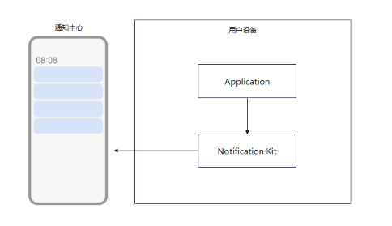
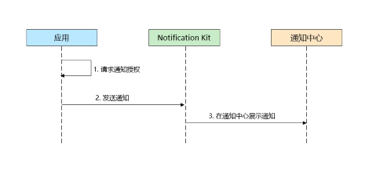
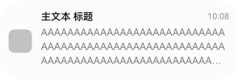

# Notification Kit简介

<!--Del-->
> **说明：**
>
> 当前为Beta阶段。
<!--DelEnd-->

Notification Kit（用户通知服务）为应用提供本地通知发布通道，应用可借助Notification Kit将业务产生的通知直接在客户端本地推送给用户，本地通知根据通知类型及发布场景会产生对应的铃声、振动、横幅、锁屏、自动亮屏、状态栏图标和通知中心的显示。

## 使用场景

当应用进程处于运行时，可以使用Notification Kit向用户发布通知。

可以在多种场景中运用本地通知能力，如同步用户的上传下载进度、发布即时的客服支付通知、更新运动步数等。

## 能力范围

仓颉侧Notification Kit支持的能力主要包括：

- 发布文本类型通知。
- 携带或更新应用通知角标。
- 取消应用发布的全部通知。
- 查询应用自身通知开关状态。
- 应用发布通知的能力默认关闭，可拉起授权框，请求用户授权发布通知。

  

## 业务流程

使用Notification Kit的主要业务流程如下：

1. 请求通知授权。

2. 应用发布通知到通知服务。

3. 将通知展示到通知中心。

## 通知样式

> **说明：**
>
> 实际显示效果依赖设备能力和通知中心UI设计样式。

Notification Kit中常用的通知样式如下：

| 类型 | 通知样式 | 规格描述 |
| ---- | --------| ------- |
| [文本](./cj-text-notification.md)   |  | 通知文本内容最多显示三行，超长后以“...”截断。 |
| [通知角标](./cj-notification-badge.md) |  | 以数字的形式展示在右上角。 |

## 约束限制

- 单个应用已发布的通知在通知中心等系统入口的留存数量有限（当前规格最多24条）。
- 通知的长度不能超过200KB（跨进程序列化大小限制）。
- 通知的发布频次和更新频次需要满足如下要求，否则会导致发布或更新失败，返回错误码1600009。
  - 单个应用发布新通知的频次累计不能超过每秒10条，更新通知的频次累计不能超过每秒20条。
  - 所有三方应用发布新通知的频次累计不能超过每秒15条，更新通知的频次累计不能超过每秒30条。

## 与相关Kit的关系

- Notification Kit创建的通知会即时显示在通知中心等系统入口，通知的生命周期由发布它的应用管理，应用可在合适的时机取消通知。
- 应用发布通知前需要获取用户授权，授权结果可以通过Notification Kit提供的接口查询。
