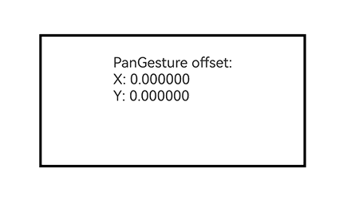

# PanGesture

<!--Del-->
> **说明：**
>
> 当前为Beta阶段。
<!--DelEnd-->

当滑动距离达到设定的最小值时，触发滑动手势事件。

以下场景可以触发滑动手势：

| 触发方式 | 输入源类型 | 输入设备类型 | 备注 |
|:---|:---|:---|:---|
| 手指按下滑动。 | [SourceTool](./cj-common-types.md#enum-sourcetool).Finger | [SourceType](./cj-common-types.md#enum-sourcetype).TouchScreen | axisVertical和axisHorizontal均为0。 |
| 鼠标左键按下滑动。 | [SourceTool](./cj-common-types.md#enum-sourcetool).Mouse | [SourceType](./cj-common-types.md#enum-sourcetype).Mouse | axisVertical和axisHorizontal均为0。 |
| 鼠标滚轮滚动。 | [SourceTool](./cj-common-types.md#enum-sourcetool).Mouse | [SourceType](./cj-common-types.md#enum-sourcetype).Mouse | axisVertical或axisHorizontal不为0。 |
| 触摸板按下左键后滑动。 | [SourceTool](./cj-common-types.md#enum-sourcetool).Mouse | [SourceType](./cj-common-types.md#enum-sourcetype).Mouse | axisVertical和axisHorizontal均为0。 |
| 触摸板双指滑动。 | [SourceTool](./cj-common-types.md#enum-sourcetool).Touchpad | [SourceType](./cj-common-types.md#enum-sourcetype).Mouse | axisVertical或axisHorizontal不为0。 |

> **说明：**
>
> 从API version 26.1.0开始支持。

## 导入模块

```cangjie
import kit.ArkUI.*
```

## class PanGesture

```cangjie
public class PanGesture <: GestureType {
    public init(fingers!: ?Int32 = Option<Int32>.None, direction!: ?PanDirection = Option<PanDirection>.None, distance!: ?Float64 = Option<Float64>.None)
}
```

**功能：** 定义滑动手势，当手指在屏幕上滑动的距离达到设定的最小值时，触发滑动手势事件。继承自[GestureType](./cj-common-types.md#class-gesturetype)，可通过[gesture](./cj-universal-attribute-gesture.md)或[parallelGesture](./cj-universal-attribute-gesture.md#func-parallelgesturegesturetype)绑定到组件上。

> **说明：**
>
> 在[GestureEvent](./cj-common-types.md#class-gestureevent)的fingerList元素中，手指索引编号与位置相对应，即fingerList[index]的id为index。对于先按下但未参与当前手势触发的手指，fingerList中对应的位置为空。建议优先使用fingerInfos。

**系统能力：** SystemCapability.ArkUI.ArkUI.Full

**起始版本：** 26.1.0

**父类型：**

- [GestureType](./cj-common-types.md#class-gesturetype)

### init(?Int32, ?PanDirection, ?Float64)

```cangjie
public init(fingers!: ?Int32 = Option<Int32>.None, direction!: ?PanDirection = Option<PanDirection>.None, distance!: ?Float64 = Option<Float64>.None)
```

**功能：** 创建滑动手势对象。

**系统能力：** SystemCapability.ArkUI.ArkUI.Full

**起始版本：** 26.1.0

**参数：**

|参数名|类型|必填|默认值|说明|
|:---|:---|:---|:---|:---|
|fingers|?Int32|否|Option\<Int32>.None| **命名参数。** 触发滑动的最少手指数。<br>取值范围：[1, 10]<br>初始值：1<br>**说明：**<br>当设置的值小于1、大于10或不设置时，使用默认值。|
|direction|?[PanDirection](./cj-common-types.md#enum-pandirection)|否|Option\<PanDirection>.None| **命名参数。** 触发滑动的手势方向，该枚举值支持逻辑与（&amp;）和逻辑或（\|）运算。<br>初始值：PanDirection.All|
|distance|?Float64|否|Option\<Float64>.None| **命名参数。** 触发滑动手势事件的最小滑动距离，单位为vp。<br>取值范围：[0, +∞)<br>初始值：5.0<br>**说明：**<br>[Tabs](./cj-navigation-switching-tabs.md)组件滑动与该滑动手势事件同时存在时，可将distance值设为1，使滑动更灵敏，避免滑动手势与Tabs组件滑动事件的响应结果不符合预期。<br>当设定的值小于0时，按默认值处理。<br>当组件应用了[scale](./cj-universal-attribute-transform.md#func-scalefloat32-float32-float32-length-length)缩放变换时，distance的实际识别距离会按照scale比例进行缩放。|

### func onActionStart((GestureEvent) -> Unit)

```cangjie
public func onActionStart(callback: (GestureEvent) -> Unit): This
```

**功能：** 设置滑动手势识别成功回调。

**系统能力：** SystemCapability.ArkUI.ArkUI.Full

**起始版本：** 26.1.0

**参数：**

|参数名|类型|必填|默认值|说明|
|:---|:---|:---|:---|:---|
|callback|([GestureEvent](./cj-common-types.md#class-gestureevent)) -> Unit|是|-|滑动手势识别成功时触发的回调函数，回调参数为[GestureEvent](./cj-common-types.md#class-gestureevent)对象，用于获取本次滑动手势的事件信息。|

**返回值：**

|类型|说明|
|:---|:---|
|This|返回当前手势对象本身，可用于链式调用。|

### func onActionUpdate((GestureEvent) -> Unit)

```cangjie
public func onActionUpdate(callback: (GestureEvent) -> Unit): This
```

**功能：** 设置滑动手势更新回调。fingerList包含多根手指时，每次触发该回调仅更新一根手指的位置信息。

**系统能力：** SystemCapability.ArkUI.ArkUI.Full

**起始版本：** 26.1.0

**参数：**

|参数名|类型|必填|默认值|说明|
|:---|:---|:---|:---|:---|
|callback|([GestureEvent](./cj-common-types.md#class-gestureevent)) -> Unit|是|-|滑动手势更新时触发的回调函数，回调参数为[GestureEvent](./cj-common-types.md#class-gestureevent)对象，用于获取滑动过程中的手势事件信息。|

**返回值：**

|类型|说明|
|:---|:---|
|This|返回当前手势对象本身，可用于链式调用。|

### func onActionEnd((GestureEvent) -> Unit)

```cangjie
public func onActionEnd(callback: (GestureEvent) -> Unit): This
```

**功能：** 设置滑动手势结束回调。滑动手势识别成功后，所有手指抬起时触发回调。

**系统能力：** SystemCapability.ArkUI.ArkUI.Full

**起始版本：** 26.1.0

**参数：**

|参数名|类型|必填|默认值|说明|
|:---|:---|:---|:---|:---|
|callback|([GestureEvent](./cj-common-types.md#class-gestureevent)) -> Unit|是|-|滑动手势结束时触发的回调函数，回调参数为[GestureEvent](./cj-common-types.md#class-gestureevent)对象，用于获取滑动结束时的手势事件信息。|

**返回值：**

|类型|说明|
|:---|:---|
|This|返回当前手势对象本身，可用于链式调用。|

### func onActionCancel(() -> Unit)

```cangjie
public func onActionCancel(callback: () -> Unit): This
```

**功能：** 设置滑动手势取消回调。滑动手势识别成功后，接收到触摸取消事件时触发回调。不返回手势事件信息。

**系统能力：** SystemCapability.ArkUI.ArkUI.Full

**起始版本：** 26.1.0

**参数：**

|参数名|类型|必填|默认值|说明|
|:---|:---|:---|:---|:---|
|callback|() -> Unit|是|-|滑动手势取消时触发的回调函数。|

**返回值：**

|类型|说明|
|:---|:---|
|This|返回当前手势对象本身，可用于链式调用。|

## 示例代码

该示例通过PanGesture实现了单指滑动手势的识别，组件跟随手指移动。

<!-- run -->

```cangjie
package ohos_app_cangjie_entry

import kit.ArkUI.*
import ohos.arkui.state_macro_manage.*

@Entry
@Component
class EntryView {
    @State
    var offsetX: Float64 = 0.0
    @State
    var offsetY: Float64 = 0.0
    var positionX: Float64 = 0.0
    var positionY: Float64 = 0.0

    func build() {
        Column {
            Column {
                Text('PanGesture offset:\nX: ' + this.offsetX.toString() + '\nY: ' + this.offsetY.toString())
            }
            .height(150)
            .width(300)
            .padding(20)
            .borderWidth(3)
            .margin(50)
            // 以组件左上角为坐标原点进行移动
            .translate(x: this.offsetX, y: this.offsetY)
            // 绑定滑动手势，仅左右方向滑动可触发
            .gesture(
                PanGesture(direction: PanDirection.Horizontal)
                    .onActionStart({ _ =>
                        // 滑动手势识别成功，记录组件当前位置作为起始位置
                        this.positionX = this.offsetX
                        this.positionY = this.offsetY
                    })
                    .onActionUpdate({ event =>
                        // 根据滑动偏移量更新组件当前位置
                        this.offsetX = this.positionX + event.offsetX
                        this.offsetY = this.positionY + event.offsetY
                    })
                    .onActionEnd({ _ =>
                        // 滑动结束后保存当前位置，作为下一次滑动的起始位置
                        this.positionX = this.offsetX
                        this.positionY = this.offsetY
                    })
            )
        }
        .height(100.percent)
        .width(100.percent)
    }
}
```


