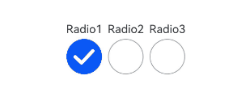
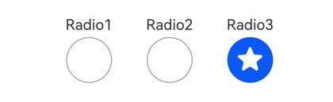

# Radio

<!--Del-->
> **说明：**
>
> 当前为Beta阶段。
<!--DelEnd-->

单选框，提供相应的用户交互选择项。

## 导入模块

```cangjie
import kit.ArkUI.*
```

## 子组件

无

## 创建组件

### init(?String, ?String)

```cangjie
public init(value!: ?String, group!: ?String)
```

**功能：** 创建单选框组件。

**系统能力：** SystemCapability.ArkUI.ArkUI.Full

**起始版本：** 22

**参数：**

|参数名|类型|必填|默认值|说明|
|:---|:---|:---|:---|:---|
|value|?String|是|-|**命名参数。** 当前单选框的值。<br>初始值：""。|
|group|?String|是|-|**命名参数。** 当前单选框的所属群组名称，相同group的Radio只能有一个被选中。<br>初始值：""。|

### init(?String, ?String, RadioIndicatorType, ?() -> Unit)

```cangjie
public init(value!: ?String, group!: ?String, indicatorType!: RadioIndicatorType,
    indicatorBuilder!: ?() -> Unit = Option<() -> Unit>.None)
```

**功能：** 创建具有指定指示器类型和可选自定义指示器构建器的单选框。

**系统能力：** SystemCapability.ArkUI.ArkUI.Full

**起始版本：** 26.1.0

**参数：**

|参数名|类型|必填|默认值|说明|
|:---|:---|:---|:---|:---|
|value|?String|是|-|**命名参数。** 当前单选框的值。<br>初始值：""。|
|group|?String|是|-|**命名参数。** 当前单选框的所属群组名称，相同group的Radio只能有一个被选中。<br>初始值：""。|
|indicatorType|[RadioIndicatorType](#enum-radioindicatortype)|是|-|**命名参数。** 配置单选框的选中样式。|
|indicatorBuilder|?() -> Unit|否|None|**命名参数。** 配置单选框的选中样式为自定义组件。自定义组件与Radio组件以中心点对齐显示。indicatorBuilder设置为None时，按照RadioIndicatorType.Tick进行显示。|

## 通用属性/通用事件

通用属性：全部支持。

通用事件：全部支持。

## 组件属性

### func checked(?Bool)

```cangjie
public func checked(value: ?Bool): This
```

**功能：** 单选框的选中状态。

**系统能力：** SystemCapability.ArkUI.ArkUI.Full

**起始版本：** 22

**参数：**

|参数名|类型|必填|默认值|说明|
|:---|:---|:---|:---|:---|
|value|?Bool|是|-|设置单选框的选中状态。<br>初始值：false。<br>**说明**：value为true时，表示从未选中变为选中。value为false时，表示从选中变为未选中。|

### func radioStyle(?ResourceColor, ?ResourceColor, ?ResourceColor)

```cangjie
public func radioStyle(
    checkedBackgroundColor!: ?ResourceColor = None,
    uncheckedBorderColor!: ?ResourceColor = None,
    indicatorColor!: ?ResourceColor = None
): This
```

**功能：** 设置单选框选中与未选中状态的颜色样式。

**系统能力：** SystemCapability.ArkUI.ArkUI.Full

**起始版本：** 26.1.0

**参数：**

|参数名|类型|必填|默认值|说明|
|:---|:---|:---|:---|:---|
|checkedBackgroundColor|?[ResourceColor](./cj-common-types.md#interface-resourcecolor)|否|None|开启状态底板颜色。|
|uncheckedBorderColor|?[ResourceColor](./cj-common-types.md#interface-resourcecolor)|否|None|关闭状态描边颜色。|
|indicatorColor|?[ResourceColor](./cj-common-types.md#interface-resourcecolor)|否|None|开启状态内部圆饼颜色。indicatorType设置为RadioIndicatorType.Tick和RadioIndicatorType.Dot时，支持修改内部颜色。indicatorType设置为RadioIndicatorType.Custom时，不支持修改内部颜色。|

## 组件事件

### func onChange(?(Bool) -> Unit)

```cangjie
public func onChange(callback: ?(Bool) -> Unit): This
```

**功能：** 单选框选中状态改变时触发该事件。

**系统能力：** SystemCapability.ArkUI.ArkUI.Full

**起始版本：** 22

**参数：**

|参数名|类型|必填|默认值|说明|
|:---|:---|:---|:---|:---|
|callback|?(Bool)->Unit|是|-|单选框的状态。<br>初始值：{ _ => }。|

## 基础类型定义

### enum RadioIndicatorType

```cangjie
public enum RadioIndicatorType <: Equatable<RadioIndicatorType> {
    | Tick
    | Dot
    | Custom
    | ...
}
```

**功能：** 单选框选中状态指示器的图标样式枚举。

**系统能力：** SystemCapability.ArkUI.ArkUI.Full

**起始版本：** 26.1.0

**父类型：**

- Equatable\<[RadioIndicatorType](#enum-radioindicatortype)>

#### Tick

```cangjie
Tick
```

**功能：** 选中样式为系统默认Tick图标。

**系统能力：** SystemCapability.ArkUI.ArkUI.Full

**起始版本：** 26.1.0

#### Dot

```cangjie
Dot
```

**功能：** 选中样式为系统默认Dot图标。

**系统能力：** SystemCapability.ArkUI.ArkUI.Full

**起始版本：** 26.1.0

#### Custom

```cangjie
Custom
```

**功能：** 选中样式为indicatorBuilder中的内容。

**系统能力：** SystemCapability.ArkUI.ArkUI.Full

**起始版本：** 26.1.0

#### operator func ==(RadioIndicatorType)

```cangjie
public operator func ==(other: RadioIndicatorType): Bool
```

**功能：** 判断两个RadioIndicatorType枚举是否相等。

**系统能力：** SystemCapability.ArkUI.ArkUI.Full

**起始版本：** 26.1.0

**参数：**

|参数名|类型|必填|默认值|说明|
|:---|:---|:---|:---|:---|
|other|[RadioIndicatorType](#enum-radioindicatortype)|是|-|要比较的另一个RadioIndicatorType枚举。|

**返回值：**

|类型|说明|
|:----|:----|
|Bool|如果两个枚举相等则返回true，否则返回false。|

#### operator func !=(RadioIndicatorType)

```cangjie
public operator func !=(other: RadioIndicatorType): Bool
```

**功能：** 判断两个RadioIndicatorType枚举是否不相等。

**系统能力：** SystemCapability.ArkUI.ArkUI.Full

**起始版本：** 26.1.0

**参数：**

|参数名|类型|必填|默认值|说明|
|:---|:---|:---|:---|:---|
|other|[RadioIndicatorType](#enum-radioindicatortype)|是|-|要比较的另一个RadioIndicatorType枚举。|

**返回值：**

|类型|说明|
|:----|:----|
|Bool|如果两个枚举不相等则返回true，否则返回false。|


## 示例代码

### 示例1（创建单选框）

<!-- run -->

```cangjie
package ohos_app_cangjie_entry

import kit.ArkUI.*
import ohos.arkui.state_macro_manage.*

@Entry
@Component
class EntryView {
    @State
    var radioName: String = "Null"

    func build() {
        Flex(direction: FlexDirection.Row, justifyContent: FlexAlign.Center, alignItems: ItemAlign.Center) {
            Column() {
                Text("Radio1")
                Radio(group: "radioGroup", value: "Radio1")
                    .checked(true)
                    .height(50)
                    .width(50)
            }
            Column() {
                Text("Radio2")
                Radio(group: "radioGroup", value: "Radio2")
                    .checked(true)
                    .height(50)
                    .width(50)
            }
            Column() {
                Text("Radio3")
                Radio(group: "radioGroup", value: "Radio3")
                    .checked(true)
                    .height(50)
                    .width(50)
            }
        }
    }
}
```



### 示例2（设置选中样式）

该示例通过配置indicatorType和indicatorBuilder以自定义选中样式。

<!-- run -->

```cangjie
package ohos_app_cangjie_entry

import kit.ArkUI.*
import ohos.arkui.state_macro_manage.*

@Entry
@Component
class EntryView {
    @Builder
    func IndicatorBuilder() {
        Text("★").fontSize(30).fontColor(Color.White)
    }

    func build() {
        Flex(direction: FlexDirection.Row, justifyContent: FlexAlign.Center, alignItems: ItemAlign.Center) {
            Column() {
                Text("Radio1")
                Radio(value: "Radio1", group: "radioGroup", indicatorType: RadioIndicatorType.Tick)
                    .checked(true)
                    .height(50)
                    .width(80)
                    .onChange({ isChecked: Bool =>
                        Hilog.info(0, "CangjieTest", "Radio1 status is ${isChecked}")
                    })
            }
            Column() {
                Text("Radio2")
                Radio(value: "Radio2", group: "radioGroup", indicatorType: RadioIndicatorType.Dot)
                    .checked(false)
                    .height(50)
                    .width(80)
                    .onChange({ isChecked: Bool =>
                        Hilog.info(0, "CangjieTest", "Radio2 status is ${isChecked}")
                    })
            }
            Column() {
                Text("Radio3")
                Radio(value: "Radio3", group: "radioGroup", indicatorType: RadioIndicatorType.Custom,
                    indicatorBuilder: bind(this.IndicatorBuilder, this))
                    .checked(false)
                    .height(50)
                    .width(80)
                    .onChange({ isChecked: Bool =>
                        Hilog.info(0, "CangjieTest", "Radio3 status is ${isChecked}")
                    })
            }
        }.padding(top: 30)
    }
}
```


