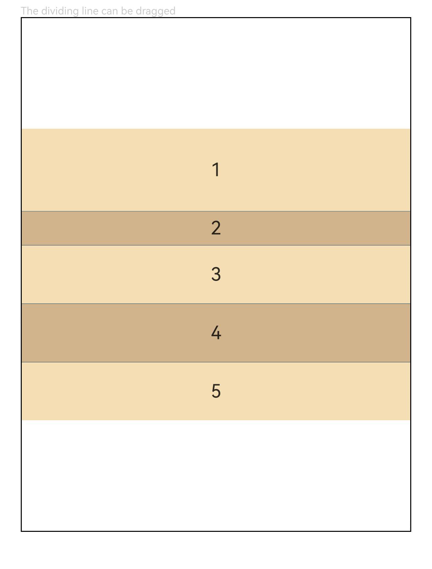

# ColumnSplit

<!--Del-->
> **说明：**
>
> 当前为Beta阶段。
<!--DelEnd-->

通过分隔线将子组件纵向分割的布局容器，子组件按垂直方向依次排列，每个子组件之间插入一根水平分隔线。

## 导入模块

```cangjie
import kit.ArkUI.*
```

## 子组件

可以包含子组件。

ColumnSplit通过分隔线限制子组件的高度，分隔线位置根据子组件的高度计算。

## 创建组件

### init(() -> Unit)

```cangjie
public init(content: () -> Unit)
```

**功能：** 创建一个纵向分割布局容器。

**系统能力：** SystemCapability.ArkUI.ArkUI.Full

**起始版本：** 26.1.0

**参数：**

|参数名|类型|必填|默认值|说明|
|:---|:---|:---|:---|:---|
|content|() -> Unit|是|-|声明容器内的子组件。|

## 通用属性/通用事件

支持[通用属性](./cj-universal-attributes.md)与[通用事件](./cj-universal-events.md)。

## 组件属性

### func resizeable(?Bool)

```cangjie
public func resizeable(value: ?Bool): This
```

**功能：** 设置分割线是否可拖拽。设置为true时，用户可拖动分割线调整相邻子组件高度；设置为false时，分割线不可拖动，子组件高度固定。

> **说明：**
>
> - 初始化后，当动态修改margin、border、padding通用属性导致子组件尺寸大于相邻分割线间距时，不支持拖动分割线改变子组件的高度。

**系统能力：** SystemCapability.ArkUI.ArkUI.Full

**起始版本：** 26.1.0

**参数：**

|参数名|类型|必填|默认值|说明|
|:---|:---|:---|:---|:---|
|value|?Bool|是|-|分割线是否可拖拽。<br>初始值：false。|

## 示例代码

### 示例1（设置可拖动的ColumnSplit组件）

本示例展示如何设置可拖动的ColumnSplit组件及其效果。

<!-- run -->

```cangjie
package ohos_app_cangjie_entry

import kit.ArkUI.*
import ohos.arkui.state_macro_manage.*

@Entry
@Component
class EntryView {
    func build() {
        Column() {
            Text("The dividing line can be dragged").fontSize(9).fontColor(0xCCCCCC).width(90.percent)
            ColumnSplit() {
                Text("1").width(100.percent).height(50).backgroundColor(0xF5DEB3).textAlign(TextAlign.Center)
                Text("2").width(100.percent).height(50).backgroundColor(0xD2B48C).textAlign(TextAlign.Center)
                Text("3").width(100.percent).height(50).backgroundColor(0xF5DEB3).textAlign(TextAlign.Center)
                Text("4").width(100.percent).height(50).backgroundColor(0xD2B48C).textAlign(TextAlign.Center)
                Text("5").width(100.percent).height(50).backgroundColor(0xF5DEB3).textAlign(TextAlign.Center)
            }
            .borderWidth(1)
            .resizeable(true) // 设置分割线可拖拽
            .width(90.percent).height(60.percent)
        }.width(100.percent)
    }
}
```


