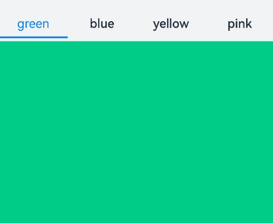
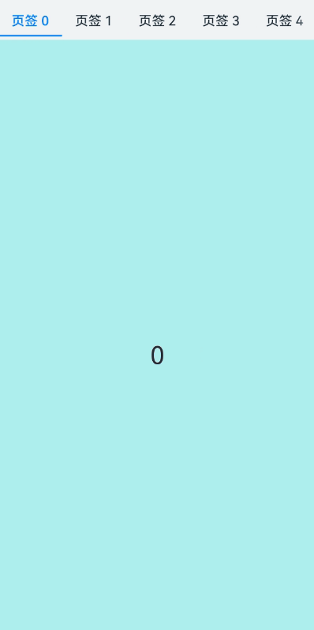
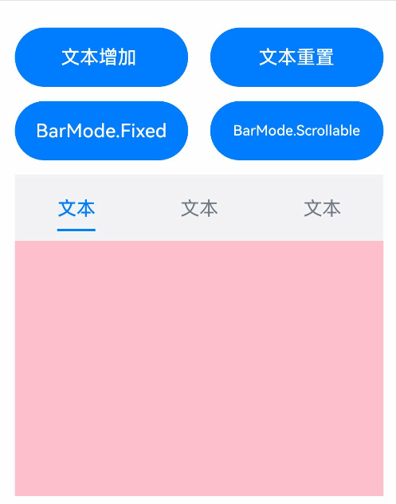
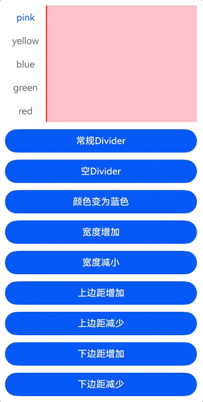
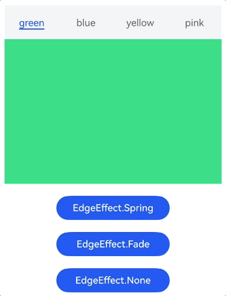
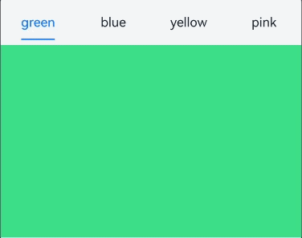
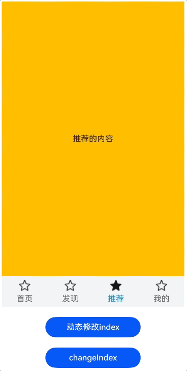

# Tabs

<!--Del-->
> **说明：**
>
> 当前为Beta阶段。
<!--DelEnd-->

通过页签进行内容视图切换的容器组件，每个页签对应一个内容视图。

## 导入模块

```cangjie
import kit.ArkUI.*
```

## 子组件

不支持自定义组件作为子组件，仅可包含子组件[TabContent](./cj-navigation-switching-tabcontent.md)，以及渲染控制类型[if/else](../../arkui-cj/rendering_control/cj-rendering-control-ifelse.md)和[ForEach](cj-state-rendering-foreach.md)，并且if/else和ForEach下也仅支持TabContent，不支持自定义组件。

> **说明：**
>
> - Tabs子组件的visibility属性设置为None，或者visibility属性设置为Hidden时，对应子组件不显示，但依然会在视窗内占位。
> - Tabs设置[height](./cj-universal-attribute-size.md#func-heightoptionlength)为[LengthMetrics.AUTO](./cj-common-types.md#static-let-auto)时，可根据子组件高度自适应高度大小。设置[width](./cj-universal-attribute-size.md#func-widthoptionlength)为[LengthMetrics.AUTO](./cj-common-types.md#static-let-auto)时，可根据子组件宽度自适应宽度大小。

## 创建组件

### init(?BarPosition, ?TabsController, ?Int32, () -> Unit)

```cangjie
public init(
    barPosition!: ?BarPosition = None,
    controller!: ?TabsController = None,
    index!: ?Int32 = None,
    child!: () -> Unit = {=>}
)
```

**功能：** 创建一个Tabs容器。

**系统能力：** SystemCapability.ArkUI.ArkUI.Full

**起始版本：** 22

**参数：**

|参数名|类型|必填|默认值|说明|
|:---|:---|:---|:---|:---|
|barPosition|?[BarPosition](./cj-common-types.md#enum-barposition)|否|None|**命名参数。** 设置Tabs的页签位置。<br> 初始值: BarPosition.Start|
|controller|?[TabsController](#class-tabscontroller)|否|None|**命名参数。** 设置Tabs控制器。<br> 初始值：TabsController()|
|index|?Int32|否|None|**命名参数。** 设置当前显示页签的索引。<br> 初始值：0 <br> **说明：**<br> 设置为小于0的值时按初始值显示。可选值为[0, TabContent子节点数量-1]。直接修改index跳页时，切换动效不生效。 使用TabController的changeIndex时，默认生效切换动效，可以设置animationDuration为0关闭动画。|
|child|()->Unit|否|{=>}|**命名参数。** 声明容器内的子组件。|

## 通用属性/通用事件

通用属性：全部支持。

通用事件：全部支持。

## 组件属性

### func animationDuration(?Float32)

```cangjie
public func animationDuration(value: ?Float32): This
```

**功能：** 设置Tabs的动画时长。

**系统能力：** SystemCapability.ArkUI.ArkUI.Full

**起始版本：** 22

**参数：**

|参数名|类型|必填|默认值|说明|
|:---|:---|:---|:---|:---|
|value|?Float32|是|-|动画时长，单位为毫秒。初始值：-1.0。|

### func barHeight(?Length)

```cangjie
public func barHeight(value: ?Length): This
```

**功能：** 设置Tabs页签栏的高度。横向Tabs可以设置height为LengthMetrics.AUTO，让TabBar自适应子组件高度。

**系统能力：** SystemCapability.ArkUI.ArkUI.Full

**起始版本：** 22

**参数：**

|参数名|类型|必填|默认值|说明|
|:---|:---|:---|:---|:---|
|value|?[Length](./cj-common-types.md#interface-length)|是|-|页签栏高度。当页签栏为水平方向时，该参数为页签栏的高；当页签栏为垂直方向时，该参数为页签栏的宽。|

### func barMode(?BarMode)

```cangjie
public func barMode(value: ?BarMode): This
```

**功能：** 设置Tabs页签栏的布局模式。

**系统能力：** SystemCapability.ArkUI.ArkUI.Full

**起始版本：** 22

**参数：**

|参数名|类型|必填|默认值|说明|
|:---|:---|:---|:---|:---|
|value|?[BarMode](./cj-common-types.md#enum-barmode)|是|-|页签栏布局模式。初始值：BarMode.Fixed。|

### func barWidth(?Length)

```cangjie
public func barWidth(value: ?Length): This
```

**功能：** 设置Tabs页签栏的宽度。

**系统能力：** SystemCapability.ArkUI.ArkUI.Full

**起始版本：** 22

**参数：**

|参数名|类型|必填|默认值|说明|
|:---|:---|:---|:---|:---|
|value|?[Length](./cj-common-types.md#interface-length)|是|-|页签栏宽度。当页签栏为水平方向时，该参数为页签栏的宽；当页签栏为垂直方向时，该参数为页签栏的高。|

### func scrollable(?Bool)

```cangjie
public func scrollable(value: ?Bool): This
```

**功能：** 设置Tabs是否可滚动。

**系统能力：** SystemCapability.ArkUI.ArkUI.Full

**起始版本：** 22

**参数：**

|参数名|类型|必填|默认值|说明|
|:---|:---|:---|:---|:---|
|value|?Bool|是|-|是否可滚动。初始值：true。|

### func vertical(?Bool)

```cangjie
public func vertical(value: ?Bool): This
```

**功能：** 设置Tabs页签栏的排列方向。

**系统能力：** SystemCapability.ArkUI.ArkUI.Full

**起始版本：** 22

**参数：**

|参数名|类型|必填|默认值|说明|
|:---|:---|:---|:---|:---|
|value|?Bool|是|-|页签栏是否垂直排列。<br>初始值：false。<br>当横向Tabs设置height为LengthMetrics.AUTO时，Tabs组件高度自适应子组件高度，即为tabBar高度+divider线宽+TabContent高度+上下padding值+上下border宽度。<br>当纵向Tabs设置width为LengthMetrics.AUTO时，Tabs组件宽度自适应子组件宽度，即为tabBar宽度+divider线宽+TabContent宽度+左右padding值+左右border宽度。|

### func divider(?Length, ?ResourceColor, ?Length, ?Length)

```cangjie
public func divider(strokeWidth!: ?Length, color!: ?ResourceColor = None, startMargin!: ?Length = None, endMargin!: ?Length = None): This
```

**功能：** 设置区分TabBar和TabContent的分割线样式。如TabBar与TabContent之间需要视觉分隔，可通过divider添加分割线。

**系统能力：** SystemCapability.ArkUI.ArkUI.Full

**起始版本：** 26.1.0

**参数：**

|参数名|类型|必填|默认值|说明|
|:---|:---|:---|:---|:---|
|strokeWidth|?[Length](./cj-common-types.md#interface-length)|是|-|**命名参数。** 分割线宽度。<br>不能设置百分比，初始值：0.0vp，取值范围：[0, +∞)，设置为小于0的值时按初始值显示。|
|color|?[ResourceColor](./cj-common-types.md#interface-resourcecolor)|否|None|**命名参数。** 分割线颜色。|
|startMargin|?[Length](./cj-common-types.md#interface-length)|否|None|**命名参数。** 分割线与侧边栏顶端的距离。<br>不能设置百分比，初始值：0.0vp，取值范围：[0, +∞)，设置为小于0的值时按初始值显示。|
|endMargin|?[Length](./cj-common-types.md#interface-length)|否|None|**命名参数。** 分割线与侧边栏底端的距离。<br>不能设置百分比，初始值：0.0vp，取值范围：[0, +∞)，设置为小于0的值时按初始值显示。|

### func edgeEffect(?EdgeEffect)

```cangjie
public func edgeEffect(edgeEffect: ?EdgeEffect): This
```

**功能：** 设置边缘滑动效果。当滑动到边缘时，根据设置的边缘效果类型执行相应的回弹动作：Spring模式使用弹簧曲线实现弹性回弹效果，Fade模式使用渐变透明度实现视觉反馈，None模式不执行任何边缘效果。边缘效果的触发条件为滑动内容超出容器边界。

**系统能力：** SystemCapability.ArkUI.ArkUI.Full

**起始版本：** 26.1.0

**参数：**

|参数名|类型|必填|默认值|说明|
|:---|:---|:---|:---|:---|
|edgeEffect|?[EdgeEffect](./cj-common-types.md#enum-edgeeffect)|是|-|边缘滑动效果。<br>初始值：EdgeEffect.Spring。|

## 组件事件

### func onChange(?Callback\<Int32, Unit>)

```cangjie
public func onChange(event: ?Callback<Int32, Unit>): This
```

**功能：** 页签切换时触发该回调。

**系统能力：** SystemCapability.ArkUI.ArkUI.Full

**起始版本：** 22

**参数：**

|参数名|类型|必填|默认值|说明|
|:---|:---|:---|:---|:---|
|event|?[Callback](./cj-common-types.md#type-callbackt-v)\<Int32, Unit>|是|-|页签索引改变时触发的回调函数。初始值：{ _ => }。|

### func onAnimationStart(?(Int32, Int32, TabsAnimationEvent) -> Unit)

```cangjie
public func onAnimationStart(handler: ?(Int32, Int32, TabsAnimationEvent) -> Unit): This
```

**功能：** 切换动画开始时触发该回调。当[animationDuration](#func-animationdurationfloat32)为0时动画关闭且[scrollable](#func-scrollablebool)为false时，不触发该回调。

**系统能力：** SystemCapability.ArkUI.ArkUI.Full

**起始版本：** 26.1.0

**参数：**

|参数名|类型|必填|默认值|说明|
|:---|:---|:---|:---|:---|
|handler|?(Int32, Int32, [TabsAnimationEvent](#class-tabsanimationevent)) -> Unit|是|-|切换动画开始时触发的回调。<br>参数一：当前显示元素的索引，索引从0开始。<br>参数二：切换动画目标元素的索引，索引从0开始。<br>参数三：动画相关信息，包括主轴方向上当前显示元素和目标元素相对Tabs起始位置的位移，以及离手速度。|

### func onContentWillChange(?(Int32, Int32) -> Bool)

```cangjie
public func onContentWillChange(handler: ?(Int32, Int32) -> Bool): This
```

**功能：** 自定义Tabs页面切换拦截事件能力，新页面即将显示时触发该回调。

满足以下任一条件，即可触发该事件：

1. 滑动TabContent切换新页面时触发。

2. 通过[TabsController.changeIndex](#func-changeindexint32)接口切换新页面时触发。

3. 通过动态修改index属性值切换新页面时触发。

4. 通过点击TabBar页签切换新页面时触发。

5. TabBar页签获焦后，通过键盘左右方向键等切换新页面时触发。

**系统能力：** SystemCapability.ArkUI.ArkUI.Full

**起始版本：** 26.1.0

**参数：**

|参数名|类型|必填|默认值|说明|
|:---|:---|:---|:---|:---|
|handler|?(Int32, Int32) -> Bool|是|-|自定义Tabs页面切换拦截事件能力，新页面即将显示时触发的回调。<br>参数一：当前显示页面的index索引，索引从0开始计算。<br>参数二：将要显示的新页面的index索引，索引从0开始计算。<br>返回值：当回调函数handler的返回值为true时，Tabs可以切换到新页面；当回调函数handler的返回值为false时，Tabs无法切换到新页面，仍然显示原来页面内容。|

### func onGestureSwipe(?(Int32, TabsAnimationEvent) -> Unit)

```cangjie
public func onGestureSwipe(handler: ?(Int32, TabsAnimationEvent) -> Unit): This
```

**功能：** 在页面跟手滑动过程中，逐帧触发，用于监听当前显示页面的实时滑动状态。

**系统能力：** SystemCapability.ArkUI.ArkUI.Full

**起始版本：** 26.1.0

**参数：**

|参数名|类型|必填|默认值|说明|
|:---|:---|:---|:---|:---|
|handler|?(Int32, [TabsAnimationEvent](#class-tabsanimationevent)) -> Unit|是|-|在页面跟手滑动过程中，逐帧触发的回调。<br>参数一：当前显示元素的索引，索引从0开始。取值范围：[0, 页签总数-1]。<br>参数二：动画相关信息，只返回主轴方向上当前显示元素相对于Tabs起始位置的位移。|

### func onTabBarClick(?(Int32) -> Unit)

```cangjie
public func onTabBarClick(event: ?(Int32) -> Unit): This
```

**功能：** Tab页签点击后触发的事件。

**系统能力：** SystemCapability.ArkUI.ArkUI.Full

**起始版本：** 26.1.0

**参数：**

|参数名|类型|必填|默认值|说明|
|:---|:---|:---|:---|:---|
|event|?(Int32) -> Unit|是|-|被点击页签的索引值，从0开始计算。|

## 基础类型定义

### class TabsController

```cangjie
public class TabsController {
    public init()
}
```

**功能：** Tabs控制器。

**系统能力：** SystemCapability.ArkUI.ArkUI.Full

**起始版本：** 22

#### init()

```cangjie
public init()
```

**功能：** 构造Tabs控制器。

**系统能力：** SystemCapability.ArkUI.ArkUI.Full

**起始版本：** 22

#### func changeIndex(?Int32)

```cangjie
public func changeIndex(value: ?Int32): Unit
```

**功能：** 切换到指定索引的页签。

**系统能力：** SystemCapability.ArkUI.ArkUI.Full

**起始版本：** 22

**参数：**

|参数名|类型|必填|默认值|说明|
|:---|:---|:---|:---|:---|
|value|?Int32|是|-|要切换到的页签索引。初始值：0。|

### class TabsAnimationEvent

```cangjie
public class TabsAnimationEvent {
    public var currentOffset: Float32
    public var targetOffset: Float32
    public var velocity: Float32
}
```

**功能：** Tabs组件动画相关信息集合。

**系统能力：** SystemCapability.ArkUI.ArkUI.Full

**起始版本：** 26.1.0

#### var currentOffset

```cangjie
public var currentOffset: Float32
```

**功能：** Tabs当前显示元素在主轴方向上，相对于Tabs起始位置的位移。单位：vp，初始值为0。正值表示向右（横向）或向下（纵向）偏移，负值表示向左（横向）或向上（纵向）偏移。

**系统能力：** SystemCapability.ArkUI.ArkUI.Full

**起始版本：** 26.1.0

#### var targetOffset

```cangjie
public var targetOffset: Float32
```

**功能：** Tabs动画目标元素在主轴方向上，相对于Tabs起始位置的位移。单位：vp，初始值为0。正值表示向右（横向）或向下（纵向）偏移，负值表示向左（横向）或向上（纵向）偏移。

**系统能力：** SystemCapability.ArkUI.ArkUI.Full

**起始版本：** 26.1.0

#### var velocity

```cangjie
public var velocity: Float32
```

**功能：** Tabs离手动画开始时的离手速度。单位：vp/s，初始值为0。正值表示向右（横向）或向下（纵向）滑动，负值表示向左（横向）或向上（纵向）滑动，速度值越大表示滑动越快，该参数可用于实现惯性滚动效果。

**系统能力：** SystemCapability.ArkUI.ArkUI.Full

**起始版本：** 26.1.0

## 示例代码

### 示例1（自定义页签切换联动）

本示例通过[onAnimationStart](#func-onanimationstartint32-int32-tabsanimationevent---unit)、[onChange](#func-onchangecallbackint32-unit)实现切换时自定义tabBar和TabContent的联动。

<!-- run -->

```cangjie
package ohos_app_cangjie_entry

import kit.ArkUI.*
import std.collection.*
import ohos.arkui.state_macro_manage.*

@Entry
@Component
class EntryView {
    @State
    var fontColor: UInt32 = 0x182431
    @State
    var selectedFontColor: UInt32 = 0x007DFF
    @State
    var currentIndex: Int32 = 0
    @State
    var selectedIndex: Int32 = 0
    var controller: TabsController = TabsController()

    func getFontColor(index: Int32): UInt32 {
        if (this.selectedIndex == index) {
            return this.selectedFontColor
        }
        return this.fontColor
    }

    func getFontWeight(index: Int32): FontWeight {
        if (this.selectedIndex == index) {
            return FontWeight.W400
        }
        return FontWeight.W500
    }

    func getOpacity(index: Int32): Float64 {
        if (this.selectedIndex == index) {
            return Float64(1)
        }
        return Float64(0)
    }

    @Builder
    func tabBuilder(index: Int32, name: String) {
        Column() {
            Text(name)
                .fontColor(this.getFontColor(index))
                .fontSize(16)
                .fontWeight(this.getFontWeight(index))
                .lineHeight(22)
                .margin(top: 17, bottom: 7)
            Divider()
                .strokeWidth(2)
                .color(0x007DFF)
                .opacity(this.getOpacity(index))
        }.width(100.percent)
    }

    func build() {
        Column() {
            Tabs(barPosition: BarPosition.Start, controller: this.controller, index: this.currentIndex) {
                TabContent() {
                    Column()
                        .width(100.percent)
                        .height(100.percent)
                        .backgroundColor(0x00CB87)
                }.tabBar({=> bind(this.tabBuilder, this)(0, "green")})

                TabContent() {
                    Column()
                        .width(100.percent)
                        .height(100.percent)
                        .backgroundColor(0x007DFF)
                }.tabBar({=> bind(this.tabBuilder, this)(1, "blue")})

                TabContent() {
                    Column()
                        .width(100.percent)
                        .height(100.percent)
                        .backgroundColor(0xFFBF00)
                }.tabBar({=> bind(this.tabBuilder, this)(2, "yellow")})

                TabContent() {
                    Column()
                        .width(100.percent)
                        .height(100.percent)
                        .backgroundColor(0xE67C92)
                }.tabBar({=> bind(this.tabBuilder, this)(3, "pink")})
            }
                .vertical(false)
                .barMode(BarMode.Fixed)
                .barWidth(360)
                .barHeight(56)
                .animationDuration(400.0)
                .onChange(
                    {
                        index: Int32 =>
                            // currentIndex控制TabContent显示页签
                            this.currentIndex = index
                            this.selectedIndex = index
                    }
                )
                .onAnimationStart(
                    {
                        index: Int32, targetIndex: Int32, event: TabsAnimationEvent =>
                            if (index == targetIndex) {
                                return
                            }
                            // selectedIndex控制自定义TabBar内Text颜色切换
                            this.selectedIndex = targetIndex
                    }
                )
                .width(360)
                .height(296)
                .margin(top: 52)
                .backgroundColor(0xF1F3F5)
        }.width(100.percent)
    }
}
```



### 示例2（页面懒加载和释放）

本示例通过使用自定义TabBar与Swiper配合LazyForEach实现页面懒加载和释放。

<!-- run -->

```cangjie
package ohos_app_cangjie_entry

import kit.ArkUI.*
import kit.PerformanceAnalysisKit.*
import std.collection.*
import ohos.arkui.state_macro_manage.*

class MyDataSource <: IDataSource<String> {
  public MyDataSource(let list: ArrayList<String> ) {}

  public func totalCount(): Int64 {
    return this.list.size
  }

  public func getData(index: Int64): String {
    return this.list[index]
  }

  public func registerDataChangeListener(listener: DataChangeListener): Unit {
  }

  public func unregisterDataChangeListener(listener: DataChangeListener): Unit {
  }
}

@Entry
@Component
class EntryView {
    @State
    var fontColor: Color = Color(0x182431)
    @State
    var selectedFontColor: Color = Color(0x007DFF)
    @State
    var currentIndex: Int32 = 0
    var list: ArrayList<String> = ArrayList<String>()
    var tabsController: TabsController = TabsController()
    var swiperController: SwiperController = SwiperController()
    var swiperData: MyDataSource = MyDataSource(ArrayList<String>())

    protected override func aboutToAppear() {
        for (i in 0..9) {
          this.list.add("${i}");
        }
        this.swiperData = MyDataSource(this.list)
    }

    @Builder
    func tabBuilder(index: Int32, name: String) {
        Column() {
            Text(name)
            .fontColor(if(this.currentIndex == index) {this.selectedFontColor} else {this.fontColor})
            .fontSize(16)
            .fontWeight(if(this.currentIndex == index) {FontWeight.W500} else {FontWeight.W400})
            .lineHeight(22)
            .margin(top: 17, bottom: 7)

            Divider()
            .strokeWidth(2)
            .color(0x007DFF)
            .opacity(if(this.currentIndex == index) {1.0} else {0.0})
        }.width(20.percent)
    }

    func build() {
        Column() {
            Tabs(barPosition: BarPosition.Start, controller: this.tabsController) {
                ForEach(this.list, itemGeneratorFunc:{item: String, index: Int64 =>
                    TabContent(){}.tabBar({=>bind(this.tabBuilder, this)(Int32(index), '页签 ${this.list[index]}')})
                })
            }
                .barMode(BarMode.Scrollable)
                .backgroundColor(0xF1F3F5)
                .height(56)
                .width(100.percent)

            Swiper(controller: this.swiperController) {
                LazyForEach(this.swiperData, itemGeneratorFunc: {
                    item: String, idx: Int64 => Text(item)
                        .onAppear({
                            => Hilog.info(0, "AppLogCj", 'onAppear ' + item)
                        })
                        .onDisAppear({
                            => Hilog.info(0, "AppLogCj", 'onDisAppear ' + item)
                        })
                        .width(100.percent)
                        .height(100.percent)
                        .backgroundColor(0xAFEEEE)
                        .textAlign(TextAlign.Center)
                        .fontSize(30)
                })
            }
            .loop(false)
            .onChange({index: Int32 =>
                this.currentIndex = index
                this.tabsController.changeIndex(index)
            })
        }
    }
}
```



### 示例3（设置TabBar的布局模式）

本示例通过barMode分别实现了页签均分布局和以实际长度布局，且展示了当页签布局长度之和超过了TabBar总长度后可滑动的效果。

<!-- run -->

```cangjie
package ohos_app_cangjie_entry

import kit.ArkUI.*
import std.collection.*
import ohos.arkui.state_macro_manage.*

@Entry
@Component
class EntryView {
    @State
    var text: String = "文本"
    @State
    var barMode: BarMode = BarMode.Fixed

    func build() {
        Column() {
            Row() {
                Button("文本增加 ")
                    .width(47.percent)
                    .height(50)
                    .onClick({event => this.text += "文本"})
                    .margin(right: 6.percent, bottom: 12)

                Button("文本重置")
                    .width(47.percent)
                    .height(50)
                    .onClick({event => this.text = "文本"})
                    .margin(bottom: 12)
            }

            Row() {
                Button("BarMode.Fixed")
                    .width(47.percent)
                    .height(50)
                    .onClick({event => this.barMode = BarMode.Fixed})
                    .margin(right: 6.percent, bottom: 12)

                Button("BarMode.Scrollable")
                    .width(47.percent)
                    .height(50)
                    .onClick({event => this.barMode = BarMode.Scrollable})
                    .margin(bottom: 12)
            }
            Tabs() {
                TabContent() {
                    Column()
                        .width(100.percent)
                        .height(100.percent)
                        .backgroundColor(0xFEC0CD)
                }.tabBar(this.text)

                TabContent() {
                    Column()
                        .width(100.percent)
                        .height(100.percent)
                        .backgroundColor(Color.Green)
                }.tabBar(this.text)

                TabContent() {
                    Column()
                        .width(100.percent)
                        .height(100.percent)
                        .backgroundColor(Color.Blue)
                }.tabBar(this.text)
            }
                .height(60.percent)
                .backgroundColor(0xf1f3f5)
                .barMode(this.barMode)
        }
            .width(100.percent)
            .height(500)
            .padding(24)
    }
}
```



# 示例4（分割线基本属性）

本示例通过[divider](#func-dividerlength-resourcecolor-length-length)实现了分割线各种属性的展示。

<!-- run -->

```cangjie
package ohos_app_cangjie_entry

import kit.ArkUI.*
import ohos.arkui.state_macro_manage.*
import kit.PerformanceAnalysisKit.Hilog

@Entry
@Component
class EntryView {
    var controller: TabsController = TabsController()
    @State
    var dividerColor: ResourceColor = Color.Red
    @State
    var strokeWidth: Float64 = 2.0
    @State
    var startMargin: Float64 = 0.0
    @State
    var endMargin: Float64 = 0.0
    @State
    var nullFlag: Bool = false

    func build() {
        Column() {
            Tabs(controller: this.controller) {
                TabContent() {
                    Column()
                        .width(100.percent)
                        .height(100.percent)
                        .backgroundColor(0xFFFFC0CB)
                }.tabBar("pink")

                TabContent() {
                    Column()
                        .width(100.percent)
                        .height(100.percent)
                        .backgroundColor(0xFFFFFF00)
                }.tabBar("yellow")

                TabContent() {
                    Column()
                        .width(100.percent)
                        .height(100.percent)
                        .backgroundColor(0xFF0000FF)
                }.tabBar("blue")

                TabContent() {
                    Column()
                        .width(100.percent)
                        .height(100.percent)
                        .backgroundColor(0xFF008000)
                }.tabBar("green")

                TabContent() {
                    Column()
                        .width(100.percent)
                        .height(100.percent)
                        .backgroundColor(0xFFFF0000)
                }.tabBar("red")
            }
                .vertical(true)
                .scrollable(true)
                .barMode(BarMode.Fixed)
                .barWidth(70)
                .barHeight(200)
                .animationDuration(400.0)
                .onChange(
                    {
                        index: Int32 =>
                            Hilog.info(1, "Cangjie", "${index}.")
                    }
                )
                .height(200.vp)
                .margin(bottom: 12.vp)
                .divider(
                    strokeWidth: if(this.nullFlag) { Option.None } else { this.strokeWidth },
                    color: if(this.nullFlag) { Option.None } else { this.dividerColor },
                    startMargin: if(this.nullFlag) { Option.None } else { this.startMargin },
                    endMargin: if(this.nullFlag) { Option.None } else { this.endMargin }
                )

            Button("常规Divider")
                .width(100.percent)
                .margin(bottom: 12.vp)
                .onClick(
                    {
                        event =>
                            this.nullFlag = false
                            this.strokeWidth = 2.0
                            this.dividerColor = 0xFFFF0000
                            this.startMargin = 0.0
                            this.endMargin = 0.0
                    }
                )
            Button("空Divider")
                .width(100.percent)
                .margin(bottom: 12.vp)
                .onClick(
                    {
                        event =>
                            this.nullFlag = true
                    }
                )
            Button("颜色变为蓝色")
                .width(100.percent)
                .margin(bottom: 12.vp)
                .onClick(
                    {
                        event =>
                            this.dividerColor = 0xFF0000FF
                    }
                )
            Button("宽度增加")
                .width(100.percent)
                .margin(bottom: 12.vp)
                .onClick(
                    {
                        event =>
                            this.strokeWidth += 2.0
                    }
                )
            Button("宽度减小")
                .width(100.percent)
                .margin(bottom: 12.vp)
                .onClick(
                    {
                        event =>
                            if (this.strokeWidth > 2.0) {
                                this.strokeWidth -= 2.0
                            }
                    }
                )
            Button("上边距增加")
                .width(100.percent)
                .margin(bottom: 12.vp)
                .onClick(
                    {
                        event =>
                            this.startMargin += 2.0
                    }
                )
            Button("上边距减少")
                .width(100.percent)
                .margin(bottom: 12.vp)
                .onClick(
                    {
                        event =>
                            if (this.startMargin > 2.0) {
                                this.startMargin -= 2.0
                            }
                    }
                )
            Button("下边距增加")
                .width(100.percent)
                .margin(bottom: 12.vp)
                .onClick(
                    {
                        event =>
                            this.endMargin += 2.0
                    }
                )
            Button("下边距减少")
                .width(100.percent)
                .margin(bottom: 12.vp)
                .onClick(
                    {
                        event =>
                            if (this.endMargin > 2.0) {
                                this.endMargin -= 2.0
                            }
                    }
                )
        }
            .padding(top: 24.vp, left: 24.vp, right: 24.vp)
    }
}
```



# 示例5（设置边缘滑动效果）

该示例通过[edgeEffect](#func-edgeeffectedgeeffect)实现了不同的边缘回弹效果。

<!-- run -->

```cangjie
package ohos_app_cangjie_entry

import kit.ArkUI.*
import ohos.arkui.state_macro_manage.*

@Entry
@Component
class EntryView {
    @State
    var edgeEffect: EdgeEffect = EdgeEffect.Spring

    func build() {
        Column() {
            Tabs() {
                TabContent() {
                    Column()
                        .width(100.percent)
                        .height(100.percent)
                        .backgroundColor(0x00CB87)
                }.tabBar("green")

                TabContent() {
                    Column()
                        .width(100.percent)
                        .height(100.percent)
                        .backgroundColor(0x007DFF)
                }.tabBar("blue")

                TabContent() {
                    Column()
                        .width(100.percent)
                        .height(100.percent)
                        .backgroundColor(0xFFBF00)
                }.tabBar("yellow")

                TabContent() {
                    Column()
                        .width(100.percent)
                        .height(100.percent)
                        .backgroundColor(0xE67C92)
                }.tabBar("pink")
            }
                .width(360)
                .height(296)
                .margin(top: 52)
                .backgroundColor(0xF1F3F5)
                .edgeEffect(this.edgeEffect) // 设置边缘滑动效果

            Button("EdgeEffect.Spring")
                .width(50.percent)
                .margin(top: 20)
                .onClick(
                    {
                        event =>
                            this.edgeEffect = EdgeEffect.Spring
                    }
                )

            Button("EdgeEffect.Fade")
                .width(50.percent)
                .margin(top: 20)
                .onClick(
                    {
                        event =>
                            this.edgeEffect = EdgeEffect.Fade
                    }
                )

            Button("EdgeEffect.None")
                .width(50.percent)
                .margin(top: 20)
                .onClick(
                    {
                        event =>
                            this.edgeEffect = EdgeEffect.None
                    }
                )
        }
            .width(100.percent)
    }
}
```



# 示例6（自定义TabBar切换动画）

本示例通过[onChange](#func-onchangecallbackint32-unit)、[onAnimationStart](#func-onanimationstartint32-int32-tabsanimationevent---unit)、[onGestureSwipe](#func-ongestureswipeint32-tabsanimationevent---unit)等接口实现了自定义TabBar的切换动画。

<!-- run -->

```cangjie
package ohos_app_cangjie_entry

import kit.ArkUI.*
import ohos.arkui.state_macro_manage.*
import kit.PerformanceAnalysisKit.Hilog
import std.collection.HashMap
import std.math.abs

@Entry
@Component
class EntryView {
    @State
    var colorArray: Array<(String, UInt32)> = [("green", 0x00CB87), ("blue", 0x007DFF), ("yellow", 0xFFBF00), ("pink", 0xE67C92)]
    @State
    var currentIndex: Int32 = 0
    @State
    var animationDuration: Float32 = 300.0
    @State
    var indicatorLeftMargin: Float64 = 0.0
    @State
    var indicatorWidth: Float64 = 0.0
    var tabsWidth: Float64 = 0.0
    var textInfos: Array<(Float64, Float64)> = Array<(Float64, Float64)>(4, repeat: (0.0, 0.0))
    var isStartAnimateTo: Bool = false

    @Builder
    func tabBuilder(index: Int32, name: String) {
        Column() {
            Text(name)
                .fontSize(16)
                .fontColor(if (this.currentIndex == index) { Color(0x007DFF) } else { Color(0x182431) })
                .fontWeight(if (this.currentIndex == index) { FontWeight.W500 } else { FontWeight.W400 })
                .id(index.toString())
                .onAreaChange(
                    {
                        oldValue: Area, newValue: Area =>
                            this.textInfos[Int64(index)] = (newValue.globalPosition.x.getOrThrow().value,newValue.width.value)
                            if (!this.isStartAnimateTo && this.currentIndex == index && this.tabsWidth > 0.0) {
                                this.setIndicatorAttr(this.textInfos[Int64(this.currentIndex)][0], this.textInfos[Int64(this.currentIndex)][1])
                            }
                    }
                )
        }.width(100.percent)
    }

    func build() {
        Stack(alignContent: Alignment.TopStart) {
            Tabs(barPosition: BarPosition.Start) {
                ForEach(this.colorArray, itemGeneratorFunc: {
                    item: (String, UInt32), index: Int64 =>
                    TabContent() {
                        Column()
                            .width(100.percent)
                            .height(100.percent)
                            .backgroundColor(item[1])
                    }.tabBar({=> bind(this.tabBuilder, this)(Int32(index), item[0])})
                })
            }
                .onAreaChange(
                    {
                        oldValue: Area, newValue: Area =>
                            this.tabsWidth = newValue.width.value
                            if (!this.isStartAnimateTo) {
                                this.setIndicatorAttr(this.textInfos[Int64(this.currentIndex)][0], this.textInfos[Int64(this.currentIndex)][1])
                            }
                    }
                )
                .barWidth(100.percent)
                .barHeight(56)
                .width(100.percent)
                .height(296)
                .backgroundColor(0xF1F3F5)
                .animationDuration(this.animationDuration)
                .onChange(
                    {
                        index: Int32 =>
                            // 监听索引index的变化，实现页签内容的切换。
                            this.currentIndex = index
                    }
                )
                .onAnimationStart(
                    {
                        index: Int32, targetIndex: Int32, event: TabsAnimationEvent =>
                            // 切换动画开始时触发该回调。下划线跟着页面一起滑动，同时宽度渐变。
                            this.currentIndex = targetIndex
                            this.startAnimateTo(Int32(this.animationDuration), this.textInfos[Int64(targetIndex)][0], this.textInfos[Int64(targetIndex)][1])
                    }
                )
                .onGestureSwipe(
                    {
                        index: Int32, event: TabsAnimationEvent =>
                            // 在页面跟手滑动过程中，逐帧触发该回调。
                            let currentIndicatorInfo = this.getCurrentIndicatorInfo(index, event)
                            this.currentIndex = Int32(currentIndicatorInfo["index"])
                            this.setIndicatorAttr(currentIndicatorInfo["left"], currentIndicatorInfo["width"])
                    }
                )

            Column()
                .height(2)
                .width(this.indicatorWidth)
                .margin(left: this.indicatorLeftMargin.vp, top: 48.vp)
                .backgroundColor(0x007DFF)
        }.width(100.percent)
    }

    func getCurrentIndicatorInfo(index: Int32, event: TabsAnimationEvent): HashMap<String, Float64> {
        var nextIndex = index
        if (index > 0 && event.currentOffset > 0.0) {
            nextIndex--
        } else if (index < Int32(this.textInfos.size) - 1 && event.currentOffset < 0.0) {
            nextIndex++
        }
        let indexInfo = this.textInfos[Int64(index)]
        let nextIndexInfo = this.textInfos[Int64(nextIndex)]
        let swipeRatio = abs(Float64(event.currentOffset) / this.tabsWidth)
        let currentIndex = if (swipeRatio > 0.5) { nextIndex } else { index } // 页面滑动超过一半，tabBar切换到下一页。
        let currentLeft = indexInfo[0] + (nextIndexInfo[0] - indexInfo[0]) * swipeRatio
        let currentWidth = indexInfo[1] + (nextIndexInfo[1] - indexInfo[1]) * swipeRatio
        var result = HashMap<String, Float64>()
        result["index"] = Float64(currentIndex)
        result["left"] = currentLeft
        result["width"] = currentWidth
        return result
    }

    func startAnimateTo(duration: Int32, leftMargin: Float64, width: Float64) {
        this.isStartAnimateTo = true
        this.getUIContext().animateTo(
            AnimateParam(
                duration: duration, // 动画时长
                curve: Curve.Linear, // 动画曲线
                iterations: 1, // 播放次数
                playMode: PlayMode.Normal, // 动画模式
                onFinish: {
                    =>
                        this.isStartAnimateTo = false
                        Hilog.info(1, "Cangjie", "play end.")
                }
            ),
            {
                =>
                    this.setIndicatorAttr(leftMargin, width)
            }
        )
    }

    func setIndicatorAttr(leftMargin: Float64, width: Float64) {
        this.indicatorWidth = width
        this.indicatorLeftMargin = leftMargin
    }
}
```



# 示例7（页面切换拦截）

本示例通过[onContentWillChange](#func-oncontentwillchangeint32-int32---bool)实现了自定义页面手势滑动切换拦截。

<!-- run -->

```cangjie
package ohos_app_cangjie_entry

import kit.ArkUI.*
import ohos.arkui.state_macro_manage.*
import kit.LocalizationKit.__GenerateResource__

@Entry
@Component
class EntryView {
    @State
    var selectedIndex: Int32 = 2
    @State
    var currentIndex: Int32 = 2
    var controller: TabsController = TabsController()

    @Builder
    func tabBuilder(title: String, targetIndex: Int32) {
        Column() {
            // @r(app.media.star_fill)需要替换为开发者所需的图像资源文件
            // @r(app.media.star)需要替换为开发者所需的图像资源文件
            Image(if (this.selectedIndex == targetIndex) { @r(app.media.star_fill) } else { @r(app.media.star) })
                .width(24)
                .height(24)
                .margin(bottom: 4)
                .objectFit(ImageFit.Contain)
            Text(title)
                .fontColor(if (this.selectedIndex == targetIndex) { Color(0x1698CE) } else { Color(0x6B6B6B) })
        }.width(100.percent)
            .height(50)
            .justifyContent(FlexAlign.Center)
    }

    func build() {
        Column() {
            Tabs(barPosition: BarPosition.End, index: this.currentIndex, controller: this.controller) {
                TabContent() {
                    Column() {
                        Text("首页的内容")
                    }.width(100.percent)
                        .height(100.percent)
                        .backgroundColor(0x00CB87)
                        .justifyContent(FlexAlign.Center)
                }.tabBar({=> bind(this.tabBuilder, this)("首页", 0)})

                TabContent() {
                    Column() {
                        Text("发现的内容")
                    }.width(100.percent)
                        .height(100.percent)
                        .backgroundColor(0x007DFF)
                        .justifyContent(FlexAlign.Center)
                }.tabBar({=> bind(this.tabBuilder, this)("发现", 1)})

                TabContent() {
                    Column() {
                        Text("推荐的内容")
                    }.width(100.percent)
                        .height(100.percent)
                        .backgroundColor(0xFFBF00)
                        .justifyContent(FlexAlign.Center)
                }.tabBar({=> bind(this.tabBuilder, this)("推荐", 2)})

                TabContent() {
                    Column() {
                        Text("我的内容")
                    }.width(100.percent)
                        .height(100.percent)
                        .backgroundColor(0xE67C92)
                        .justifyContent(FlexAlign.Center)
                }.tabBar({=> bind(this.tabBuilder, this)("我的", 3)})
            }
                .vertical(false)
                .barMode(BarMode.Fixed)
                .barWidth(360)
                .barHeight(60)
                .animationDuration(0.0)
                .onChange(
                    {
                        index: Int32 =>
                            this.currentIndex = index
                            this.selectedIndex = index
                    }
                )
                .width(360)
                .height(600)
                .backgroundColor(0xF1F3F5)
                .scrollable(true)
                .onContentWillChange(
                    {
                        currentIndex: Int32, comingIndex: Int32 =>
                            if (comingIndex == 2) {
                                return false
                            }
                            return true
                    }
                )

            Button("动态修改index")
                .width(50.percent)
                .margin(top: 20)
                .onClick(
                    {
                        event =>
                            this.currentIndex = (this.currentIndex + 1) % 4
                    }
                )

            Button("changeIndex")
                .width(50.percent)
                .margin(top: 20)
                .onClick(
                    {
                        event =>
                            this.currentIndex = (this.currentIndex + 1) % 4
                            this.controller.changeIndex(this.currentIndex)
                    }
                )
        }.width(100.percent)
    }
}
```

