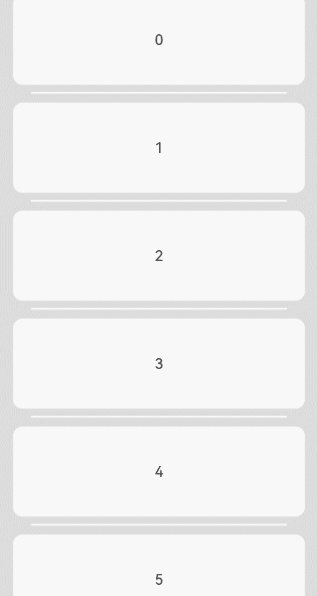
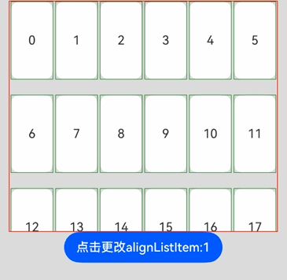
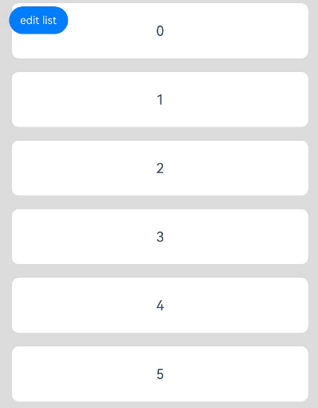
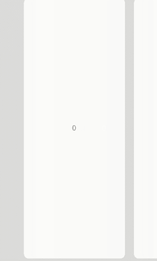
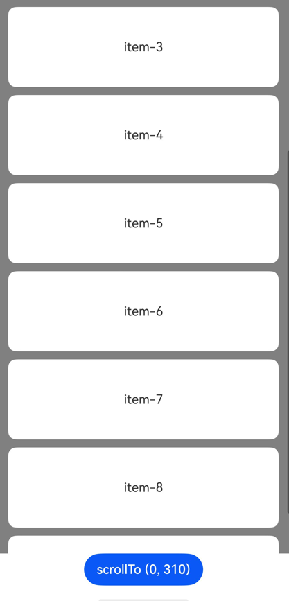
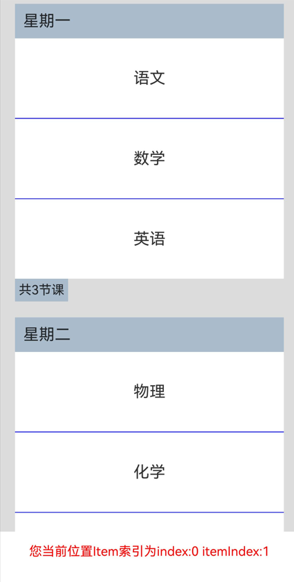
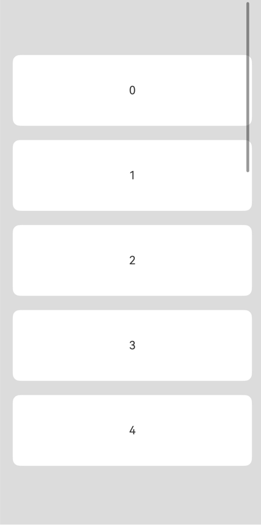
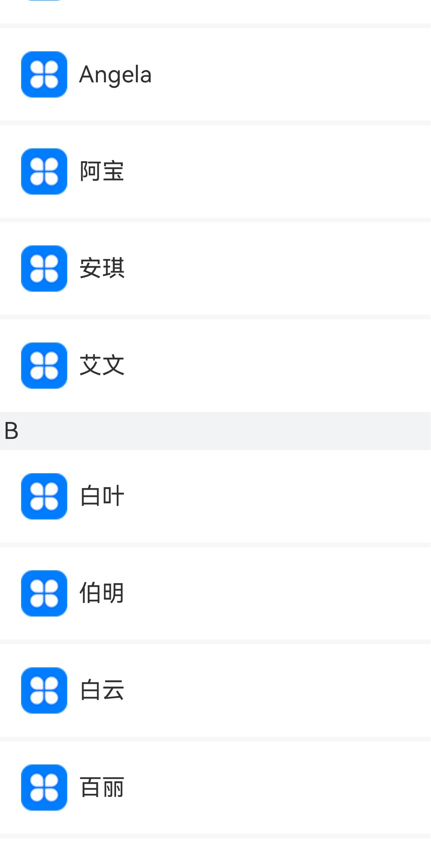

# List

<!--Del-->
> **说明：**
>
> 当前为Beta阶段。
<!--DelEnd-->

一个包含一系列相同宽度的列表项的容器组件。适合连续、多行呈现同类数据，例如图片和文本。

## 导入模块

```cangjie
import kit.ArkUI.*
```

## 子组件

仅支持[ListItem](./cj-scroll-swipe-listitem.md)、[ListItemGroup](./cj-scroll-swipe-listgroup.md)子组件。支持渲染控制类型（[if/else](../../arkui-cj/rendering_control/cj-rendering-control-ifelse.md)、[ForEach](../../arkui-cj/rendering_control/cj-rendering-control-foreach.md)、[LazyForEach](./cj-state-rendering-lazyforeach.md)）。

> **说明：**
>
> List的子组件的索引值计算规则：
>
> * 按子组件的顺序依次递增。
> * if/else语句中，只有条件成立的分支内的子组件会参与索引值计算，条件不成立的分支内子组件不计算索引值。
> * ForEach/LazyForEach语句中，会计算展开所有子节点索引值。
> * [if/else](../../arkui-cj/rendering_control/cj-rendering-control-ifelse.md)、[ForEach](../../arkui-cj/rendering_control/cj-rendering-control-foreach.md)、[LazyForEach](./cj-state-rendering-lazyforeach.md)发生变化以后，会更新子节点索引值。
> * ListItemGroup作为一个整体计算一个索引值，ListItemGroup内部的ListItem不计算索引值。
> * List子组件visibility属性设置为Hidden或None依然会计算索引值。

## 创建组件

### init(?Int64, ?Int32, ?Scroller, () -> Unit)

```cangjie
public init(
    space!: ?Int64 = None,
    initialIndex!: ?Int32 = None,
    scroller!: ?Scroller = Option<Scroller>.None,
    child!: () -> Unit
)
```

**功能：** 创建一个可包含子组件的List容器。

**系统能力：** SystemCapability.ArkUI.ArkUI.Full

**起始版本：** 22

**参数：**

|参数名|类型|必填|默认值|说明|
|:---|:---|:---|:---|:---|
|space|?Int64|否|None| **命名参数。** 子组件主轴方向的间隔。|
|initialIndex|?Int32|否|None|**命名参数。** 设置当前List初次加载时视口起始位置显示的item，即显示第一个item，如果设置的值超过了当前List最后一个item的索引值，则设置为不生效。|
|scroller|?[Scroller](cj-scroll-swipe-scroll.md#class-scroller)|否|Option\<Scroller>.None| **命名参数。** 可滚动组件的控制器。用于与可滚动组件进行绑定。|
|child|() -> Unit|是|-| **命名参数。** 声明容器内的List子组件。|

## 通用属性/通用事件

通用属性：除了支持通用属性外，还支持[滚动组件通用属性](./cj-scroll-swipe-common.md#组件属性)。

通用事件：除了支持通用事件外，还支持[滚动组件通用事件](./cj-scroll-swipe-common.md#组件事件)。

## 组件属性

### func alignListItem(?ListItemAlign)

```cangjie
public func alignListItem(value: ?ListItemAlign): This
```

**功能：** 设置List交叉轴方向宽度大于ListItem交叉轴宽度 * lanes时，ListItem在List交叉轴方向的布局方式。

**系统能力：** SystemCapability.ArkUI.ArkUI.Full

**起始版本：** 22

**参数：**

|参数名|类型|必填|默认值|说明|
|:---|:---|:---|:---|:---|
|value|?[ListItemAlign](./cj-common-types.md#enum-listitemalign)|是|-|交叉轴方向的布局方式。初始值：ListItemAlign.Start。|

### func cachedCount(?Int32)

```cangjie
public func cachedCount(value: ?Int32): This
```

**功能：** 设置列表中ListItem/ListItemGroup的预加载数量，懒加载场景只会预加载List显示区域外cachedCount的内容，非懒加载场景会全部加载。懒加载、非懒加载都只布局List显示区域+List显示区域外cachedCount的内容。

List设置cachedCount后，显示区域外上下各会预加载并布局cachedCount行ListItem。计算ListItem行数时，会计算ListItemGroup内部的ListItem行数。如果ListItemGroup内没有ListItem，则整个ListItemGroup算一行。

List下嵌套使用LazyForEach，并且LazyForEach下嵌套使用ListItemGroup时，LazyForEach会在List显示区域外上下各会创建cachedCount个ListItemGroup。

**系统能力：** SystemCapability.ArkUI.ArkUI.Full

**起始版本：** 22

**参数：**

|参数名|类型|必填|默认值|说明|
|:---|:---|:---|:---|:---|
|value|?Int32|是|-|列表中ListItem/ListItemGroup的预加载数量。初始值：1。|

### func chainAnimation(?Bool)

```cangjie
public func chainAnimation(value: ?Bool): This
```

**功能：** 设置是否启用链式动画，链式动画效果在列表滚动或拖拽到顶部或底部边界时提供视觉上的连接或"链式"效果。

**系统能力：** SystemCapability.ArkUI.ArkUI.Full

**起始版本：** 22

**参数：**

|参数名|类型|必填|默认值|说明|
|:---|:---|:---|:---|:---|
|value|?Bool|是|-|是否启用链式动画。初始值：false。|

### func divider(Option\<ListDividerOptions>)

```cangjie
public func divider(value: Option<ListDividerOptions>): This
```

**功能：** 设置列表项的分割线样式。默认情况下没有分割线。

**系统能力：** SystemCapability.ArkUI.ArkUI.Full

**起始版本：** 22

**参数：**

|参数名|类型|必填|默认值|说明|
|:---|:---|:---|:---|:---|
|value|Option\<[ListDividerOptions](./cj-scroll-swipe-listgroup.md#class-listdivideroptions)>|是|-|分割线样式配置。|

### func edgeEffect(?EdgeEffect)

```cangjie
public func edgeEffect(value: ?EdgeEffect): This
```

**功能：** 设置滚动到边界时使用的边缘效果。

**系统能力：** SystemCapability.ArkUI.ArkUI.Full

**起始版本：** 22

**参数：**

|参数名|类型|必填|默认值|说明|
|:---|:---|:---|:---|:---|
|value|?[EdgeEffect](./cj-common-types.md#enum-edgeeffect)|是|-|边缘效果类型。初始值：EdgeEffect.Spring。|

### func edgeEffect(?EdgeEffect, ?EdgeEffectOptions)

```cangjie
public func edgeEffect(edgeEffect: ?EdgeEffect, options!: ?EdgeEffectOptions): This
```

**功能：** 设置边缘滑动效果。

**系统能力：** SystemCapability.ArkUI.ArkUI.Full

**起始版本：** 26.1.0

**参数：**

|参数名|类型|必填|默认值|说明|
|:---|:---|:---|:---|:---|
|edgeEffect|?[EdgeEffect](./cj-common-types.md#enum-edgeeffect)|是|-|边缘滑动效果，支持弹簧效果和阴影效果。初始值：EdgeEffect.Spring。|
|options|?[EdgeEffectOptions](./cj-common-types.md#class-edgeeffectoptions)|是|-|当组件内容小于组件自身尺寸时，是否启用滑动效果。取值为 EdgeEffectOptions(true) 表示启用该效果，EdgeEffectOptions(false) 表示不启用。初始值：EdgeEffectOptions(false)。|

### func lanes(?Int32)

```cangjie
public func lanes(value: ?Int32): This
```

**功能：** 设置列表中列或行的数量。

**系统能力：** SystemCapability.ArkUI.ArkUI.Full

**起始版本：** 22

**参数：**

|参数名|类型|必填|默认值|说明|
|:---|:---|:---|:---|:---|
|value|?Int32|是|-|列表中列或行的数量。初始值：1。|

### func lanes(?Length, ?Length)

```cangjie
public func lanes(minLength!: ?Length, maxLength!: ?Length): This
```

**功能：** 设置列表中列或行的数量。

**系统能力：** SystemCapability.ArkUI.ArkUI.Full

**起始版本：** 22

**参数：**

|参数名|类型|必填|默认值|说明|
|:---|:---|:---|:---|:---|
|minLength|?[Length](./cj-common-types.md#interface-length)|是|-| **命名参数。** 列或行的最小长度。初始值：(-1.0).vp。|
|maxLength|?[Length](./cj-common-types.md#interface-length)|是|-| **命名参数。** 列或行的最大长度。初始值：(-1.0).vp。|

### func listDirection(?Axis)

```cangjie
public func listDirection(value: ?Axis): This
```

**功能：** 设置列表项排列的方向。

**系统能力：** SystemCapability.ArkUI.ArkUI.Full

**起始版本：** 22

**参数：**

|参数名|类型|必填|默认值|说明|
|:---|:---|:---|:---|:---|
|value|?[Axis](./cj-common-types.md#enum-axis)|是|-|列表项排列方向。初始值：Axis.Vertical。|

### func multiSelectable(?Bool)

```cangjie
public func multiSelectable(value: ?Bool): This
```

**功能：** 设置是否启用多选。

**系统能力：** SystemCapability.ArkUI.ArkUI.Full

**起始版本：** 22

**参数：**

|参数名|类型|必填|默认值|说明|
|:---|:---|:---|:---|:---|
|value|?Bool|是|-|是否启用多选。初始值：false。|

### func scrollSnapAlign(?ScrollSnapAlign)

```cangjie
public func scrollSnapAlign(value: ?ScrollSnapAlign): This
```

**功能：** 设置列表项滚动结束对齐效果。

**系统能力：** SystemCapability.ArkUI.ArkUI.Full

**起始版本：** 26.1.0

**参数：**

|参数名|类型|必填|默认值|说明|
|:---|:---|:---|:---|:---|
|value|?[ScrollSnapAlign](#enum-scrollsnapalign)|是|-|滚动吸附位置的对齐模式。初始值：ScrollSnapAlign.None。|

> **说明：**
>
> 吸附对齐仅支持等高列表项，等高约束不满足时对齐结果可能不准确。吸附对齐动画期间，[onWillScroll](./cj-scroll-swipe-common.md#func-onwillscrolloptionfloat64scrollstatescrollsource---scrollresult)事件上报的滚动来源为ScrollSource.Fling。

### func sticky(?StickyStyle)

```cangjie
public func sticky(value: ?StickyStyle): This
```

**功能：** 设置是否将ListItemGroup中的header固定在顶部或将footer固定在底部。

**系统能力：** SystemCapability.ArkUI.ArkUI.Full

**起始版本：** 22

**参数：**

|参数名|类型|必填|默认值|说明|
|:---|:---|:---|:---|:---|
|value|?[StickyStyle](./cj-common-types.md#enum-stickystyle)|是|-|粘性样式。初始值：StickyStyle.None。|

## 组件事件

### func onScrollFrameBegin(?(Float64, ScrollState) -> OnScrollFrameBeginHandlerResult)

```cangjie
public func onScrollFrameBegin(event: ?(Float64, ScrollState) -> OnScrollFrameBeginHandlerResult): This
```

**功能：** 每帧滚动开始时触发。

**系统能力：** SystemCapability.ArkUI.ArkUI.Full

**起始版本：** 22

**参数：**

|参数名|类型|必填|默认值|说明|
|:---|:---|:---|:---|:---|
|event|?(Float64, [ScrollState](./cj-common-types.md#enum-scrollstate)) -> [OnScrollFrameBeginHandlerResult](#class-onscrollframebeginhandlerresult)|是|-|滚动帧开始事件回调。参数一表示即将发生的滑动量，参数二表示当前的滑动的状态，返回值表示实际滑动量。初始值：{ _, _ => OnScrollFrameBeginHandlerResult(offsetRemain: 0.0) }。|

### func onScrollIndex(?(Int32, Int32, Int32) -> Unit)

```cangjie
public func onScrollIndex(event: ?(Int32, Int32, Int32) -> Unit): This
```

**功能：** 当子组件进入或离开列表显示区域时触发。

**系统能力：** SystemCapability.ArkUI.ArkUI.Full

**起始版本：** 22

**参数：**

|参数名|类型|必填|默认值|说明|
|:---|:---|:---|:---|:---|
|event|?(Int32, Int32, Int32) -> Unit|是|-|滚动索引事件回调。<br> 参数一表示List显示区域内第一个子组件的索引值；<br> 参数二表示List显示区域内最后一个子组件的索引值；<br> 参数三表示List显示区域内中间位置子组件的索引值。初始值：{ _, _, _ => }。|

## 基础类型定义

### class ListScroller

List组件的滚动控制器，通过它控制List组件的滚动，仅支持一对一绑定到List组件。

```cangjie
public class ListScroller <: Scroller {
    public init()
}
```

**功能：** List组件的控制器，继承自[Scroller](./cj-scroll-swipe-scroll.md#class-scroller)，在Scroller能力基础上提供分组列表项的滚动与布局信息查询能力。

**系统能力：** SystemCapability.ArkUI.ArkUI.Full

**起始版本：** 26.1.0

#### init()

```cangjie
public init()
```

**功能：** 构造函数，用于创建一个ListScroller对象。

**系统能力：** SystemCapability.ArkUI.ArkUI.Full

**起始版本：** 26.1.0

#### func getItemRectInGroup(Int32, Int32)

```cangjie
public func getItemRectInGroup(index: Int32, indexInGroup: Int32): RectResult
```

**功能：** 获取列表项组内列表项的尺寸及其相对于List的位置。

**系统能力：** SystemCapability.ArkUI.ArkUI.Full

**起始版本：** 26.1.0

**参数：**

|参数名|类型|必填|默认值|说明|
|:---|:---|:---|:---|:---|
|index|Int32|是|-|列表项组在List中的索引。仅支持当前显示区域内可见的列表项组。|
|indexInGroup|Int32|是|-|列表项组内列表项的索引。仅支持当前显示区域内可见的列表项。|

**返回值：**

|类型|说明|
|:----|:----|
|[RectResult](./cj-scroll-swipe-scroll.md#class-rectresult)|组内列表项的尺寸及其相对于List的位置，单位vp。index或indexInGroup取无效值（负值、超出最大索引或目标项不在显示区域内）时，返回的尺寸和位置均为0。|

**异常：**

- [BusinessException](../arkinterop/cj-api-business_exception.md#class-businessexception)：对应错误码如下表，详见[通用错误码](../cj-errorcode-universal.md)。

  |错误码|说明|
  |:----|:----|
  |100004|Controller not bound to a component.|

#### func scrollToItemInGroup(Int32, Int32, ?Bool, ?ScrollAlign)

```cangjie
public func scrollToItemInGroup(
    index: Int32,
    indexInGroup: Int32,
    smooth!: ?Bool = None,
    align!: ?ScrollAlign = None
): Unit
```

**功能：** 滚动到指定列表项组内的指定列表项。

**系统能力：** SystemCapability.ArkUI.ArkUI.Full

**起始版本：** 26.1.0

**参数：**

|参数名|类型|必填|默认值|说明|
|:---|:---|:---|:---|:---|
|index|Int32|是|-|目标列表项组在当前容器中的索引。|
|indexInGroup|Int32|是|-|目标列表项在index指定列表项组内的索引。|
|smooth|?Bool|否|None|是否开启滚动动画。初始值：false。smooth为true时会加载并布局计算所有传入的列表项，列表项数量较多时可能存在性能问题。|
|align|?[ScrollAlign](./cj-scroll-swipe-scroll.md#enum-scrollalign)|否|None|滚动到的列表项与容器的对齐方式。初始值：ScrollAlign.Start。|

> **说明：**
>
> index或indexInGroup为负值或超出对应最大索引时视为非法值，不执行滚动。对齐目标超出最大滚动范围时，滚动到最大滚动位置。

**异常：**

- [BusinessException](../arkinterop/cj-api-business_exception.md#class-businessexception)：对应错误码如下表，详见[通用错误码](../cj-errorcode-universal.md)。

  |错误码|说明|
  |:----|:----|
  |100004|Controller not bound to a component.|

#### func closeAllSwipeActions(?() -> Unit)

```cangjie
public func closeAllSwipeActions(onFinish!: ?() -> Unit = None): Unit
```

**功能：** 收拢全部处于展开状态的侧滑列表项，并设置回调。

**系统能力：** SystemCapability.ArkUI.ArkUI.Full

**起始版本：** 26.1.0

**参数：**

|参数名|类型|必填|默认值|说明|
|:---|:---|:---|:---|:---|
|onFinish|?() -> Unit|否|None|全部展开状态的列表项收拢完成后触发的回调。当前不存在展开状态的列表项时，回调不触发。|

**异常：**

- [BusinessException](../arkinterop/cj-api-business_exception.md#class-businessexception)：对应错误码如下表，详见[通用错误码](../cj-errorcode-universal.md)。

  |错误码|说明|
  |:----|:----|
  |100004|Controller not bound to a component.|

#### func getVisibleListContentInfo(Float64, Float64)

```cangjie
public func getVisibleListContentInfo(x: Float64, y: Float64): VisibleListContentInfo
```

**功能：** 根据坐标获取子组件的索引信息。

**系统能力：** SystemCapability.ArkUI.ArkUI.Full

**起始版本：** 26.1.0

**参数：**

|参数名|类型|必填|默认值|说明|
|:---|:---|:---|:---|:---|
|x|Float64|是|-|x坐标，单位vp。|
|y|Float64|是|-|y坐标，单位vp。|

**返回值：**

|类型|说明|
|:----|:----|
|[VisibleListContentInfo](#class-visiblelistcontentinfo)|指定坐标处可见子组件的索引信息。|

> **说明：**
>
> - 入参坐标(x, y)的基准点是List组件的位置。
> - 如果该坐标位置处于ListItem范围内，且该ListItem的父组件是List，则返回值对象成员index为该ListItem在List中的索引值，itemGroupArea返回None，itemIndexInGroup返回None。
> - 如果该坐标位置处于ListItem范围内，且该ListItem的父组件是ListItemGroup，则返回值对象成员index为该ListItemGroup在List中的索引值，itemGroupArea返回ListItemGroupArea.InListItemArea，itemIndexInGroup返回该ListItem在ListItemGroup中的索引值。
> - 如果该坐标位置不处于ListItem范围内，但是处于ListItemGroup的header或者footer范围内，则返回值对象成员index为该ListItemGroup在List中的索引值，itemIndexInGroup返回None。如果坐标位置处于header范围，itemGroupArea返回ListItemGroupArea.InHeaderArea。如果坐标位置处于footer范围，itemGroupArea返回ListItemGroupArea.InFooterArea。
> - 如果该坐标位置既不处于ListItem范围内，也不处于ListItemGroup的header或者footer范围内，但是处于ListItemGroup的范围内，则返回值对象成员index为该ListItemGroup在List中的索引值，itemIndexInGroup返回None，itemGroupArea返回ListItemGroupArea.None。
> - 如果该坐标位置既不处于ListItem范围内，也不处于ListItemGroup的范围内，则返回值对象成员index为-1，itemIndexInGroup返回None，itemGroupArea返回None。

**异常：**

- [BusinessException](../arkinterop/cj-api-business_exception.md#class-businessexception)：对应错误码如下表，详见[通用错误码](../cj-errorcode-universal.md)。

  |错误码|说明|
  |:----|:----|
  |100004|Controller not bound to a component.|

### class OnScrollFrameBeginHandlerResult

```cangjie
public class OnScrollFrameBeginHandlerResult {
    public var offsetRemain: ?Float64
    public init(offsetRemain!: ?Float64)
}
```

**功能：** 滚动帧开始处理结果。

**系统能力：** SystemCapability.ArkUI.ArkUI.Full

**起始版本：** 22

#### var offsetRemain

```cangjie
public var offsetRemain: ?Float64
```

**功能：** 剩余偏移量。

**类型：** ?Float64

**读写能力：** 可读写

**系统能力：** SystemCapability.ArkUI.ArkUI.Full

**起始版本：** 22

#### init(?Float64)

```cangjie
public init(offsetRemain!: ?Float64)
```

**功能：** 创建OnScrollFrameBeginHandlerResult对象。

**系统能力：** SystemCapability.ArkUI.ArkUI.Full

**起始版本：** 22

**参数：**

|参数名|类型|必填|默认值|说明|
|:---|:---|:---|:---|:---|
|offsetRemain|?Float64|是|-| **命名参数。** 剩余偏移量。初始值：0.0。|

### class VisibleListContentInfo

```cangjie
public class VisibleListContentInfo {
    public var index: Int32
    public var itemGroupArea: ?ListItemGroupArea
    public var itemIndexInGroup: ?Int32
    public init(index: Int32, itemGroupArea!: ?ListItemGroupArea = Option<ListItemGroupArea>.None,
        itemIndexInGroup!: ?Int32 = None)
}
```

**功能：** 用于表示List可见内容区子组件的详细信息。

**系统能力：** SystemCapability.ArkUI.ArkUI.Full

**起始版本：** 26.1.0

#### var index

```cangjie
public var index: Int32
```

**功能：** 表示ListItem或ListItemGroup在List中的索引值。

**类型：** Int32

**读写能力：** 可读写

**系统能力：** SystemCapability.ArkUI.ArkUI.Full

**起始版本：** 26.1.0

#### var itemGroupArea

```cangjie
public var itemGroupArea: ?ListItemGroupArea
```

**功能：** 表示处于ListItemGroup的哪一个区域。

**类型：** ?[ListItemGroupArea](#enum-listitemgrouparea)

**读写能力：** 可读写

**系统能力：** SystemCapability.ArkUI.ArkUI.Full

**起始版本：** 26.1.0

#### var itemIndexInGroup

```cangjie
public var itemIndexInGroup: ?Int32
```

**功能：** 表示ListItem在ListItemGroup中的索引值。

**类型：** ?Int32

**读写能力：** 可读写

**系统能力：** SystemCapability.ArkUI.ArkUI.Full

**起始版本：** 26.1.0

#### init(Int32, ?ListItemGroupArea, ?Int32)

```cangjie
public init(index: Int32, itemGroupArea!: ?ListItemGroupArea = Option<ListItemGroupArea>.None,
    itemIndexInGroup!: ?Int32 = None)
```

**功能：** 构造函数，用于创建一个VisibleListContentInfo对象。

**系统能力：** SystemCapability.ArkUI.ArkUI.Full

**起始版本：** 26.1.0

**参数：**

|参数名|类型|必填|默认值|说明|
|:---|:---|:---|:---|:---|
|index|Int32|是|-|列表项或列表项组的索引。|
|itemGroupArea|?[ListItemGroupArea](#enum-listitemgrouparea)|否|Option\<ListItemGroupArea>.None|列表项组内的位置。|
|itemIndexInGroup|?Int32|否|None|列表项组内列表项的索引。|

### enum ListItemGroupArea

```cangjie
public enum ListItemGroupArea <: Equatable<ListItemGroupArea> {
    | None
    | InListItemArea
    | InHeaderArea
    | InFooterArea
    | ...
}
```

枚举了ListItemGroup各个区域。

**系统能力：** SystemCapability.ArkUI.ArkUI.Full

**起始版本：** 26.1.0

**父类型：**

- Equatable\<[ScrollSnapAlign](#enum-scrollsnapalign)>

#### None

```cangjie
None
```

**功能：** 列表项组内除列表项、header、footer之外的区域，用于空列表项组（无列表项、header、footer）。

**系统能力：** SystemCapability.ArkUI.ArkUI.Full

**起始版本：** 26.1.0

#### InListItemArea

```cangjie
InListItemArea
```

**功能：** 列表项区域。

**系统能力：** SystemCapability.ArkUI.ArkUI.Full

**起始版本：** 26.1.0

#### InHeaderArea

```cangjie
InHeaderArea
```

**功能：** header区域。

**系统能力：** SystemCapability.ArkUI.ArkUI.Full

**起始版本：** 26.1.0

#### InFooterArea

```cangjie
InFooterArea
```

**功能：** footer区域。

**系统能力：** SystemCapability.ArkUI.ArkUI.Full

**起始版本：** 26.1.0

#### operator func ==(ListItemGroupArea)

```cangjie
public operator func ==(other: ListItemGroupArea): Bool
```

**功能：** 判断两个ListItemGroupArea枚举是否相等。

**系统能力：** SystemCapability.ArkUI.ArkUI.Full

**起始版本：** 26.1.0

**参数：**

|参数名|类型|必填|默认值|说明|
|:---|:---|:---|:---|:---|
|other|[ListItemGroupArea](#enum-listitemgrouparea)|是|-|要比较的另一个ListItemGroupArea枚举。|

**返回值：**

|类型|说明|
|:----|:----|
|Bool|如果两个枚举相等则返回true，否则返回false。|

#### operator func !=(ListItemGroupArea)

```cangjie
public operator func !=(other: ListItemGroupArea): Bool
```

**功能：** 判断两个ListItemGroupArea枚举是否不相等。

**系统能力：** SystemCapability.ArkUI.ArkUI.Full

**起始版本：** 26.1.0

**参数：**

|参数名|类型|必填|默认值|说明|
|:---|:---|:---|:---|:---|
|other|[ListItemGroupArea](#enum-listitemgrouparea)|是|-|要比较的另一个ListItemGroupArea枚举。|

**返回值：**

|类型|说明|
|:----|:----|
|Bool|如果两个枚举不相等则返回true，否则返回false。|

### enum ScrollSnapAlign

```cangjie
public enum ScrollSnapAlign <: Equatable<ScrollSnapAlign> {
    | None
    | Start
    | Center
    | End
    | ...
}
```

设置列表项滚动结束对齐效果。

**系统能力：** SystemCapability.ArkUI.ArkUI.Full

**起始版本：** 26.1.0

**父类型：**

- Equatable\<[ListItemGroupArea](#enum-listitemgrouparea)>

#### None

```cangjie
None
```

**功能：** 无吸附对齐，列表项滚动停止后保持原位置。初始值。

**系统能力：** SystemCapability.ArkUI.ArkUI.Full

**起始版本：** 26.1.0

#### Start

```cangjie
Start
```

**功能：** 列表项滚动结束后与List起始端对齐。

**系统能力：** SystemCapability.ArkUI.ArkUI.Full

**起始版本：** 26.1.0

#### Center

```cangjie
Center
```

**功能：** 列表项滚动结束后与List中心对齐。

**系统能力：** SystemCapability.ArkUI.ArkUI.Full

**起始版本：** 26.1.0

#### End

```cangjie
End
```

**功能：** 列表项滚动结束后与List末尾端对齐。

**系统能力：** SystemCapability.ArkUI.ArkUI.Full

**起始版本：** 26.1.0

#### operator func ==(ScrollSnapAlign)

```cangjie
public operator func ==(other: ScrollSnapAlign): Bool
```

**功能：** 判断两个ScrollSnapAlign枚举是否相等。

**系统能力：** SystemCapability.ArkUI.ArkUI.Full

**起始版本：** 26.1.0

**参数：**

|参数名|类型|必填|默认值|说明|
|:---|:---|:---|:---|:---|
|other|[ScrollSnapAlign](#enum-scrollsnapalign)|是|-|要比较的另一个ScrollSnapAlign枚举。|

**返回值：**

|类型|说明|
|:----|:----|
|Bool|如果两个枚举相等则返回true，否则返回false。|

#### operator func !=(ScrollSnapAlign)

```cangjie
public operator func !=(other: ScrollSnapAlign): Bool
```

**功能：** 判断两个ScrollSnapAlign枚举是否不相等。

**系统能力：** SystemCapability.ArkUI.ArkUI.Full

**起始版本：** 26.1.0

**参数：**

|参数名|类型|必填|默认值|说明|
|:---|:---|:---|:---|:---|
|other|[ScrollSnapAlign](#enum-scrollsnapalign)|是|-|要比较的另一个ScrollSnapAlign枚举。|

**返回值：**

|类型|说明|
|:----|:----|
|Bool|如果两个枚举不相等则返回true，否则返回false。|

## 示例代码

### 示例1 （添加滚动事件）

该示例实现了设置纵向列表，并在当前显示界面发生改变时回调索引。

<!-- run -->

```cangjie
package ohos_app_cangjie_entry

import kit.ArkUI.*
import ohos.arkui.state_macro_manage.*
import kit.PerformanceAnalysisKit.*

func loggerInfo(str: String) {
    Hilog.info(0, "CangjieTest", str)
}

@Entry
@Component
class EntryView {
    let arr = [0, 1, 2, 3, 4, 5, 6, 7, 8, 9]
    func build() {
        Stack(alignContent: Alignment.TopStart) {
            Column() {
                List(space: 20, initialIndex: 0) {
                    ForEach(this.arr, itemGeneratorFunc: {
                        item: Int64, _: Int64 => ListItem() {
                            Text("${item}")
                                .width(100.percent)
                                .height(100)
                                .fontSize(16)
                                .textAlign(TextAlign.Center)
                                .borderRadius(10)
                                .backgroundColor(0xFFFFFF)
                        }
                    })
                }
                    .id("list")
                    .listDirection(Axis.Vertical) // 排列方向
                    .scrollBar(BarState.Off)
                    //.friction(0.6)
                    .divider(
                        ListDividerOptions(strokeWidth: 2.px, color: Color(0xFFFFFF), startMargin: 20.px,
                            endMargin: 20.px)) // 每行之间的分界线
                    .edgeEffect(EdgeEffect.Spring) // 边缘效果设置为Spring
                    .onScrollIndex(
                        {
                            firstIndex: Int32, lastIndex: Int32, middleIndex: Int32 =>
                                loggerInfo("first" + firstIndex.toString())
                                loggerInfo("last" + lastIndex.toString())
                                loggerInfo("middle" + middleIndex.toString())
                        }
                    )
                    .width(90.percent)
            }
                .width(100.percent)
                .height(100.percent)
                .backgroundColor(0xDCDCDC)
                .padding(top: 5.px)
        }
    }
}
```



### 示例2 （设置子元素对齐）

该示例展示了不同ListItemAlign枚举值下，List组件交叉轴方向子元素对齐效果。

<!-- run -->

```cangjie
package ohos_app_cangjie_entry

import kit.ArkUI.*
import ohos.arkui.state_macro_manage.*

@Entry
@Component
class EntryView {
    let arr: Array<String> = ["0", "1", "2", "3", "4", "5", "6", "7", "8", "9", "10", "11", "12", "13", "14", "15", "16",
        "17", "18", "19"]
    @State
    var alignListItem: ListItemAlign = ListItemAlign.Start

    func build() {
        Column() {
            List(space: 20, initialIndex: 0) {
                ForEach(
                    this.arr,
                    itemGeneratorFunc: {
                        item: String, _: Int64 => ListItem() {
                            Text("${item}")
                            .width(100.percent)
                            .height(100)
                            .fontSize(16)
                            .textAlign(TextAlign.Center)
                            .borderRadius(10).backgroundColor(0xFFFFFF)
                        }.border(width: 2.px, color: Color.Green).width(55)
                    }
                )
            }
            .height(300)
            .width(90.percent)
            .border(width: 3.px, color: Color.Red)
            .lanes(6)
            .alignListItem(
                this.alignListItem)
            .scrollBar(BarState.Off)
            Button("点击更改alignListItem}").onClick(
                {
                 evt => match (this.alignListItem) {
                    case ListItemAlign.Start =>
                        this.alignListItem = ListItemAlign.Center
                    case ListItemAlign.Center =>
                        this.alignListItem = ListItemAlign.End
                    case ListItemAlign.End =>
                        this.alignListItem = ListItemAlign.Start
                    case _ => return
                }
            })
        }.width(100.percent).height(100.percent).backgroundColor(0xDCDCDC).padding(top: 5.px)
    }
}
```



### 示例3 （设置编辑模式）

该示例展示了如何设置当前List组件是否处于可编辑模式。

<!-- run -->

```cangjie
package ohos_app_cangjie_entry

import kit.ArkUI.*
import ohos.arkui.state_macro_manage.*

@Entry
@Component
class EntryView {
    @State
    var arr: ObservedArrayList<Int64> = ObservedArrayList<Int64>([0, 1, 2, 3, 4, 5, 6, 7, 8, 9])
    @State
    var editFlag: Bool = false

  func build() {
    Stack(alignContent: Alignment.TopStart ) {
      Column() {
        List(space: 20, initialIndex: 0 ) {
          ForEach(this.arr, itemGeneratorFunc:{item: Int64,index: Int64  =>
            ListItem() {
              Flex(direction:FlexDirection.Row, alignItems:ItemAlign.Center) {
                Text("${item}" )
                  .width(100.percent)
                  .height(80)
                  .fontSize(20)
                  .textAlign(TextAlign.Center)
                  .borderRadius(10)
                  .backgroundColor(0xFFFFFF)
                  .flexShrink(1)
                if (this.editFlag) {
                  Button() {
                    Text("delete").fontSize(16)
                  }.width(30.percent).height(40)
                  .onClick({event =>
                    if (index >=0 && index<this.arr.size) {
                      //BaseLog.info( "${this.arr[index]}Delete")
                      this.arr.remove(index)
                      //Hilog.info(0, "AppLogCj", this.arr.size.toString())
                      this.editFlag = false
                   }
                  }).stateEffect(true)
                }
              }
            }
          })
        }.width(90.percent)
        .scrollBar(BarState.Off)
      }.width(100.percent)

      Button("edit list")
        .onClick({event=>
          this.editFlag = !this.editFlag
        }).margin(top: 5, left: 20 )
    }.width(100.percent).height(100.percent).backgroundColor(0xDCDCDC).padding(top: 5)
  }
}
```



### 示例4 （设置限位对齐）

该示例展示了List组件设置居中限位的实现效果。

<!-- run -->

```cangjie
package ohos_app_cangjie_entry

import kit.ArkUI.*
import ohos.arkui.state_macro_manage.*
import std.collection.ArrayList

@Entry
@Component
class EntryView {
    let arr: ArrayList<Int64> = ArrayList<Int64>([0, 1, 2, 3, 4, 5, 6, 7, 8, 9, 10, 11, 12, 13, 14, 15, 16, 17, 18, 19])
    let scrollerForList = Scroller()

    func build() {
        Column() {
            Row() {
                List(space: 20, initialIndex: 3, scroller: this.scrollerForList) {
                    ForEach(this.arr, itemGeneratorFunc: {
                        item: Int64, _: Int64 => ListItem() {
                            Text("${item}")
                                .width(100.percent)
                                .height(100)
                                .fontSize(16)
                                .textAlign(TextAlign.Center)
                        }
                            .borderRadius(10)
                            .backgroundColor(0xFFFFFF)
                            .width(60.percent)
                            .height(80.percent)
                    })
                }
                    .chainAnimation(true)
                    .edgeEffect(EdgeEffect.Spring)
                    .listDirection(Axis.Horizontal)
                    .height(100.percent)
                    .width(100.percent)
                    .borderRadius(10.px)
                    .backgroundColor(0xDCDCDC)
            }
                .width(100.percent)
                .height(100.percent)
                .backgroundColor(0xDCDCDC)
                .padding(top: 10.px)
        }
    }
}
```




### 示例5（跳转准确）

该示例展示了List组件调用scrollTo接口跳转到指定位置。

<!-- run -->

```cangjie
package ohos_app_cangjie_entry

import kit.ArkUI.*
import ohos.arkui.state_macro_manage.*

@Entry
@Component
class EntryView {
    let listScroller: ListScroller = ListScroller()

    func build() {
        Column() {
            List(space: 10, initialIndex: 4, scroller: this.scroller) {
                ForEach([0, 1, 2, 3, 4, 5, 6, 7, 8, 9], itemGeneratorFunc: {
                    item: Int64, _: Int64 => ListItem() {
                        Text("item-${item}")
                            .height(100).width(90.percent)
                            .fontSize(16).textAlign(TextAlign.Center)
                            .borderRadius(10).backgroundColor(0xFFFFFF)
                    }
                })
            }
            .backgroundColor(Color.Gray)
            .layoutWeight(1)
            .scrollBar(BarState.On)
            .alignListItem(ListItemAlign.Center)

            Button("scrollTo (0, 310)")
                .onClick({ evt =>
                    this.listScroller.scrollTo(xOffset: 0.0, yOffset: 310.0)
                })
        }
    }
}
```



### 示例6（获得子组件索引信息）

该示例展示了含有分组时，拖拽过程中获取List组件的列表项索引相关信息，并对当前所在位置的列表项进行高亮显示。

<!-- run -->

```cangjie
package ohos_app_cangjie_entry

import kit.ArkUI.*
import ohos.arkui.state_macro_manage.*

class TimeTable {
    var title: String
    var projects: Array<String>

    init(title: String, projects: Array<String>) {
        this.title = title
        this.projects = projects
    }
}

@Entry
@Component
class EntryView {
    private var timeTable: Array<TimeTable> = [
        TimeTable("星期一", ["语文", "数学", "英语"]),
        TimeTable("星期二", ["物理", "化学", "生物"]),
        TimeTable("星期三", ["历史", "地理", "政治"]),
        TimeTable("星期四", ["美术", "音乐", "体育"])
    ]
    private var scroller: ListScroller = ListScroller()
    @State
    var listIndexInfo: Int32 = -1
    @State
    var mess: String = "null"
    @State
    var itemBackgroundColorArr: Array<Bool> = Array<Bool>(12, repeat: false)

    @Builder
    func ItemHead(text: String) {
        Text(text).fontSize(20).backgroundColor(0xAABBCC).width(100.percent).padding(10)
    }

    @Builder
    func ItemFoot(num: Int64) {
        Text("共${num}节课").fontSize(16).backgroundColor(0xAABBCC).padding(5)
    }

    func updateIndexInfo(localX: Float64, localY: Float64) {
        try {
            let info = this.scroller.getVisibleListContentInfo(localX, localY)
            this.listIndexInfo = info.index
            var itemIndex = "undefined"
            if (info.itemIndexInGroup.isSome()) {
                itemIndex = "${info.itemIndexInGroup.getOrThrow()}"
                if (info.index >= 0 && info.itemIndexInGroup.getOrThrow() >= 0) {
                    this.itemBackgroundColorArr[Int64(info.index) * 3 + Int64(info.itemIndexInGroup.getOrThrow())] = true
                }
            }
            this.mess = "index:${info.index} itemIndex:${itemIndex}"
        } catch (e: Exception) {
            Hilog.error(0, "CangjieTest", "Failed to get visible list content info. Code: ${e.message}")
        }
    }

    func build() {
        Column() {
            List(space: 20, scroller: this.scroller) {
                ForEach(this.timeTable, itemGeneratorFunc: {
                    item: TimeTable, index: Int64 =>
                        ListItemGroup(header: this.ItemHead(item.title), footer: this.ItemFoot(item.projects.size)) {
                            ForEach(item.projects, itemGeneratorFunc: {
                                project: String, subIndex: Int64 => ListItem() {
                                    Text(project)
                                        .width(100.percent)
                                        .height(100)
                                        .fontSize(20)
                                        .textAlign(TextAlign.Center)
                                        .backgroundColor(
                                            if (this.itemBackgroundColorArr[index * 3 + subIndex]) {
                                                0x68B4FF
                                            } else {
                                                0xFFFFFF
                                            })
                                }
                            }, keyGeneratorFunc: { project: String, _: Int64 => project })
                        }
                        .divider(ListDividerOptions(strokeWidth: 1, color: Color.Blue))
                }, keyGeneratorFunc: { item: TimeTable, _: Int64 => item.title })
            }
            .width(90.percent)
            .sticky(StickyStyle.Header)
            .scrollBar(BarState.Off)
            .gesture(
                PanGesture()
                    .onActionUpdate({ event: GestureEvent =>
                        if (event.fingerList.size > 0) {
                            this.updateIndexInfo(event.fingerList[0].localX, event.fingerList[0].localY)
                        }
                    })
            )
            .onClick({ evt =>
                this.itemBackgroundColorArr = Array<Bool>(12, repeat: false)
                this.mess = "null"
            })
            Text("您当前位置Item索引为${this.mess}")
                .fontColor(Color.Red)
                .height(50)
        }
        .width(100.percent)
        .height(90.percent)
        .backgroundColor(0xDCDCDC)
        .padding(top: 5)
    }
}
```



### 示例7（单边边缘效果）

该示例通过[edgeEffect](#func-edgeeffectedgeeffect-edgeeffectoptions)接口，实现了List组件设置单边边缘效果。

<!-- run -->

```cangjie
package ohos_app_cangjie_entry

import kit.ArkUI.*
import ohos.arkui.state_macro_manage.*

@Entry
@Component
class EntryView {
    let listScroller: ListScroller = ListScroller()

    func build() {
        Column() {
            List(space: 20, initialIndex: 0, scroller: this.listScroller) {
                ForEach([0, 1, 2, 3, 4, 5, 6, 7, 8, 9, 10, 11],
                    itemGeneratorFunc: {
                        item: Int64, _: Int64 => ListItem() {
                            Text("${item}")
                                .width(100.percent).height(100).fontSize(16)
                                .textAlign(TextAlign.Center).borderRadius(10).backgroundColor(0xFFFFFF)
                        }
                    })
            }
            .edgeEffect(EdgeEffect.Spring, options: EdgeEffectOptions(true, effectEdge: 1))
            .width(90.percent)
            .height(90.percent)
        }
        .width(100.percent)
        .height(100.percent)
        .backgroundColor(0xDCDCDC)
        .padding(top: 5)
    }
}
```




### 示例8（实现ListItemGroup中点击项的居中效果）

该示例使用[scrollToItemInGroup](#func-scrolltoitemingroupint32-int32-bool-scrollalign)接口，实现了单击[ListItemGroup](./cj-scroll-swipe-listgroup.md)中的[ListItem](./cj-scroll-swipe-listitem.md)时将其居中的效果。

<!-- run -->

```cangjie
package ohos_app_cangjie_entry

import kit.ArkUI.*
import ohos.arkui.state_macro_manage.*

class Contact {
    var name: String

    init(name: String) {
        this.name = name
    }
}

class ContactsGroup {
    var title: String
    var contacts: Array<Contact>

    init(title: String, contacts: Array<Contact>) {
        this.title = title
        this.contacts = contacts
    }
}

@Entry
@Component
class EntryView {
    private var listScroller: ListScroller = ListScroller()
    private var contactsGroups: Array<ContactsGroup> = [
        ContactsGroup("A", [
            Contact("艾佳"), Contact("安安"), Contact("Angela"),
            Contact("阿宝"), Contact("安琪"), Contact("艾文")
        ]),
        ContactsGroup("B", [
            Contact("白叶"), Contact("伯明"), Contact("白云"),
            Contact("百丽"), Contact("斌斌"), Contact("北北")
        ])
    ]

    @Builder
    func ItemHead(text: String) {
        Text(text).fontSize(20).backgroundColor(0xFFF1F3F5).width(100.percent).padding(5)
    }

    func build() {
        List(scroller: this.listScroller) {
            ForEach(this.contactsGroups, itemGeneratorFunc: {
                item: ContactsGroup, index: Int64 =>
                    ListItemGroup(header: this.ItemHead(item.title)) {
                        ForEach(item.contacts, itemGeneratorFunc: {
                            contact: Contact, subIndex: Int64 => ListItem() {
                                Row() {
                                    Image(@r(app.media.icon))
                                        .width(40)
                                        .height(40)
                                        .margin(10)
                                    Text(contact.name).fontSize(20)
                                }
                                .width(100.percent)
                                .justifyContent(FlexAlign.Start)
                                .margin(10)
                            }
                            .onClick({ evt =>
                                try {
                                    let itemRect = this.listScroller.getItemRectInGroup(Int32(index), Int32(subIndex))
                                    Hilog.info(0, "CangjieTest", "第${index + 1}个ListItemGroup的第${subIndex + 1}个ListItem的 x: ${itemRect.x}, y: ${itemRect.y}, width: ${itemRect.width}, height: ${itemRect.height}")
                                    this.listScroller.scrollToItemInGroup(Int32(index), Int32(subIndex), smooth: true, align: ScrollAlign.Center)
                                } catch (e: Exception) {
                                    Hilog.error(0, "CangjieTest", "getItemRectInGroup or scrollToItemInGroup failed, error: ${e.message}")
                                }
                            })
                        })
                    }
                    .divider(ListDividerOptions(strokeWidth: 4.vp))
                    .width(100.percent)
            }, keyGeneratorFunc: { item: ContactsGroup, _: Int64 => item.title })
        }
        .onScrollFrameBegin({ offset: Float64, state: ScrollState =>
            OnScrollFrameBeginHandlerResult(offsetRemain: offset)
        })
    }
}
```


