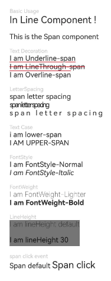

# Span

<!--Del-->
> **说明：**
>
> 当前为Beta阶段。
<!--DelEnd-->

作为[Text](cj-text-input-text.md)组件的子组件，用于显示行内文本的组件。

## 导入模块

```cangjie
import kit.ArkUI.*
```

## 子组件

无

## 创建组件

### init(?ResourceStr)

```cangjie
public init(value: ?ResourceStr)
```

**功能：** 创建Span组件。

**系统能力：** SystemCapability.ArkUI.ArkUI.Full

**起始版本：** 22

**参数：**

|参数名|类型|必填|默认值|说明|
|:---|:---|:---|:---|:---|
|value|?[ResourceStr](./cj-common-types.md#interface-resourcestr)|是|-|文本内容。<br>初始值：""。|

## 通用属性/通用事件

通用属性：不支持。

通用事件：仅支持点击事件[onClick](#func-onclickclickevent---unit)。

> **说明：**
>
> 由于Span组件无尺寸信息，因此点击事件返回的ClickEvent对象的target属性无效。

## 组件属性

### func decoration(?TextDecorationType, ?ResourceColor)

```cangjie
public func decoration(decorationType!: ?TextDecorationType, color!: ?ResourceColor = None): This
```

**功能：** 设置文本装饰线样式及其颜色。

**系统能力：** SystemCapability.ArkUI.ArkUI.Full

**起始版本：** 22

**参数：**

|参数名|类型|必填|默认值|说明|
|:---|:---|:---|:---|:---|
|decorationType|?[TextDecorationType](./cj-common-types.md#enum-textdecorationtype)|是|-| **命名参数。** 文本装饰线样式。<br>初始值：TextDecorationType.None。|
|color|?[ResourceColor](./cj-common-types.md#interface-resourcecolor)|否|None| **命名参数。** 文本装饰线颜色。<br>初始值：Color.Black。|

### func fontColor(?ResourceColor)

```cangjie
public func fontColor(value: ?ResourceColor): This
```

**功能：** 设置字体颜色。

**系统能力：** SystemCapability.ArkUI.ArkUI.Full

**起始版本：** 22

**参数：**

|参数名|类型|必填|默认值|说明|
|:---|:---|:---|:---|:---|
|value|?[ResourceColor](./cj-common-types.md#interface-resourcecolor)|是|-|字体颜色。|

### func fontFamily(?ResourceStr)

```cangjie
public func fontFamily(value: ?ResourceStr): This
```

**功能：** 设置字体列表。

**系统能力：** SystemCapability.ArkUI.ArkUI.Full

**起始版本：** 22

**参数：**

|参数名|类型|必填|默认值|说明|
|:---|:---|:---|:---|:---|
|value|?[ResourceStr](./cj-common-types.md#interface-resourcestr)|是|-|字体列表。<br>初始值："HarmonyOS Sans"。|

### func fontSize(?Length)

```cangjie
public func fontSize(value: ?Length): This
```

**功能：** 设置字体大小。

**系统能力：** SystemCapability.ArkUI.ArkUI.Full

**起始版本：** 22

**参数：**

|参数名|类型|必填|默认值|说明|
|:---|:---|:---|:---|:---|
|value|?[Length](./cj-common-types.md#interface-length)|是|-|字体大小。|

### func fontStyle(?FontStyle)

```cangjie
public func fontStyle(value: ?FontStyle): This
```

**功能：** 设置字体样式。

**系统能力：** SystemCapability.ArkUI.ArkUI.Full

**起始版本：** 22

**参数：**

|参数名|类型|必填|默认值|说明|
|:---|:---|:---|:---|:---|
|value|?[FontStyle](./cj-common-types.md#enum-fontstyle)|是|-|字体样式。<br>初始值：FontStyle.Normal。|

### func fontWeight(?FontWeight)

```cangjie
public func fontWeight(value: ?FontWeight): This
```

**功能：** 设置文本的字体粗细，设置过大可能会在不同字体下有截断。

**系统能力：** SystemCapability.ArkUI.ArkUI.Full

**起始版本：** 22

**参数：**

|参数名|类型|必填|默认值|说明|
|:---|:---|:---|:---|:---|
|value|?[FontWeight](./cj-common-types.md#enum-fontweight)|是|-|文本的字体粗细，设置过大可能会在不同字体下有截断。<br>初始值：FontWeight.Normal。|

### func letterSpacing(?Length)

```cangjie
public func letterSpacing(value: ?Length): This
```

**功能：** 设置文本字符间距。

**系统能力：** SystemCapability.ArkUI.ArkUI.Full

**起始版本：** 22

**参数：**

|参数名|类型|必填|默认值|说明|
|:---|:---|:---|:---|:---|
|value|?[Length](./cj-common-types.md#interface-length)|是|-|字符间距。<br>初始值：0.0.px。|

### func textCase(?TextCase)

```cangjie
public func textCase(value: ?TextCase): This
```

**功能：** 设置文本大小写。

**系统能力：** SystemCapability.ArkUI.ArkUI.Full

**起始版本：** 22

**参数：**

|参数名|类型|必填|默认值|说明|
|:---|:---|:---|:---|:---|
|value|?[TextCase](./cj-common-types.md#enum-textcase)|是|-|文本大小写。<br>初始值：TextCase.Normal。|

### func lineHeight(?Length)

```cangjie
public func lineHeight(value: ?Length): This
```

**功能：** 设置文本行高。未通过该接口设置时，默认由系统根据字体大小自动计算行高。

**系统能力：** SystemCapability.ArkUI.ArkUI.Full

**起始版本：** 26.1.0

**参数：**

|参数名|类型|必填|默认值|说明|
|:---|:---|:---|:---|:---|
|value|?[Length](./cj-common-types.md#interface-length)|是|-|文本行高。<br>Int64、Float64类型时单位为fp。不支持设置百分比字符串。|

## 组件事件

### func onClick(?(ClickEvent) -> Unit)

```cangjie
public func onClick(event: ?(ClickEvent) -> Unit): This
```

**功能：** 点击事件回调函数。

**系统能力：** SystemCapability.ArkUI.ArkUI.Full

**起始版本：** 22

**参数：**

|参数名|类型|必填|默认值|说明|
|:---|:---|:---|:---|:---|
|event|?([ClickEvent](./cj-common-types.md#class-clickevent)) -> Unit|是|-|点击事件回调函数，点击事件回调。<br>初始值：{ _ => }。|

## 基础类型定义

### class BaseSpan

```cangjie
public abstract class BaseSpan {}
```

**功能：** Span组件的基类。

**系统能力：** SystemCapability.ArkUI.ArkUI.Full

**起始版本：** 22

## 示例代码

### 示例1（设置文本样式）

该示例展示了设置不同样式的文本效果以及Span配置点击事件。

<!--run-->

```cangjie
package ohos_app_cangjie_entry

import kit.ArkUI.*
import ohos.arkui.state_macro_manage.*
import std.collection.*

@Entry
@Component
class EntryView {
    func build() {
        Flex(direction: FlexDirection.Column, alignItems: ItemAlign.Start) {
            Text("Basic Usage").fontSize(9).fontColor(0xCCCCCC)
            Text() {
                Span("In Line")
                Span(" Component")
                Span(" !")
            }

            Text() {
                Span("This is the Span component")
                    .fontSize(12)
                    .textCase(TextCase.Normal)
                    .decoration(decorationType: TextDecorationType.None, color: Color.Red)
                    .fontFamily("HarmonyOS Sans")
            }.margin(top: 12)

            // 文本装饰线设置
            Text("Text Decoration").fontSize(9).fontColor(0xCCCCCC).margin(top: 12)
            Text() {
                Span("I am Underline-span")
                    .decoration(decorationType: TextDecorationType.Underline, color: Color.Red)
                    .fontSize(12)
            }

            Text() {
                Span("I am LineThrough-span")
                    .decoration(decorationType: TextDecorationType.LineThrough, color: Color.Red)
                    .fontSize(12)
            }

            Text() {
                Span("I am Overline-span")
                    .decoration(decorationType: TextDecorationType.Overline, color: Color.Red)
                    .fontSize(12)
            }

            // 文本字符间距
            Text("LetterSpacing").fontSize(9).fontColor(0xCCCCCC).margin(top: 12)
            Text() {
                Span("span letter spacing")
                    .letterSpacing(0)
                    .fontSize(12)
            }

            Text() {
                Span("span letter spacing")
                    .letterSpacing(-2)
                    .fontSize(12)
            }

            Text() {
                Span("span letter spacing")
                    .letterSpacing(3)
                    .fontSize(12)
            }

            // 文本大小写展示设置
            Text("Text Case").fontSize(9).fontColor(0xCCCCCC).margin(top: 12)
            Text() {
                Span("I am Lower-span")
                    .fontSize(12)
                    .textCase(TextCase.LowerCase)
                    .decoration(decorationType: TextDecorationType.None)
            }

            Text() {
                Span("I am Upper-span")
                    .fontSize(12)
                    .textCase(TextCase.UpperCase)
                    .decoration(decorationType: TextDecorationType.None)
            }

            // 文本字体样式设置
            Text("FontStyle").fontSize(9).fontColor(0xCCCCCC).margin(top: 12)
            Text() {
                Span("I am FontStyle-Normal")
                    .fontSize(12)
                    .fontStyle(FontStyle.Normal)
            }

            Text() {
                Span("I am FontStyle-Italic")
                    .fontSize(12)
                    .fontStyle(FontStyle.Italic)
            }

            // 文本字体粗细设置
            Text("FontWeight").fontSize(9).fontColor(0xCCCCCC).margin(top: 12)
            Text() {
                Span("I am FontWeight-Lighter")
                    .fontSize(12)
                    .fontWeight(FontWeight.Lighter)
            }

            Text() {
                Span("I am FontWeight-Bold")
                    .fontSize(12)
                    .fontWeight(FontWeight.Bold)
            }

            // 文本行高设置
            Text("LineHeight").fontSize(9).fontColor(0xCCCCCC).margin(top: 12)
            Text() {
                Span("I am lineHeight default\n")
                    .fontSize(12)
                    .fontWeight(FontWeight.Lighter)
                Span("I am lineHeight 30")
                    .fontSize(12)
                    .lineHeight(30)
            }
                .backgroundColor(Color.Gray)

            // span点击事件设置
            Text("span click event").fontSize(9).fontColor(0xCCCCCC).margin(top: 12)
            Text() {
                Span("Span default ").fontSize(12)
                Span("Span click")
                    .onClick(
                        {
                            event =>
                                println("span onClick")
                        }
                    )
            }
        }
            .width(100.percent)
            .padding(left: 35, right: 35, top: 35)
    }
}
```


