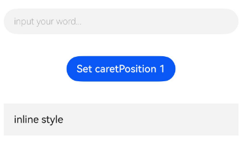

# TextInput

<!--Del-->
> **说明：**
>
> 当前为Beta阶段。
<!--DelEnd-->

单行文本输入框组件。当前仅支持基本输入模式，无特殊限制。

## 导入模块

```cangjie
import kit.ArkUI.*
```

## 子组件

无

## 创建组件

### init(?ResourceStr, ?ResourceStr, ?TextInputController)

```cangjie
public init(placeholder!: ?ResourceStr = None, text!: ?ResourceStr = None, controller!: ?TextInputController = None)
```

**功能：** 创建一个包含占位符文本、当前文本内容和控制器的TextInput对象。

**系统能力：** SystemCapability.ArkUI.ArkUI.Full

**起始版本：** 22

**参数：**

|参数名|类型|必填|默认值|说明|
|:---|:---|:---|:---|:---|
|placeholder|?[ResourceStr](./cj-common-types.md#interface-resourcestr)|否|None| **命名参数。** 占位符文本，无输入时显示的文本。|
|text|?[ResourceStr](./cj-common-types.md#interface-resourcestr)|否|None| **命名参数。** TextInput的当前值。|
|controller|?[TextInputController](#class-textinputcontroller)|否|None| **命名参数。** TextInput组件的控制器。|

## 通用属性/通用事件

通用属性：全部支持。

通用事件：全部支持。

> **说明：**
>
> 单行输入框可设置.[width](./cj-universal-attribute-size.md#func-widthoptionlength)([LengthMetrics.AUTO](./cj-common-types.md#static-let-auto))使组件宽度自适应文本宽度，自适应时组件宽度受[constraintSize](./cj-universal-attribute-layoutconstraints.md#func-constraintsizelength-length-length-length)属性以及父容器传递的最大最小宽度限制。

## 组件属性

### func caretColor(?ResourceColor)

```cangjie
public func caretColor(value: ?ResourceColor): This
```

**功能：** 设置光标的颜色。

**系统能力：** SystemCapability.ArkUI.ArkUI.Full

**起始版本：** 22

**参数：**

|参数名|类型|必填|默认值|说明|
|:---|:---|:---|:---|:---|
|value|?[ResourceColor](./cj-common-types.md#interface-resourcecolor)|是|-|光标的颜色。<br>初始值：0xFF007DFF。|

### func customKeyboard(?CustomBuilder, ?Bool)

```cangjie
public func customKeyboard(value: ?CustomBuilder, supportAvoidance!: ?Bool = None): This
```

**功能：** 定义文本输入的自定义键盘。

**系统能力：** SystemCapability.ArkUI.ArkUI.Full

**起始版本：** 22

**参数：**

|参数名|类型|必填|默认值|说明|
|:---|:---|:---|:---|:---|
|value|?[CustomBuilder](./cj-common-types.md#type-custombuilder)|是|-|设置TextInput的自定义键盘。<br>初始值：{ => }。|
|supportAvoidance|?Bool|否|None| **命名参数。** TextInput的自定义键盘选项。<br>初始值：false。|

### func ellipsisMode(?EllipsisMode)

```cangjie
public func ellipsisMode(mode: ?EllipsisMode): This
```

**功能：** 设置省略位置。ellipsisMode属性仅在[TextInputStyle](#func-styletextinputstyle)的内联模式下生效，需要配合[textOverflow](#func-textoverflowtextoverflow)设置为TextOverflow.Ellipsis使用，单独设置ellipsisMode属性不生效。未通过该接口设置时，初始值为EllipsisMode.End。

非编辑态时正常生效，编辑态时EllipsisMode.Start和EllipsisMode.Center仅在[maxLines](#func-maxlinesint32)设置为1时生效，EllipsisMode.End正常生效。EllipsisMode.MultilineStart和EllipsisMode.MultilineCenter正常生效。

**系统能力：** SystemCapability.ArkUI.ArkUI.Full

**起始版本：** 26.1.0

**参数：**

|参数名|类型|必填|默认值|说明|
|:---|:---|:---|:---|:---|
|mode|?[EllipsisMode](./cj-common-types.md#enum-ellipsismode)|是|-|省略位置。|

### func enableKeyboardOnFocus(?Bool)

```cangjie
public func enableKeyboardOnFocus(value: ?Bool): This
```

**功能：** 设置在获得焦点时是否请求键盘。

**系统能力：** SystemCapability.ArkUI.ArkUI.Full

**起始版本：** 22

**参数：**

|参数名|类型|必填|默认值|说明|
|:---|:---|:---|:---|:---|
|value|?Bool|是|-|设置在获得焦点时是否请求键盘。<br>初始值：true。|

### func enterKeyType(?EnterKeyType)

```cangjie
public func enterKeyType(value: ?EnterKeyType): This
```

**功能：** 设置软键盘输入按钮的类型。

**系统能力：** SystemCapability.ArkUI.ArkUI.Full

**起始版本：** 22

**参数：**

|参数名|类型|必填|默认值|说明|
|:---|:---|:---|:---|:---|
|value|?[EnterKeyType](./cj-common-types.md#enum-enterkeytype)|是|-|软键盘输入按钮的类型。<br>初始值：EnterKeyType.Done。|

### func fontFamily(?ResourceStr)

```cangjie
public func fontFamily(value: ?ResourceStr): This
```

**功能：** 设置文本的字体族。

**系统能力：** SystemCapability.ArkUI.ArkUI.Full

**起始版本：** 22

**参数：**

|参数名|类型|必填|默认值|说明|
|:---|:---|:---|:---|:---|
|value|?[ResourceStr](./cj-common-types.md#interface-resourcestr)|是|-|文本的字体族。<br>初始值："HarmonyOS Sans"。|

### func fontColor(?ResourceColor)

```cangjie
public func fontColor(value: ?ResourceColor): This
```

**功能：** 设置文本的颜色。

**系统能力：** SystemCapability.ArkUI.ArkUI.Full

**起始版本：** 22

**参数：**

|参数名|类型|必填|默认值|说明|
|:---|:---|:---|:---|:---|
|value|?[ResourceColor](./cj-common-types.md#interface-resourcecolor)|是|-|文本的颜色。<br>初始值：0xdbffffff。|

### func fontSize(?Length)

```cangjie
public func fontSize(value: ?Length): This
```

**功能：** 设置文本的字体大小。

**系统能力：** SystemCapability.ArkUI.ArkUI.Full

**起始版本：** 22

**参数：**

|参数名|类型|必填|默认值|说明|
|:---|:---|:---|:---|:---|
|value|?[Length](./cj-common-types.md#interface-length)|是|-|文本的字体大小。|

### func fontStyle(?FontStyle)

```cangjie
public func fontStyle(value: ?FontStyle): This
```

**功能：** 设置文本的字体样式。

**系统能力：** SystemCapability.ArkUI.ArkUI.Full

**起始版本：** 22

**参数：**

|参数名|类型|必填|默认值|说明|
|:---|:---|:---|:---|:---|
|value|?[FontStyle](./cj-common-types.md#enum-fontstyle)|是|-|文本的字体样式。<br>初始值：FontStyle.Normal。|

### func fontWeight(?FontWeight)

```cangjie
public func fontWeight(value: ?FontWeight): This
```

**功能：** 设置文本的字体粗细。

**系统能力：** SystemCapability.ArkUI.ArkUI.Full

**起始版本：** 22

**参数：**

|参数名|类型|必填|默认值|说明|
|:---|:---|:---|:---|:---|
|value|?[FontWeight](./cj-common-types.md#enum-fontweight)|是|-|文本的字体粗细。<br>初始值：FontWeight.Normal。|

### func halfLeading(?Bool)

```cangjie
public func halfLeading(halfLeading: ?Bool): This
```

**功能：** 设置文本在行内垂直居中，将行间距平分至行的顶部与底部。未通过该接口设置时，初始值为false。

**系统能力：** SystemCapability.ArkUI.ArkUI.Full

**起始版本：** 26.1.0

**参数：**

|参数名|类型|必填|默认值|说明|
|:---|:---|:---|:---|:---|
|halfLeading|?Bool|是|-|设置文本是否垂直居中。<br>true表示将行间距平分至行的顶部与底部，false则不平分。|

### func inputFilter(?ResourceStr, ?(String) -> Unit)

```cangjie
public func inputFilter(value: ?ResourceStr, error!: ?(String) -> Unit = None): This
```

**功能：** 设置文本的输入过滤规则。

**系统能力：** SystemCapability.ArkUI.ArkUI.Full

**起始版本：** 22

**参数：**

|参数名|类型|必填|默认值|说明|
|:---|:---|:---|:---|:---|
|value|?[ResourceStr](./cj-common-types.md#interface-resourcestr)|是|-|输入过滤规则。<br>初始值：""。|
|error|?(String) -> Unit|否|None| **命名参数。** 输入错误时的回调函数。|

### func maxLength(?UInt32)

```cangjie
public func maxLength(value: ?UInt32): This
```

**功能：** 设置文本的最大长度。

**系统能力：** SystemCapability.ArkUI.ArkUI.Full

**起始版本：** 22

**参数：**

|参数名|类型|必填|默认值|说明|
|:---|:---|:---|:---|:---|
|value|?UInt32|是|-|文本的最大长度。|

### func maxLines(?Int32)

```cangjie
public func maxLines(value: ?Int32): This
```

**功能：** 定义文本输入的最大行数。

**系统能力：** SystemCapability.ArkUI.ArkUI.Full

**起始版本：** 22

**参数：**

|参数名|类型|必填|默认值|说明|
|:---|:---|:---|:---|:---|
|value|?Int32|是|-|文本输入的最大行数。<br>初始值：3。|

### func placeholderColor(?ResourceColor)

```cangjie
public func placeholderColor(value: ?ResourceColor): This
```

**功能：** 设置占位符文本的颜色。

**系统能力：** SystemCapability.ArkUI.ArkUI.Full

**起始版本：** 22

**参数：**

|参数名|类型|必填|默认值|说明|
|:---|:---|:---|:---|:---|
|value|?[ResourceColor](./cj-common-types.md#interface-resourcecolor)|是|-|占位符文本的颜色。|

### func placeholderFont(?Length, ?FontWeight, ?String, ?FontStyle)

```cangjie
public func placeholderFont(size!: ?Length, weight!: ?FontWeight = None, family!: ?String = None,
    style!: ?FontStyle = None): This
```

**功能：** 设置占位符文本的字体属性。

**系统能力：** SystemCapability.ArkUI.ArkUI.Full

**起始版本：** 22

**参数：**

|参数名|类型|必填|默认值|说明|
|:---|:---|:---|:---|:---|
|size|?[Length](./cj-common-types.md#interface-length)|是|-| **命名参数。** 占位符文本的字体大小。<br>初始值：(-1.0).px。|
|weight|?[FontWeight](./cj-common-types.md#enum-fontweight)|否|None| **命名参数。** 占位符文本的字体粗细。<br>初始值：FontWeight.W400。|
|family|?String|否|None| **命名参数。** 占位符文本的字体族。<br>初始值：""。|
|style|?[FontStyle](./cj-common-types.md#enum-fontstyle)|否|None| **命名参数。** 占位符文本的字体样式。<br>初始值：FontStyle.Normal。|

### func selectionMenuHidden(?Bool)

```cangjie
public func selectionMenuHidden(value: ?Bool): This
```

**功能：** 控制选择菜单是否弹出。

**系统能力：** SystemCapability.ArkUI.ArkUI.Full

**起始版本：** 22

**参数：**

|参数名|类型|必填|默认值|说明|
|:---|:---|:---|:---|:---|
|value|?Bool|是|-|控制选择菜单是否弹出。<br>初始值：false。|

### func showUnderline(?Bool)

```cangjie
public func showUnderline(value: ?Bool): This
```

**功能：** 定义是否显示文本输入的下划线。

**系统能力：** SystemCapability.ArkUI.ArkUI.Full

**起始版本：** 22

**参数：**

|参数名|类型|必填|默认值|说明|
|:---|:---|:---|:---|:---|
|value|?Bool|是|-|定义是否显示文本输入的下划线。<br>初始值：false。|

### func style(?TextInputStyle)

```cangjie
public func style(value: ?TextInputStyle): This
```

**功能：** 文本输入样式。

**系统能力：** SystemCapability.ArkUI.ArkUI.Full

**起始版本：** 22

**参数：**

|参数名|类型|必填|默认值|说明|
|:---|:---|:---|:---|:---|
|value|?[TextInputStyle](./cj-common-types.md#enum-textinputstyle)|是|-|文本输入样式。<br>初始值：TextInputStyle.Default。|

### func textAlign(?TextAlign)

```cangjie
public func textAlign(value: ?TextAlign): This
```

**功能：** 设置文本的水平对齐方式。

**系统能力：** SystemCapability.ArkUI.ArkUI.Full

**起始版本：** 22

**参数：**

|参数名|类型|必填|默认值|说明|
|:---|:---|:---|:---|:---|
|value|?[TextAlign](./cj-common-types.md#enum-textalign)|是|-|文本的水平对齐方式。<br>初始值：TextAlign.Start。|

### func textIndent(?Length)

```cangjie
public func textIndent(value: ?Length): This
```

**功能：** 设置首行文本缩进。未通过该接口设置时，初始值为0。

**系统能力：** SystemCapability.ArkUI.ArkUI.Full

**起始版本：** 26.1.0

**参数：**

|参数名|类型|必填|默认值|说明|
|:---|:---|:---|:---|:---|
|value|?[Length](./cj-common-types.md#interface-length)|是|-|首行文本缩进。<br>单位：vp<br>取值范围：大于等于0。设置负数时，按初始值处理。|

### func textOverflow(?TextOverflow)

```cangjie
public func textOverflow(value: ?TextOverflow): This
```

**功能：** 设置文本超长时的显示方式。仅在[TextInputStyle](#func-styletextinputstyle)值为内联模式的编辑态、非编辑态下支持。未通过该接口设置时，内联模式非编辑态下默认为TextOverflow.Ellipsis，内联模式编辑态下默认为TextOverflow.Clip。

当textOverflow设置为TextOverflow.None时，效果与TextOverflow.Clip相同。

**系统能力：** SystemCapability.ArkUI.ArkUI.Full

**起始版本：** 26.1.0

**参数：**

|参数名|类型|必填|默认值|说明|
|:---|:---|:---|:---|:---|
|value|?[TextOverflow](./cj-common-types.md#enum-textoverflow)|是|-|文本超长时的显示方式。|

## 组件事件

### func onChange(?(String) -> Unit)

```cangjie
public func onChange(callback: ?(String) -> Unit): This
```

**功能：** 输入框内容发生变化时触发该回调。

**系统能力：** SystemCapability.ArkUI.ArkUI.Full

**起始版本：** 22

**参数：**

|参数名|类型|必填|默认值|说明|
|:---|:---|:---|:---|:---|
|callback|?(String) -> Unit|是|-|输入框内容发生变化时的回调函数。<br>初始值：{ _ => }。|

### func onCopy(?(String) -> Unit)

```cangjie
public func onCopy(callback: ?(String) -> Unit): This
```

**功能：** 使用剪贴板菜单时触发该回调。

**系统能力：** SystemCapability.ArkUI.ArkUI.Full

**起始版本：** 22

**参数：**

|参数名|类型|必填|默认值|说明|
|:---|:---|:---|:---|:---|
|callback|?(String) -> Unit|是|-|复制操作时的回调函数。<br>初始值：{ _ => }。|

### func onCut(?(String) -> Unit)

```cangjie
public func onCut(callback: ?(String) -> Unit): This
```

**功能：** 使用剪贴板菜单时触发该回调。

**系统能力：** SystemCapability.ArkUI.ArkUI.Full

**起始版本：** 22

**参数：**

|参数名|类型|必填|默认值|说明|
|:---|:---|:---|:---|:---|
|callback|?(String) -> Unit|是|-|剪切操作时的回调函数。<br>初始值：{ _ => }。|

### func onEditChange(?(Bool) -> Unit)

```cangjie
public func onEditChange(callback: ?(Bool) -> Unit): This
```

**功能：** 判断文本编辑状态是否发生变化。

**系统能力：** SystemCapability.ArkUI.ArkUI.Full

**起始版本：** 22

**参数：**

|参数名|类型|必填|默认值|说明|
|:---|:---|:---|:---|:---|
|callback|?(Bool) -> Unit|是|-|文本编辑状态变化时的回调函数。<br>初始值：{ _ => }。|

### func onPaste(?(String) -> Unit)

```cangjie
public func onPaste(callback: ?(String) -> Unit): This
```

**功能：** 使用剪贴板菜单时触发该回调。

**系统能力：** SystemCapability.ArkUI.ArkUI.Full

**起始版本：** 22

**参数：**

|参数名|类型|必填|默认值|说明|
|:---|:---|:---|:---|:---|
|callback|?(String) -> Unit|是|-|粘贴操作时的回调函数。<br>初始值：{ _ => }。|

### func onSubmit(?(EnterKeyType) -> Unit)

```cangjie
public func onSubmit(callback: ?(EnterKeyType) -> Unit): This
```

**功能：** 提交时触发该回调。

**系统能力：** SystemCapability.ArkUI.ArkUI.Full

**起始版本：** 22

**参数：**

|参数名|类型|必填|默认值|说明|
|:---|:---|:---|:---|:---|
|callback|?([EnterKeyType](./cj-common-types.md#enum-enterkeytype)) -> Unit|是|-|提交时的回调函数。<br>初始值：{ _ => }。|

## 基础类型定义

### class TextInputController

```cangjie
public class TextInputController {
    public init()
}
```

**功能：** TextInputController是TextInput组件的控制器，可以定义该类型的对象并绑定至TextInput组件，实现对TextInput组件的控制。

**系统能力：** SystemCapability.ArkUI.ArkUI.Full

**起始版本：** 22

#### init()

```cangjie
public init()
```

**功能：** TextInputController的构造函数。

**系统能力：** SystemCapability.ArkUI.ArkUI.Full

**起始版本：** 22

#### func caretPosition(?Int32)

```cangjie
public func caretPosition(value: ?Int32): Unit
```

**功能：** 设置插入光标的位置。

**系统能力：** SystemCapability.ArkUI.ArkUI.Full

**起始版本：** 22

**参数：**

|参数名|类型|必填|默认值|说明|
|:---|:---|:---|:---|:---|
|value|?Int32|是|-|光标位置。|

#### func setTextSelection(?Int32, ?Int32, ?MenuPolicy)

```cangjie
public func setTextSelection(selectionStart: ?Int32, selectionEnd: ?Int32, options!: ?MenuPolicy = None): Unit
```

**功能：** 通过指定文本的起始和结束位置实现文本选择。

**系统能力：** SystemCapability.ArkUI.ArkUI.Full

**起始版本：** 22

**参数：**

|参数名|类型|必填|默认值|说明|
|:---|:---|:---|:---|:---|
|selectionStart|?Int32|是|-|选中文本的起始位置。|
|selectionEnd|?Int32|是|-|选中文本的结束位置。|
|options|?[MenuPolicy](./cj-common-types.md#enum-menupolicy)|否|None| **命名参数。** 文本选择的选项。<br>初始值：MenuPolicy.Default。|

#### func stopEditing()

```cangjie
public func stopEditing(): Unit
```

**功能：** 退出编辑状态。

**系统能力：** SystemCapability.ArkUI.ArkUI.Full

**起始版本：** 22

## 示例代码

### 示例1（设置光标位置）

<!--run-->

```cangjie
package ohos_app_cangjie_entry

import kit.ArkUI.*
import kit.PerformanceAnalysisKit.*
import ohos.arkui.state_macro_manage.*

@Entry
@Component
class EntryView {
    @State
    var text: String = ''
    @State
    var passwordState: Bool = false
    var controller: TextInputController = TextInputController()

    func build() {
        Column() {
            TextInput(text: this.text, placeholder: 'input your word...', controller: this.controller)
                .placeholderColor(Color.Gray)
                .placeholderFont(size: 14, weight: FontWeight.W100)
                .caretColor(Color.Blue)
                .width(95.percent)
                .height(40)
                .margin(20)
                .fontSize(14)
                .fontColor(Color.Black)
                .inputFilter('[a-z]', error: {
                    info: String => Hilog.error(0, "AppLogCj", "inputFilter error")
                })
                .onChange({
                    value: String => this.text = value
                })
            Text(this.text)
            Button('Set caretPosition 1')
                .margin(15)
                .onClick({
                    evt =>
                    // 将光标移动至第一个字符后
                    this
                        .controller
                        .caretPosition(1)
                })
            // 内联风格输入框
            TextInput(text: 'inline style')
                .width(95.percent)
                .height(50)
                .margin(20)
                .borderRadius(0)
                .style(TextInputStyle.Inline)
        }.width(100.percent)
    }
}
```



### 示例2（文本设置省略模式）

该示例通过[textOverflow](#func-textoverflowtextoverflow)、[ellipsisMode](#func-ellipsismodeellipsismode)、[style](#func-styletextinputstyle)属性展示了文本超长省略以及调整省略位置的效果，通过MultilineStart和MultilineCenter两种类型实现了单行文本和多行文本场景下的省略号在行首和行中的效果。

<!--run-->

```cangjie
package ohos_app_cangjie_entry

import kit.ArkUI.*
import std.collection.*
import ohos.arkui.state_macro_manage.*

@Entry
@Component
class EllipsisModeExample {
    @State
    var text: String = "As the sun begins to set, casting a warm golden hue across the sky," +
        "the world seems to slow down and breathe a sigh of relief. The sky is painted with hues of orange, " +
        " pink, and lavender, creating a breath taking tapestry that stretches as far as the eye can see." +
        "The air is filled with the sweet scent of blooming flowers, mingling with the earthy aroma of freshly turned soil."
    @State
    var ellipsisModeIndex: Int32 = 0
    var ellipsisMode: Array<EllipsisMode> = Array<EllipsisMode>(5, item: {i =>
        if (i == 0) {
            EllipsisMode.End
        } else if (i == 1) {
            EllipsisMode.Start
        } else if (i == 2) {
            EllipsisMode.Center
        } else if (i == 3) {
            EllipsisMode.MultilineStart
        } else {
            EllipsisMode.MultilineCenter
        }
    })
    var ellipsisModeStr: Array<String> = Array<String>(5, item: {i =>
        if (i == 0) {
            "END"
        } else if (i == 1) {
            "START"
        } else if (i == 2) {
            "CENTER"
        } else if (i == 3) {
            "MULTILINE_START"
        } else {
            "MULTILINE_CENTER"
        }
    })
    @State
    var textOverflowIndex: Int32 = 0
    var textOverflow: Array<TextOverflow> = Array<TextOverflow>(2, item: {i =>
        if (i == 0) {
            TextOverflow.Ellipsis
        } else {
            TextOverflow.Clip
        }
    })
    var textOverflowStr: Array<String> = Array<String>(2, item: {i =>
        if (i == 0) {
            "Ellipsis"
        } else {
            "Clip"
        }
    })
    @State
    var styleInputIndex: Int32 = 0
    var styleInput: Array<TextInputStyle> = Array<TextInputStyle>(2, item: {i =>
        if (i == 0) {
            TextInputStyle.Inline
        } else {
            TextInputStyle.Default
        }
    })
    var styleInputStr: Array<String> = Array<String>(2, item: {i =>
        if (i == 0) {
            "Inline"
        } else {
            "Default"
        }
    })

    func build() {
        Row() {
            Column(space: 20) {
                TextInput(text: this.text)
                    .textOverflow(this.textOverflow[this.textOverflowIndex])
                    .ellipsisMode(this.ellipsisMode[this.ellipsisModeIndex])
                    .style(this.styleInput[this.styleInputIndex])
                    .fontSize(30)
                    .margin(30)
                Button("更改ellipsisMode模式：" + this.ellipsisModeStr[this.ellipsisModeIndex])
                    .onClick(
                        {
                            event =>
                                this.ellipsisModeIndex += 1
                                if (this.ellipsisModeIndex > Int32(this.ellipsisModeStr.size) - 1) {
                                    this.ellipsisModeIndex = 0
                                }
                        }
                    )
                    .fontSize(20)
                Button("更改textOverflow模式：" + this.textOverflowStr[this.textOverflowIndex])
                    .onClick(
                        {
                            event =>
                                this.textOverflowIndex += 1
                                if (this.textOverflowIndex > Int32(this.textOverflowStr.size) - 1) {
                                    this.textOverflowIndex = 0
                                }
                        }
                    )
                    .fontSize(20)
                Button("更改Style大小：" + this.styleInputStr[this.styleInputIndex])
                    .onClick(
                        {
                            event =>
                                this.styleInputIndex += 1
                                if (this.styleInputIndex > Int32(this.styleInputStr.size) - 1) {
                                    this.styleInputIndex = 0
                                }
                        }
                    )
                    .fontSize(20)
            }
        }
    }
}
```

