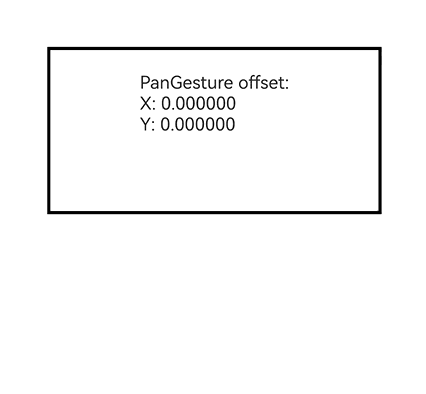
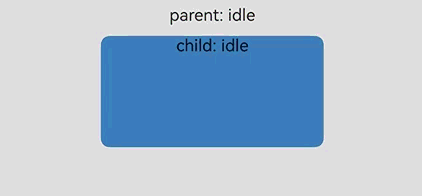

# 绑定手势事件

<!--Del-->
> **说明：**
>
> 当前为Beta阶段。
<!--DelEnd-->

为组件绑定不同类型的手势事件，并设置事件的响应方式；支持普通手势绑定（gesture）和父子组件同时触发的并行手势绑定（parallelGesture），适用于组件交互响应、父子组件手势协同触发等场景。

> **说明：**
>
> - 当前版本仅支持绑定滑动手势[PanGesture](./cj-basic-gestures-pangesture.md)。
> - 可以通过[触摸热区设置](./cj-universal-attribute-touchtarget.md)指定可识别手势的区域。

## 导入模块

```cangjie
import kit.ArkUI.*
```

## func gesture(GestureType)

```cangjie
func gesture(gesture: GestureType): T
```

**功能：** 绑定手势。

**系统能力：** SystemCapability.ArkUI.ArkUI.Full

**起始版本：** 26.1.0

**参数：**

|参数名|类型|必填|默认值|说明|
|:---|:---|:---|:---|:---|
|gesture|[GestureType](./cj-common-types.md#class-gesturetype)|是|-|绑定的手势类型，当前版本仅支持[PanGesture](./cj-basic-gestures-pangesture.md)。|

**返回值：**

|类型|说明|
|:---|:---|
|T|返回调用此接口的组件实例本身，可用于链式调用。|

## func gesture(GestureType, ?GestureMask)

```cangjie
func gesture(gesture: GestureType, mask: ?GestureMask): T
```

**功能：** 绑定手势，并通过手势掩码控制是否屏蔽子组件手势。

**系统能力：** SystemCapability.ArkUI.ArkUI.Full

**起始版本：** 26.1.0

**参数：**

|参数名|类型|必填|默认值|说明|
|:---|:---|:---|:---|:---|
|gesture|[GestureType](./cj-common-types.md#class-gesturetype)|是|-|绑定的手势类型，当前版本仅支持[PanGesture](./cj-basic-gestures-pangesture.md)。|
|mask|?[GestureMask](./cj-common-types.md#enum-gesturemask)|是|GestureMask.Normal|事件响应设置。当需要控制是否屏蔽子组件手势时传入该参数：GestureMask.Normal表示不屏蔽子组件手势，适用于父组件手势响应后仍允许子组件手势按默认规则参与识别的场景；GestureMask.IgnoreInternal表示屏蔽子组件手势，适用于希望父组件绑定的手势响应并忽略子组件手势的场景。|

**返回值：**

|类型|说明|
|:---|:---|
|T|返回调用此接口的组件实例本身，可用于链式调用。|

## func parallelGesture(GestureType)

```cangjie
func parallelGesture(gesture: GestureType): T
```

**功能：** 绑定可与子组件手势同时触发的并行手势。手势事件为非冒泡事件，当父组件设置parallelGesture时，父子组件相同的手势事件都可以触发，实现类似冒泡效果。

**系统能力：** SystemCapability.ArkUI.ArkUI.Full

**起始版本：** 26.1.0

**参数：**

|参数名|类型|必填|默认值|说明|
|:---|:---|:---|:---|:---|
|gesture|[GestureType](./cj-common-types.md#class-gesturetype)|是|-|绑定的手势对象，当前版本仅支持[PanGesture](./cj-basic-gestures-pangesture.md)。|

**返回值：**

|类型|说明|
|:---|:---|
|T|返回调用此接口的组件实例本身，可用于链式调用。|

## func parallelGesture(GestureType, ?GestureMask)

```cangjie
func parallelGesture(gesture: GestureType, mask: ?GestureMask): T
```

**功能：** 绑定可与子组件手势同时触发的并行手势，并通过手势掩码控制是否屏蔽子组件手势。手势事件为非冒泡事件，当父组件设置parallelGesture时，父子组件相同的手势事件都可以触发，实现类似冒泡效果。

**系统能力：** SystemCapability.ArkUI.ArkUI.Full

**起始版本：** 26.1.0

**参数：**

|参数名|类型|必填|默认值|说明|
|:---|:---|:---|:---|:---|
|gesture|[GestureType](./cj-common-types.md#class-gesturetype)|是|-|绑定的手势对象，当前版本仅支持[PanGesture](./cj-basic-gestures-pangesture.md)。|
|mask|?[GestureMask](./cj-common-types.md#enum-gesturemask)|是|GestureMask.Normal|事件响应设置。当需要配置父子组件手势同时触发时，可传入该参数控制是否屏蔽子组件手势：GestureMask.Normal表示不屏蔽子组件手势，适用于父子组件手势都需要响应的场景；GestureMask.IgnoreInternal表示屏蔽子组件手势，适用于只希望父组件parallelGesture绑定的手势响应的场景。|

**返回值：**

|类型|说明|
|:---|:---|
|T|返回调用此接口的组件实例本身，可用于链式调用。|

## 示例代码

### 示例1（绑定滑动手势并跟随手指移动组件）

该示例演示了通过gesture绑定滑动手势，在滑动手势识别成功后的回调中获取偏移量，实现组件跟随手指移动的效果。

<!-- run -->

```cangjie
package ohos_app_cangjie_entry

import kit.ArkUI.*
import ohos.arkui.state_macro_manage.*

@Entry
@Component
class EntryView {
    @State
    var offsetX: Float64 = 0.0
    @State
    var offsetY: Float64 = 0.0
    var positionX: Float64 = 0.0
    var positionY: Float64 = 0.0

    func build() {
        Column {
            Column {
                Text('PanGesture offset:\nX: ' + this.offsetX.toString() + '\nY: ' + this.offsetY.toString())
            }
            .height(150)
            .width(300)
            .padding(20)
            .borderWidth(3)
            .margin(50)
            // 以组件左上角为坐标原点进行移动
            .translate(x: this.offsetX, y: this.offsetY)
            // 绑定滑动手势，单指以任意方向滑动即可触发
            .gesture(
                PanGesture(fingers: 1, direction: PanDirection.All, distance: 5.0)
                    .onActionStart({ _ =>
                        // 滑动手势识别成功，记录组件当前位置作为起始位置
                        this.positionX = this.offsetX
                        this.positionY = this.offsetY
                    })
                    .onActionUpdate({ event =>
                        // 根据滑动偏移量更新组件当前位置
                        this.offsetX = this.positionX + event.offsetX
                        this.offsetY = this.positionY + event.offsetY
                    })
                    .onActionEnd({ _ =>
                        // 滑动结束后保存当前位置，作为下一次滑动的起始位置
                        this.positionX = this.offsetX
                        this.positionY = this.offsetY
                    })
            )
        }
        .height(100.percent)
        .width(100.percent)
    }
}
```



### 示例2（父子组件同时响应滑动手势）

该示例演示了父组件通过parallelGesture绑定并行手势后，在子组件区域内滑动时，父子组件绑定的滑动手势可同时触发的效果。

<!-- run -->

```cangjie
package ohos_app_cangjie_entry

import kit.ArkUI.*
import ohos.arkui.state_macro_manage.*

@Entry
@Component
class EntryView {
    @State
    var parentText: String = 'parent: idle'
    @State
    var childText: String = 'child: idle'

    func build() {
        Column {
            Text(this.parentText)
                .fontSize(15)
                .margin(bottom: 10)
            Column {
                Text(this.childText)
                    .fontSize(15)
            }
            .width(200)
            .height(100)
            .backgroundColor(0x4682B4)
            .borderRadius(8)
            // 子组件通过gesture绑定滑动手势
            .gesture(
                PanGesture()
                    .onActionUpdate({ event =>
                        this.childText = 'child pan, offsetX: ' + event.offsetX.toString()
                    })
            )
        }
        .width(100.percent)
        .height(200)
        .backgroundColor(0xDDDDDD)
        .borderRadius(12)
        .padding(10)
        // 父组件通过parallelGesture绑定并行手势，父子组件的滑动手势可同时触发
        .parallelGesture(
            PanGesture()
                .onActionUpdate({ event =>
                    this.parentText = 'parent parallel pan, offsetX: ' + event.offsetX.toString()
                })
        )
    }
}
```


