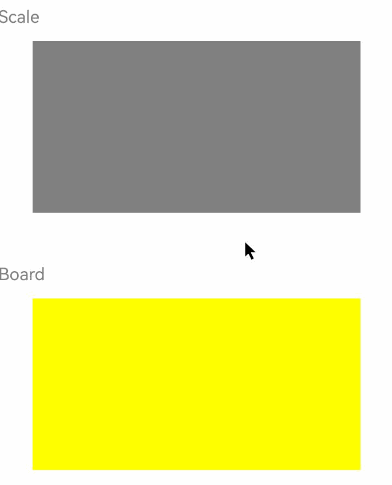

# 悬浮态效果

<!--Del-->
> **说明：**
>
> 当前为Beta阶段。
<!--DelEnd-->

设置组件的鼠标悬浮态显示效果，支持缩放、淡入淡出、系统默认等多种悬浮效果类型，用于在鼠标指针悬停到组件上时呈现视觉反馈，帮助用户识别当前交互区域并提升界面交互体验。

## 导入模块

```cangjie
import kit.ArkUI.*
```

## func hoverEffect(?HoverEffect)

```cangjie
func hoverEffect(value: ?HoverEffect): T
```

**功能：** 设置组件的鼠标悬浮态显示效果。当未设置hoverEffect时，组件默认鼠标悬浮态效果为HoverEffect.Auto。对于设置了悬浮态效果的组件，当鼠标悬浮于组件上并按下时，悬浮态效果会消失；松开鼠标且鼠标指针仍悬浮于组件上方时，悬浮态效果会恢复。value为None时，保持默认悬浮态效果。

**系统能力：** SystemCapability.ArkUI.ArkUI.Full

**起始版本：** 26.1.0

**参数：**

|参数名|类型|必填|默认值|说明|
|:---|:---|:---|:---|:---|
|value|?[HoverEffect](./cj-common-types.md#enum-hovereffect)|是|-|设置当前组件悬浮态下的悬浮效果。|

**返回值：**

|类型|说明|
|:---|:---|
|T|返回调用此接口的组件实例本身。|

## 示例代码

该示例通过hoverEffect设置组件的鼠标悬浮态显示效果。

 <!-- run -->

```cangjie
package ohos_app_cangjie_entry

import kit.ArkUI.*
import kit.PerformanceAnalysisKit.Hilog
import ohos.arkui.state_macro_manage.*

@Entry
@Component
class EntryView {
    @State
    var isHoverVal: Bool = false

    func build() {
        Column(space: 5) {
            Column(space: 5) {
                Text('Scale').fontSize(20).fontColor(Color.Gray).width(90.percent).position(x: 0, y: 80)
                Column()
                    .width(80.percent)
                    .height(200)
                    .backgroundColor(Color.Gray)
                    .position(x: 40, y: 120)
                    // 设置悬浮态效果为放大缩小效果
                    .hoverEffect(HoverEffect.Scale)
                    .onHover({ isHover =>
                        Hilog.info(1, "info", "Scale isHover: ${isHover}")
                        this.isHoverVal = isHover
                    })

                Text('Board').fontSize(20).fontColor(Color.Gray).width(90.percent).position(x: 0, y: 380)
                Column()
                    .width(80.percent)
                    .height(200)
                    .backgroundColor(Color.Yellow)
                    // 设置悬浮态效果为背景淡入淡出的强调效果
                    .hoverEffect(HoverEffect.Highlight)
                    .position(x: 40, y: 420)
                    .onHover({ isHover =>
                        Hilog.info(1, "info", "Highlight isHover: ${isHover}")
                        this.isHoverVal = isHover
                    })
            }
                // 设置悬浮态效果为无效果
                .hoverEffect(HoverEffect.None)
                .width(100.percent)
                .height(100.percent)
                .border(width: 1)
                .onHover({ isHover =>
                    Hilog.info(1, "info", "HoverEffect.None")
                    this.isHoverVal = isHover
                })
        }
    }
}
```


