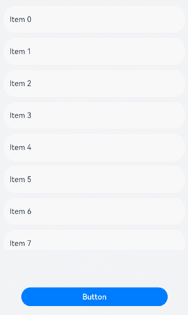

# 自定义事件分发

<!--Del-->
> **说明：**
>
> 当前为Beta阶段。
<!--DelEnd-->

在处理触屏事件时，ArkUI会在触屏事件触发前进行按压点和组件区域的[触摸测试](../../arkui-cj/cj-common-events-distribute.md#触摸测试)，收集需要响应触屏事件的组件，再基于触摸测试结果分发相应的触屏事件。在父节点，可以通过onChildTouchTest决定子节点的触摸测试方式，影响子组件的触摸测试，从而影响后续的触屏事件分发。具体影响参考[TouchTestStrategy](#enum-touchteststrategy)枚举说明。

> **说明：**
>
> - 子节点信息数组中仅包含命名节点的信息，即开发者通过[id](./cj-universal-attribute-componentid.md#func-idstring)属性设置了id的节点。
> - onClick和旋转、捏合手势经过自定义事件分发后，可能会因为未命中触摸热区导致事件不响应。

## 导入模块

```cangjie
import kit.ArkUI.*
```

## func onChildTouchTest(?(Array\<TouchTestInfo>) -> TouchResult)

```cangjie
func onChildTouchTest(callback: ?(Array<TouchTestInfo>) -> TouchResult): T
```

**功能：** 当前组件通过设置回调，可自定义触摸测试并控制触摸测试中的子节点行为。回调接收包含子节点触摸测试信息的数组，数组中仅包含命名节点（即通过id属性设置了id的节点）的信息；回调返回[TouchResult](#class-touchresult)，用于控制子节点的事件分发策略。callback为None时，按系统默认策略分发。

**系统能力：** SystemCapability.ArkUI.ArkUI.Full

**起始版本：** 26.1.0

**参数：**

|参数名|类型|必填|默认值|说明|
|:---|:---|:---|:---|:---|
|callback|?(Array\<[TouchTestInfo](#class-touchtestinfo)>) -> [TouchResult](#class-touchresult)|是|-|自定义触摸测试的回调函数，在每次触摸测试时被调用。|

**返回值：**

|类型|说明|
|:---|:---|
|T|返回调用此接口的组件实例本身。|

## class ComponentRect

```cangjie
public class ComponentRect {
    public var x: Float64
    public var y: Float64
    public var width: Float64
    public var height: Float64
}
```

**功能：** 描述组件的位置和宽高。该类对象由框架创建，在[TouchTestInfo](#class-touchtestinfo)的rect字段中返回，开发者无需构造。

**系统能力：** SystemCapability.ArkUI.ArkUI.Full

**起始版本：** 26.1.0

### var x

```cangjie
public var x: Float64
```

**功能：** 水平方向横坐标。

**类型：** Float64

**读写能力：** 可读写

**系统能力：** SystemCapability.ArkUI.ArkUI.Full

**起始版本：** 26.1.0

### var y

```cangjie
public var y: Float64
```

**功能：** 竖直方向纵坐标。

**类型：** Float64

**读写能力：** 可读写

**系统能力：** SystemCapability.ArkUI.ArkUI.Full

**起始版本：** 26.1.0

### var width

```cangjie
public var width: Float64
```

**功能：** 内容宽度大小。

**类型：** Float64

**读写能力：** 可读写

**系统能力：** SystemCapability.ArkUI.ArkUI.Full

**起始版本：** 26.1.0

### var height

```cangjie
public var height: Float64
```

**功能：** 内容高度大小。

**类型：** Float64

**读写能力：** 可读写

**系统能力：** SystemCapability.ArkUI.ArkUI.Full

**起始版本：** 26.1.0

## class TouchResult

```cangjie
public class TouchResult {
    public var strategy: TouchTestStrategy
    public var id: ?String
    public init(strategy: TouchTestStrategy, id!: ?String = None)
}
```

**功能：** 自定义事件分发结果，开发者通过返回结果来影响事件分发。

**系统能力：** SystemCapability.ArkUI.ArkUI.Full

**起始版本：** 26.1.0

### var strategy

```cangjie
public var strategy: TouchTestStrategy
```

**功能：** 事件派发策略。

**类型：** [TouchTestStrategy](#enum-touchteststrategy)

**读写能力：** 可读写

**系统能力：** SystemCapability.ArkUI.ArkUI.Full

**起始版本：** 26.1.0

### var id

```cangjie
public var id: ?String
```

**功能：** 子组件的唯一标识。当strategy为TouchTestStrategy.Default时，id是可选的；当strategy是TouchTestStrategy.ForwardCompetition或TouchTestStrategy.Forward时，id是必需的（如果没有返回id，则视为TouchTestStrategy.Default处理）。

**类型：** ?String

**读写能力：** 可读写

**系统能力：** SystemCapability.ArkUI.ArkUI.Full

**起始版本：** 26.1.0

### init(TouchTestStrategy, ?String)

```cangjie
public init(strategy: TouchTestStrategy, id!: ?String = None)
```

**功能：** 构造TouchResult对象。

**系统能力：** SystemCapability.ArkUI.ArkUI.Full

**起始版本：** 26.1.0

**参数：**

|参数名|类型|必填|默认值|说明|
|:---|:---|:---|:---|:---|
|strategy|[TouchTestStrategy](#enum-touchteststrategy)|是|-|事件派发策略。|
|id|?String|否|None|**命名参数。** 子组件的唯一标识。|

## class TouchTestInfo

```cangjie
public class TouchTestInfo {
    public var windowX: Float64
    public var windowY: Float64
    public var parentX: Float64
    public var parentY: Float64
    public var x: Float64
    public var y: Float64
    public var rect: ComponentRect
    public var id: String
}
```

**功能：** 当前屏幕触点相对于窗口、父组件和子组件的坐标，以及子组件的id、位置和尺寸相关信息。该类对象由框架创建，在[onChildTouchTest](#func-onchildtouchtestarraytouchtestinfo---touchresult)回调中传给开发者。

**系统能力：** SystemCapability.ArkUI.ArkUI.Full

**起始版本：** 26.1.0

### var windowX

```cangjie
public var windowX: Float64
```

**功能：** 按压点相对于窗口左上角的x轴坐标。

**类型：** Float64

**读写能力：** 可读写

**系统能力：** SystemCapability.ArkUI.ArkUI.Full

**起始版本：** 26.1.0

### var windowY

```cangjie
public var windowY: Float64
```

**功能：** 按压点相对于窗口左上角的y轴坐标。

**类型：** Float64

**读写能力：** 可读写

**系统能力：** SystemCapability.ArkUI.ArkUI.Full

**起始版本：** 26.1.0

### var parentX

```cangjie
public var parentX: Float64
```

**功能：** 按压点相对于父组件左上角的x轴坐标。

**类型：** Float64

**读写能力：** 可读写

**系统能力：** SystemCapability.ArkUI.ArkUI.Full

**起始版本：** 26.1.0

### var parentY

```cangjie
public var parentY: Float64
```

**功能：** 按压点相对于父组件左上角的y轴坐标。

**类型：** Float64

**读写能力：** 可读写

**系统能力：** SystemCapability.ArkUI.ArkUI.Full

**起始版本：** 26.1.0

### var x

```cangjie
public var x: Float64
```

**功能：** 按压点相对于子组件左上角的x轴坐标。

**类型：** Float64

**读写能力：** 可读写

**系统能力：** SystemCapability.ArkUI.ArkUI.Full

**起始版本：** 26.1.0

### var y

```cangjie
public var y: Float64
```

**功能：** 按压点相对于子组件左上角的y轴坐标。

**类型：** Float64

**读写能力：** 可读写

**系统能力：** SystemCapability.ArkUI.ArkUI.Full

**起始版本：** 26.1.0

### var rect

```cangjie
public var rect: ComponentRect
```

**功能：** 子组件的位置和宽高。

**类型：** [ComponentRect](#class-componentrect)

**读写能力：** 可读写

**系统能力：** SystemCapability.ArkUI.ArkUI.Full

**起始版本：** 26.1.0

### var id

```cangjie
public var id: String
```

**功能：** 子组件的唯一标识。

**类型：** String

**读写能力：** 可读写

**系统能力：** SystemCapability.ArkUI.ArkUI.Full

**起始版本：** 26.1.0

## enum TouchTestStrategy

```cangjie
public enum TouchTestStrategy <: Equatable<TouchTestStrategy> {
    | Default
    | ForwardCompetition
    | Forward
    | ...
}
```

**功能：** 事件派发策略。

**系统能力：** SystemCapability.ArkUI.ArkUI.Full

**起始版本：** 26.1.0

**父类型：**

- Equatable\<[TouchTestStrategy](#enum-touchteststrategy)>

### Default

```cangjie
Default
```

**功能：** 自定义分发不产生影响，系统按当前节点命中状态分发事件。

**系统能力：** SystemCapability.ArkUI.ArkUI.Full

**起始版本：** 26.1.0

### ForwardCompetition

```cangjie
ForwardCompetition
```

**功能：** 由应用指定将事件分发到某个子节点，系统决定是否继续向其他兄弟节点分发事件。

**系统能力：** SystemCapability.ArkUI.ArkUI.Full

**起始版本：** 26.1.0

### Forward

```cangjie
Forward
```

**功能：** 由应用指定将事件分发到某个子节点，系统不再将事件分发到其他兄弟节点。

**系统能力：** SystemCapability.ArkUI.ArkUI.Full

**起始版本：** 26.1.0

### operator func ==(TouchTestStrategy)

```cangjie
public operator func ==(other: TouchTestStrategy): Bool
```

**功能：** 判断两个TouchTestStrategy枚举是否相等。

**系统能力：** SystemCapability.ArkUI.ArkUI.Full

**起始版本：** 26.1.0

**参数：**

|参数名|类型|必填|默认值|说明|
|:---|:---|:---|:---|:---|
|other|[TouchTestStrategy](#enum-touchteststrategy)|是|-|要比较的另一个TouchTestStrategy枚举。|

**返回值：**

|类型|说明|
|:----|:----|
|Bool|如果两个枚举相等则返回true，否则返回false。|

### operator func !=(TouchTestStrategy)

```cangjie
public operator func !=(other: TouchTestStrategy): Bool
```

**功能：** 判断两个TouchTestStrategy枚举是否不相等。

**系统能力：** SystemCapability.ArkUI.ArkUI.Full

**起始版本：** 26.1.0

**参数：**

|参数名|类型|必填|默认值|说明|
|:---|:---|:---|:---|:---|
|other|[TouchTestStrategy](#enum-touchteststrategy)|是|-|要比较的另一个TouchTestStrategy枚举。|

**返回值：**

|类型|说明|
|:----|:----|
|Bool|如果两个枚举不相等则返回true，否则返回false。|

## 示例代码

### 示例1（设置事件派发策略为ForwardCompetition）

在该示例中，点击List下方空白区域后拖动，可使List滑动。点击Button按钮时，Button会响应onClick事件。

<!-- run -->

```cangjie
package ohos_app_cangjie_entry

import kit.ArkUI.*
import ohos.arkui.ui_context.*
import ohos.arkui.state_macro_manage.*
import kit.PerformanceAnalysisKit.Hilog

@Entry
@Component
class EntryView {
    let arr: Array<Int64> = [0, 1, 2, 3, 4, 5, 6, 7, 8, 9, 10, 11, 12]
    @State
    var text: String = 'Button'

    func build() {
        Column {
            List(space: 12, initialIndex: 0) {
                ForEach(this.arr, itemGeneratorFunc: {
                    item: Int64, _: Int64 =>
                        ListItem {
                            Text('Item ' + item.toString())
                                .width(100.percent)
                                .height(56)
                                .fontSize(16)
                                .textAlign(TextAlign.Start)
                        }
                            .borderRadius(24)
                            .backgroundColor(Color.White)
                            .padding(left: 12, right: 12)
                }, keyGeneratorFunc: {
                    item: Int64, _: Int64 => item.toString()
                })
            }
                .listDirection(Axis.Vertical)
                .scrollBar(BarState.Off)
                .edgeEffect(EdgeEffect.Spring)
                .onScrollIndex({
                    firstIndex: Int32, lastIndex: Int32, _: Int32 =>
                        Hilog.info(0, 'cangjie', "first ${firstIndex}")
                        Hilog.info(0, 'cangjie', "last ${lastIndex}")
                })
                .onDidScroll({
                    scrollOffset: Float64, scrollState: ScrollState =>
                        let stateStr = match (scrollState) {
                            case ScrollState.Idle => "Idle"
                            case ScrollState.Scroll => "Scroll"
                            case ScrollState.Fling => "Fling"
                            case _ => ""
                        }
                        Hilog.info(0, 'cangjie', "onScroll scrollState = ScrollState ${stateStr}, scrollOffset = ${scrollOffset}")
                })
                .width(100.percent)
                .height(70.percent)
                .id('MyList')

            Button(this.text)
                .width(312)
                .height(40)
                .id('MyButton')
                .fontSize(16)
                .fontWeight(FontWeight.Medium)
                .margin(top: 80)
                .onClick({ _ =>
                    this.text = 'click the button'
                    getUIContext()
                        .getPromptAction()
                        .showToast(
                            ShowToastOptions(
                                message: 'you click the button.',
                                duration: 3000
                            )
                        )
                })
        }
            .width(100.percent)
            .height(100.percent)
            .backgroundColor(0xF1F3F5)
            .justifyContent(FlexAlign.End)
            .padding(left: 12, right: 12, bottom: 24)
            .onChildTouchTest({ touchInfo: Array<TouchTestInfo> =>
                for (info in touchInfo) {
                    if (info.id == 'MyList') {
                        return TouchResult(TouchTestStrategy.ForwardCompetition, id: info.id)
                    }
                }
                return TouchResult(TouchTestStrategy.Default)
            })
    }
}
```



### 示例2（设置事件派发策略为Forward）

点击List下方空白区域后拖动，可以滑动List。点击Button按钮时，Button不会响应onClick事件。

<!-- run -->

```cangjie
package ohos_app_cangjie_entry

import kit.ArkUI.*
import ohos.arkui.ui_context.*
import ohos.arkui.state_macro_manage.*
import kit.PerformanceAnalysisKit.Hilog

@Entry
@Component
class EntryView {
    let arr: Array<Int64> = [0, 1, 2, 3, 4, 5, 6, 7, 8, 9, 10, 11, 12]
    @State
    var text: String = 'Button'

    func build() {
        Column {
            List(space: 12, initialIndex: 0) {
                ForEach(this.arr, itemGeneratorFunc: {
                    item: Int64, _: Int64 =>
                        ListItem {
                            Text('Item ' + item.toString())
                                .width(100.percent)
                                .height(56)
                                .fontSize(16)
                                .textAlign(TextAlign.Start)
                        }
                            .borderRadius(24)
                            .backgroundColor(Color.White)
                            .padding(left: 12, right: 12)
                }, keyGeneratorFunc: {
                    item: Int64, _: Int64 => item.toString()
                })
            }
                .listDirection(Axis.Vertical)
                .scrollBar(BarState.Off)
                .edgeEffect(EdgeEffect.Spring)
                .onScrollIndex({
                    firstIndex: Int32, lastIndex: Int32, _: Int32 =>
                        Hilog.info(0, 'cangjie', "first ${firstIndex}")
                        Hilog.info(0, 'cangjie', "last ${lastIndex}")
                })
                .onDidScroll({
                    scrollOffset: Float64, scrollState: ScrollState =>
                        let stateStr = match (scrollState) {
                            case ScrollState.Idle => "Idle"
                            case ScrollState.Scroll => "Scroll"
                            case ScrollState.Fling => "Fling"
                            case _ => ""
                        }
                        Hilog.info(0, 'cangjie', "onScroll scrollState = ScrollState ${stateStr}, scrollOffset = ${scrollOffset}")
                })
                .width(100.percent)
                .height(70.percent)
                .id('MyList')

            Button(this.text)
                .width(312)
                .height(40)
                .id('MyButton')
                .fontSize(16)
                .fontWeight(FontWeight.Medium)
                .margin(top: 80)
                .onClick({ _ =>
                    this.text = 'click the button'
                    getUIContext()
                        .getPromptAction()
                        .showToast(
                            ShowToastOptions(
                                message: 'you click the button.',
                                duration: 3000
                            )
                        )
                })
        }
            .width(100.percent)
            .height(100.percent)
            .backgroundColor(0xF1F3F5)
            .justifyContent(FlexAlign.End)
            .padding(left: 12, right: 12, bottom: 24)
            .onChildTouchTest({ touchInfo: Array<TouchTestInfo> =>
                for (info in touchInfo) {
                    if (info.id == 'MyList') {
                        return TouchResult(TouchTestStrategy.Forward, id: info.id)
                    }
                }
                return TouchResult(TouchTestStrategy.Default)
            })
    }
}
```


### 示例3（设置事件派发策略为Default）

点击List下方空白区域后拖动，List不会滑动。点击Button按钮时，Button会响应onClick事件。

<!-- run -->

```cangjie
package ohos_app_cangjie_entry

import kit.ArkUI.*
import ohos.arkui.ui_context.*
import ohos.arkui.state_macro_manage.*
import kit.PerformanceAnalysisKit.Hilog

@Entry
@Component
class EntryView {
    let arr: Array<Int64> = [0, 1, 2, 3, 4, 5, 6, 7, 8, 9, 10, 11, 12]
    @State
    var text: String = 'Button'

    func build() {
        Column {
            List(space: 12, initialIndex: 0) {
                ForEach(this.arr, itemGeneratorFunc: {
                    item: Int64, _: Int64 =>
                        ListItem {
                            Text('Item ' + item.toString())
                                .width(100.percent)
                                .height(56)
                                .fontSize(16)
                                .textAlign(TextAlign.Start)
                        }
                            .borderRadius(24)
                            .backgroundColor(Color.White)
                            .padding(left: 12, right: 12)
                }, keyGeneratorFunc: {
                    item: Int64, _: Int64 => item.toString()
                })
            }
                .listDirection(Axis.Vertical)
                .scrollBar(BarState.Off)
                .edgeEffect(EdgeEffect.Spring)
                .onScrollIndex({
                    firstIndex: Int32, lastIndex: Int32, _: Int32 =>
                        Hilog.info(0, 'cangjie', "first ${firstIndex}")
                        Hilog.info(0, 'cangjie', "last ${lastIndex}")
                })
                .onDidScroll({
                    scrollOffset: Float64, scrollState: ScrollState =>
                        let stateStr = match (scrollState) {
                            case ScrollState.Idle => "Idle"
                            case ScrollState.Scroll => "Scroll"
                            case ScrollState.Fling => "Fling"
                            case _ => ""
                        }
                        Hilog.info(0, 'cangjie', "onScroll scrollState = ScrollState ${stateStr}, scrollOffset = ${scrollOffset}")
                })
                .width(100.percent)
                .height(70.percent)
                .id('MyList')

            Button(this.text)
                .width(312)
                .height(40)
                .id('MyButton')
                .fontSize(16)
                .fontWeight(FontWeight.Medium)
                .margin(top: 80)
                .onClick({ _ =>
                    this.text = 'click the button'
                    getUIContext()
                        .getPromptAction()
                        .showToast(
                            ShowToastOptions(
                                message: 'you click the button.',
                                duration: 3000
                            )
                        )
                })
        }
            .width(100.percent)
            .height(100.percent)
            .backgroundColor(0xF1F3F5)
            .justifyContent(FlexAlign.End)
            .padding(left: 12, right: 12, bottom: 24)
            .onChildTouchTest({ _: Array<TouchTestInfo> =>
                return TouchResult(TouchTestStrategy.Default)
            })
    }
}
```


